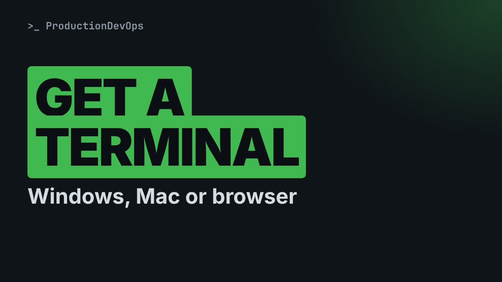
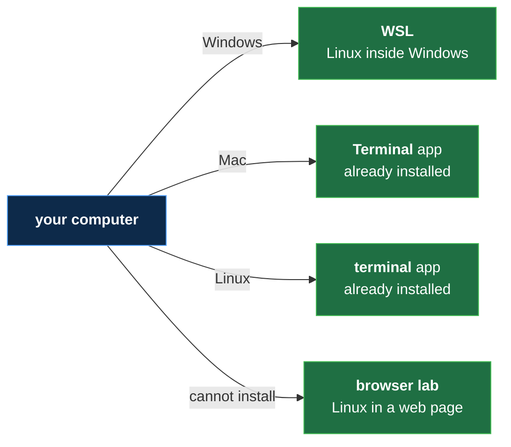
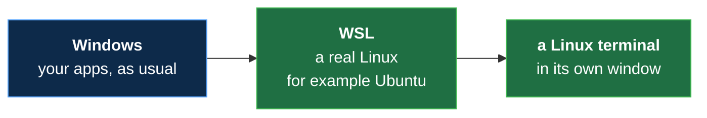
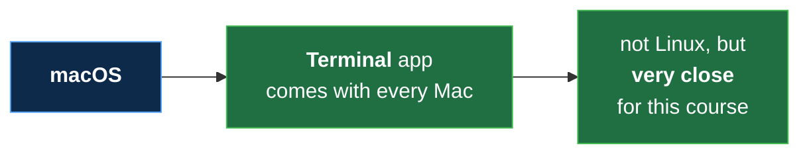
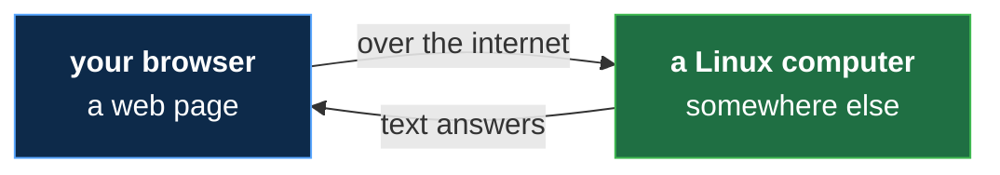

# Getting a Linux Terminal on Your Computer: Windows, Mac or Browser (No Experience Needed)



**Video:** https://youtu.be/VypQL1AVYEk

You do not need a new computer to learn Linux. This lesson of Linux from Zero shows, with simple pictures, the free ways to get a Linux terminal: WSL on Windows, the terminal that comes with a Mac, the terminal of a Linux desktop, or a Linux lab in your web browser when you cannot install anything. Which one to pick, what to watch out for on a Mac, and how to tell that your terminal is ready. No experience needed. A step-by-step setup guide, the challenge and its solution are in the demos repo.

## Files in this folder

- [`challenge-solution.md`](challenge-solution.md) (solution of the challenge: try it yourself first)
- [`setup.md`](setup.md)

## What you need

A Linux shell (a VM, WSL or a container is fine). Everything runs inside this folder.

## The lesson, step by step

The same explanations as the video, with every command. Read it, then run it yourself.

You do not need a new computer to learn Linux. One of four free options already fits yours. And at the end, one warning for Mac users.

To watch this lesson, you need nothing. To set up a terminal, you need your computer, and the right to install apps. Cannot install anything? A web browser is enough.

### The plan

This is lesson two of Linux from Zero. First, which option fits your computer. Then Windows, Mac, and Linux. Then any computer, with a lab in your browser. And how to tell that your terminal is ready.

### Options

- `operating system — The main program that runs a computer and all its apps (like the office manager: runs the office, the cabinet included)`: 
New word: operating system. It is the main program that runs a computer, and all its apps. Like the manager of an office.

- `Linux — A free operating system, used by most servers (like one way of running an office, shared by millions of offices)`: 
New word: Linux, a free operating system. Most servers on the internet run it. Think of one way of running an office, shared by millions of offices.

**Pick your option**



Here are your options. It depends on your computer, and on whether you can install apps.

### Windows

- `WSL — Windows Subsystem for Linux: a real Linux, inside Windows (like a second, smaller office inside your building)`: 
On Windows, the word is W S L. Windows Subsystem for Linux: a real Linux, running inside Windows.

**Windows: Linux inside Windows**



W S L runs a real Linux next to your usual apps. Ubuntu is a popular choice. You open it, and you get a Linux terminal.

Follow Microsoft's official guide for installing W S L. Usually it takes one command, then a restart. You need an administrator account on the computer. The first time, Linux asks you to choose a user name and a password.

### Mac and Linux

**Mac: a terminal is already there**



On a Mac, an app called Terminal comes installed. Mac OS is not Linux. But for this course, its terminal works almost the same.

Already on Linux? Open the terminal app from your app menu. On many desktops, Control Alt T opens it too.

### So far

So far: on Windows, W S L, a real Linux inside Windows. On a Mac or on Linux, a terminal is already there. Next: no install at all. And the warning for Mac users.

### Browser

**Any computer: a lab in your browser**



Cannot install apps? Some websites give you a Linux terminal in a browser tab. The Linux runs on their computer, not on yours.

Free options exist. Search for: Linux terminal in browser. Many of them reset when you close the tab. Never type passwords, or private files, into them.

### Pick one

On Windows, pick W S L. It is the closest to a real server. On a Mac, the Terminal app is enough for this course. On Linux, the terminal app you already have. And if you cannot install anything, a browser lab.

Here is the Mac warning. Its commands are close cousins of the Linux ones. A few extras behave differently. Lesson eight shows one. But the five commands of this course work the same.

### Ready?

```
sre@lab:~$
```

Your terminal is ready when you see a prompt, and a cursor after it. Yours shows your own name and computer. On a Mac, it may end with a percent sign.

### Recap

Recap: on Windows, W S L. On a Mac or Linux, the terminal app. Cannot install? A browser lab, with nothing private in it. Your terminal is ready when you see a prompt. Your challenge: open your terminal. What does your prompt show? The setup guide and the answer are in the demo repo.

### Where next

Where next? Lesson three: your first command. The first question in any terminal: where am I?

Next lesson: where am I? Your first Linux command. Subscribe so you do not miss it.

## Challenge

Your challenge: open your terminal. What does your prompt show? The setup guide and the answer are in the demo repo.

When you have tried: [`challenge-solution.md`](challenge-solution.md).

---

From the [ProductionDevOps](https://www.youtube.com/@production-devops) channel: real-world DevOps and SRE, explained with real commands.
