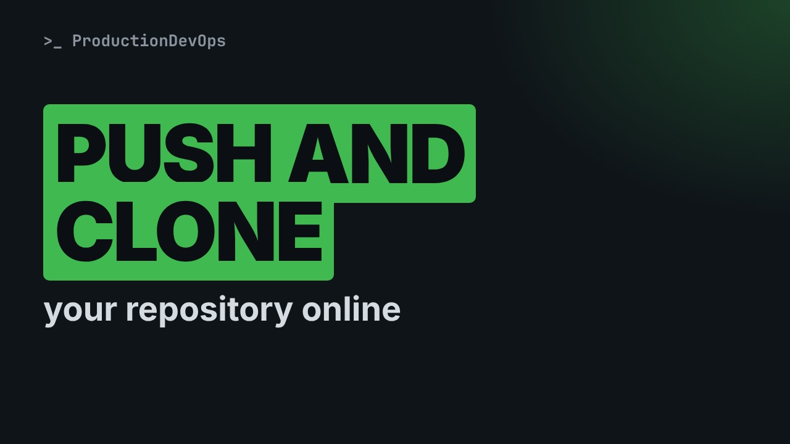
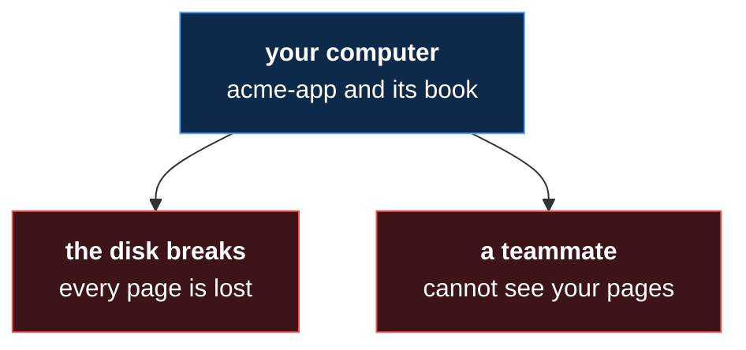
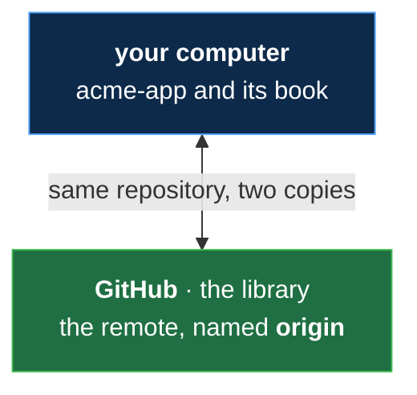
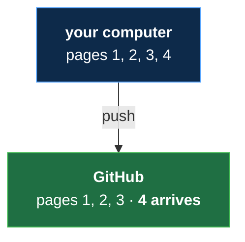
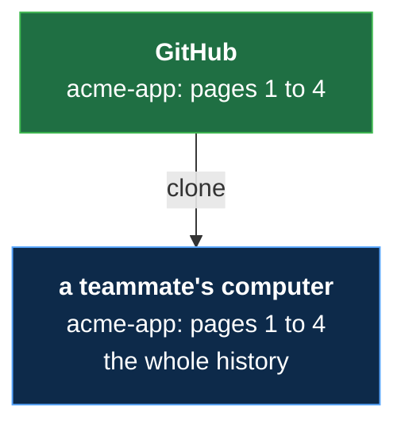
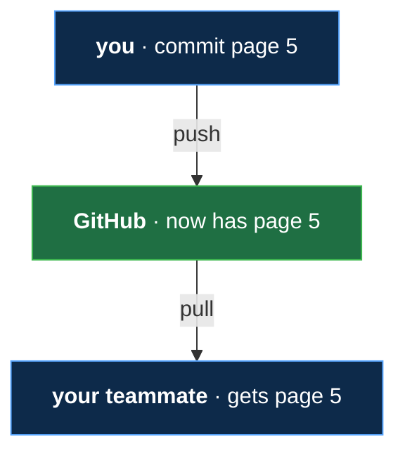

# GitHub: Your Repository Online (Git from Zero, No Experience Needed)

**Video:** coming soon on the [channel](https://www.youtube.com/@production-devops).

Your repository lives on one computer: if the disk dies, the history dies too. This lesson of Git and GitHub from Zero draws what GitHub adds with one comparison: a shared library where everyone keeps a copy of the recipe book. Remote, push, clone and pull, one picture each, and what is never sent online. No terminal, nothing to install, no experience needed. Every new word is explained on screen. The challenge and its solution are in the demos repo.

## Files in this folder

- [`challenge-solution.md`](challenge-solution.md) (solution of the challenge: try it yourself first)

## What you need

A Linux shell (a VM, WSL or a container is fine). Everything runs inside this folder.

## The lesson, step by step

The same explanations as the video, with every command. Read it, then run it yourself.

Your book lives on one computer. If the disk dies, the history dies too. At the end: how a teammate gets the whole book, in one step.

For this lesson you need nothing. Just watch. Only pictures. You do not need an account today.

### The plan

This is lesson eight of Git and GitHub from Zero. First, why put a repository online. Then, GitHub: the shared library. Then, push: take your pages there. And clone and pull: get them back.

### One copy

**One computer, one copy**

Today, the book lives on one computer, and that has two problems. If the disk breaks, every page is lost. And a teammate cannot see your pages.

### GitHub

- `GitHub — A website that keeps Git repositories online, to share them (like a shared library where everyone keeps a copy of the book)`: 
New word: GitHub. It is a website that keeps Git repositories online, to share them. A shared library, with a copy of the book.

Git and GitHub are not the same. Git is the tool on your computer, from lessons three to seven. GitHub is a website that stores repositories. Similar websites exist too. The ideas are the same.

### Remote

- `remote — A copy of your repository somewhere else, usually online (like the library's copy of your recipe book)`: 
New word: remote. A remote is a copy of your repository somewhere else, usually online. The library's copy of your book.

**Your book and the library**

Same repository, two copies. One on your computer, one in the library. Your copy calls the library origin, the usual name of a remote.

### push

- `push — Send your new commits to the remote (like taking your new pages to the library)`: 
New word: push. To push means to send your new commits to the remote. Like taking your new pages to the library.

**push, drawn**

The library has pages one to three. You saved page four. A push takes page four there.

What does a push send? Only commits: signed pages. Not the tray, and not your unsaved changes. And nothing goes online until you push. Saved five new commits? One push sends them all.

### So far

So far: GitHub keeps a copy of the book, online. The remote is that copy. Push sends your new commits there. Next: a teammate gets the whole book.

### clone

- `clone — Make your own full copy of a repository from a remote (like copying the whole book at the library, every page included)`: 
New word: clone. To clone means to make your own full copy of a repository. The whole book, every page included.

**clone, drawn**

Here is the payoff. A teammate clones acme app, in one step. They get every file, and the whole history.

### pull

- `pull — Bring the new commits from the remote into your copy (like bringing home the pages others added)`: 
New word: pull. To pull means to bring the new commits from the remote into your copy. The pages others added.

**Working together**

Here is a day of teamwork. You commit page five, and push it. Your teammate pulls, and gets page five.

### The commands

Each word is also a Git command. Git push sends your new commits. Git clone, with the address of a repository, copies it. Git pull brings the new commits home. A later course practises all three.

### Good to know

Good to know. A repository can be public or private. You choose who can read it. Never push passwords or keys. Once online, assume someone saw them. To push, you sign in once, from your computer. You clone a repository once. After that, you pull every day.

### Recap

Recap: GitHub is the shared library. The remote is the copy that lives there. Push sends your commits to the remote. Clone copies it all. Pull brings new pages home. Your challenge: match push, clone and pull to the three pictures of this lesson. The answers are in the demo repo.

### Where next

Where next? Lesson nine: pull requests. Asking for a review, before a change goes into main.

Next lesson: pull requests, asking for a review. Subscribe so you do not miss it.

## Challenge

Your challenge: match push, clone and pull to the three pictures of this lesson. The answers are in the demo repo.

When you have tried: [`challenge-solution.md`](challenge-solution.md).

---

From the [ProductionDevOps](https://www.youtube.com/@production-devops) channel: real-world DevOps and SRE, explained with real commands.
