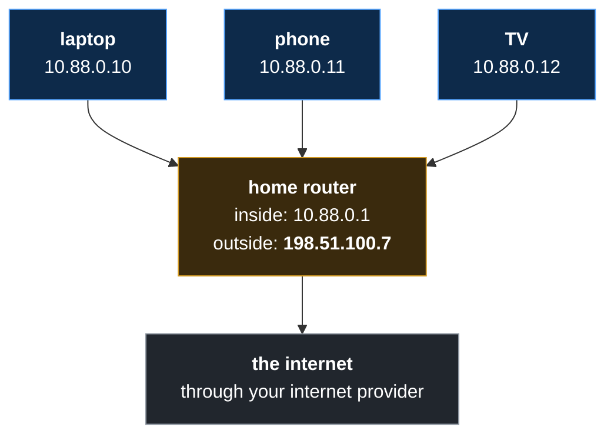

# Your Home Network and the Router (How the Internet Works, No Experience Needed)

**Video:** coming soon on the [channel](https://www.youtube.com/@production-devops).

At home, a laptop, two phones and a TV all use the internet, yet your home has only one address on the internet. How? This lesson of How the Internet Works, Simply explains the home network and the router with the postal service: the building's internal mail and its mailroom. Private and public addresses, who hands out addresses at home, and the trick the router plays with return addresses so every answer finds the right device. No terminal, nothing to install, no experience needed. Every new word is explained on screen. The challenge and its solution are in the demos repo.

## Files in this folder

- [`challenge-solution.md`](challenge-solution.md) (solution of the challenge: try it yourself first)

## What you need

A Linux shell (a VM, WSL or a container is fine). Everything runs inside this folder.

## The lesson, step by step

The same explanations as the video, with every command. Read it, then run it yourself.

At home, many devices use the internet. But your home has only one address on the internet. At the end: the trick your router plays with return addresses.

For this lesson you need nothing. Just watch. No terminal and no code. Only pictures. About five minutes.

### The plan

This is lesson six of How the Internet Works, Simply. First, your home network, drawn. Then, private and public addresses. Then, who hands out addresses at home. And the router's trick.

### At home

- `home network — The devices in one home, connected to each other (like the internal mail of one building)`: 
New words: home network. It is the devices in one home, connected to each other. Think of the internal mail of one building.

- `router — A device that passes packets between networks (like the mailroom of your building: mail goes in and out through it)`: 
Remember router, from lesson one: it passes packets between networks. Your home router is the mailroom of your building.

**A home network**

Here is a home. A laptop, a phone and a TV connect to the router: by cable, or by Wi-Fi. The router connects the home to the internet.

Look at the router. It has two sides. Inside, it has an address for the home. Outside, it has one address for the internet. The devices have inside addresses only.

### Private, public

- `private address — An address used only inside one home or office (like a flat number: it means nothing outside the building)`: 
New words: private address. It is used only inside one home or office. Like a flat number: it means nothing outside the building.

- `public address — An address on the internet itself, unique in the world (like the building's street address, the one on the outside)`: 
New words: public address. It is an address on the internet itself, unique in the world. Like the building's street address.

Private addresses start with ten. Or with one seventy two, sixteen to thirty one. Or with one nine two, one six eight. Millions of homes reuse the same ones. That is no problem. They never leave the building. Our home in this lesson uses ten dot eighty eight dot zero, then one number.

### Handing out

Who gives each device its address? A new phone joins the Wi-Fi. It asks the router: which address can I use? The router gives it a free one, for a while. This hand-out has a name, D H C P. You will meet it again later.

### So far

So far: devices at home have private addresses. The router has one public address for the whole home. Next: if the home has one address, how do answers find the right device?

### The trick

- `NAT — Network Address Translation: swap private From addresses for the public one (like the mailroom writes the building's address on outgoing letters)`: 
New word: NAT, network address translation. The router swaps the private From address for its public one.

Time flows down. Watch the From and To addresses.

- `laptop → home router`: From 10.88.0.10 · To 203.0.113.10
The laptop sends a request to the shop. From is its private address.

- `home router → shop server`: From 198.51.100.7 · To 203.0.113.10
The router writes its public address as From, and notes who really sent it.

- `shop server → home router`: To 198.51.100.7
The shop answers to the only address it saw: the router's.

- `home router → laptop`: To 10.88.0.10
The router reads its note, and passes the answer to the laptop.

Remember lesson two? The envelope said: From, one nine eight dot fifty one dot one hundred dot seven. You. Now you know: that was really your router's public address. Your laptop's own address never leaves home.

### Good to know

Good to know: the box at home is often three things in one. A router, a Wi-Fi point, and a modem: the part that talks to your provider's line. Offices work the same way, just bigger. NAT in detail is in the course Networking Fundamentals.

### Recap

Recap: a home network is your devices, plus a router, the mailroom. Private addresses inside, one public address outside. With NAT, the router swaps the From address, and keeps a note. Your challenge: the TV asks the shop for a video. Which From address does the shop see? The answer is in the demo repo.

### Where next

Where next? Lesson seven: clients and servers. Who asks, and who answers. Then lesson eight: your first command.

Next lesson: clients and servers, who asks, and who answers. Subscribe so you do not miss it.

## Challenge

Your challenge: the TV asks the shop for a video. Which From address does the shop see? The answer is in the demo repo.

When you have tried: [`challenge-solution.md`](challenge-solution.md).

---

From the [ProductionDevOps](https://www.youtube.com/@production-devops) channel: real-world DevOps and SRE, explained with real commands.
