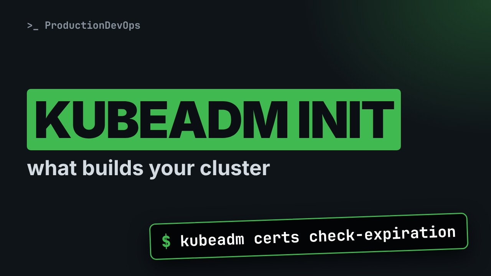
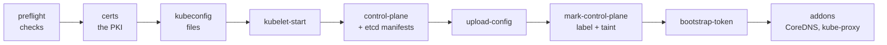

# How a Kubernetes Cluster Is Built: kubeadm, Certificates and kubeconfig



**Video:** https://youtu.be/COD5qqO0emI

Before you can fix a cluster, you need to know what built it and where it put things. We open a real cluster built by kubeadm: the init phases, the certificates and when they expire, the static Pod manifests, the configuration saved inside the cluster, the control plane taint, how workers join, and the kubeconfig files that give each component its own identity. Lesson 2 of Kubernetes Deep Dive.

## Files in this folder

- [`challenge-solution.sh`](challenge-solution.sh) (solution of the challenge: try it yourself first)

## What you need

A Kubernetes cluster you can break: a local [kind](https://kind.sigs.k8s.io/) cluster with one control plane and two workers is what the video uses, plus `kubectl`. Never run these commands against a cluster that matters.

The outputs below were captured for real on the lab cluster. On yours, names, ages, IPs and ports will differ; everything else should match.

## The lesson, step by step

The same explanations as the video, with every command and its real output. Read it, then run it yourself.

One morning kubectl answers: certificate has expired. To fix it, you need to know what built your cluster, and where it put every file. Today we open a real cluster and find out.

### The plan

This is lesson two of Kubernetes Deep Dive. Here is the plan. First, three ways to get a cluster, and who runs the control plane in each. Then kubeadm init, phase by phase, with the files it left on our lab. Then certificates and their expiry, how workers join, and how packages are installed. Finally, the kubeconfig files that give each component its own identity.

### Ways to get a cluster

Every cluster has the same parts. What changes is who runs them. With kubeadm on your own machines, you run everything: control plane, nodes, upgrades, certificates. With a managed service like EKS, GKE or AKS, the provider runs the control plane. You only see the API. kind and minikube build lab clusters on a laptop. kind turns each node into a container. And kind runs kubeadm inside those containers. So our lab is a real kubeadm cluster to study.

### Our lab

```
kind: Cluster
apiVersion: kind.x-k8s.io/v1alpha4
nodes:
  - role: control-plane
  - role: worker
  - role: worker
```

This small file is how our lab was created. It is a kind cluster definition. One node with the control plane role. And two workers. kind starts three containers, and runs kubeadm init on the first one, and kubeadm join on the others.

Docker shows the three node containers. Their names start with the cluster name, lab.

```console
$ docker ps --filter name=lab- --format '{{.Names}}'
lab-worker2
lab-worker
lab-control-plane
```

Inside the control plane node, kubeadm is installed, at the same version as the cluster.

```console
$ docker exec lab-control-plane kubeadm version -o short
v1.37.0
```

### kubeadm init

**kubeadm init, phase by phase**



kubeadm init is a list of phases. It checks the machine, creates the certificates and the kubeconfig files, starts the kubelet, and writes the control plane as Pod manifests. Then it saves its own configuration, marks the node, creates a token for joining, and installs two addons.

### What kubeadm wrote

The certs phase writes everything into slash etc slash kubernetes slash pki. We list the file names, never the content.

```console
$ docker exec lab-control-plane ls /etc/kubernetes/pki
apiserver-etcd-client.crt
apiserver-etcd-client.key
apiserver-kubelet-client.crt
apiserver-kubelet-client.key
apiserver.crt
apiserver.key
ca.crt
ca.key
etcd
front-proxy-ca.crt
front-proxy-ca.key
front-proxy-client.crt
front-proxy-client.key
sa.key
sa.pub
```

ca dot crt and ca dot key are the cluster's certificate authority. Every other certificate is signed by it. The API server has its own certificates, to talk to etcd and to the kubelets. sa dot key signs ServiceAccount tokens.

Slash etc slash kubernetes holds the kubeconfig files written by the kubeconfig phase.

```console
$ docker exec lab-control-plane ls /etc/kubernetes
admin.conf
controller-manager.conf
kubelet.conf
manifests
pki
scheduler.conf
super-admin.conf
```

admin dot conf is for the administrator. Scheduler, controller manager and kubelet each get their own file. Recent versions add super admin dot conf, a break glass credential. The control plane phase writes four Pod manifests. The kubelet reads this folder and runs them as static Pods.

```console
$ docker exec lab-control-plane ls /etc/kubernetes/manifests
etcd.yaml
kube-apiserver.yaml
kube-controller-manager.yaml
kube-scheduler.yaml
```

upload config saves the configuration kubeadm used inside the cluster, in a ConfigMap. We print a few key lines.

```console
$ kubectl -n kube-system get cm kubeadm-config -o jsonpath='{.data.ClusterConfiguration}' | grep -E 'kubernetesVersion|controlPlaneEndpoint'
controlPlaneEndpoint: lab-control-plane:6443
kubernetesVersion: v1.37.0
```

Joins and upgrades read this ConfigMap later. That is why you change it with kubeadm, not by hand.

mark control plane gives the node a role label, and a taint. The taint keeps normal Pods off the control plane.

```console
$ kubectl describe node lab-control-plane | grep -E '^(Roles|Taints):'
Roles:              control-plane
Taints:             node-role.kubernetes.io/control-plane:NoSchedule
```

The addons phase installs CoreDNS and kube proxy. We list the Deployments and DaemonSets in kube system.

```console
$ kubectl -n kube-system get deploy,ds -o custom-columns=KIND:.kind,NAME:.metadata.name
KIND         NAME
Deployment   coredns
DaemonSet    kindnet
DaemonSet    kube-proxy
```

kindnet is the network plugin. kubeadm never installs one: until you add a CNI, nodes stay Not Ready.

### Joining workers

```
# printed by kubeadm init, or by:
# kubeadm token create --print-join-command
kubeadm join lab-control-plane:6443 \
  --token <token-id>.<token-secret> \
  --discovery-token-ca-cert-hash sha256:<hash>
```

On a new machine, kubeadm join points to the API server address. The bootstrap token proves the machine may join. It is short lived: one day by default. The hash pins the cluster's CA. The new node refuses an API server signed by any other CA. Once trusted, the kubelet asks for its own client certificate, and the cluster signs it. This is called TLS bootstrap. Lost the join command, or the token expired? Token create, with print join command, prints a fresh one.

### Certificates

check expiration lists every certificate kubeadm manages. We keep the headers and a few lines, and cut the long columns.

```console
$ docker exec lab-control-plane kubeadm certs check-expiration | grep -E 'RESIDUAL|admin.conf|apiserver|^ca ' | cut -c1-72
CERTIFICATE                EXPIRES                  RESIDUAL TIME   CERT
admin.conf                 Oct 22, 2027 12:28 UTC   364d            ca  
apiserver                  Oct 22, 2027 12:28 UTC   364d            ca  
apiserver-etcd-client      Oct 22, 2027 12:28 UTC   364d            etcd
apiserver-kubelet-client   Oct 22, 2027 12:28 UTC   364d            ca  
super-admin.conf           Oct 22, 2027 12:28 UTC   364d            ca  
CERTIFICATE AUTHORITY   EXPIRES                  RESIDUAL TIME   EXTERNA
ca                      Oct 19, 2036 12:28 UTC   9y              no
```

The leaf certificates last one year. The certificate authorities last ten. Every kubeadm upgrade renews them. A cluster never upgraded for a year stops working. Kubeadm certs renew fixes it, then the control plane Pods must restart.

### kubeconfig in depth

Our own kubeconfig came from admin dot conf. Auth whoami asks the API server who we are.

```console
$ kubectl auth whoami
ATTRIBUTE                                           VALUE
Username                                            kubernetes-admin
Groups                                              [kubeadm:cluster-admins system:authenticated]
Extra: authentication.kubernetes.io/credential-id   [X509SHA256=e2fc6291d2bc32adee727d213e9be3345d524bd19e60c57cf17cab8d77b5f4fa]
```

Dash dash kubeconfig picks a file for one command. Same cluster, but with the scheduler's file.

```console
$ docker exec lab-control-plane kubectl --kubeconfig /etc/kubernetes/scheduler.conf auth whoami
ATTRIBUTE                                           VALUE
Username                                            system:kube-scheduler
Groups                                              [system:authenticated]
Extra: authentication.kubernetes.io/credential-id   [X509SHA256=35a93d614fa1b7f5d98ce33426ac3eaff29ca95a37c6d4d3b6a61f0319da8e04]
```

And the scheduler may not create Deployments. Each component gets only the rights it needs.

```console
$ docker exec lab-control-plane kubectl --kubeconfig /etc/kubernetes/scheduler.conf auth can-i create deployments
no
```

Contexts, merging files with the KUBECONFIG variable, completion and aliases: we covered them in the Kubernetes Path, part four.

Inside scheduler dot conf, the client certificate is embedded as base64 data. We replace it with a marker before printing.

```console
$ docker exec lab-control-plane cat /etc/kubernetes/scheduler.conf | awk '/certificate-data/ {sub(/: .*/, ": <embedded data>")} /^- name:|client-certificate/'
- name: system:kube-scheduler
    client-certificate-data: <embedded data>
```

The kubelet's file is different. It points to a file on disk, because the kubelet renews its certificate by itself.

```console
$ docker exec lab-control-plane cat /etc/kubernetes/kubelet.conf | awk '/certificate-data/ {sub(/: .*/, ": <embedded data>")} /^- name:|client-certificate/'
- name: system:node:lab-control-plane
    client-certificate: /var/lib/kubelet/pki/kubelet-client-current.pem
```

### Packages

On real machines, packages come from the official Kubernetes repository. The official packages live on p k g s dot k eight s dot i o, with one repository per minor version. You install kubeadm, kubelet and kubectl, and hold them, so a normal update never upgrades them by surprise. Before that, every node needs a container runtime, such as containerd. To move to the next minor version, you point to its repository first. The old apt dot kubernetes dot io is gone.

### Gotchas

Four traps worth knowing. A copied admin dot conf gives full rights until its certificate expires. A certificate cannot be revoked. A cluster not upgraded for a year: its certificates expire, and the API stops answering. Nodes Not Ready right after init: no network plugin yet. kubeadm does not install one. A join command from last week fails: the token expired. Create a new one.

### Recap

Let's recap. kubeadm init writes certificates, kubeconfig files, static Pod manifests, its configuration, and two addons. Certificates last one year. Upgrades renew them, or kubeadm certs renew. Each component has its own kubeconfig file and its own identity, with only the rights it needs. Your challenge: find which identity the controller manager uses, whether its certificate is embedded or a path, and when it expires. The solution is in the demo repository.

Every cluster you run was built by something like kubeadm, so learn where it puts things. Next lesson: what really happens, step by step, when you create a Pod. Subscribe to follow the whole Deep Dive.

## All the commands, to copy

Run them from inside this folder, in this order.

```bash
docker ps --filter name=lab- --format '{{.Names}}'
docker exec lab-control-plane kubeadm version -o short
docker exec lab-control-plane ls /etc/kubernetes/pki
docker exec lab-control-plane ls /etc/kubernetes
docker exec lab-control-plane ls /etc/kubernetes/manifests
kubectl -n kube-system get cm kubeadm-config -o jsonpath='{.data.ClusterConfiguration}' | grep -E 'kubernetesVersion|controlPlaneEndpoint'
kubectl describe node lab-control-plane | grep -E '^(Roles|Taints):'
kubectl -n kube-system get deploy,ds -o custom-columns=KIND:.kind,NAME:.metadata.name
docker exec lab-control-plane kubeadm certs check-expiration | grep -E 'RESIDUAL|admin.conf|apiserver|^ca ' | cut -c1-72
kubectl auth whoami
docker exec lab-control-plane kubectl --kubeconfig /etc/kubernetes/scheduler.conf auth whoami
docker exec lab-control-plane kubectl --kubeconfig /etc/kubernetes/scheduler.conf auth can-i create deployments
docker exec lab-control-plane cat /etc/kubernetes/scheduler.conf | awk '/certificate-data/ {sub(/: .*/, ": <embedded data>")} /^- name:|client-certificate/'
docker exec lab-control-plane cat /etc/kubernetes/kubelet.conf | awk '/certificate-data/ {sub(/: .*/, ": <embedded data>")} /^- name:|client-certificate/'
```

## Challenge

Your challenge: find which identity the controller manager uses, whether its certificate is embedded or a path, and when it expires. The solution is in the demo repository.

When you have tried: [`challenge-solution.sh`](challenge-solution.sh).

---

From the [ProductionDevOps](https://www.youtube.com/@production-devops) channel: real-world DevOps and SRE, explained with real commands.
