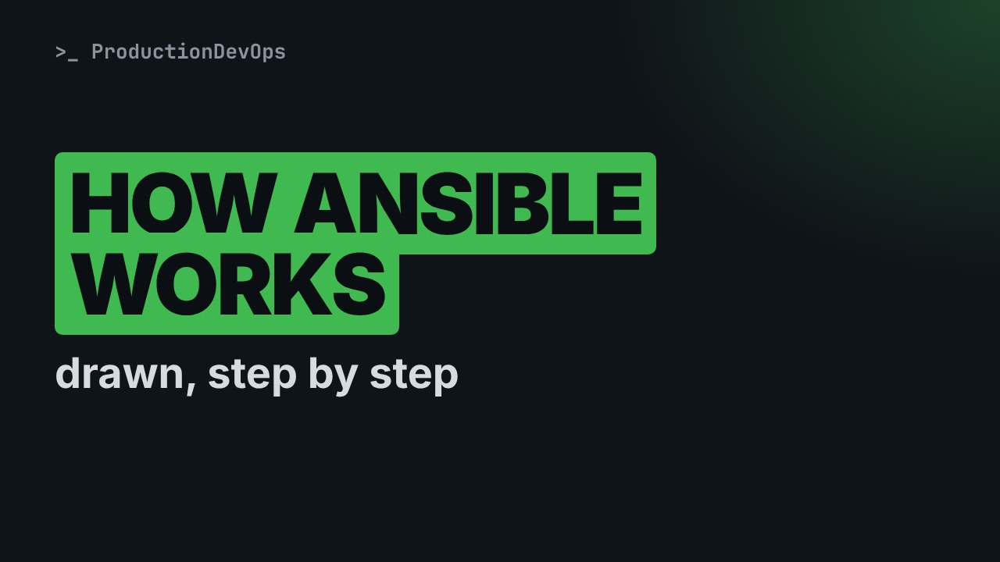
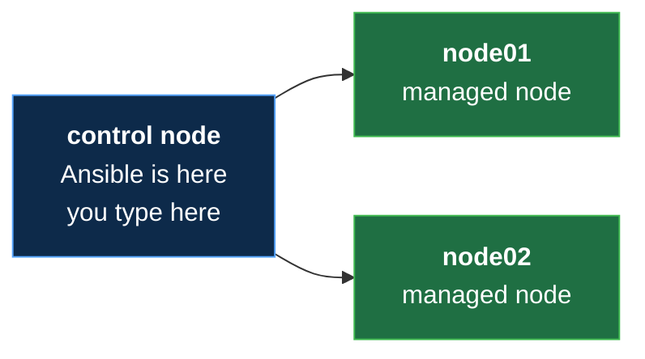
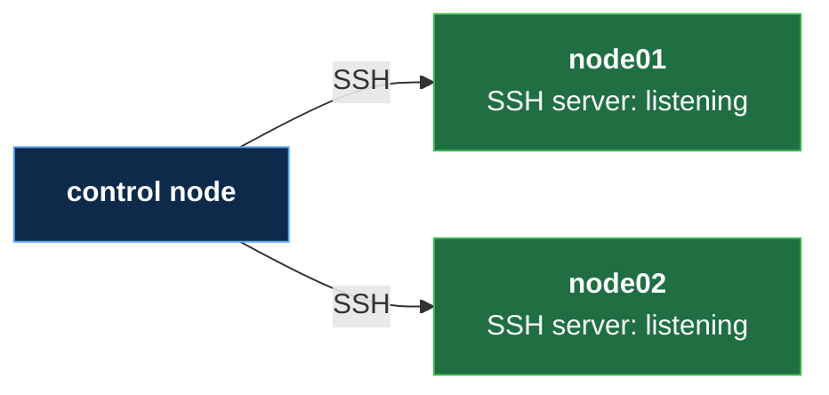
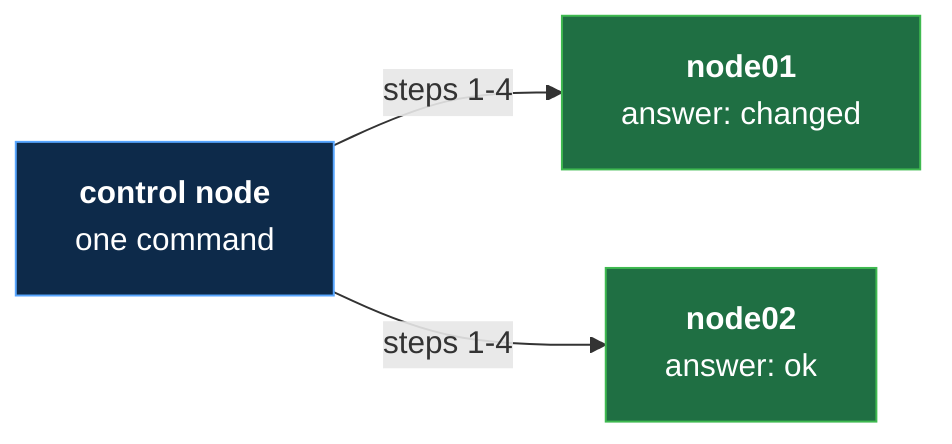
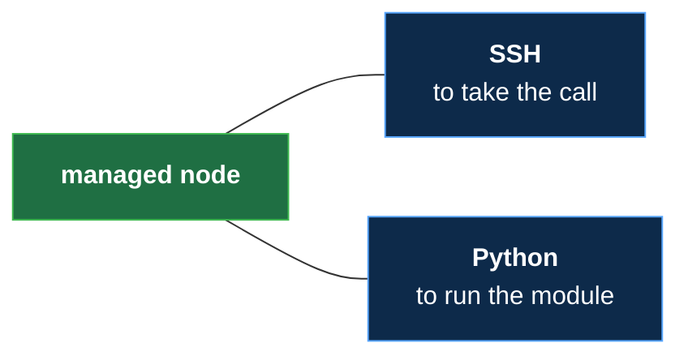

# How Ansible Works, Drawn: Control Node, SSH and Modules (No Experience Needed)

**Video:** https://youtu.be/0dZMvQpGprg

You type one command and two servers change, yet nothing was installed on them. How? This lesson of Ansible from Zero draws it piece by piece: the control node where you type, the managed nodes it looks after, the SSH connection between them, and one task step by step, from the small program Ansible sends to the answer it gets back. Then what is left on the server afterwards: almost nothing. No terminal, nothing to install, no experience needed. Every new word is explained on screen. The challenge and its solution are in the demos repo.

## Files in this folder

- [`challenge-solution.md`](challenge-solution.md) (solution of the challenge: try it yourself first)

## What you need

A Linux shell (a VM, WSL or a container is fine). Everything runs inside this folder.

## The lesson, step by step

The same explanations as the video, with every command. Read it, then run it yourself.

You type one command, and two servers change. Yet nothing was installed on them. Today we draw how that works.

For this lesson you need nothing. Just watch. No terminal today, only pictures. About five minutes.

### The plan

This is lesson two of Ansible from Zero. First, the two sides: where you type, and where the work happens. Then the line between them. Then one task, step by step. And at the end, what is left on the server. Almost nothing.

### Two sides

- `control node`: The computer where Ansible is installed, and where you type (like the head chef's desk: every recipe card starts here)
First word: control node. It is the computer where Ansible is installed, and where you type. Think of the head chef's desk.

- `managed node`: A server that Ansible looks after (like a kitchen that receives the recipe cards)
Second word: managed node. It is a server that Ansible looks after. A kitchen that receives the recipe cards.

**One control node, two managed nodes**

Here is the picture of this course. One control node, and two managed nodes, called node zero one and node zero two.

### The line

- `SSH`: A safe, locked connection from one computer to another (like a private phone line to each kitchen)
How do they talk? With SSH, a safe, locked connection from one computer to another. Like a private phone line to each kitchen.

**They talk over SSH**

Almost every Linux server already has an SSH server. It listens for calls. Ansible uses it, so there is nothing new to set up.

### One task

- `module`: A small program that does one job on a server (like a standard step every cook knows: preheat the oven)
What travels on the line? A module: a small program that does one job on a server. Like a standard step: preheat the oven.

- `Python`: A programming language that most Linux servers already have (like a language every cook, in every kitchen, speaks)
Modules are written in Python. It is a programming language that most Linux servers already have. A language every cook speaks.

### So far

So far: you type on the control node. The managed nodes are the servers. They talk over SSH, and a module does one job. Next: one task, step by step. And what stays behind.

Here is one task. Time flows down.

- `control node → node01`: 1. log in over SSH
Step one: Ansible logs in to node zero one, over SSH.

- `control node → node01`: 2. send the module
Step two: it sends the module, the small program for this job.

- `node01 → control node`: 3. the answer: changed, or ok
Step three: Python on the node runs the module. The module answers: I changed something, or all was already fine.

- `control node → node01`: 4. delete the module
Step four: Ansible deletes the module, and hangs up.

**Many servers at the same time**

With two servers, Ansible does these four steps on both, at the same time. Each server sends its own answer.

### What stays

Now the answer from the start. What stays on the server? No Ansible is installed on it. No program is left running. The module is deleted after the job. Only the result stays: the change you asked for.

- `agentless`: Nothing extra to install or keep running on the servers (like kitchens that only need a phone, no robot cook inside)
This has a name: agentless. Nothing extra is installed or kept running on the servers. The kitchens only need a phone.

**What a managed node needs**

So a managed node needs only two things. SSH, to take the call. And Python, to run the module.

### Good to know

Ansible acts only when you run it. Between runs, it does nothing. The control node can be your own computer. It runs on Linux or macOS. On Windows, it runs inside WSL, a Linux inside Windows. In this course, the managed nodes are two practice servers: node zero one and node zero two.

### Recap

Recap: you type on the control node. The managed nodes are the servers. Over SSH, Ansible sends a module, and Python runs it. It is agentless. The server needs only SSH and Python. Your challenge, true or false: Ansible must be installed on every server. And why? The answer is in the demo repo.

### Where next

Where next? Lesson three: just enough YAML for Ansible. Then lesson four: the list of servers, and your first command.

Next lesson: YAML for Ansible, in five minutes. Subscribe so you do not miss it.

## Challenge

Your challenge, true or false: Ansible must be installed on every server. And why? The answer is in the demo repo.

When you have tried: [`challenge-solution.md`](challenge-solution.md).

---

From the [ProductionDevOps](https://www.youtube.com/@production-devops) channel: real-world DevOps and SRE, explained with real commands.
