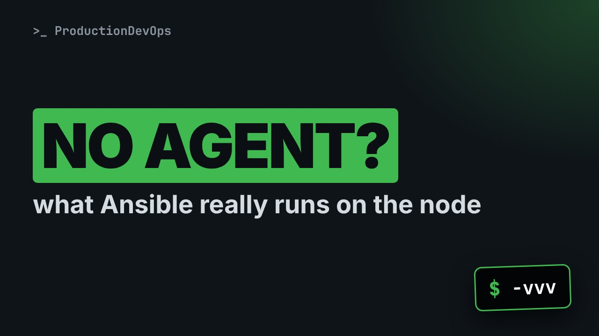
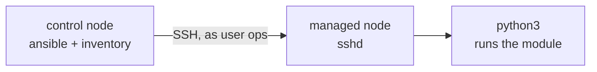
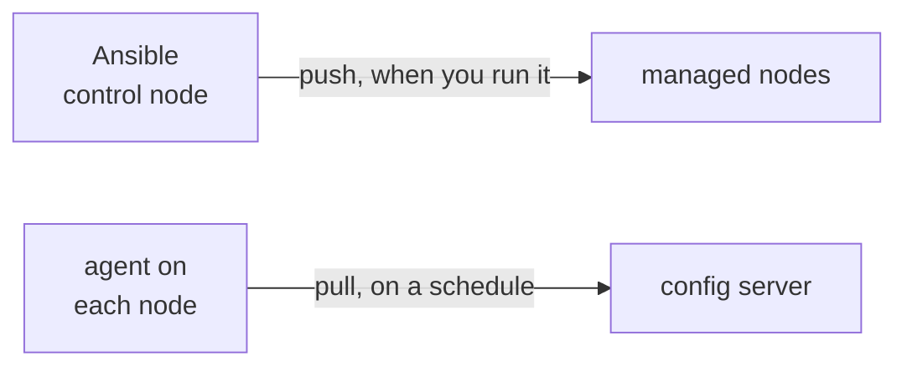

# How Ansible Really Works: SSH, Python and Idempotency, Step by Step



**Video:** coming soon on the [channel](https://www.youtube.com/@production-devops).

Lesson 2 of Ansible for RHCE. Ansible installs nothing on your servers, so what really happens when you run a task? We keep the files Ansible sends and read its verbose log: one SSH login as the automation user, a module copied into a temp directory, run by the node's Python, a JSON answer, and a cleanup. Then idempotency, for real: the same task twice, changed then ok, and why command always says changed. Plus the push model, and ansible-core vs collections vs Automation Platform.

## Files in this folder

- [`ansible.cfg`](ansible.cfg)
- [`inventory.ini`](inventory.ini)
- [`lab/up.sh`](lab/up.sh)
- [`challenge-solution.sh`](challenge-solution.sh) (solution of the challenge: try it yourself first)

## What you need

A Linux shell (a VM, WSL or a container is fine). Everything runs inside this folder.

## Before you start

The video runs these commands first, off screen:

```bash
if [ -f .lab-reset ]; then bash lab/up.sh; else bash lab/up.sh reset && touch .lab-reset; fi >/dev/null 2>&1
```

## The lesson, step by step

The same explanations as the video, with every command. Read it, then run it yourself.

You type one command, and two servers change, with nothing installed on them. Today we catch Ansible in the act, step by step. And at the end, a command that says changed when nothing changed at all.

### The plan

This is lesson 2 of Ansible for RHCE. First, the control node and the managed nodes. Agentless, over SSH. Then we watch one module travel to the node. Then idempotency. We run the same task twice. And finally push, and ansible core versus collections.

### Agentless

**Control node and managed nodes**



Ansible is installed only on the control node. A managed node needs just two things: an SSH server, and Python. There is no agent, and nothing to keep running.

### One module

```console
$ ANSIBLE_KEEP_REMOTE_FILES=1 ansible node01 -m ping -vvv &> ping.log
```

To see what happens, we run a single ping, with two debugging options.

- `ANSIBLE_KEEP_REMOTE_FILES=1`: keep the files on the node
This variable tells Ansible to keep the files it sends to the node. Debugging only.

- `node01`: one host only
One host: node zero one.

- `-m ping`: the module to run
Dash m ping: the module to run.

- `-vvv`: show every SSH command
Dash v v v: Ansible prints every command it sends over SSH.

- `&> ping.log`: all output into a file
And all the output goes into a file, to read step by step.

We run it.

```console
$ ANSIBLE_KEEP_REMOTE_FILES=1 ansible node01 -m ping -vvv &> ping.log
```

Nothing on screen. Everything is in the log file, so let's read it.

The first thing Ansible does: an SSH connection to the node, as the user ops.

```console
$ grep -m1 ESTABLISH ping.log
```

How many commands did it send over SSH, for one single ping?

```console
$ grep -c 'SSH: EXEC' ping.log
```

```
echo ~ops                                   # 1. find the home directory
mkdir ~/.ansible/tmp/ansible-tmp-XXXX       # 2. a private temp directory
sftp put AnsiballZ_ping.py                  # 3. copy the module
chmod u+rwx .../AnsiballZ_ping.py           # 4. make it executable
/usr/bin/python3 .../AnsiballZ_ping.py      # 5. run it with Python
```

Simplified, here they are. First, find the home directory of ops, and create a private temp directory there. Then copy the module into it, with sftp, and make it executable. Finally, run it with the node's Python. Without the keep variable, a sixth command deletes the temp directory.

Because we kept the files, the module is still on node zero one.

```console
$ ssh node01 find .ansible/tmp -name '*.py'
```

Its first line: it is a Python script.

```console
$ ssh node01 head -1 .ansible/tmp/*/AnsiballZ_ping.py
```

And it is big for a ping. The module and the helper code it needs travel zipped inside one file. Ansible calls this AnsiballZ.

```console
$ ssh node01 wc -c .ansible/tmp/*/AnsiballZ_ping.py
```

What does the module print when Python runs it? We run the kept file ourselves, with python3 on the node, like Ansible did.

```console
$ ssh node01 python3 .ansible/tmp/*/AnsiballZ_ping.py
```

Look at the output: one small JSON document, with ping and pong. The control node reads that JSON, and turns it into the green SUCCESS you know.

A quick checkpoint. Every task connects over SSH, copies a module, runs it with Python, and cleans up. The module answers in JSON. The node needs only SSH and Python. Next: idempotency, and the command that says changed when nothing changed.

### Idempotency

```console
$ ansible node01 -b -m file -a "path=/opt/acme-app state=directory"
```

Now the most important idea in Ansible. Before we run it, let's read this command.

- `-b`: become root, with sudo
Dash b means become. On the node, the module runs as root, through sudo.

- `-m file`: the file module
Dash m file: the module that manages files and directories.

- `-a "path=/opt/acme-app state=directory"`: the state we want
Dash a gives the module its arguments. We do not say create it. We say: this path must be a directory.

Does the directory exist on node zero one today? We ask with ls over ssh.

```console
$ ssh node01 ls -d /opt/acme-app
```

Now we ask Ansible for the state: slash opt slash acme dash app is a directory.

```console
$ ansible node01 -b -m file -a "path=/opt/acme-app state=directory"
```

CHANGED, in yellow. The directory did not exist, so the module created it.

Now the exact same command, a second time.

```console
$ ansible node01 -b -m file -a "path=/opt/acme-app state=directory"
```

SUCCESS, and changed false. The module checked first, found the directory, and did nothing.

This is idempotency. You describe the end state, not the steps to get there. Run it once or ten times, and you get the same result. And changed means that something really changed.

Compare with the command module. The directory already exists, and we run mkdir dash p.

```console
$ ansible node01 -b -m command -a "mkdir -p /opt/acme-app"
```

CHANGED, even though nothing changed. Command cannot know what a program did. When a real module exists, use it.

### Push

**Push, not pull**



Ansible pushes. Nothing happens until you run a command on the control node. Agent based tools pull instead: an agent on every node asks a server for its configuration, on a schedule.

### Core and collections

Three names you will meet everywhere. ansible core is the engine: the commands, and the built-in modules. Collections add more modules and roles, for example ansible dot posix. The package called ansible is core plus many community collections. And Automation Platform is Red Hat's product around it, with a web interface.

Our lab has only ansible core. ansible doc dash l lists its modules, and the long list goes into a file.

```console
$ ansible-doc -l ansible.builtin &> modules.txt
```

How many modules is that? wc dash l counts the lines of the file.

```console
$ wc -l modules.txt
```

And head dash three shows the first three lines. Each name starts with ansible dot builtin.

```console
$ head -3 modules.txt
```

### Gotchas

Three things that will bite you. No Python on a node? Most modules fail. Only raw works, and it can install Python. Command and shell always report changed. Prefer a module that describes a state. The keep remote files variable leaves files on your nodes. Use it for debugging only.

### Recap

Let's recap. Ansible is agentless. A managed node needs SSH and Python. Every task connects, copies a module, runs it, reads its JSON, and cleans up. Idempotent modules report changed only when they really change something. Your challenge: slash opt slash acme dash app owned by ops, on all nodes, in one command, and a second run with no change. The solution is in the demo repository.

No agent, just SSH and Python, and tasks that only change what is wrong. Next lesson: the control node, and which ansible dot cfg is really used. Subscribe so you do not miss it.

## All the commands, to copy

Run them from inside this folder, in this order (some are expected to fail: that is the point of the demo).

```bash
ANSIBLE_KEEP_REMOTE_FILES=1 ansible node01 -m ping -vvv &> ping.log
grep -m1 ESTABLISH ping.log
grep -c 'SSH: EXEC' ping.log
ssh node01 find .ansible/tmp -name '*.py'
ssh node01 head -1 .ansible/tmp/*/AnsiballZ_ping.py
ssh node01 wc -c .ansible/tmp/*/AnsiballZ_ping.py
ssh node01 python3 .ansible/tmp/*/AnsiballZ_ping.py
ansible node01 -b -m file -a "path=/opt/acme-app state=directory"
ssh node01 ls -d /opt/acme-app
ansible node01 -b -m command -a "mkdir -p /opt/acme-app"
ansible-doc -l ansible.builtin &> modules.txt
wc -l modules.txt
head -3 modules.txt
```

## Challenge

Your challenge: slash opt slash acme dash app owned by ops, on all nodes, in one command, and a second run with no change. The solution is in the demo repository.

When you have tried: [`challenge-solution.sh`](challenge-solution.sh).

---

From the [ProductionDevOps](https://www.youtube.com/@production-devops) channel: real-world DevOps and SRE, explained with real commands.
