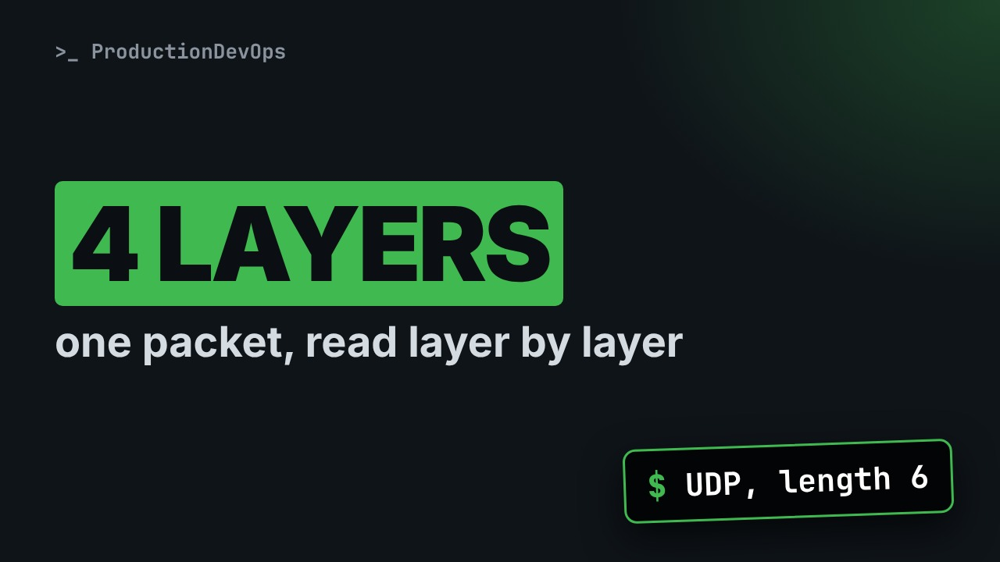
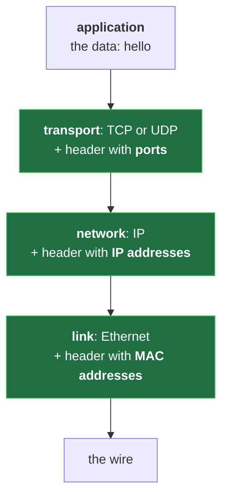
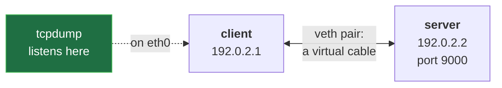
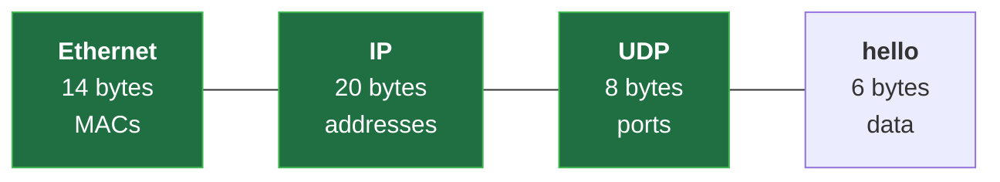

# How the Internet Is Layered: Encapsulation on a Real Packet (Linux Lab, tcpdump)



**Video:** coming soon on the [channel](https://www.youtube.com/@production-devops).

Six bytes of data, and the wire carries 48: who adds the other 42, and why? We build a two-host network lab from Linux network namespaces, explain the lab script line by line, send one UDP message and read the capture layer by layer: Ethernet, IP, UDP, data. Along the way: packets versus connections, the end-to-end idea, ports, client/server and peer-to-peer, and what an RFC is. Lab script, capture script and challenge solution in the demos repo.

## Files in this folder

- [`hello.sh`](hello.sh)
- [`lab/net.sh`](lab/net.sh)
- [`challenge-solution.sh`](challenge-solution.sh) (solution of the challenge: try it yourself first)

## What you need

A Linux shell (a VM, WSL or a container is fine). Everything runs inside this folder.

## Before you start

The video runs these commands first, off screen:

```bash
bash lab/net.sh up pair >/dev/null 2>&1
```

## The lesson, step by step

The same explanations as the video, with every command. Read it, then run it yourself.

Send six bytes to another host, and the wire carries forty-eight. Who adds the other forty-two? Today we build a lab, and count them on a real packet.

### The plan

This is lesson 1 of Networking Fundamentals. The ideas. Our lab, and its script. One message, captured. The capture, layer by layer.

### The ideas

Data travels in packets, each carrying its full destination. Links are shared, and a packet can be lost. A connection is only state kept by the two end hosts. That is the end-to-end idea: a simple network, and smart ends.

**Four layers, four headers**



Going down, each layer wraps the data in its own header: ports, then IP addresses, then MACs. That wrapping is encapsulation.

The IP address finds the host; the port finds the program. Names are for people; DNS turns them into addresses. A server waits, a client starts. Peer to peer: hosts do both. The rules are RFCs, free numbered documents: UDP is RFC 768.

### The lab

**Our lab: two namespaces, one cable**



A network namespace is a private copy of the Linux network stack. Two of them are our hosts, joined by a veth pair, a virtual cable.

The lab is one script, lab slash net dot sh. This part builds the pair.

```
host() {    # host NAME: a new, empty network stack, with its loopback up
  [ -e "/run/netns/$1" ] || ip netns add "$1"
  ip -n "$1" link set lo up
}
cable() {   # cable A B PEER: a virtual cable (veth pair), eth0 in A, PEER in B
  ip -n "$1" link show eth0 >/dev/null 2>&1 ||
    ip link add eth0 netns "$1" type veth peer name "$3" netns "$2"
}
nic() {     # nic HOST ADDRESS MAC: eth0 gets a fixed MAC and an address, and goes up
  ip -n "$1" link set eth0 address "$3" up
  ip -n "$1" addr replace "$2" dev eth0
}
up_pair() { # two hosts, one cable
  host client; host server
  cable client server eth0
  nic client 192.0.2.1/24 02:00:00:00:00:01
  nic server 192.0.2.2/24 02:00:00:00:00:02
}
```

The recipe. host: a new host. cable: a virtual cable. nic: the network card.

```
up_pair() { # two hosts, one cable
  host client; host server
  cable client server eth0
  nic client 192.0.2.1/24 02:00:00:00:00:01
  nic server 192.0.2.2/24 02:00:00:00:00:02
}
```

A function is a named list of commands. up pair first makes two hosts. Then one cable joins them. And each card gets an IP address, and a fixed MAC: lesson 4.

### The script

```
host() {    # host NAME: a new, empty network stack, with its loopback up
  [ -e "/run/netns/$1" ] || ip netns add "$1"
  ip -n "$1" link set lo up
}
```

Dollar one is the function's first argument: the name. Create the namespace, if it is missing. ip dash n runs ip inside that host: here, it turns on the loopback.

```console
$ [ -e "/run/netns/$1" ] || ip netns add "$1"
```

- `[ -e "/run/netns/$1" ]`: does its file exist?
Each namespace is a file in slash run slash netns. Bracket dash e: does it exist?

- `||`: if not, run the next command
The double bar runs the next command only if the test failed.

- `ip netns add "$1"`: create the namespace
ip netns add creates it. Safe to run twice.

```
cable() {   # cable A B PEER: a virtual cable (veth pair), eth0 in A, PEER in B
  ip -n "$1" link show eth0 >/dev/null 2>&1 ||
    ip link add eth0 netns "$1" type veth peer name "$3" netns "$2"
}
```

Three arguments: host A, host B, and the name of the far end. Does host A have an eth0 already? The redirections hide the answer. If not, the double bar runs the next line: create the cable.

```console
$ ip link add eth0 netns "$1" type veth peer name "$3" netns "$2"
```

- `ip link add eth0`: a new interface: eth0
ip link add creates an interface, eth0,

- `netns "$1"`: placed in host A
in host A.

- `type veth`: a veth: always two ends
Type veth: two ends. What enters one end comes out of the other.

- `peer name "$3" netns "$2"`: the other end, in host B
The far end gets its name, in host B.

```
nic() {     # nic HOST ADDRESS MAC: eth0 gets a fixed MAC and an address, and goes up
  ip -n "$1" link set eth0 address "$3" up
  ip -n "$1" addr replace "$2" dev eth0
}
```

Three arguments: a host, an IP address, a MAC. Set the MAC, and up turns the card on. Then the IP address. replace means: add it, or keep it if it is there.

All together. The rest of the file, with down and reset, is in the demo repo.

```
host() {    # host NAME: a new, empty network stack, with its loopback up
  [ -e "/run/netns/$1" ] || ip netns add "$1"
  ip -n "$1" link set lo up
}
cable() {   # cable A B PEER: a virtual cable (veth pair), eth0 in A, PEER in B
  ip -n "$1" link show eth0 >/dev/null 2>&1 ||
    ip link add eth0 netns "$1" type veth peer name "$3" netns "$2"
}
nic() {     # nic HOST ADDRESS MAC: eth0 gets a fixed MAC and an address, and goes up
  ip -n "$1" link set eth0 address "$3" up
  ip -n "$1" addr replace "$2" dev eth0
}
up_pair() { # two hosts, one cable
  host client; host server
  cable client server eth0
  nic client 192.0.2.1/24 02:00:00:00:00:01
  nic server 192.0.2.2/24 02:00:00:00:00:02
}
```

### Build it

We build it. reset deletes old lab hosts, then builds the pair.

```console
$ bash lab/net.sh reset pair
```

Which hosts exist?

```console
$ ip netns list
```

And the client's cards, one line each with dash b r.

```console
$ ip -n client -br addr
```

### So far

So far: each layer adds a header. Our lab: two hosts, one cable. Next: send six bytes, and count what the wire carries.

### The capture

A second script runs the experiment.

```
#!/usr/bin/env bash
# One UDP message from client to server, captured on the client's eth0
bash lab/net.sh reset pair
ip netns exec client tcpdump -n -i eth0 -w hello.pcap -Z root 2>/dev/null &
ip netns exec server nc -u -l 9000 &
sleep 1
echo hello | ip netns exec client nc -u -w 1 -p 40000 192.0.2.2 9000
kill %1 %2
wait
echo "capture saved: hello.pcap"
```

A clean lab. The capture. The server. The client, then cleanup.

```
#!/usr/bin/env bash
# One UDP message from client to server, captured on the client's eth0
bash lab/net.sh reset pair
```

The shebang: run this file with bash. A hash starts a comment. Then, fresh hosts.

```
ip netns exec client tcpdump -n -i eth0 -w hello.pcap -Z root 2>/dev/null &
```

tcpdump records the client's packets into a file.

```console
$ ip netns exec client tcpdump -n -i eth0 -w hello.pcap -Z root 2>/dev/null &
```

- `ip netns exec client`: run inside the client host
ip netns exec: run it inside the client.

- `-n`: numbers, no name lookups
Dash n: numbers, no name lookups.

- `-i eth0`: listen on eth0
Dash i: listen on eth0.

- `-w hello.pcap`: write the packets to a file
Dash w: write a file.

- `-Z root`: stay root: may write the file
Dash capital Z root: stay root, to write here.

- `2>/dev/null`: hide its status messages
Hide its status messages.

- `&`: background: job %1
The ampersand: background, job one.

```
ip netns exec server nc -u -l 9000 &
sleep 1
```

The server: netcat listens for UDP on port nine thousand, and prints what arrives. Job two. Give both jobs a second to start.

### The client

```
echo hello | ip netns exec client nc -u -w 1 -p 40000 192.0.2.2 9000
kill %1 %2
wait
echo "capture saved: hello.pcap"
```

The client sends hello. kill stops both jobs; wait lets them finish. And echo says where the packets are.

```console
$ echo hello | ip netns exec client nc -u -w 1 -p 40000 192.0.2.2 9000
```

- `echo hello |`: hello becomes nc's input
echo hello, piped into nc: six bytes, with the newline.

- `nc -u`: netcat, UDP
Dash u: UDP, one message, no connection.

- `-w 1`: then wait 1 s and quit
Dash w one: then wait a second, and quit.

- `-p 40000`: fixed source port
Dash p: a fixed source port, for repeatable runs.

- `192.0.2.2 9000`: server address and port
The server's address and port.

The whole script again.

```
#!/usr/bin/env bash
# One UDP message from client to server, captured on the client's eth0
bash lab/net.sh reset pair
ip netns exec client tcpdump -n -i eth0 -w hello.pcap -Z root 2>/dev/null &
ip netns exec server nc -u -l 9000 &
sleep 1
echo hello | ip netns exec client nc -u -w 1 -p 40000 192.0.2.2 9000
kill %1 %2
wait
echo "capture saved: hello.pcap"
```

```console
$ tcpdump -n -t -e -r hello.pcap udp
```

- `-t`: no timestamps
To read the file: dash t, no timestamps.

- `-e`: show the link layer too
Dash e: show the link layer too.

- `-r hello.pcap`: read the saved file
Dash r: read the file.

- `udp`: filter: only UDP packets
And udp: only UDP packets.

### Run it

We run it. That hello is printed by the server: it arrived.

```console
$ bash hello.sh
```

Two ARP lines: the client asks for the server's MAC, lesson 7. Then our UDP message.

```console
$ tcpdump -n -t -r hello.pcap
```

Now with dash e, and only UDP.

```console
$ tcpdump -n -t -e -r hello.pcap udp
```

### Layer by layer

```console
$ 02:00:00:00:00:01 > 02:00:00:00:00:02, ethertype IPv4 (0x0800), length 48: 192.0.2.1.40000 > 192.0.2.2.9000: UDP, length 6
```

Our packet, one header at a time.

- `02:00:00:00:00:01 > 02:00:00:00:00:02`: link: MAC to MAC, 14 bytes
Ethernet, from MAC to MAC: a fourteen-byte header.

- `ethertype IPv4`: inside: an IP packet
ethertype: inside is IP.

- `length 48`: the whole frame: 48 bytes
The whole frame: forty-eight bytes.

- `192.0.2.1.40000 > 192.0.2.2.9000`: IP addresses, then ports
IP, twenty bytes: addresses. UDP, eight bytes: the ports, after the last dot.

- `UDP, length 6`: the data: hello + newline
And six bytes of data.

**6 bytes of data, 48 on the wire**



Forty-two bytes of headers around six bytes of data: one header per layer, read by its partner on the other side.

### Gotchas

Length appears twice: the frame, then the UDP data. A namespace is not a container: only the network is private. net dot sh changes the network: use a throwaway machine.

### Recap

Recap: packets, shared links, connections at the ends. Each layer adds a header; its partner reads it. The lab is one command away. Challenge: hello over TCP. How many packets now? Solution in the demo repo.

Next lesson: IPv4 addresses, subnets and CIDR. Subscribe so you do not miss it.

## All the commands, to copy

Run them from inside this folder, in this order (some are expected to fail: that is the point of the demo).

```bash
[ -e "/run/netns/$1" ] || ip netns add "$1"
ip link add eth0 netns "$1" type veth peer name "$3" netns "$2"
bash lab/net.sh reset pair
ip netns list
ip -n client -br addr
ip netns exec client tcpdump -n -i eth0 -w hello.pcap -Z root 2>/dev/null &
echo hello | ip netns exec client nc -u -w 1 -p 40000 192.0.2.2 9000
tcpdump -n -t -e -r hello.pcap udp
bash hello.sh
tcpdump -n -t -r hello.pcap
02:00:00:00:00:01 > 02:00:00:00:00:02, ethertype IPv4 (0x0800), length 48: 192.0.2.1.40000 > 192.0.2.2.9000: UDP, length 6
```

## Challenge

Challenge: hello over TCP. How many packets now? Solution in the demo repo.

When you have tried: [`challenge-solution.sh`](challenge-solution.sh).

---

From the [ProductionDevOps](https://www.youtube.com/@production-devops) channel: real-world DevOps and SRE, explained with real commands.
