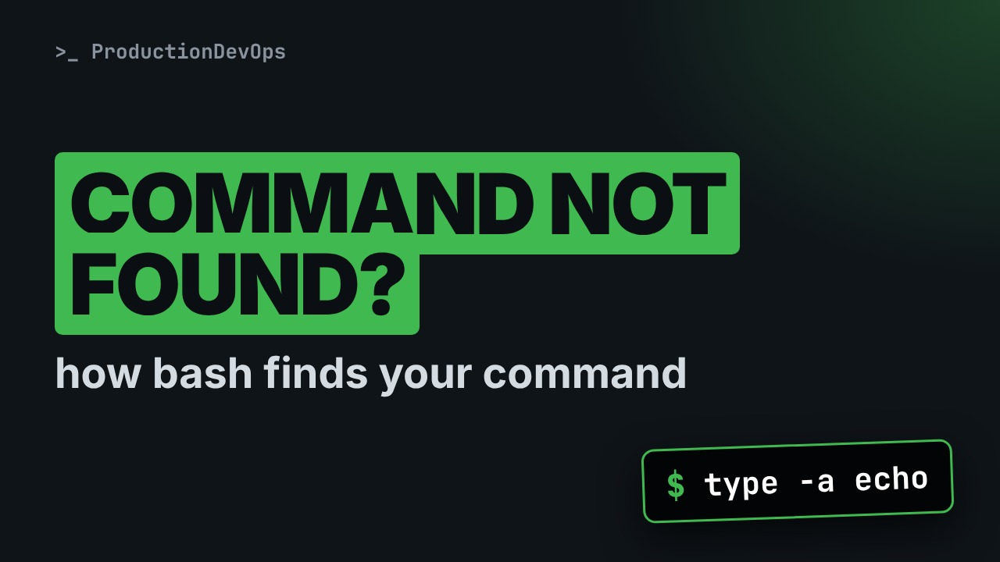
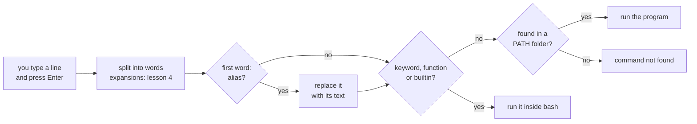
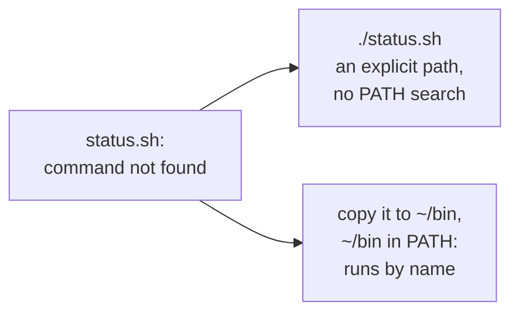

# How the Shell Reads Your Command: Builtins, PATH, Aliases and History



**Video:** coming soon on the [channel](https://www.youtube.com/@production-devops).

Your script is right there in the folder, and the shell says command not found. In lesson 3 we follow what bash does with every line you type: the prompt, builtins and external commands (type, which, command -v), the PATH search and why ./ is needed, aliases, history with !! and !$, line editing keys and tab completion. Lesson 3 of Linux from User to Server Admin.

## Files in this folder

- [`status.sh`](status.sh)
- [`challenge-solution.sh`](challenge-solution.sh) (solution of the challenge: try it yourself first)

## What you need

A Linux shell (a VM, WSL or a container is fine). Everything runs inside this folder.

## Before you start

The video runs these commands first, off screen:

```bash
shopt -s expand_aliases
HISTIGNORE='export HOME=*:clear'; set -o history
```

## The lesson, step by step

The same explanations as the video, with every command. Read it, then run it yourself.

Your script is right there in the folder, and the shell says: command not found. Let's follow what the shell does with each line, and by the middle of this lesson, that error will make sense.

### The plan

This is lesson 3 of Linux from User to Server Admin. First, the prompt, and what happens when you press Enter. Then builtin and external commands. Then PATH, and why your script needs dot slash. Finally aliases, history, and the keys that save time.

### The prompt

The prompt is the shell telling you: I am ready, type a command. Ours reads: user sre, at host lab, in the folder demo inside home. The tilde means home. A dollar sign means a normal user. A hash sign means root: be careful. The shell itself is a program: bash, by default.

**What happens when you press Enter**



When you press Enter, bash splits the line into words, and the first word is the command. An alias is replaced by its text, then bash checks its keywords, functions and builtins. Only if none matches does it search the folders in PATH, and if that fails: command not found.

### Builtin or external

What is cd, really? The type command tells you: a shell builtin, part of bash itself.

```console
$ type cd
```

ls is an external command: a program file on disk, in slash usr slash bin.

```console
$ type ls
```

if is a keyword: part of the shell's grammar, like a word in a language.

```console
$ type if
```

Dash a shows every match. echo exists twice, as a builtin and as a program, and the builtin wins.

```console
$ type -a echo
```

which searches the PATH folders, and prints the program it finds.

```console
$ which ls
```

But which knows nothing about builtins: for cd, it prints nothing, and fails. It is not a reliable tool.

```console
$ which cd
```

command dash v is part of the shell, so it knows builtins too.

```console
$ command -v cd
```

Is a tool installed? In a script, ask command dash v. Double pipe runs echo only if it fails, and acmectl does not exist.

```console
$ command -v acmectl || echo "acmectl is not installed"
```

A quick checkpoint. Bash checks aliases, then its own keywords, functions and builtins, and only then PATH. type and command dash v tell you what will run. Next: PATH, and why your script is not found.

### PATH

PATH is a variable. It holds a list of folders, separated by colons.

```console
$ echo "$PATH"
```

Hard to read. tr replaces each colon with a new line. Bash searches these folders from top to bottom, and runs the first match.

```console
$ echo "$PATH" | tr ':' '\n'
```

Notice what is not in the list: the current folder.

Here is a small script, status dot sh, in our folder.

```console
$ ls
```

We type its name. Command not found. The current folder is not in PATH, so bash never looks here.

```console
$ status.sh
```

The exit code of a command that is not found is always 127.

```console
$ echo $?
```

Dot slash means: this folder. With a slash in the name, bash runs that exact file, and skips the PATH search.

```console
$ ./status.sh
```

How do we run it by name? We put it in a PATH folder. First, a personal bin folder in our home.

```console
$ mkdir -p ~/bin
```

Then cp copies the script into it.

```console
$ cp status.sh ~/bin/
```

Then we add that folder at the front of PATH, for this shell only. The old value stays at the end.

```console
$ PATH="$HOME/bin:$PATH"
```

Now the name alone works, from any folder.

```console
$ status.sh
```

To keep it, RHEL and Ubuntu already add your bin folder at login, when it exists. More in lesson 5.

**Two ways to fix command not found**



So command not found has two fixes: an explicit path like dot slash, or a folder that is in PATH.

### Aliases

An alias is a shortcut. alias l l equals ls dash l, in single quotes.

```console
$ alias ll='ls -l'
```

type confirms it: ll is aliased to ls dash l.

```console
$ type ll
```

Now ll works like ls dash l.

```console
$ ll status.sh
```

unalias removes it.

```console
$ unalias ll
```

And the name is unknown again.

```console
$ ll
```

### History

Bash remembers your commands. Let's create a folder.

```console
$ mkdir -p reports/2026
```

Bang dollar means the last argument of the previous command. Bash shows the expanded line, then runs it.

```console
$ ls -d !$
```

Bang bang means the whole previous command, again.

```console
$ !!
```

history lists what you typed, numbered. Bang and a number runs that line again.

```console
$ history
```

### Keys

```
Tab / Tab Tab    complete a name / show all the choices
Up / Down        previous / next command from history
Ctrl+R           search history: type a word, Enter runs it
Ctrl+A / Ctrl+E  jump to the start / the end of the line
Ctrl+W / Ctrl+U  delete the word / everything before the cursor
Alt+.            paste the last argument, like !$
Ctrl+L           clear the screen, keep the line
```

Tab completes a name, and Tab twice shows the choices. The bash completion package adds options too. The arrows walk through history. Control R searches it: type a few letters, and Enter runs the match. Control A and E jump to the start and the end. Control W deletes a word, Control U the line before the cursor. Alt dot pastes the last argument, like bang dollar. Control L clears the screen.

### Gotchas

Three traps around commands and PATH. One. Never put the current folder in PATH: a fake ls in a shared folder would run as you. Two. Aliases work only in interactive shells, never in scripts. Three. Bash remembers where programs are. After a move, hash dash r makes it forget.

### Recap

Let's recap. Aliases, then keywords, functions and builtins, and only then PATH. type dash a and command dash v tell you exactly what will run. A script here needs dot slash, or a folder in PATH. Exit code 127 means not found. Your challenge: your own command, by name, in every new terminal. Then explain type dash a for test and pwd. The solution is in the demo repository.

Every line goes through the same steps: aliases, builtins, then PATH. Next lesson: pipes, redirection and expansion. Subscribe to follow the course.

## All the commands, to copy

Run them from inside this folder, in this order (some are expected to fail: that is the point of the demo).

```bash
type cd
type ls
type if
type -a echo
which ls
which cd
command -v cd
command -v acmectl || echo "acmectl is not installed"
echo "$PATH"
echo "$PATH" | tr ':' '\n'
ls
status.sh
echo $?
./status.sh
mkdir -p ~/bin
cp status.sh ~/bin/
PATH="$HOME/bin:$PATH"
alias ll='ls -l'
type ll
ll status.sh
unalias ll
ll
mkdir -p reports/2026
ls -d !$
!!
history
```

## Challenge

Your challenge: your own command, by name, in every new terminal. Then explain type dash a for test and pwd. The solution is in the demo repository.

When you have tried: [`challenge-solution.sh`](challenge-solution.sh).

---

From the [ProductionDevOps](https://www.youtube.com/@production-devops) channel: real-world DevOps and SRE, explained with real commands.
