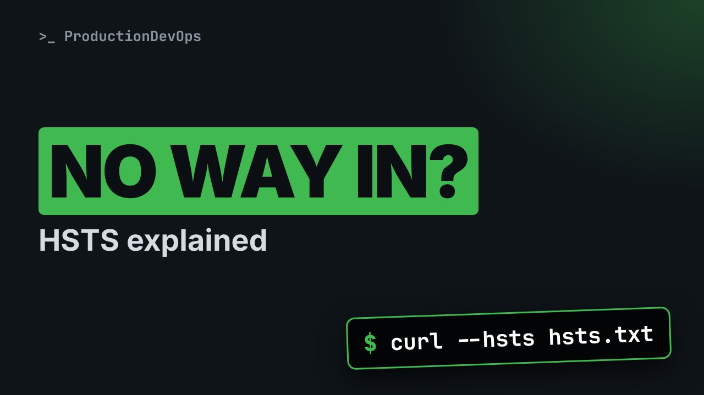
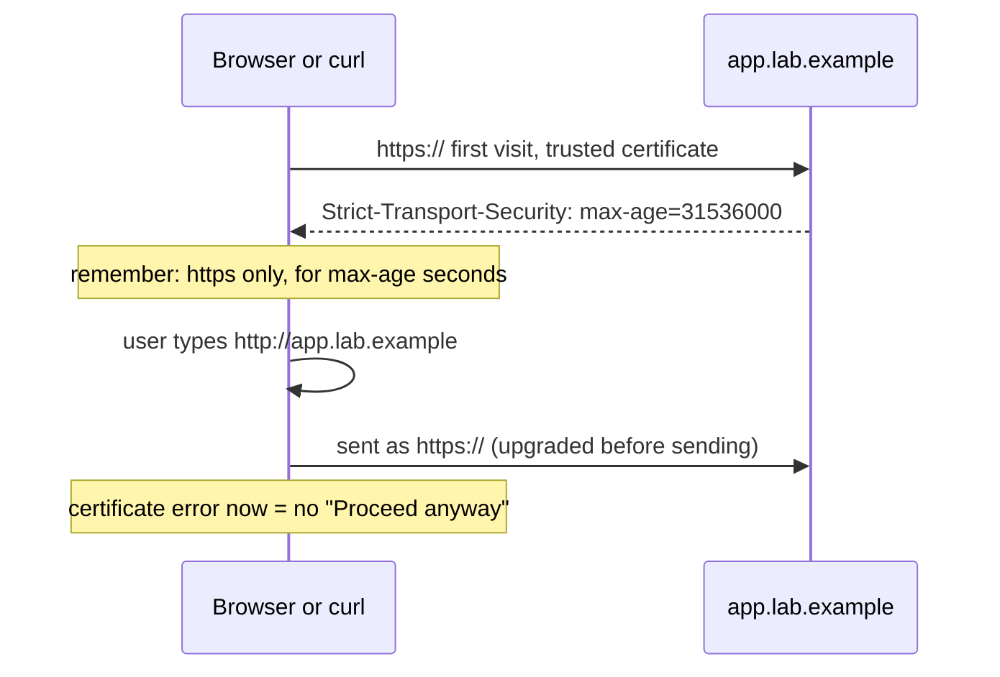
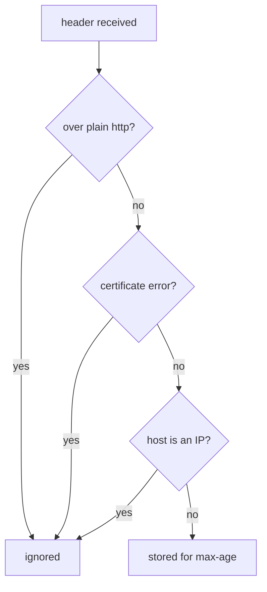

# HSTS Explained: Why You Can't Click "Proceed Anyway"



**Video:** https://youtu.be/3qI4BNjC8Y8

A certificate error with no way to continue, or a browser that keeps forcing https: that is HSTS. We read the Strict-Transport-Security header, watch curl remember it and upgrade http to https by itself, see when browsers ignore the header (and when they don't), and how to fix or clear it in a development browser without disabling security.

## Files in this folder

- [`serve.sh`](serve.sh)
- [`tls-server.py`](tls-server.py)

## What you need

A Linux shell (a VM, WSL or a container is fine). Everything runs inside this folder.

## Before you start

The video runs these commands first, off screen:

```bash
[ -f san.pem ] || openssl req -x509 -newkey rsa:2048 -nodes -keyout san.key -out san.pem -days 365 -subj /CN=app.lab.example -addext subjectAltName=DNS:app.lab.example,DNS:localhost,IP:127.0.0.1 2>/dev/null
./serve.sh san.pem san.key >/dev/null
```

## The big picture

The first https visit stores the HSTS rule; after that the client upgrades http to https by itself and certificate errors cannot be bypassed.



When a client ignores the header, so you can only get locked out of a name that was once trusted.



## The lesson, step by step

The same explanations as the video, with every command. Read it, then run it yourself.

A certificate error, and no proceed anyway button. Or a browser that turns every http link into https. Both come from one response header. Let's see exactly how it works.

### The plan

Here is the plan. First, we read the header, piece by piece. Then we watch a client remember it, and change our URL by itself. We see when it is ignored, and when it really locks you out. And how to fix it, or clear it in a development browser.

### The header

Our test server uses a certificate we trust, from the previous video. Dash capital I asks only for the headers. grep keeps the one we want.

```console
$ curl -sSI --cacert san.pem https://localhost:8443/app/login | grep -i strict-transport
```

There it is: strict transport security. H S T S for short.

```console
$ Strict-Transport-Security: max-age=31536000; includeSubDomains
```

The header has only a few pieces.

- `Strict-Transport-Security`: HTTPS only, for this host
Strict transport security: from now on, talk to this host only over HTTPS.

- `max-age=31536000`: remember it for 1 year
Max age: how long the browser remembers it, in seconds. This value is one year.

- `includeSubDomains`: every subdomain too
Include sub domains: the same rule for every name under this one.

### What the browser does

Once a browser has stored this header for a host, two things change for that host. One. Any http address is turned into https before a single byte is sent. In Chrome you see it as a three oh seven internal redirect. Two. Certificate errors can no longer be bypassed. The proceed anyway button disappears. This is on purpose.

### See it happen

curl can keep an H S T S cache, like a browser. Dash dash hsts names the cache file. We call the server by name, with dash dash resolve.

```console
$ curl -sS --hsts hsts.txt --cacert san.pem --resolve app.lab.example:8443:127.0.0.1 -o /dev/null -w '%{http_code}\n' https://app.lab.example:8443/app/login
```

Let's look at the last line of the cache.

```console
$ tail -1 hsts.txt
```

The host is stored, with an expiry date one year away. The leading dot means: sub domains too.

Now we ask for plain http, and print the URL curl really used.

```console
$ curl -sS --hsts hsts.txt --cacert san.pem --resolve app.lab.example:8443:127.0.0.1 -o /dev/null -w '%{url_effective}\n' http://app.lab.example:8443/app/login
```

We typed http. curl went to https by itself, because of the cache. That is exactly what a browser does.

### When it is ignored

The standard, R F C sixty seven ninety seven, also says when the header must be ignored. This part surprises many people. Received over plain http: ignored. Received over a connection with certificate errors: ignored. Clicking through a warning does not store it. And when the host is an IP address: ignored. So you get locked out only if that name had a trusted certificate at some point.

In practice, it happens in two ways. A development or test host reuses a name that once had a real, trusted certificate. Or a parent domain sends include sub domains, and every internal host under it inherits the rule.

Here is the second case, live. Our cache says: app dot lab dot example, and all its sub domains. Now we ask for plain http on dev dot app dot lab dot example, a host curl has never seen.

```console
$ curl -sS --hsts hsts.txt --cacert san.pem --resolve dev.app.lab.example:8443:127.0.0.1 -o /dev/null -w '%{url_effective}\n' http://dev.app.lab.example:8443/app/login
```

curl switched to https anyway, because of the parent rule. And this certificate does not cover that name, so the request fails, with no way around it. A browser would show an error page without a proceed button.

### The fix

So what do you do? The real fix: a valid, trusted certificate, with the right names in the S A N list. That is the previous video. Don't send H S T S from development and test hosts. To clear it in Chrome: open chrome, net internals, H S T S, and delete the domain. In Firefox: in the history, forget about this site.

### Gotchas

Three mistakes to avoid when you set the header yourself. One. Include sub domains on a parent domain, when you don't control every host under it. Two. A one year max age while you are still testing. Start small, for example five minutes, then increase it. Three. The preload list is built into browsers and almost permanent. Use it only for public sites you fully control.

### Recap

Let's recap. H S T S means https only, and no bypass, for max age seconds. It is ignored over plain http, with certificate errors, and for IP addresses. Fix the certificate. Don't fight the browser.

Next in this series: an AI assistant blamed H S T S for an empty page. We check that diagnosis claim by claim. Subscribe so you don't miss it.

## All the commands, to copy

Run them from inside this folder, in this order (some are expected to fail: that is the point of the demo).

```bash
curl -sSI --cacert san.pem https://localhost:8443/app/login | grep -i strict-transport
curl -sS --hsts hsts.txt --cacert san.pem --resolve app.lab.example:8443:127.0.0.1 -o /dev/null -w '%{http_code}\n' https://app.lab.example:8443/app/login
tail -1 hsts.txt
curl -sS --hsts hsts.txt --cacert san.pem --resolve app.lab.example:8443:127.0.0.1 -o /dev/null -w '%{url_effective}\n' http://app.lab.example:8443/app/login
curl -sS --hsts hsts.txt --cacert san.pem --resolve dev.app.lab.example:8443:127.0.0.1 -o /dev/null -w '%{url_effective}\n' http://dev.app.lab.example:8443/app/login
```

---

From the [ProductionDevOps](https://www.youtube.com/@production-devops) channel: real-world DevOps and SRE, explained with real commands.
