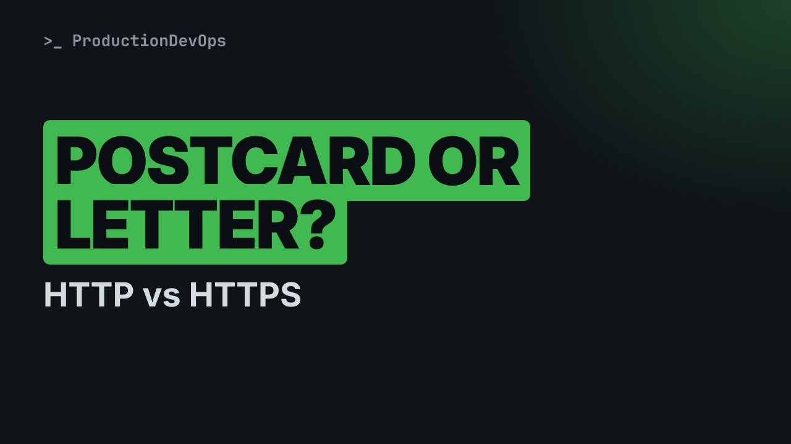
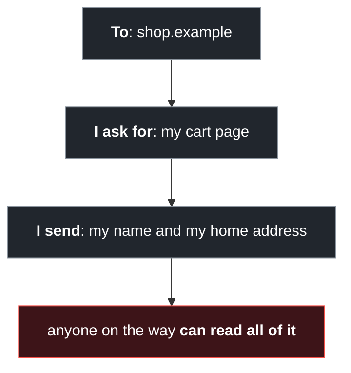
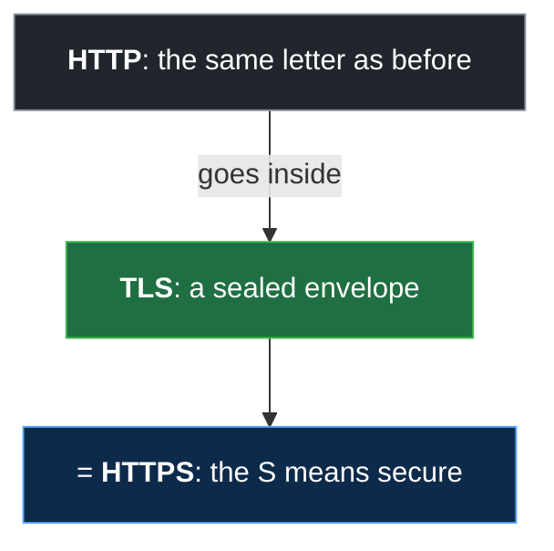
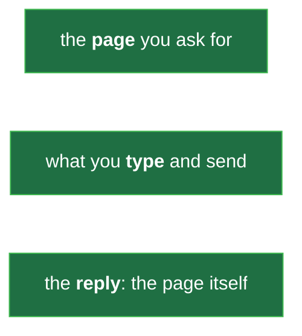
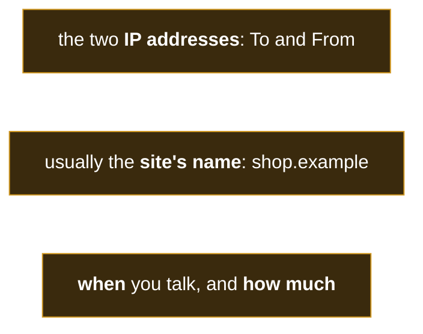

# HTTP and HTTPS: a Postcard and a Sealed Letter (HTTPS and Certificates, No Experience Needed)

**Video:** coming soon on the [channel](https://www.youtube.com/@production-devops).

The same request can travel as a postcard that anyone on the way can read, or as a sealed letter that nobody can. That is the difference between HTTP and HTTPS. This lesson of HTTPS and Certificates, Simply follows one visit to a small online shop, step by step, with pictures: what HTTP shows to the café Wi-Fi, how TLS seals the same letter, what a visit over HTTPS looks like, and what people on the way can still see, even with the seal. No terminal, nothing to install, no experience needed. Every new word is explained on screen. The challenge and its solution are in the demos repo.

## Files in this folder

- [`challenge-solution.md`](challenge-solution.md) (solution of the challenge: try it yourself first)

## What you need

A Linux shell (a VM, WSL or a container is fine). Everything runs inside this folder.

## The lesson, step by step

The same explanations as the video, with every command. Read it, then run it yourself.

In five minutes: why HTTP is a postcard, and HTTPS a sealed letter. And what still shows on the envelope.

For this lesson you need nothing. Just watch. It helps to have seen lesson one, what the padlock means. About five minutes.

### The plan

This is lesson two of HTTPS and Certificates, Simply. First, HTTP: the postcard. Then, HTTPS: the same letter, sealed. Then, one visit, step by step. And what the seal does not hide.

### The postcard

- `HTTP — The rules for asking for a web page, and sending it back (like the way to write a letter: a request, then a reply)`: 
First word: HTTP. It is the rules for asking for a web page, and sending it back. Think of how to write a letter: a request, then a reply.

**An HTTP request is a postcard**

Here is an HTTP request, as a postcard. Who it is for, what you ask, what you send. Anyone on the way can read all of it.

The café Wi-Fi can read it. So can every router on the way. Someone could even change it, and you would not know. And nothing proves who wrote the reply.

### The sealed letter

- `TLS — The rules that seal a connection, and check the site (like the envelope and its seal, plus an ID check)`: 
New word: TLS. It is the rules that seal a connection, and check the site. Think of the envelope and its seal, plus an ID check.

**HTTPS = HTTP inside TLS**

HTTPS is not a new letter. It is the same HTTP letter, inside a TLS envelope. The S means secure.

- `handshake — The first messages of a visit: they set up the seal (like two people agreeing on a secret code before they talk)`: 
New word: handshake. It is the first messages of a visit, which set up the seal. Like agreeing on a secret code before you talk.

### One visit

Time flows down. Each arrow is one message. This is the idea, simplified.

- `your browser → shop server`: hello: I want shop.example
Step one. Your browser says hello, names the site, and sends its half of a seal.

- `shop server → your browser`: hello: the other half, and my ID card
Step two. The server sends the other half of the seal, and its ID card, the certificate.

- `your browser → shop server`: ID card checked: ready
Step three. Your browser checks the ID card. If it is fine, the seal is ready.

- `your browser → shop server`: 🔒 please send my cart
Step four. Now the request travels sealed.

- `shop server → your browser`: 🔒 here is your cart
Step five. The reply comes back sealed too.

How can they agree on a seal, with everyone listening? Both sides build the same secret. That secret never travels whole on the way. It works by clever maths, which is beyond this course.

### So far

So far: HTTP is a postcard. Anyone on the way can read it. HTTPS is the same letter, sealed by TLS. Next: what the seal does not hide. People on the way still see some things. If this is helping, subscribe: the next lesson shows how your browser spots an impostor.

### Not hidden

**With HTTPS, what is hidden?**

With HTTPS, the inside is hidden. The page you ask for, what you type, and the reply.

**With HTTPS, what can still be seen?**

But the outside can still be seen. The two addresses, usually the site's name, and when and how much you send.

Think of an envelope. The post office still reads the address, and sees its size. But it never reads the letter inside. So people on the way know where you go. Not what you say.

### Ports

Remember ports, the desk inside the building. HTTP usually answers at port eighty. HTTPS usually answers at port four four three.

### Good to know

Good to know: most sites send H T T P visitors straight to HTTPS. Every visit gets a new seal. An old one cannot open new letters. And HTTPS is the normal case today, on almost every site.

### Recap

Recap: HTTP is a postcard. HTTPS is the same letter, inside TLS. The handshake sets up the seal, and checks the ID card. Still visible: where you go. Not what you say. Your challenge: two addresses on screen. What can the café Wi-Fi read in each? The answer is in the demo repo.

### Where next

Where next? Lesson three: what a certificate proves. The site's ID card, and how your browser checks it.

Subscribe, and the next lesson, what a certificate proves, finds you.

## Challenge

Your challenge: two addresses on screen. What can the café Wi-Fi read in each? The answer is in the demo repo.

When you have tried: [`challenge-solution.md`](challenge-solution.md).

---

From the [ProductionDevOps](https://www.youtube.com/@production-devops) channel: real-world DevOps and SRE, explained with real commands.
