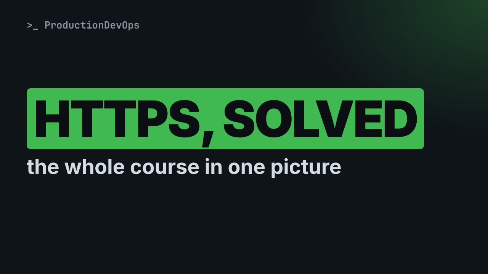
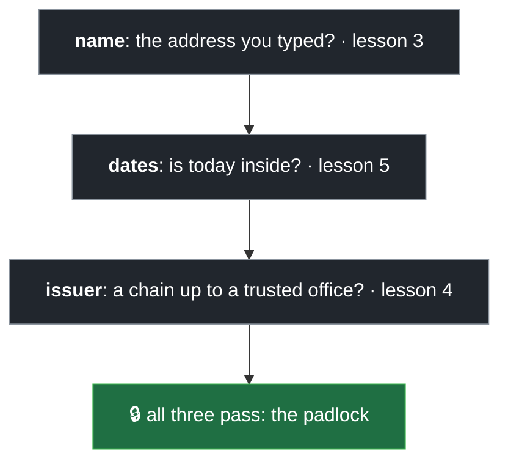
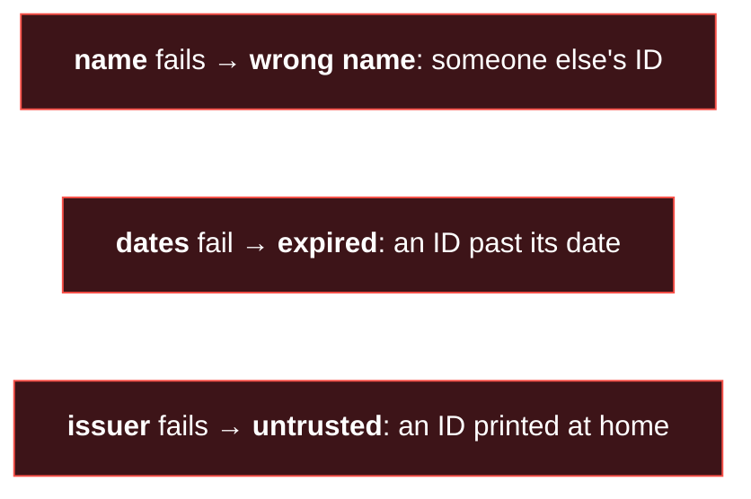
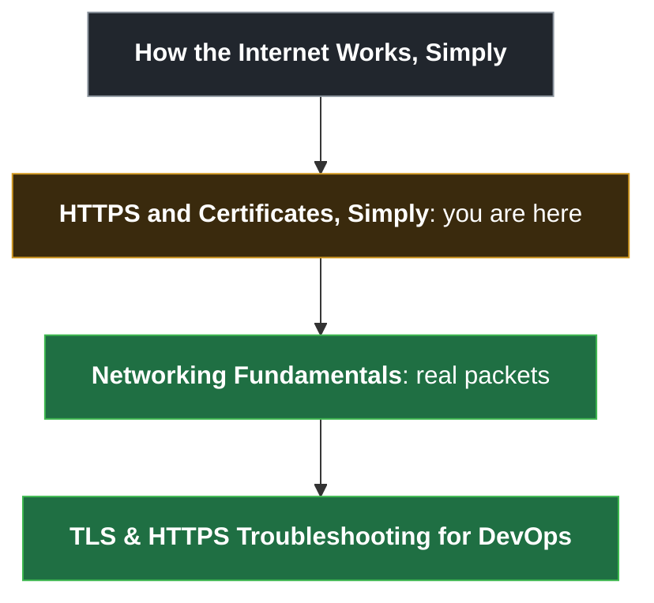

# Where Next: What You Can Do Now (HTTPS and Certificates, No Experience Needed)

**Video:** coming soon on the [channel](https://www.youtube.com/@production-devops).

You can now read the padlock, a website's certificate and the browser's warnings. This last lesson of HTTPS and Certificates, Simply puts the whole course in one picture: one HTTPS visit from start to end, the three checks your browser makes, and every new word in post office terms, from the postcard and the sealed letter to the office that vouches for the office. Then: what you can do now, and where to go next, the course TLS & HTTPS Troubleshooting for DevOps. No terminal, nothing to install. The challenge and its solution are in the demos repo.

## Files in this folder

- [`challenge-solution.md`](challenge-solution.md) (solution of the challenge: try it yourself first)

## What you need

A Linux shell (a VM, WSL or a container is fine). Everything runs inside this folder.

## The lesson, step by step

The same explanations as the video, with every command. Read it, then run it yourself.

In five minutes: the whole course in one picture. Then what you can do now, and where next.

For this lesson you need nothing. Just watch. It works best after lessons one to seven of this course. About five minutes.

### The plan

This is lesson eight, the last of HTTPS and Certificates, Simply. First, one visit, from start to end. Then, the three checks, again. Then, every word of the course, in post office terms. And what you can do now, and where to go next.

### One visit

Time flows down. Each arrow is one message, simplified.

- `your browser → address book (DNS)`: where is shop.example?
Step one. Your browser asks the address book: where is shop dot example?

- `address book (DNS) → your browser`: at 203.0.113.10
Step two. The answer comes back: an address.

- `your browser → shop server`: hello: I want shop.example
Step three. Hello to the shop, with the site's name, and half of a seal.

- `shop server → your browser`: the other half, my ID card, my signature
Step four. The other half of the seal, the ID card, and a fresh signature.

- `your browser → shop server`: 🔒 card checked: please send my cart
Step five. Your browser checks the card. Then the request travels sealed.

- `shop server → your browser`: 🔒 here is your cart
Step six. The sealed reply. And the padlock appears.

### Three checks

**The three checks, again**

At step five, your browser makes three checks. Name, dates, issuer. All three pass: the padlock.

**When a check fails**

One check fails, and you get a warning page. Wrong name, expired, or untrusted. Lessons six and seven.

### The words

Now every word, in post office terms. HTTP is a postcard. HTTPS is a sealed letter. Encryption and TLS are the envelope, and its seal. A certificate is the website's ID card. A key pair: a signature sample on the card, and the hand that signs.

A C A is the office that issues ID cards. A chain is the office that vouches for the office. The trust store is the list of offices your browser already trusts. And self-signed is an ID card printed at home.

### So far

So far: one visit. The address, hello, the ID card, the checks, then the seal. And every word has its post office picture. Next: what you can do now, and where to go. If this is helping, subscribe: the next course tests real servers, with real commands.

### What you can do

What can you do now? Say what the padlock promises, and what it does not. Read a certificate: in a browser, or with open S S L x five oh nine. Name the cause of a warning, from its clue word. And check the name, the dates and the issuer yourself.

One thing from lesson one stays true. The padlock never says the site is honest. Always read the name in the address. And never click through a warning when your money is at stake.

### Where next

**Where this course sits**

Here is where this course sits. Networking Fundamentals adds real packets. Then TLS and HTTPS Troubleshooting for DevOps.

The next course is TLS and HTTPS Troubleshooting for DevOps. Real commands, on a real test server. You learn to tell if a problem is the network, TLS, or the app. And you meet the second list of names, and sites where continue anyway is gone.

### Recap

Recap of the whole course. HTTPS is HTTP, sealed by TLS, sent to a checked site. The check: name, dates, and issuer. It proves the name, not honesty. Your challenge: tell one HTTPS visit in six steps, in post office words. A model answer is in the demo repo.

Where next? The next course is TLS and HTTPS Troubleshooting for DevOps. Its first lesson: is it the network, TLS, or the app? New to packets? Take Networking Fundamentals first.

Subscribe, and the next course, TLS and HTTPS Troubleshooting for DevOps, finds you.

## Challenge

Your challenge: tell one HTTPS visit in six steps, in post office words. A model answer is in the demo repo.

When you have tried: [`challenge-solution.md`](challenge-solution.md).

---

From the [ProductionDevOps](https://www.youtube.com/@production-devops) channel: real-world DevOps and SRE, explained with real commands.
