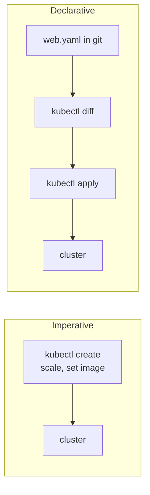
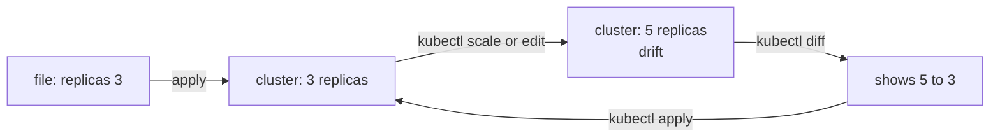

# kubectl create vs apply: Stop Your Cluster Drifting From Git


**Video:** https://youtu.be/FgkpneZH1Yc

One quick kubectl command fixes production, and a week later the YAML in git silently undoes it. We compare the two ways to change a cluster on a real three-node lab: imperative commands like create, scale and set image, and declarative files with apply. We generate clean YAML without writing it by hand, preview every change with kubectl diff, watch a live edit drift away from the file and come back, and see why mixing create and apply prints a warning. Part 5 of the Kubernetes Path.

## Files in this folder

- [`challenge-solution.sh`](challenge-solution.sh) (solution of the challenge: try it yourself first)

## What you need

A Kubernetes cluster you can break: a local [kind](https://kind.sigs.k8s.io/) cluster with one control plane and two workers is what the video uses, plus `kubectl`. Never run these commands against a cluster that matters.

The outputs below were captured for real on the lab cluster. On yours, names, ages, IPs and ports will differ; everything else should match.

## The big picture

Two ways to change a cluster: commands that leave no file, or a file in git that apply turns into the cluster state.



Drift: a live change moves the cluster away from the file, diff shows it, apply brings it back.



## The lesson, step by step

The same explanations as the video, with every command and its real output. Read it, then run it yourself.

You fix production with one quick kubectl command. A week later, someone applies the YAML from git, and your fix is gone. Today: the two ways to change a cluster, and how to keep them from fighting.

### The plan

This is part five of the Kubernetes Path. Here is the plan. First, the imperative way: quick commands that change the cluster, and leave no file. Then we let kubectl write the YAML for us, with a dry run. Then the declarative way: apply a file, change it, and preview the change with diff. Finally, a live change that drifts away from the file, and how apply brings it back.

### Imperative

We work in a namespace called shop. kubectl create deployment makes a Deployment called hello, running nginx.

```console
$ kubectl create deployment hello --image=nginx:1.27 -n shop
deployment.apps/hello created
```

We want three copies. kubectl scale changes the number of replicas.

```console
$ kubectl scale deployment hello --replicas=3 -n shop
deployment.apps/hello scaled
```

And a newer nginx. set image changes the image of the container called nginx.

```console
$ kubectl set image deployment/hello nginx=nginx:1.28 -n shop
deployment.apps/hello image updated
```

The cluster now has three replicas of nginx one point twenty eight. Jsonpath prints just those two fields.

```console
$ kubectl get deployment hello -n shop -o jsonpath='{.spec.replicas} {.spec.template.spec.containers[0].image}{"\n"}'
3 nginx:1.28
```

Fast. But where is this written? Only in the cluster. No file to review, no history, nothing to rebuild it from.

### Two styles

Two ways to change a cluster. Imperative: you tell kubectl what to do, one step at a time. Create, scale, set image. Declarative: a file describes the end state you want. kubectl apply makes the cluster match it. The file lives in git, so every change is reviewed, has a history, and can be rolled back. And apply is safe to repeat. Run it twice, and the result is the same.

### Generate the YAML

Writing YAML by hand is slow and error prone. Instead, we ask kubectl create to build the object, without sending it.

```console
$ kubectl create deployment web --image=nginx:1.27 --replicas=2 -n shop --dry-run=client -o yaml > web.yaml
```

Dash o yaml prints it as YAML, and we save it to a file. Here is the top: the apiVersion, kind Deployment, its name and namespace, two replicas, and the selector.

```console
$ head -n 12 web.yaml
apiVersion: apps/v1
kind: Deployment
metadata:
  labels:
    app: web
  name: web
  namespace: shop
spec:
  replicas: 2
  selector:
    matchLabels:
      app: web
```

And the rest: the Pod template, with the label and the nginx container.

```console
$ tail -n +13 web.yaml
  strategy: {}
  template:
    metadata:
      labels:
        app: web
    spec:
      containers:
      - image: nginx:1.27
        name: nginx
        resources: {}
status: {}
```

The empty fields, like status and resources, are placeholders. Keep them or delete them: apply does not care.

### Declarative

Now the declarative way. kubectl apply dash f sends the file.

```console
$ kubectl apply -f web.yaml
deployment.apps/web created
```

Two replicas, as the file says.

```console
$ kubectl get deployment web -n shop
NAME   READY   UP-TO-DATE   AVAILABLE   AGE
web    2/2     2            2           3s
```

### Change and diff

We change one line in the file: three replicas instead of two. Here with sed, in real life with your editor and a commit.

```console
$ sed -i 's/replicas: 2/replicas: 3/' web.yaml
```

Before applying, kubectl diff compares the file with the live object. Grep keeps only the changed lines.

```console
$ kubectl diff -f web.yaml | grep '^[-+] '
-  generation: 1
+  generation: 2
-  replicas: 2
+  replicas: 3
```

The replicas go from two to three, and the generation counter goes up by one. kubectl diff also has a useful exit code. One means there are differences. Zero means the cluster already matches.

```console
$ kubectl diff -f web.yaml > /dev/null; echo "exit code: $?"
exit code: 1
```

Happy with the preview, we apply.

```console
$ kubectl apply -f web.yaml
deployment.apps/web configured
```

Three replicas.

```console
$ kubectl get deployment web -n shop
NAME   READY   UP-TO-DATE   AVAILABLE   AGE
web    3/3     3            3           11s
```

### Drift

Now someone changes the cluster directly. kubectl edit would open the live object in an editor and save it. Scale does the same, in one line.

```console
$ kubectl scale deployment web --replicas=5 -n shop
deployment.apps/web scaled
```

Five replicas run. The file in git still says three. The cluster has drifted.

```console
$ kubectl get deployment web -n shop
NAME   READY   UP-TO-DATE   AVAILABLE   AGE
web    5/5     5            5           14s
```

diff shows it at once.

```console
$ kubectl diff -f web.yaml | grep '^[-+] '
-  generation: 3
+  generation: 4
-  replicas: 5
+  replicas: 3
```

The next apply, maybe from a pipeline a week later, puts back what the file says.

```console
$ kubectl apply -f web.yaml
deployment.apps/web configured
```

Back to three. Good, if the live change was a mistake. Bad, if it was a fix that nobody wrote in the file.

```console
$ kubectl get deployment web -n shop
NAME   READY   UP-TO-DATE   AVAILABLE   AGE
web    3/3     3            3           16s
```

### Mixing create and apply

Back to hello, made with commands. We generate a file with its current values, three replicas of nginx one point twenty eight.

```console
$ kubectl create deployment hello --image=nginx:1.28 --replicas=3 -n shop --dry-run=client -o yaml > hello.yaml
```

Now we apply it. It works, but kubectl prints a warning.

```console
$ kubectl apply -f hello.yaml
Warning: resource deployments/hello is missing the kubectl.kubernetes.io/last-applied-configuration annotation which is required by kubectl apply. kubectl apply should only be used on resources created declaratively by either kubectl create --save-config or kubectl apply. The missing annotation will be patched automatically.
deployment.apps/hello configured
```

apply keeps a copy of the last file it applied, in an annotation. Objects made with create do not have one yet. apply adds it now, and from here on, use only apply.

### Delete

Deleting works the same way. Dash f deletes what the file describes.

```console
$ kubectl delete -f web.yaml
deployment.apps "web" deleted from shop namespace
```

Or by label. kubectl create deployment labelled hello with app equals hello.

```console
$ kubectl delete deployment -l app=hello -n shop
deployment.apps "hello" deleted from shop namespace
```

We clean up the namespace, and everything left in it.

```console
$ kubectl delete namespace shop
namespace "shop" deleted
```

### Gotchas

Three habits that prevent surprises. kubectl edit in production is sometimes needed. Then update the file in git too, or the next apply undoes your fix. Pick one style per object. Once a file exists, change it only with apply. Run kubectl diff before every apply. In a pipeline, exit code one means changes are coming.

### Recap

Let's recap. Imperative commands are fast, but the result lives only in the cluster. Dry run client, dash o yaml, writes the YAML for you. Change the file, check the diff, then apply. Your challenge: generate a Deployment and a Service without writing YAML by hand. Apply them, change the replicas in the file, and show the diff before applying. The solution is in the demo repository.

Change the file, check the diff, then apply. Next on the Kubernetes Path: the API behind kubectl, and how to talk to it yourself. Subscribe to follow the whole path.

## All the commands, to copy

Run them from inside this folder, in this order.

```bash
kubectl create deployment hello --image=nginx:1.27 -n shop
kubectl scale deployment hello --replicas=3 -n shop
kubectl set image deployment/hello nginx=nginx:1.28 -n shop
kubectl get deployment hello -n shop -o jsonpath='{.spec.replicas} {.spec.template.spec.containers[0].image}{"\n"}'
kubectl create deployment web --image=nginx:1.27 --replicas=2 -n shop --dry-run=client -o yaml > web.yaml
head -n 12 web.yaml
tail -n +13 web.yaml
kubectl apply -f web.yaml
kubectl get deployment web -n shop
sed -i 's/replicas: 2/replicas: 3/' web.yaml
kubectl diff -f web.yaml | grep '^[-+] '
kubectl diff -f web.yaml > /dev/null; echo "exit code: $?"
kubectl scale deployment web --replicas=5 -n shop
kubectl create deployment hello --image=nginx:1.28 --replicas=3 -n shop --dry-run=client -o yaml > hello.yaml
kubectl apply -f hello.yaml
kubectl delete -f web.yaml
kubectl delete deployment -l app=hello -n shop
kubectl delete namespace shop
```

## Challenge

Your challenge: generate a Deployment and a Service without writing YAML by hand. Apply them, change the replicas in the file, and show the diff before applying. The solution is in the demo repository.

When you have tried: [`challenge-solution.sh`](challenge-solution.sh).

---

From the [ProductionDevOps](https://www.youtube.com/@production-devops) channel: real-world DevOps and SRE, explained with real commands.
