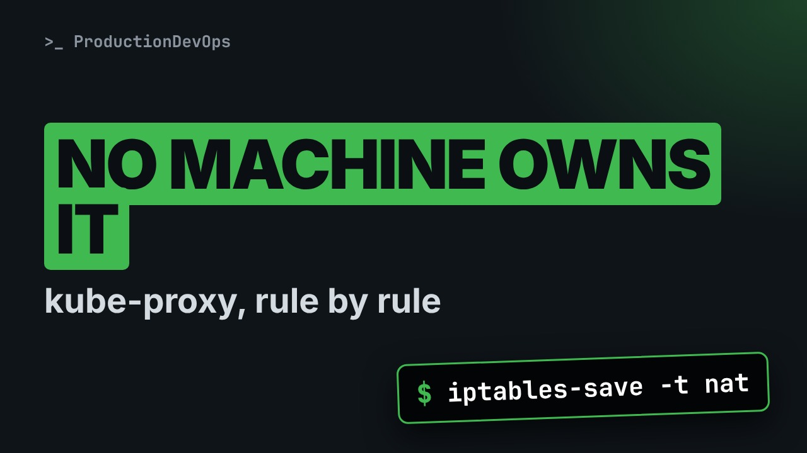
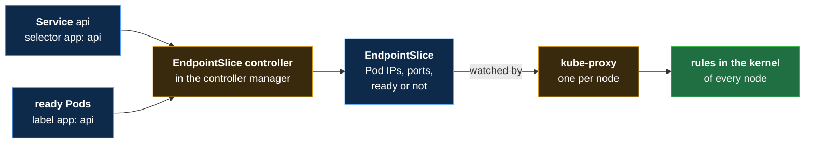
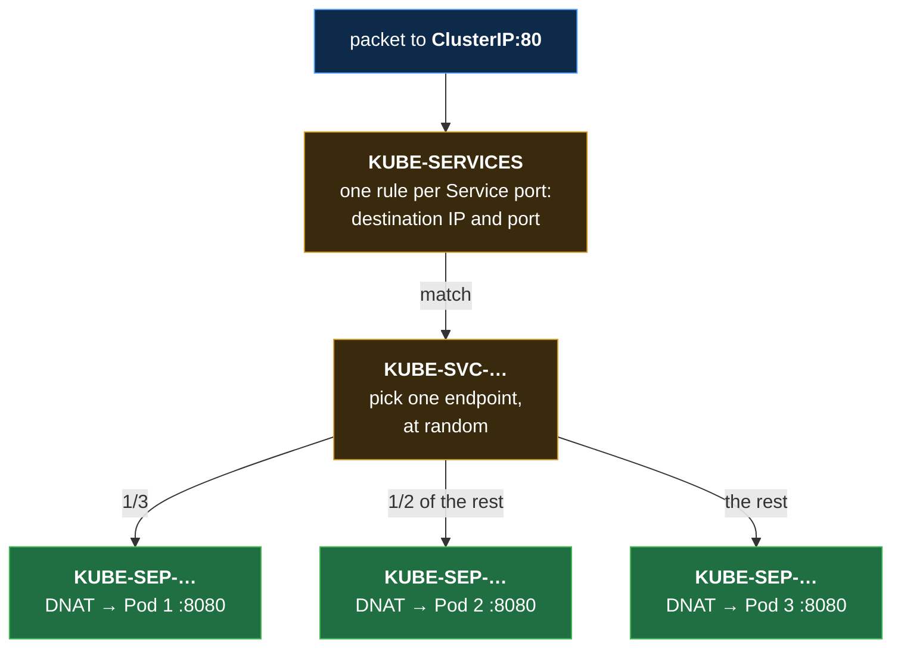

# Inside kube-proxy: EndpointSlices and the iptables Rules Behind a Service



**Video:** coming soon on the [channel](https://www.youtube.com/@production-devops).

A Service address belongs to no machine, yet every node answers it. On a real cluster we follow the whole path: the EndpointSlice that lists the Pods (and why Endpoints is deprecated), ready and not-ready endpoints, kube-proxy on every node, and the iptables chains KUBE-SERVICES, KUBE-SVC and KUBE-SEP read straight from a node, with the random probabilities that share the load and the DNAT to the Pod. Then a Pod fails its readiness probe and leaves the rules without being deleted, and we see what the nftables mode changes. Lesson 8 of Kubernetes Deep Dive.

## Files in this folder

- [`api.yaml`](api.yaml)
- [`challenge-solution.sh`](challenge-solution.sh) (solution of the challenge: try it yourself first)
- [`cleanup.sh`](cleanup.sh)

## What you need

A Kubernetes cluster you can break: a local [kind](https://kind.sigs.k8s.io/) cluster with one control plane and two workers is what the video uses, plus `kubectl`. Never run these commands against a cluster that matters.

The outputs below were captured for real on the lab cluster. On yours, names, ages, IPs and ports will differ; everything else should match.

## The lesson, step by step

The same explanations as the video, with every command and its real output. Read it, then run it yourself.

A Service address belongs to no machine, yet every node answers it. Today we read the rules behind it, and at the end a running Pod leaves them without being deleted.

### The plan

Lesson eight of Kubernetes Deep Dive. EndpointSlices. Kube proxy, on every node. Its rules, read from a node. Then a Pod that is not ready, and the N F tables mode.

**From a Service to the rules**



A controller matches the selector to ready Pods and writes an EndpointSlice. Kube proxy, on every node, turns it into kernel rules.

### The app

Our app: three Pods, with a readiness probe we can break.

```
apiVersion: apps/v1
kind: Deployment
metadata:
  name: api
  namespace: acme
spec:
  replicas: 3
  selector: {matchLabels: {app: api}}
  template:
    metadata: {labels: {app: api}}
    spec:
      containers:
        - name: api
          image: busybox:1.36
          command: ["sh", "-c", "touch /tmp/ready; httpd -f -p 8080 -h /tmp"]
          ports: [{name: http, containerPort: 8080}]
          readinessProbe:
            exec: {command: ["cat", "/tmp/ready"]}
            periodSeconds: 2
```

The Deployment. The Pod template, with its probe.

```
apiVersion: apps/v1
kind: Deployment
metadata:
  name: api
  namespace: acme
spec:
  replicas: 3
  selector: {matchLabels: {app: api}}
```

A Deployment api, in namespace acme. Three replicas, label app equals api.

```
template:
  metadata: {labels: {app: api}}
  spec:
    containers:
      - name: api
        image: busybox:1.36
        command: ["sh", "-c", "touch /tmp/ready; httpd -f -p 8080 -h /tmp"]
        ports: [{name: http, containerPort: 8080}]
        readinessProbe:
          exec: {command: ["cat", "/tmp/ready"]}
          periodSeconds: 2
```

Each Pod gets the label, and one busybox container. The command first creates an empty file, slash tmp slash ready. Then a web server on port eighty eighty, in the foreground. That port is named http. The probe reads that file every two seconds. Delete it, and the Pod is not ready.

All together: three Pods, ready while the file exists.

```
apiVersion: apps/v1
kind: Deployment
metadata:
  name: api
  namespace: acme
spec:
  replicas: 3
  selector: {matchLabels: {app: api}}
  template:
    metadata: {labels: {app: api}}
    spec:
      containers:
        - name: api
          image: busybox:1.36
          command: ["sh", "-c", "touch /tmp/ready; httpd -f -p 8080 -h /tmp"]
          ports: [{name: http, containerPort: 8080}]
          readinessProbe:
            exec: {command: ["cat", "/tmp/ready"]}
            periodSeconds: 2
```

```console
$ kubectl expose deployment api --port=80 --target-port=http -n acme
```

The Service comes from expose, as in lesson seven.

- `kubectl expose deployment api`: a Service with the Deployment's selector
A Service with the Deployment's selector,

- `--port=80`: the Service listens on 80
It listens on port eighty,

- `--target-port=http`: the Pods' port named http
and sends to the port named http.

We apply it, in a fresh namespace.

```console
$ kubectl apply -f api.yaml
deployment.apps/api created
```

And we expose it.

```console
$ kubectl expose deployment api --port=80 --target-port=http -n acme
service/api exposed
```

### EndpointSlices

The old way to list a Service's Pods: get endpoints.

```console
$ kubectl get endpoints api -n acme
Warning: v1 Endpoints is deprecated in v1.33+; use discovery.k8s.io/v1 EndpointSlice
NAME   ENDPOINTS                                         AGE
api    192.0.2.10:8080,192.0.2.11:8080,192.0.2.12:8080   4s
```

Read the warning: Endpoints is deprecated, replaced by EndpointSlice. So, get endpoint slices.

```console
$ kubectl get endpointslices -n acme
NAME        ADDRESSTYPE   PORTS   ENDPOINTS                          AGE
api-psqw6   IPv4          8080    192.0.2.10,192.0.2.12,192.0.2.11   5s
```

Port eighty eighty: the target port, resolved from its name. One slice holds up to a hundred endpoints.

```console
$ kubectl get endpointslices -n acme -l kubernetes.io/service-name=api -o custom-columns=IP:.endpoints[*].addresses[0],READY:.endpoints[*].conditions.ready,NODE:.endpoints[*].nodeName
```

Each endpoint also says if it is ready, and where it runs.

- `-l kubernetes.io/service-name=api`: the slices of Service api
This label ties a slice to its Service.

- `-o custom-columns=`: we choose the columns
Custom columns: header, colon, path.

- `IP:.endpoints[*].addresses[0]`: each endpoint's address
Star means every endpoint: its address.

- `READY:.endpoints[*].conditions.ready`: is it ready?
Is it ready?

- `NODE:.endpoints[*].nodeName`: on which node
And its node.

We run it.

```console
$ kubectl get endpointslices -n acme -l kubernetes.io/service-name=api -o custom-columns=IP:.endpoints[*].addresses[0],READY:.endpoints[*].conditions.ready,NODE:.endpoints[*].nodeName
IP                                 READY            NODE
192.0.2.10,192.0.2.12,192.0.2.11   true,true,true   lab-worker2,lab-worker,lab-worker2
```

Read by position: the first address, its readiness, its node.

### kube-proxy

Who reads the slices? Kube proxy, a DaemonSet.

```console
$ kubectl get daemonset kube-proxy -n kube-system
NAME         DESIRED   CURRENT   READY   UP-TO-DATE   AVAILABLE   NODE SELECTOR            AGE
kube-proxy   3         3         3       3            3           kubernetes.io/os=linux   5m21s
```

Which backend? Its config map has a mode field.

```console
$ kubectl get configmap kube-proxy -n kube-system -o yaml | grep 'mode:'
    mode: iptables
```

Our lab runs the iptables mode: iptables rules, in each node's kernel.

### The chains

**A packet, chain by chain**



Kube services finds the Service. Kube S V C picks an endpoint at random, and kube S E P rewrites the destination to that Pod.

```console
$ docker exec lab-worker iptables-save -t nat | grep KUBE-SERVICES | grep acme/api
```

Our nodes are containers: docker exec runs a command on one.

- `docker exec lab-worker`: run on the node lab-worker
On the node lab worker,

- `iptables-save -t nat`: print the nat table
print the nat table, where addresses are rewritten.

- `| grep KUBE-SERVICES`: only the entry chain
Keep the entry chain,

- `| grep acme/api`: only our Service
and our Service: each rule has a comment, namespace slash name.

We run it.

```console
$ docker exec lab-worker iptables-save -t nat | grep KUBE-SERVICES | grep acme/api
-A KUBE-SERVICES -d 192.0.2.13/32 -p tcp -m comment --comment "acme/api cluster IP" -m tcp --dport 80 -j KUBE-SVC-SIXL6CZHMBBSN5DP
```

Destination: the cluster IP, port eighty. Then a jump to the Service's chain, named with a hash. Inside it, one jump per endpoint. Their comment has an arrow, so we grep for it.

```console
$ docker exec lab-worker iptables-save -t nat | grep 'acme/api ->'
-A KUBE-SVC-SIXL6CZHMBBSN5DP -m comment --comment "acme/api -> 192.0.2.10:8080" -m statistic --mode random --probability 0.33333333349 -j KUBE-SEP-Y2BCOIFXJ6GWZYKP
-A KUBE-SVC-SIXL6CZHMBBSN5DP -m comment --comment "acme/api -> 192.0.2.11:8080" -m statistic --mode random --probability 0.50000000000 -j KUBE-SEP-LUPLPDMFVAM7NUHD
-A KUBE-SVC-SIXL6CZHMBBSN5DP -m comment --comment "acme/api -> 192.0.2.12:8080" -j KUBE-SEP-DCEYFGDR2VSYWTDJ
```

The first takes a third of new connections, the second half of the rest, the last all the rest. Equal shares.

And the endpoint chains, which rewrite.

```console
$ docker exec lab-worker iptables-save -t nat | grep DNAT | grep acme/api
-A KUBE-SEP-DCEYFGDR2VSYWTDJ -p tcp -m comment --comment "acme/api" -m tcp -j DNAT --to-destination 192.0.2.12:8080
-A KUBE-SEP-LUPLPDMFVAM7NUHD -p tcp -m comment --comment "acme/api" -m tcp -j DNAT --to-destination 192.0.2.11:8080
-A KUBE-SEP-Y2BCOIFXJ6GWZYKP -p tcp -m comment --comment "acme/api" -m tcp -j DNAT --to-destination 192.0.2.10:8080
```

The destination becomes a Pod's address and port. Connection tracking rewrites the replies back.

### So far

So far: an EndpointSlice lists the Pods. Kube proxy turns it into chains, on every node. Next, the payoff: a running Pod leaves the rules.

### Not ready

We delete the file in one Pod: deploy slash api picks one.

```console
$ kubectl exec deploy/api -n acme -- rm /tmp/ready
```

Seconds later, one Pod is zero of one ready. Still running.

```console
$ kubectl get pods -n acme
NAME                   READY   STATUS    RESTARTS   AGE
api-7b49c969bc-brpzq   0/1     Running   0          32s
api-7b49c969bc-jcsg4   1/1     Running   0          32s
api-7b49c969bc-lgsgt   1/1     Running   0          32s
```

The slice keeps it, marked not ready.

```console
$ kubectl get endpointslices -n acme -l kubernetes.io/service-name=api -o custom-columns=IP:.endpoints[*].addresses[0],READY:.endpoints[*].conditions.ready,NODE:.endpoints[*].nodeName
IP                                 READY             NODE
192.0.2.10,192.0.2.12,192.0.2.11   true,false,true   lab-worker2,lab-worker,lab-worker2
```

And on the node, the same grep as before.

```console
$ docker exec lab-worker iptables-save -t nat | grep 'acme/api ->'
-A KUBE-SVC-SIXL6CZHMBBSN5DP -m comment --comment "acme/api -> 192.0.2.10:8080" -m statistic --mode random --probability 0.50000000000 -j KUBE-SEP-Y2BCOIFXJ6GWZYKP
-A KUBE-SVC-SIXL6CZHMBBSN5DP -m comment --comment "acme/api -> 192.0.2.11:8080" -j KUBE-SEP-LUPLPDMFVAM7NUHD
```

The Pod was never deleted. Not ready means no new traffic: kube proxy left it out.

Each endpoint carries three conditions. Ready: it gets new traffic. Serving: like ready, also while terminating. Terminating ones get traffic only if nothing is ready. Publish not ready addresses keeps not ready Pods in, for DNS.

### nftables

Iptables is not the only mode. Iptables: long chains, our lab's mode. N F tables, stable since one thirty three: one table, maps instead of chains. Faster updates on big clusters. Read it with N F T list table. I P V S is deprecated. On kind, one field in the cluster config picks the mode.

We delete the namespace, and everything in it.

```console
$ kubectl delete namespace acme
namespace "acme" deleted
```

### Recap

Let's recap. EndpointSlices, not Endpoints. Kube services, a random pick, then the rewrite. Not ready means listed, but out of the rules. Challenge: scale api to four. Which probabilities do you expect? The solution is in the demo repository.

Next: cluster DNS, how a Service's name becomes its address. Subscribe to follow the course.

## All the commands, to copy

Run them from inside this folder, in this order.

```bash
kubectl expose deployment api --port=80 --target-port=http -n acme
kubectl apply -f api.yaml
kubectl get endpoints api -n acme
kubectl get endpointslices -n acme
kubectl get endpointslices -n acme -l kubernetes.io/service-name=api -o custom-columns=IP:.endpoints[*].addresses[0],READY:.endpoints[*].conditions.ready,NODE:.endpoints[*].nodeName
kubectl get daemonset kube-proxy -n kube-system
kubectl get configmap kube-proxy -n kube-system -o yaml | grep 'mode:'
docker exec lab-worker iptables-save -t nat | grep KUBE-SERVICES | grep acme/api
docker exec lab-worker iptables-save -t nat | grep 'acme/api ->'
docker exec lab-worker iptables-save -t nat | grep DNAT | grep acme/api
kubectl exec deploy/api -n acme -- rm /tmp/ready
kubectl get pods -n acme
kubectl delete namespace acme
```

## Challenge

Challenge: scale api to four. Which probabilities do you expect? The solution is in the demo repository.

When you have tried: [`challenge-solution.sh`](challenge-solution.sh).

---

From the [ProductionDevOps](https://www.youtube.com/@production-devops) channel: real-world DevOps and SRE, explained with real commands.
