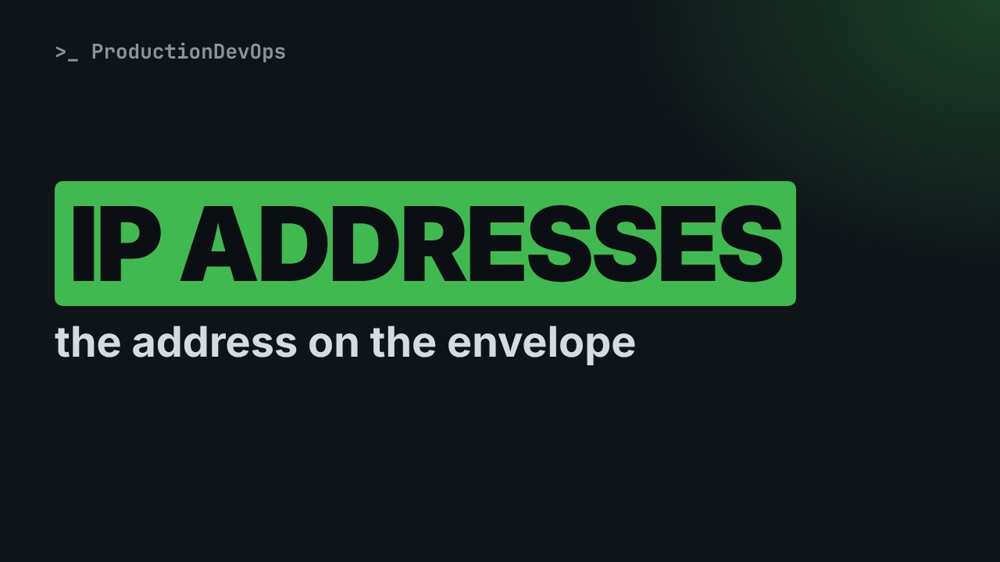
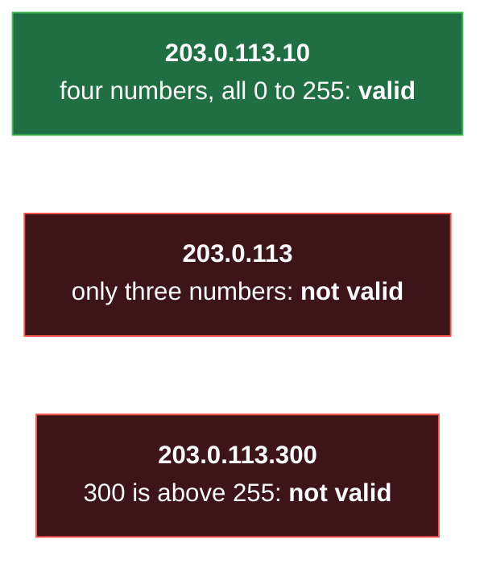
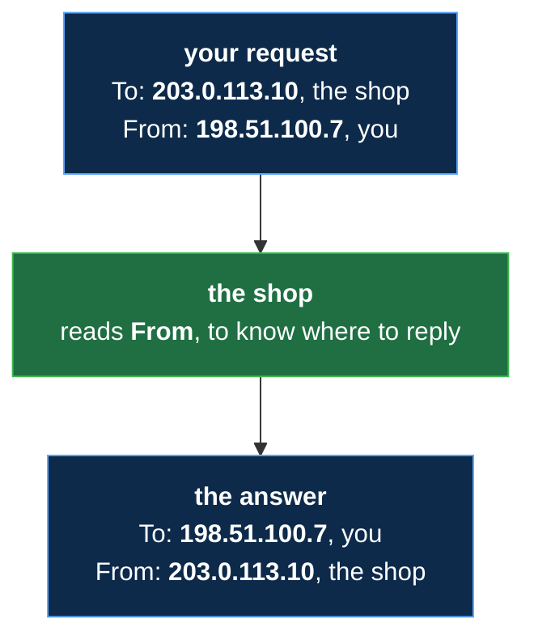
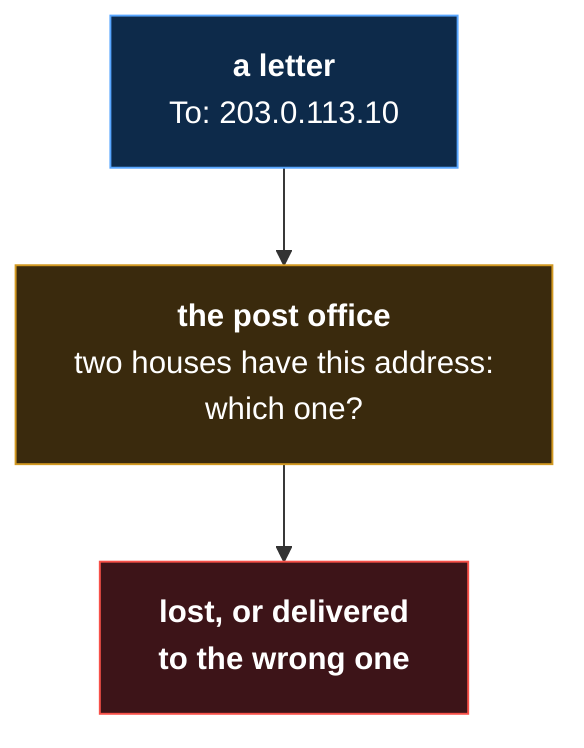

# Addresses for Computers: IP Addresses (How the Internet Works, No Experience Needed)

**Video:** coming soon on the [channel](https://www.youtube.com/@production-devops).

A letter without an address never arrives, and data between computers is no different. This lesson of How the Internet Works, Simply explains the IP address with the postal service: what it is, how to read four numbers with dots, why every envelope carries two addresses, why an address must be unique, and why your own address can change. At the end you will know why we almost never type these numbers. No terminal, nothing to install, no experience needed. Every new word is explained on screen. The challenge and its solution are in the demos repo.

## Files in this folder

- [`challenge-solution.md`](challenge-solution.md) (solution of the challenge: try it yourself first)

## What you need

A Linux shell (a VM, WSL or a container is fine). Everything runs inside this folder.

## The lesson, step by step

The same explanations as the video, with every command. Read it, then run it yourself.

A letter without an address never arrives. Computers have the same problem. At the end: why we almost never type these addresses.

For this lesson you need nothing. Just watch. No terminal and no code. Only pictures. About five minutes.

### The plan

This is lesson two of How the Internet Works, Simply. First, what an IP address is. Then, how to read one. Then, the two addresses on every envelope. And why every address must be unique.

### The address

Remember lesson one. The browser asked: where is shop dot example? The answer was four numbers with dots. Today: what those four numbers are.

- `IP address — A number that says where a computer is on a network (like the street address on an envelope)`: 
New word: IP address. It is a number that says where a computer is on a network. Think of the street address on an envelope.

- `protocol — Rules both sides follow, so they understand each other (like the rules for writing an address on an envelope)`: 
I P stands for Internet Protocol. A protocol is a set of rules both sides follow. Like the rules for writing an address.

### Reading it

Let's read the shop's address. Four numbers, separated by three dots. Each number goes from zero to two hundred and fifty five. No maths needed. Read it like a phone number. You can say it number by number, with dot in between.

**Valid or not?**

Of these three, only the first is valid. The second has only three numbers. The third has three hundred, above the limit.

### Two addresses

- `data — Anything computers store or send: text, pictures, video (like the letter inside the envelope)`: 
New word: data. Data is anything computers store or send: text, pictures, video. Think of the letter inside the envelope.

**Every envelope carries two addresses**

Every envelope carries two addresses: To, and From. The shop reads From, to know where to reply. In the answer, the two swap places.

To is the destination: where the data goes. From is the source: who sent it. Without From, the answer would have nowhere to go.

### So far

So far: an IP address is four numbers, each from zero to two hundred and fifty five. Every envelope carries two addresses, To and From. Next: why addresses must be unique, and why yours can change.

### Unique

**Two houses, one address?**

Imagine two houses with the same address. The post office cannot choose. On the internet, an address must point to one computer only.

Who hands out addresses? Networks do. Nobody picks one at random. Your internet provider, the company that connects your home, gives you one. Inside your home, your router gives one to each device. That is lesson six.

### It can change

Your home's address can change from time to time. Like moving house. A server usually keeps a fixed address, so people can find it. And numbers are hard to remember. That is why we almost never type them. We type names. Lesson three.

### Good to know

Good to know: these are called I P version four addresses. A longer kind, version six, exists too. The addresses in this course are reserved for examples. Real computers never use them. Like a fake phone number in a film.

### Recap

Recap: an IP address says where a computer is, like a street address. It is four numbers, each up to two hundred and fifty five. Every envelope carries two. It must be unique, and yours can change. Your challenge: which of the four addresses on screen are valid? The answer is in the demo repo.

### Where next

Where next? Lesson three: names for people, and the address book. Then lesson four: ports, which program answers.

Next lesson: names for people, D N S. Subscribe so you do not miss it.

## Challenge

Your challenge: which of the four addresses on screen are valid? The answer is in the demo repo.

When you have tried: [`challenge-solution.md`](challenge-solution.md).

---

From the [ProductionDevOps](https://www.youtube.com/@production-devops) channel: real-world DevOps and SRE, explained with real commands.
