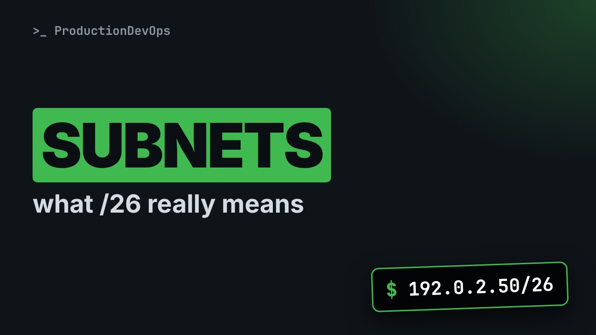
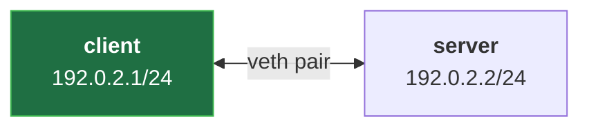
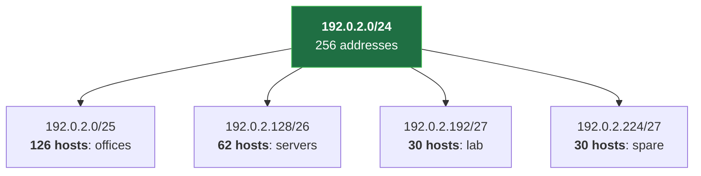
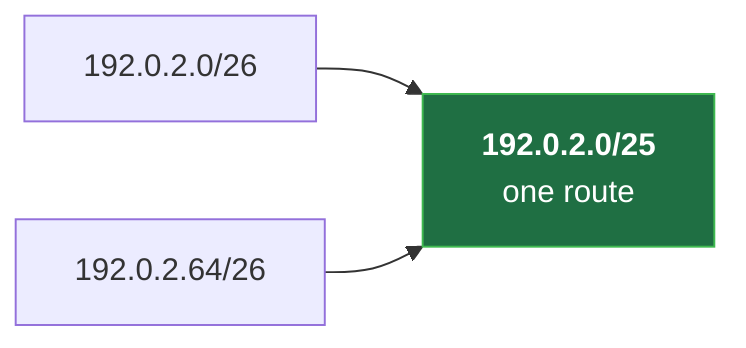

# IPv4 Addresses, Subnets and CIDR Without Fear (Masks, Prefixes, VLSM, Aggregation)



**Video:** https://youtu.be/OQYk657Ft9Q

Two addresses only twenty apart, and yet they cannot talk without a router: the prefix length decides. We read an IPv4 address as 32 bits, go from the old classes to CIDR, turn a /26 into its mask, network, hosts and broadcast, then split a /24 with VLSM and merge two prefixes back into one. Every answer is computed exactly by a 12-line Python script, explained line by line, and checked against a real Linux interface. Scripts and challenge solution in the demos repo.

## Files in this folder

- [`lab/net.sh`](lab/net.sh)
- [`subnet.py`](subnet.py)
- [`challenge-solution.sh`](challenge-solution.sh) (solution of the challenge: try it yourself first)

## What you need

A Linux shell (a VM, WSL or a container is fine). Everything runs inside this folder.

## Before you start

The video runs these commands first, off screen:

```bash
bash lab/net.sh up pair >/dev/null 2>&1
```

## The lesson, step by step

The same explanations as the video, with every command. Read it, then run it yourself.

192.0.2.50 and 192.0.2.70 are only twenty apart. With a slash 26, they cannot talk without a router. By the end, you will see why, and prove it.

### The plan

This is lesson 2 of Networking Fundamentals. An address, as 32 bits. From classes to CIDR: prefixes and masks. A script that computes any subnet. Then split a network, and merge two.

### 32 bits

An IPv4 address is 32 bits. We write it as four numbers, one per byte, with dots.

- `octet 1`: 192 = 11000000
Each byte, or octet, is a number from 0 to 255. The first: 192.

- `octet 4`: 50 = 00110010
The last: 50. In bits, zero zero one one zero zero one zero.

Until 1993, the first bits of an address fixed its network size: the classes. Class A, 16 million hosts. B, 65 thousand. C, 254. Three hundred hosts needed a class B: most addresses wasted. CIDR fixed it: any prefix length, written after a slash.

### The prefix

Slash 26 cuts the 32 bits in two.

- `network part: 26 bits`: 192.0.2 + 00 → network 192.0.2.0
The first 26 bits name the network. Every host on it shares them.

- `host: 6 bits`: 110010 = 50
The last 6 bits number the host: here, 50.

The mask is the same prefix, written as an address.

- `255`: 11111111
Each 255 is eight ones: three of them make 24.

- `192`: 11000000
192 is two more ones, then six zeros. 26 ones in all.

So slash 26 and 255.255.255.192 say the same thing. Host bits all zero: the network itself. All ones: broadcast, every host on it. So 64 addresses, and 62 for hosts.

A quick trick: 256 minus the last mask byte gives the block size. Here, 64. So slash 26 networks start every 64: at 0, 64, 128, and 192. 50 falls in the first block, 70 in the second. We will check it exactly.

### On a real card

**Our lab: two hosts, one /24**



Our lab from lesson 1: two hosts, each with a slash 24. Where does the prefix show up?

On the client's card, ip addr show prints the address with its prefix.

```console
$ ip -n client addr show eth0
```

And from the prefix, the kernel adds a route: the whole slash 24 is right on this cable.

```console
$ ip -n client route
```

### So far

So far: the prefix gives the network bits; the rest number the host. Same network means reachable directly. Next: a script that computes it exactly, and answers our question.

### The script

Twelve lines of Python do the arithmetic for us. Three blocks.

```
#!/usr/bin/env python3
# subnet.py ADDRESS/PREFIX: the network this address belongs to, computed exactly
import ipaddress
import sys

net = ipaddress.ip_interface(sys.argv[1]).network
print("network  ", net)
print("mask     ", net.netmask)
print("first    ", net[1])
print("last     ", net[-2])
print("broadcast", net.broadcast_address)
print("addresses", net.num_addresses)
```

The tools. The network. Its facts.

```
#!/usr/bin/env python3
# subnet.py ADDRESS/PREFIX: the network this address belongs to, computed exactly
import ipaddress
import sys
```

Run with Python 3. The comment says how to call it. ipaddress comes with Python: it knows the address arithmetic. sys gives us the command-line arguments.

```
net = ipaddress.ip_interface(sys.argv[1]).network
```

One line finds the network: take it apart next.

```console
$ net = ipaddress.ip_interface(sys.argv[1]).network
```

- `net =`: store the result in net
net equals: store the result.

- `ipaddress.ip_interface(`: an address with its prefix
ip interface reads an address with its prefix, like a card's setting.

- `sys.argv[1]`: the first argument
sys dot argv one: the first argument we type.

- `).network`: → the network it belongs to
And dot network: the network it belongs to. Host bits set to zero.

```
print("network  ", net)
print("mask     ", net.netmask)
print("first    ", net[1])
print("last     ", net[-2])
print("broadcast", net.broadcast_address)
print("addresses", net.num_addresses)
```

print shows a label, then a value: the network, and its mask. A network is a list of addresses. Index 1 is the first host; minus 2, the last. Then the broadcast, and how many addresses.

The whole script. Now we ask it our question.

```
#!/usr/bin/env python3
# subnet.py ADDRESS/PREFIX: the network this address belongs to, computed exactly
import ipaddress
import sys

net = ipaddress.ip_interface(sys.argv[1]).network
print("network  ", net)
print("mask     ", net.netmask)
print("first    ", net[1])
print("last     ", net[-2])
print("broadcast", net.broadcast_address)
print("addresses", net.num_addresses)
```

### The answer

Which network is 192.0.2.50 in, with a slash 26?

```console
$ python3 subnet.py 192.0.2.50/26
```

And 192.0.2.70?

```console
$ python3 subnet.py 192.0.2.70/26
```

Different networks. To talk, they need a router. With a slash 24, both are in 192.0.2.0.

- `50: the first 24 bits`: 192.0.2
The first 24 bits are the same for both.

- `net`: 00
In 50, the last two network bits are zero zero.

- `net`: 01
In 70, zero one. One bit apart: two networks.

### VLSM

**VLSM: one /24, cut to size**



VLSM, variable length subnet masks: cut one network into pieces of different sizes. Each piece gets the smallest prefix that fits its hosts.

Is 192.0.2.192 slash 27 really thirty hosts? We ask the script.

```console
$ python3 subnet.py 192.0.2.192/27
```

### Aggregation

**Aggregation: two prefixes, one route**



Aggregation is the reverse. Two neighbor slash 26 networks share their first 25 bits, so a router can announce them as one slash 25. Fewer routes, smaller tables.

Does the slash 25 cover both? Hosts from 1 to 126: yes.

```console
$ python3 subnet.py 192.0.2.0/25
```

### Gotchas

192.0.2.50 slash 26 is a host on a network. Tools that want a network will refuse it. Only aligned neighbors merge: 64 plus 128 is not a slash 25. And slash 31 and 32 break the minus two rule: they are for links and single hosts.

### Recap

Recap: 32 bits, a network part, and a host part. The mask is the prefix as ones. Host bits zero, the network; all ones, broadcast. VLSM splits; aggregation merges. Challenge: give our hosts 192.0.2.50 and 192.0.2.70, slash 26. Does ping work? Solution in the demo repo.

Next lesson: special addresses, and IPv6. Subscribe so you do not miss it.

## All the commands, to copy

Run them from inside this folder, in this order (some are expected to fail: that is the point of the demo).

```bash
ip -n client addr show eth0
ip -n client route
net = ipaddress.ip_interface(sys.argv[1]).network
python3 subnet.py 192.0.2.50/26
python3 subnet.py 192.0.2.70/26
python3 subnet.py 192.0.2.192/27
python3 subnet.py 192.0.2.0/25
```

## Challenge

Challenge: give our hosts 192.0.2.50 and 192.0.2.70, slash 26. Does ping work? Solution in the demo repo.

When you have tried: [`challenge-solution.sh`](challenge-solution.sh).

---

From the [ProductionDevOps](https://www.youtube.com/@production-devops) channel: real-world DevOps and SRE, explained with real commands.
