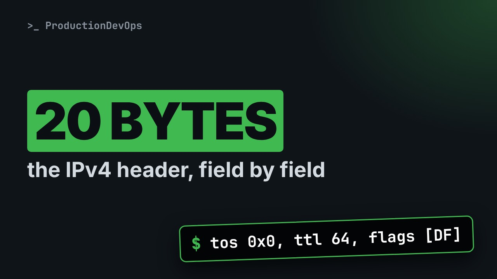
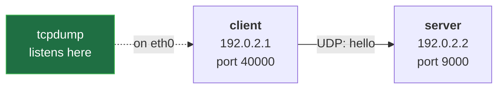

# The IPv4 Header, Field by Field: Version, TTL, Flags, Checksum and Options in a Real Capture



**Video:** coming soon on the [channel](https://www.youtube.com/@production-devops).

Every IPv4 packet starts with the same 20 bytes, and tcpdump -v prints most of them. We capture one UDP message between two Linux network namespaces and read its header field by field, in tcpdump and in raw hex: version and IHL, the DS field with DSCP and ECN, total length, identification, the DF and MF flags, TTL, protocol, the header checksum and the addresses. Then we run it again to prove what the checksum covers, and make the header grow from 20 to 60 bytes with an IP option. Lab script, capture script and challenge solution in the demos repo.

## Files in this folder

- [`header.sh`](header.sh)
- [`lab/net.sh`](lab/net.sh)
- [`challenge-solution.sh`](challenge-solution.sh) (solution of the challenge: try it yourself first)

## What you need

A Linux shell (a VM, WSL or a container is fine). Everything runs inside this folder.

## Before you start

The video runs these commands first, off screen:

```bash
bash lab/net.sh up pair >/dev/null 2>&1
```

## The lesson, step by step

The same explanations as the video, with every command. Read it, then run it yourself.

Every IPv4 packet carries the same 20 bytes in front. Today we capture one packet and read every field. And at the end, we make that header grow to 60 bytes.

### The plan

This is lesson 8 of Networking Fundamentals. The header as a map. One packet, captured and read. Every field, and who uses it. Then options: the header that grows.

### The map

- `row 1 · version · IHL · DS field · total length`: what am I, and how long?
Five rows of 32 bits: 20 bytes. Row one: what packet, how long.

- `row 2 · identification · flags · fragment offset`: the pieces, if split (lesson 21)
Row two: the pieces, if it was split.

- `row 3 · TTL · protocol · header checksum`: lifetime, contents, integrity
Row three: lifetime, contents, and a checksum.

- `row 4 · source address`: who sent it
Then who sent it,

- `row 5 · destination address`: who gets it
who gets it,

- `options · 0 to 40 bytes`: rare
and options, rare.

### The lab

**Our lab: one message, captured on the client**



Our pair from lesson 1. The client sends one UDP message, hello, to the server's port nine thousand. tcpdump listens on the client's card.

### The script

The script is lesson 4's, with one change. Three blocks.

```
#!/usr/bin/env bash
# One UDP message, hello, from client to server: we capture it to read its IPv4 header
bash lab/net.sh reset pair
ip netns exec client tcpdump -n -i eth0 -w ip.pcap -Z root udp 2>/dev/null &
ip netns exec server nc -u -l 9000 >/dev/null &
sleep 1
echo hello | ip netns exec client nc -u -w 1 -p 40000 192.0.2.2 9000
kill %1 %2
wait
echo "capture saved: ip.pcap"
```

A clean lab. A capture, and a server. One message, then cleanup.

```
#!/usr/bin/env bash
# One UDP message, hello, from client to server: we capture it to read its IPv4 header
bash lab/net.sh reset pair
```

Run with bash; the hash line is a comment. reset pair rebuilds the two hosts from scratch.

```
ip netns exec client tcpdump -n -i eth0 -w ip.pcap -Z root udp 2>/dev/null &
ip netns exec server nc -u -l 9000 >/dev/null &
sleep 1
```

tcpdump saves the client's packets to a file, in the background: job one. The server: netcat listens for UDP on port nine thousand. Job two. One second for both to start.

```console
$ ip netns exec client tcpdump -n -i eth0 -w ip.pcap -Z root udp 2>/dev/null &
```

- `ip netns exec client`: run inside the client
Inside the client,

- `-n -i eth0`: numbers only; on eth0
numbers only, on eth0,

- `-w ip.pcap -Z root`: into a file, as root
into a file, as root.

- `udp`: the change: UDP only, no ARP
The change: the filter udp keeps only our message, no ARP.

- `2>/dev/null &`: quiet, in the background
Quietly, in the background.

```
echo hello | ip netns exec client nc -u -w 1 -p 40000 192.0.2.2 9000
kill %1 %2
wait
echo "capture saved: ip.pcap"
```

hello goes through a pipe into netcat, as one UDP message from port forty thousand. Stop both jobs, and wait for them. And say where the packet is.

```console
$ echo hello | ip netns exec client nc -u -w 1 -p 40000 192.0.2.2 9000
```

- `echo hello |`: hello becomes nc's input
echo hello, and the pipe makes it netcat's input.

- `nc -u -w 1`: UDP; wait 1 s, then quit
Dash u: UDP. Dash w one: wait a second, then quit.

- `-p 40000 192.0.2.2 9000`: from port 40000, to the server
From port forty thousand, to the server.

The whole script. One message: one packet to read.

```
#!/usr/bin/env bash
# One UDP message, hello, from client to server: we capture it to read its IPv4 header
bash lab/net.sh reset pair
ip netns exec client tcpdump -n -i eth0 -w ip.pcap -Z root udp 2>/dev/null &
ip netns exec server nc -u -l 9000 >/dev/null &
sleep 1
echo hello | ip netns exec client nc -u -w 1 -p 40000 192.0.2.2 9000
kill %1 %2
wait
echo "capture saved: ip.pcap"
```

### Run it

```console
$ tcpdump -n -t -v -r ip.pcap
```

- `-t`: no timestamps
To read it: dash t, no timestamps.

- `-v`: verbose: print the IP header
The new piece, dash v, verbose: tcpdump prints the IP header fields.

- `-r ip.pcap`: read the saved file
Dash r: read the file.

We run the script.

```console
$ bash header.sh
```

And read it, verbose. The header is the part in parentheses.

```console
$ tcpdump -n -t -v -r ip.pcap
```

Now the raw bytes: dash x prints the packet in hex, starting from the IP header.

```console
$ tcpdump -n -t -x -r ip.pcap
```

The first 20 bytes, up to c000 0202, are the header. The rest is UDP and hello.

### Field by field

Our packet, drawn as the grid. Hex first, then the meaning.

- `version`: 4
The first hex digit: version four. IPv6 starts with six.

- `IHL`: 5
Then IHL, the header length in 4-byte words. Five: 20 bytes.

- `DSCP`: 0
Six bits of DSCP, a traffic class. Zero: best effort.

- `ECN`: 00
Two bits of ECN, for congestion signals: not in use. Together, tcpdump calls them tos.

- `total length`: 34
Total length: 20 of IP, 8 of UDP, 6 of hello. 34.

- `identification`: new every run
Identification ties the pieces of a split packet together.

- `flags`: DF
Flags: DF, do not fragment, is set. MF, more fragments, is not.

- `fragment offset`: 0
The offset: where a piece belongs. Zero: the whole packet.

- `TTL`: 64
TTL, time to live: 64, the Linux default. Each router takes one away.

- `protocol`: 17 = UDP
Protocol 17: UDP. TCP is 6, ICMP is 1.

- `header checksum`: changes with ID
The checksum covers the header only.

- `source address`: 192.0.2.1
The source: c0 00 02 01, the client.

- `destination address`: 192.0.2.2
And the destination: the server.

### DS and ECN

The DS field was once type of service: hence tos. DSCP marks a class: 46 is for voice. With ECN, a busy router marks instead of dropping. Lesson 36.

### So far

So far: three rows of control fields, and two rows of addresses. Next: a proof of what the checksum covers, then the header that grows.

### The checksum

The bytes of our first run, again.

```console
$ tcpdump -n -t -x -r ip.pcap
```

Now a second run, and the same view. Double ampersand: read only if the script worked.

```console
$ bash header.sh && tcpdump -n -t -x -r ip.pcap
```

Compare the two first lines. Bytes five and six changed: a new ID. So bytes eleven and twelve, the checksum, changed too.

Every router lowers the TTL, so every router computes a new checksum. The data is checked end to end, by UDP or TCP.

### Options

Options are rare, but one is easy to see. Ping dash capital R adds record route: each hop writes its address into the header.

```console
$ ip netns exec client ping -c 1 -R 192.0.2.2
```

Look at the first line: 56 bytes of data become 124 on the wire. A plain ping makes 84. And the RR lines: the addresses written on the way there and back.

- `IHL`: 15
IHL is now fifteen: fifteen words of four bytes. Sixty, the maximum.

- `total length`: 124
Total length: 124.

- `options: 40 bytes = 10 more rows`: record route: 9 addresses
And 40 bytes of options: room for only nine addresses. Many routers ignore or drop options, so they are rare today.

### Gotchas

tos is the whole byte: DSCP is only its top six bits. The length in parentheses counts the whole IP packet. And a packet with options may be slowed down, or dropped.

### Recap

Recap: twenty bytes of header. TTL, protocol, a checksum of the header only, the addresses. Options add up to forty bytes, rarely. Challenge: capture a ping with dash capital Q 0xb8. What are DSCP and ECN? Solution in the demo repo.

Next lesson: forwarding and routing tables. Subscribe so you do not miss it.

## All the commands, to copy

Run them from inside this folder, in this order (some are expected to fail: that is the point of the demo).

```bash
ip netns exec client tcpdump -n -i eth0 -w ip.pcap -Z root udp 2>/dev/null &
echo hello | ip netns exec client nc -u -w 1 -p 40000 192.0.2.2 9000
tcpdump -n -t -v -r ip.pcap
bash header.sh
tcpdump -n -t -x -r ip.pcap
bash header.sh && tcpdump -n -t -x -r ip.pcap
ip netns exec client ping -c 1 -R 192.0.2.2
```

## Challenge

Challenge: capture a ping with dash capital Q 0xb8. What are DSCP and ECN? Solution in the demo repo.

When you have tried: [`challenge-solution.sh`](challenge-solution.sh).

---

From the [ProductionDevOps](https://www.youtube.com/@production-devops) channel: real-world DevOps and SRE, explained with real commands.
