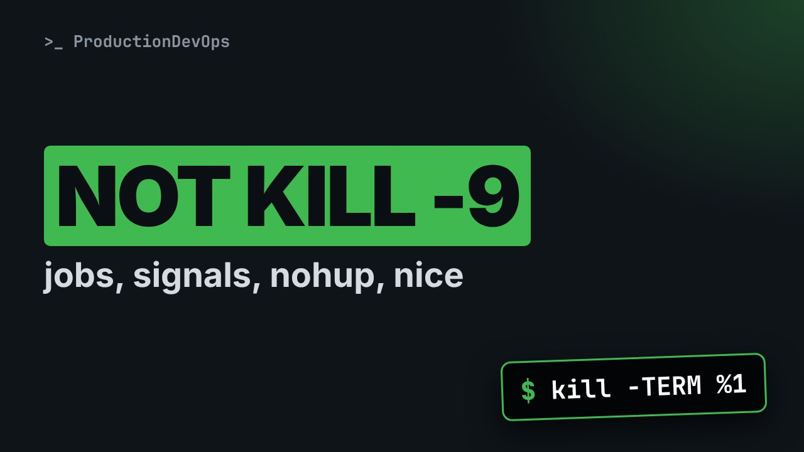
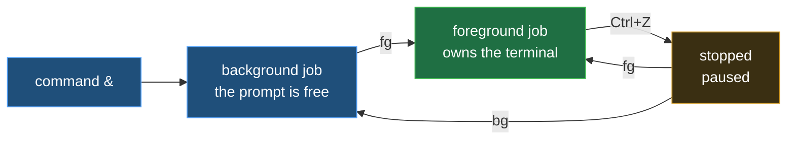
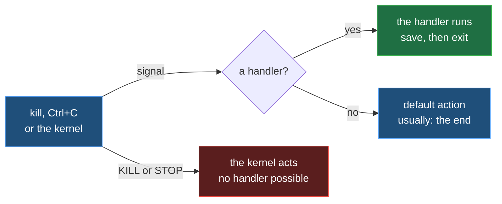
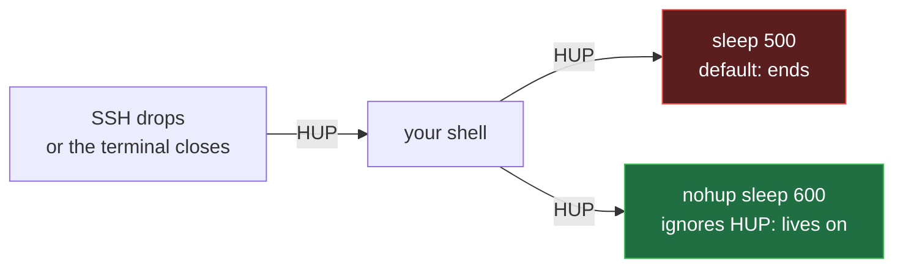

# Jobs, Signals and Priorities: fg, bg, kill, nohup, nice and renice



**Video:** coming soon on the [channel](https://www.youtube.com/@production-devops).

You start a long task over SSH, the connection drops, and the task dies. Why? A signal. In lesson 13 we prove, live: background jobs with &, jobs, fg and bg, what Ctrl+C and Ctrl+Z really send, kill and the signal list, TERM that lets a program clean up vs KILL that does not, the HUP that ends your jobs when the terminal closes and how nohup survives it, then nice and renice, and cgroups in brief. Up to date for RHEL/AlmaLinux 9 and Ubuntu 24.04. Lesson 13 of Linux from User to Server Admin.

## Files in this folder

- [`acme-worker.sh`](acme-worker.sh)
- [`worker.log`](worker.log)
- [`challenge-solution.sh`](challenge-solution.sh) (solution of the challenge: try it yourself first)

## What you need

A Linux shell (a VM, WSL or a container is fine). Everything runs inside this folder.

## Before you start

The video runs these commands first, off screen:

```bash
set -m
trap 'kill $(jobs -p) 2>/dev/null' EXIT
```

## The lesson, step by step

The same explanations as the video, with every command. Read it, then run it yourself.

You start a long task over SSH, the connection drops, and the task dies: a signal killed it. By the end, you will know which one, and the one word that protects your task.

### The plan

This is lesson 13 of Linux from User to Server Admin. First, jobs, in front and behind. Then signals, and what kill really sends. Then priorities.

### Jobs

**Foreground, background, stopped**



A job is a command started from your shell: in the foreground, it owns the terminal until it ends. An ampersand starts it in the background, and you get the prompt back. Control Z pauses a foreground job; b g resumes it behind, f g in front.

sleep three hundred, with an ampersand: the job number in brackets, then the PID.

```console
$ sleep 300 &
```

jobs lists the jobs of this shell. The plus marks the current one.

```console
$ jobs
```

Control Z sends the signal TSTP to the foreground job. Our job is in the background, so kill sends it. Percent one means job one.

```console
$ kill -TSTP %1
```

Job one is stopped: paused, using no CPU.

```console
$ jobs
```

b g resumes it, in the background.

```console
$ bg %1
```

A short job, eight seconds, in the background.

```console
$ sleep 8 &
```

f g brings the current job to the foreground. It owns the terminal now, and the prompt comes back when it ends.

```console
$ fg
```

### Signals

**How a signal is delivered**



A signal is a short message to a process, delivered by the kernel. If the process has a handler, it runs; if not, the default action, usually the end. KILL and STOP can never be handled.

Each signal has a name and a number. HUP, one: the terminal closed. INT, two, is Control C. TSTP is Control Z. TERM, fifteen: please end. kill sends it by default. KILL, nine: end now. STOP and CONT pause and resume.

A small worker, whole: it handles one signal.

```
#!/bin/bash
# acme-worker.sh: works until it is told to stop
trap 'echo "TERM received: saving state, bye"; exit 0' TERM
echo "worker started"
while true
do
  sleep 1
done
```

bash runs it, and it must stop cleanly. trap sets a handler: when TERM arrives, run this. Piece by piece next. Then it says it started, and loops forever.

```console
$ trap 'echo "TERM received: saving state, bye"; exit 0' TERM
```

- `trap`: set a signal handler
trap sets a handler, in bash. Lesson 17 goes deeper.

- `'echo "TERM received: saving state, bye";`: first: say goodbye
In single quotes, what to run: a goodbye. A real program saves its work here.

- `exit 0'`: then end, with success
Then exit zero: end, with success.

- `TERM`: for this signal
And the signal it handles: TERM.

Start the worker in the background, its messages into worker dot log.

```console
$ ./acme-worker.sh > worker.log &
```

kill, with no signal named, sends TERM. Dollar exclamation mark is the PID of the last background job.

```console
$ kill $!
```

The log shows the goodbye: the handler ran. The shell reports the job Done.

```console
$ cat worker.log
```

Again, but with KILL, signal nine.

```console
$ ./acme-worker.sh > worker.log &
```

Dash KILL. The kernel ends it at once.

```console
$ kill -KILL $!
```

Only the first line: no goodbye, no saved state. The shell says Killed.

```console
$ cat worker.log
```

Let's take stock. Jobs start with an ampersand, and move with f g and b g. TERM lets a program clean up. KILL never does. Next: the signal that killed our task over SSH.

### HUP and nohup

**The terminal closes: HUP**



When SSH drops, your shell receives HUP, hang up, and passes it on to its jobs. By default, HUP ends a program: that is what killed the task. A command started with nohup ignores it.

An ordinary job, and the signal a dropped connection sends: HUP.

```console
$ sleep 500 &
```

We send HUP ourselves.

```console
$ kill -HUP $!
```

jobs reports it: Hangup. The job is gone.

```console
$ jobs
```

Now with nohup. Its output goes to a file, because the terminal may be gone.

```console
$ nohup sleep 600 > nohup.log 2>&1 &
```

The same HUP.

```console
$ kill -HUP $!
```

Still running: nohup is the one word that protects your task.

```console
$ jobs
```

### Priorities

On a busy CPU, the nice value decides who gets more. From minus twenty, first in line, to nineteen, last. The default is zero. Anyone can raise it, only root can lower it. ps shows it, in the N I column.

nice dash n ten starts a command with nice value ten.

```console
$ nice -n 10 sleep 700 &
```

The NI column shows ten, and the N in STAT means low priority.

```console
$ ps -o pid,ni,stat,cmd -p $!
```

renice changes it while it runs: from ten to fifteen.

```console
$ renice -n 15 -p $!
```

Can a normal user go below zero? We try as dev1: permission denied.

```console
$ su dev1 -c 'nice -n -5 true'
```

nice only shares the CPU. A cgroup sets hard limits. A cgroup is a group of processes with limits, like memory dot max. systemd gives every service its own cgroup. Containers are namespaces plus cgroups: see lesson 56.

### Gotchas

Three traps to remember. One. TERM first, then KILL: dash nine skips every cleanup. Two. Kill percent one is job one. Kill one is PID one. Three. For real long tasks: tmux, or a service.

### Recap

Let's recap. Jobs move between front and back, and two keys send signals. kill sends TERM, and KILL cannot be handled. HUP comes when the terminal closes; nohup ignores it. Your challenge: pause a job with STOP, prove it with ps, resume it with CONT. The solution is in the demo repository.

Now you can move jobs, send the right signal, and keep a task alive. Next lesson: writing shell scripts, from the first line to the exit code. Subscribe to follow the course.

## All the commands, to copy

Run them from inside this folder, in this order (some are expected to fail: that is the point of the demo).

```bash
sleep 300 &
jobs
kill -TSTP %1
bg %1
sleep 8 &
fg
trap 'echo "TERM received: saving state, bye"; exit 0' TERM
./acme-worker.sh > worker.log &
kill $!
cat worker.log
kill -KILL $!
sleep 500 &
kill -HUP $!
nohup sleep 600 > nohup.log 2>&1 &
nice -n 10 sleep 700 &
ps -o pid,ni,stat,cmd -p $!
renice -n 15 -p $!
su dev1 -c 'nice -n -5 true'
```

## Challenge

Your challenge: pause a job with STOP, prove it with ps, resume it with CONT. The solution is in the demo repository.

When you have tried: [`challenge-solution.sh`](challenge-solution.sh).

---

From the [ProductionDevOps](https://www.youtube.com/@production-devops) channel: real-world DevOps and SRE, explained with real commands.
