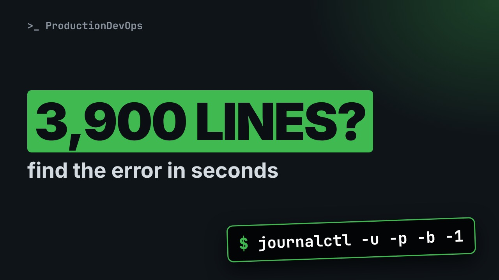
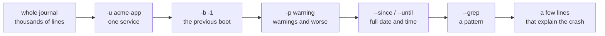
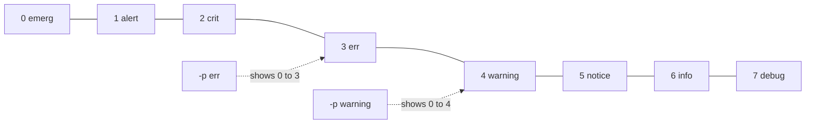

# journalctl Filters: Find the Error in Seconds, Not Minutes



**Video:** coming soon on the [channel](https://www.youtube.com/@production-devops).

An app crashed at night and journalctl prints thousands of lines. Five filters cut them down to the few lines that explain the crash: unit, priority, boot, time window and pattern. Then the journal fields behind every line, and one triage command that combines everything. All on a real journal with two boots and a crash before a reboot.

## Files in this folder

- [`make-journal.py`](make-journal.py)
- [`challenge-solution.sh`](challenge-solution.sh) (solution of the challenge: try it yourself first)

## What you need

A Linux shell (a VM, WSL or a container is fine). Everything runs inside this folder.

## Before you start

The video runs these commands first, off screen:

```bash
[ -s journal/lab.journal ] || { mkdir -p journal && python3 make-journal.py > lab.export && /lib/systemd/systemd-journal-remote --output=journal/lab.journal lab.export >/dev/null 2>&1; rm -f lab.export; }
export TT_JOURNAL="$PWD/journal"; journalctl() { command journalctl -D "$TT_JOURNAL" "$@"; }
```

## The big picture

Five filters, each one cutting the journal down, from thousands of lines to the few that explain the crash.



Priority levels: -p err keeps err and everything more severe, so the warnings that explain an error are hidden.



## The lesson, step by step

The same explanations as the video, with every command. Read it, then run it yourself.

Last night a service crashed and the server was rebooted. You open the journal, and it has thousands of lines. The few lines that explain the crash are in there. Five filters find them in seconds.

### The plan

This is part three of the Linux logging series. Here is the plan. First, our lab journal: two boots, and one crash before a reboot. Then five filters, one at a time: unit, priority, boot, time, and pattern. Then the fields behind every journal line, and how to filter on any of them. And finally one triage command that combines everything, plus three traps.

### The haystack

Our lab server is node zero one. It runs a web front end and an app called acme app. How many lines are in its journal?

```console
$ journalctl | wc -l
```

Almost four thousand, and this is a small server. Dash dash list boots shows the boots the journal remembers.

```console
$ journalctl --list-boots
```

Two boots. Index zero is the current one. Index minus one ended at two nineteen, when the server was rebooted.

### Filter 1: the unit

Dash u keeps only the lines of one systemd unit. Here, the acme app service.

```console
$ journalctl -u acme-app | wc -l
```

Still almost a thousand lines. The app logs every batch it processes. We need a second filter.

### Filter 2: priority

Every journal line has a priority, from zero, the most severe, to seven. Zero is emergency, then alert, critical, and three is error. Four is warning, then notice, info, and seven is debug. Dash p err shows error, and everything more severe: critical, alert, and emergency too.

Dash u acme app, dash p err.

```console
$ journalctl -u acme-app -p err
```

Five errors instead of a thousand lines. The out of memory line is critical, so dash p err shows it too. And the line with two dashes marks where a new boot starts.

### Filter 3: the boot

Dash b alone means the current boot.

```console
$ journalctl -u acme-app -b -p err
```

Only one error since the reboot. The crash is in the previous boot: dash b minus one.

```console
$ journalctl -u acme-app -b -1 -p err
```

### Filter 4: time

Errors alone hide the warnings that came first. So we drop dash p, and look at the five minutes before the crash.

```console
$ journalctl -u acme-app -b -1 --since "2026-10-20 02:10" --until "2026-10-20 02:15"
```

Now the story is clear. The connection pool filled up, requests timed out, the app ran out of memory, and systemd reports it was killed. The last two lines come from systemd itself. Dash u shows them too, because they are about this unit.

### Filter 5: pattern

Dash dash grep searches only the message, and keeps every other filter.

```console
$ journalctl -u acme-app -b -1 --grep timeout
```

A lowercase pattern is case insensitive. And unlike a pipe to grep, the output keeps the journal format and its options.

### Fields

Every journal line is a set of fields. Dash capital F lists all the values of one field. Here, every unit in the journal.

```console
$ journalctl -F _SYSTEMD_UNIT
```

Any field can be a filter: write it as name equals value. Two fields together must both match. Dash o cat prints the message only.

```console
$ journalctl _SYSTEMD_UNIT=acme-app.service _PID=2187 -p err -o cat
```

Every error of process two one eight seven, the run that crashed, with nothing but the messages.

### One triage command

```console
$ journalctl -u acme-app -b -1 -p warning --since "2026-10-20 02:00" -o short-iso
```

When a service crashed overnight, this is the command to start with. Left to right.

- `-u acme-app`: one service
Dash u: only the service that crashed.

- `-b -1`: the previous boot
Dash b minus one: the boot before the reboot, where the crash happened.

- `-p warning`: warnings and worse
Dash p warning, not err. The warnings usually explain the error that follows.

- `--since "2026-10-20 02:00"`: full date and time
Dash dash since, with the full date. A bare time would mean today.

- `-o short-iso`: year and time zone
Dash o short iso prints the year and the time zone, so the times are never ambiguous.

Let's run it.

```console
$ journalctl -u acme-app -b -1 -p warning --since "2026-10-20 02:00" -o short-iso
```

Only the lines that matter, from the first warning to the kill, with dates you can paste into an incident report.

### Gotchas

Three traps that waste time during an incident. Dash dash since with only a time means today. For last night's crash, you get nothing. Always write the date. Dash p err hides warnings. Start with dash p warning, then narrow down. In scripts, add dash dash no pager. And remember that times follow the server's time zone.

### Recap

Let's recap. Five filters: dash u for the unit, dash p for the priority, dash b for the boot, since and until for time, and grep for a pattern. Dash capital F lists the values of a field. Field equals value filters on it. Dash o cat for messages only. Dash o short iso for full timestamps. Your challenge: show, message only, every warning or worse that acme web logged in the previous boot after two in the morning. The solution is in the demo repository.

Filter by unit, priority, boot and time, then read the few lines that are left. Subscribe for the next episodes of the Linux logging series.

## All the commands, to copy

Run them from inside this folder, in this order (some are expected to fail: that is the point of the demo).

```bash
journalctl | wc -l
journalctl --list-boots
journalctl -u acme-app | wc -l
journalctl -u acme-app -p err
journalctl -u acme-app -b -p err
journalctl -u acme-app -b -1 -p err
journalctl -u acme-app -b -1 --since "2026-10-20 02:10" --until "2026-10-20 02:15"
journalctl -u acme-app -b -1 --grep timeout
journalctl -F _SYSTEMD_UNIT
journalctl _SYSTEMD_UNIT=acme-app.service _PID=2187 -p err -o cat
journalctl -u acme-app -b -1 -p warning --since "2026-10-20 02:00" -o short-iso
```

## Challenge

Your challenge: show, message only, every warning or worse that acme web logged in the previous boot after two in the morning. The solution is in the demo repository.

When you have tried: [`challenge-solution.sh`](challenge-solution.sh).

---

From the [ProductionDevOps](https://www.youtube.com/@production-devops) channel: real-world DevOps and SRE, explained with real commands.
