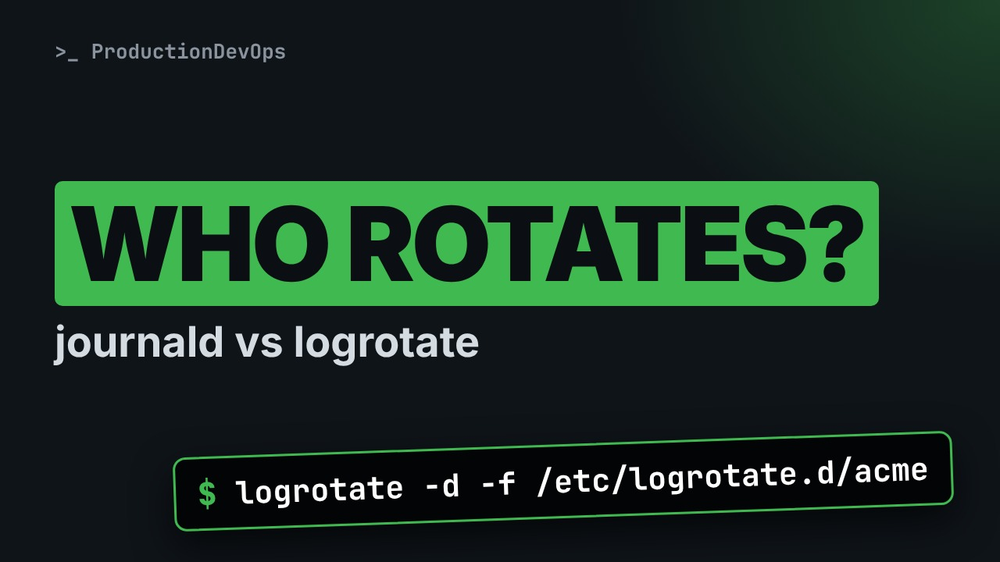
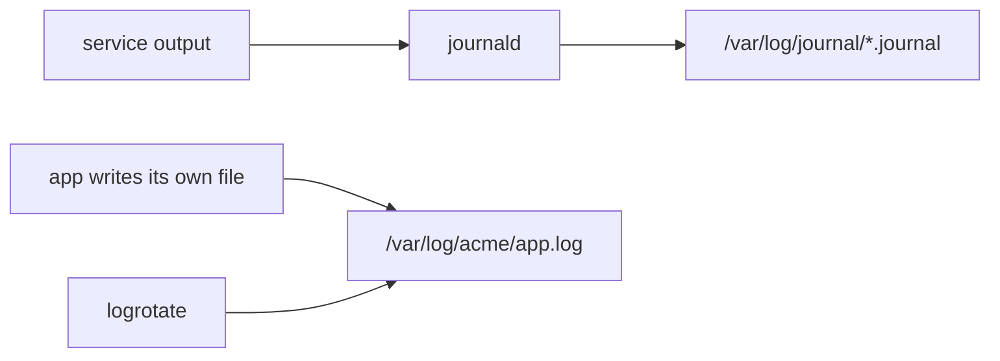

# journald vs logrotate: Who Rotates Which Logs on Linux?



**Video:** https://youtu.be/8wSTzmsd_jA

Modern Linux boxes have two log systems: the systemd journal and the classic text files in /var/log. They rotate in completely different ways, and mixing them up leads to full disks, empty log files and broken journals. We look at what each one owns, dry-run real logrotate rules, and fix the two mistakes we see most often.

## What you need

A Linux shell (a VM, WSL or a container is fine). Everything runs inside this folder.

The outputs below were captured for real on the lab cluster. On yours, names, ages, IPs and ports will differ; everything else should match.

## The lesson, step by step

The same explanations as the video, with every command and its real output. Read it, then run it yourself.

On a modern Linux server, two different systems keep your logs under control. They do not know about each other. When you mix up who owns what, you get full disks, or empty log files. Let's sort it out.

### The plan

Here is the plan. First, what log rotation is, in one minute. Then the two systems, and which logs each one owns. We look at both of them on a server. And we see two classic mistakes, each shown on screen.

### Log rotation in one minute

Why do we need log rotation? Logs only grow. Left alone, they fill the disk, and a full disk can stop a whole server. Rotation means: regularly start a new log file, keep a few old ones, often compressed. And delete the oldest ones, so the space used stays under control.

### Two systems

On a modern Linux server, two systems do this job. journald, the systemd journal. It collects what services print, and stores it in binary files, under slash var slash log slash journal. journald rotates and deletes its own files, by itself, using its own settings in journald dot conf. logrotate handles plain text files, like the log files an application writes in its own folder. Its rules live in slash etc slash logrotate dot d. The golden rule: every log file has exactly one owner. Problems start when a file has two owners, or none.

**Who owns what**



Two separate paths. On the top, service output goes to journald, which manages the journal files. On the bottom, an application writes its own text file, and logrotate rotates it. The two paths never cross.

### journald on a server

Let's look at a server. First, how much space is the journal using?

```console
$ journalctl --disk-usage
Archived and active journals take up 1.2G in the file system.
```

Which limits apply? This command prints the journald settings really in use, and grep keeps only the size ones.

```console
$ systemd-analyze cat-config systemd/journald.conf | grep -E '^#?(SystemMaxUse|SystemKeepFree|MaxFileSec)='
#SystemMaxUse=
#SystemKeepFree=
#MaxFileSec=1month
```

Every line starts with a hash, so it is commented out, and the defaults apply. Here is the surprise: the default size limit is not a fixed number. It is ten percent of the disk, up to four gigabytes.

### logrotate on a server

Now logrotate. Each file in this folder is a rule.

```console
$ ls /etc/logrotate.d
acme  btmp  chrony  dnf  firewalld  wtmp
```

This is the rule for our application, acme.

```console
$ cat /etc/logrotate.d/acme
/var/log/acme/*.log {
    daily
    rotate 7
    compress
    copytruncate
}
```

The first line says which files: every dot log file in the acme folder. Inside the braces: rotate every day, keep seven old files, compress them, and copy truncate, which we will explain in a minute.

Never trust a rule until you test it. Dash d is debug mode: logrotate only explains what it would do. Dash f forces the rotation, even if the files are not due yet. grep keeps the important lines.

```console
$ logrotate -d -f /etc/logrotate.d/acme 2>&1 | grep -E 'considering|copying|truncating'
considering log /var/log/acme/app.log
considering log /var/log/acme/worker.log
copying /var/log/acme/app.log to /var/log/acme/app.log.1
truncating /var/log/acme/app.log
copying /var/log/acme/worker.log to /var/log/acme/worker.log.1
truncating /var/log/acme/worker.log
```

It would touch exactly the two text files of our app, and nothing from the journal. A healthy setup.

### Mistake 1: a rule for the journal

```
/var/log/journal/*/*.journal {
    daily
    rotate 7
    compress
}
```

Now the first classic mistake. The journal is filling the disk, so someone writes a logrotate rule for the journal files. Rotate daily, keep seven, compress. It looks reasonable. Let's test it.

Same dry run as before.

```console
$ logrotate -d -f /etc/logrotate.d/journal 2>&1 | grep -E 'renaming|compressing'
renaming /var/log/journal/4d6f0a5b7c1e4e2f9a8b3c7d1e0f2a6b/system.journal to /var/log/journal/4d6f0a5b7c1e4e2f9a8b3c7d1e0f2a6b/system.journal.1
compressing log with: /bin/gzip
renaming /var/log/journal/4d6f0a5b7c1e4e2f9a8b3c7d1e0f2a6b/user-1000.journal to /var/log/journal/4d6f0a5b7c1e4e2f9a8b3c7d1e0f2a6b/user-1000.journal.1
compressing log with: /bin/gzip
```

logrotate would rename the journal files that journald is using right now, and then compress them. journald does not know. It keeps writing into the renamed file. And the renamed, compressed copies are no longer seen by journald's own clean up. So the space is not controlled anymore. The right fix is a size limit in journald itself. We do exactly that in the next video of this series.

### Mistake 2: the app keeps writing

```
/var/log/acme/*.log {
    daily
    rotate 7
    compress
    copytruncate
}
```

The second mistake is the opposite one: a logrotate rule that forgets the application. By default, logrotate renames app dot log to app dot log dot one, and creates a new, empty app dot log. But the application opened the file when it started, and it keeps it open. So it keeps writing into the renamed file. The new app dot log stays empty, and the old one keeps growing. Fix one: copy truncate. logrotate copies the file, and then empties the original. The app keeps writing to the same file. It is simple, but a few lines written during the copy can be lost. Fix two, the cleaner one: a post rotate script, that tells the application to reopen its log file. Many programs do it when they receive a hang up signal. Use it when your application supports it.

### Recap

Let's recap with four checks. One. Check the journal size with journalctl dash dash disk usage, and set its limits in journald, never with logrotate. Two. One logrotate rule per application, matching only that application's files. Three. Test every rule with dash d and dash f before it goes to production. Four. Every rule for a running application needs copy truncate, or a post rotate script. Never neither.

journald for the journal, logrotate for text files, and one owner for every file. In the next video of this series, we make sure the journal survives a reboot. Subscribe so you do not miss it.

## All the commands, to copy

Run them from inside this folder, in this order.

```bash
journalctl --disk-usage
systemd-analyze cat-config systemd/journald.conf | grep -E '^#?(SystemMaxUse|SystemKeepFree|MaxFileSec)='
ls /etc/logrotate.d
cat /etc/logrotate.d/acme
logrotate -d -f /etc/logrotate.d/acme 2>&1 | grep -E 'considering|copying|truncating'
logrotate -d -f /etc/logrotate.d/journal 2>&1 | grep -E 'renaming|compressing'
```

---

From the [ProductionDevOps](https://www.youtube.com/@production-devops) channel: real-world DevOps and SRE, explained with real commands.
