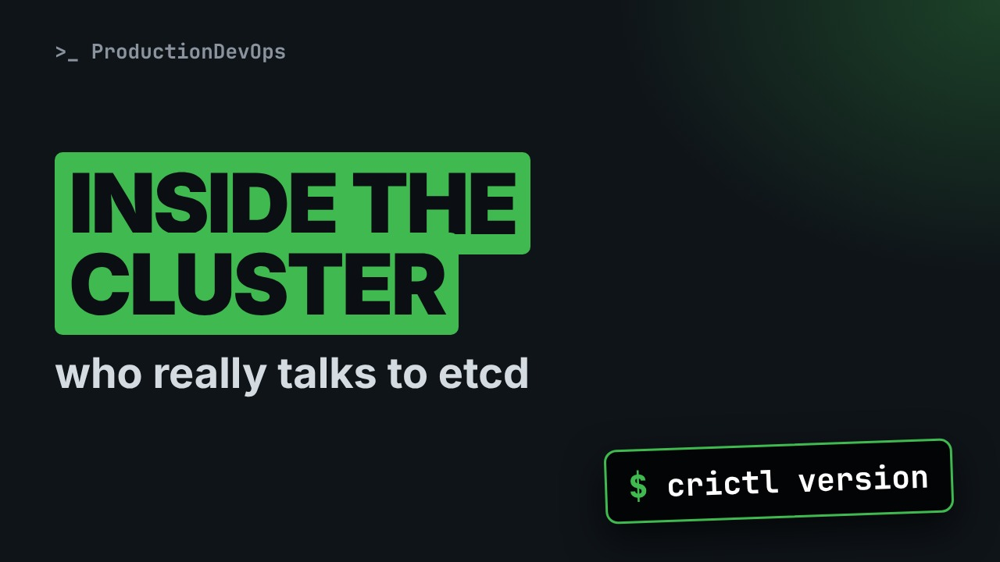
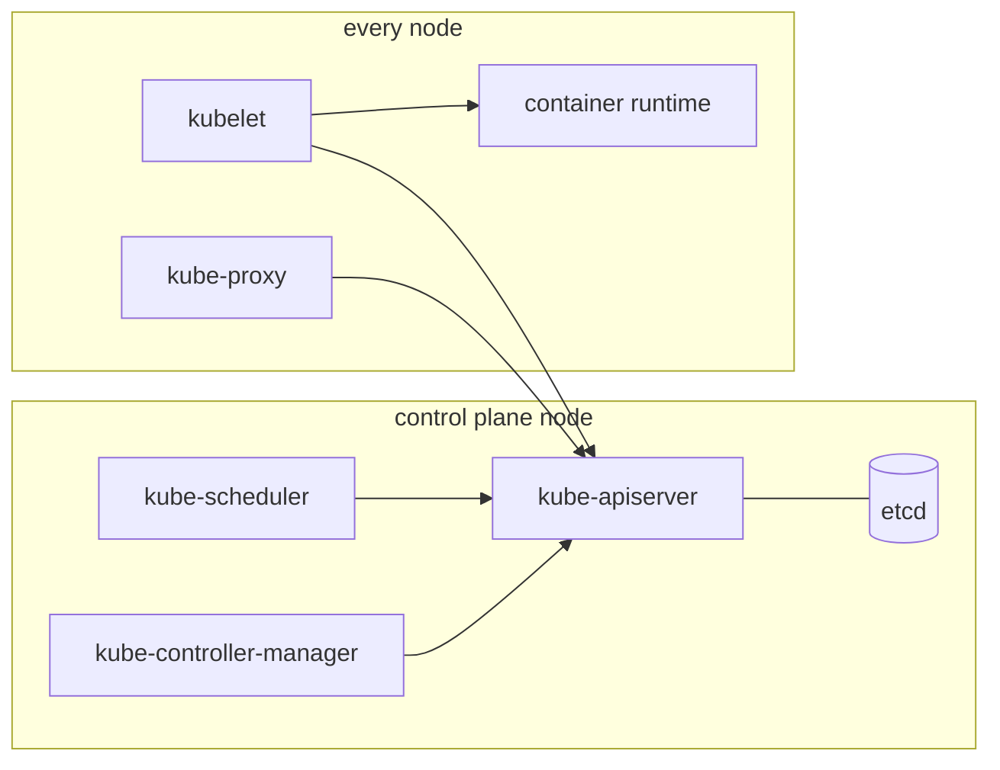
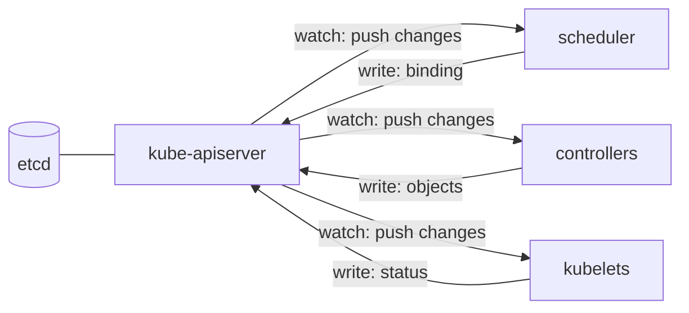

# Kubernetes Architecture Under the Hood: Who Really Talks to etcd



**Video:** https://youtu.be/SUaWFr5oXSE

Lesson one of Kubernetes Deep Dive. We open a real three-node cluster and look at every component: the API server, etcd, the scheduler and the controller manager on the control plane, and the kubelet, kube-proxy and the container runtime on each node. We prove that only the API server talks to etcd, watch the API server push events, and see the CRI, CNI and storage plugins for real.

## Files in this folder

- [`challenge-solution.sh`](challenge-solution.sh) (solution of the challenge: try it yourself first)

## What you need

A Kubernetes cluster you can break: a local [kind](https://kind.sigs.k8s.io/) cluster with one control plane and two workers is what the video uses, plus `kubectl`. Never run these commands against a cluster that matters.

The outputs below were captured for real on the lab cluster. On yours, names, ages, IPs and ports will differ; everything else should match.

## The lesson, step by step

The same explanations as the video, with every command and its real output. Read it, then run it yourself.

When a cluster misbehaves, the question is always the same: which component is responsible? To answer it fast, you need a clear map of who does what, and who talks to whom.

### The plan

This is lesson one of Kubernetes Deep Dive. Here is the plan. First, the control plane: four components and one database. We prove that only the API server talks to etcd, and that everyone else watches the API server. Then the node: the kubelet, kube-proxy and the container runtime. And the three plug-in points: the runtime interface, the network plugin, and storage.

### The map

**The map of a cluster**



On the left, the control plane: the API server, etcd behind it, the scheduler and the controller manager. On the right, what runs on every node: the kubelet, kube-proxy and the container runtime. Every arrow points to the API server. That is the most important fact of this lesson.

### Our lab

Our lab is a local cluster made with kind: three nodes, each one a container on this machine.

```console
$ kubectl get nodes
NAME                STATUS   ROLES           AGE   VERSION
lab-control-plane   Ready    control-plane   90m   v1.37.0
lab-worker          Ready    <none>          89m   v1.37.0
lab-worker2         Ready    <none>          89m   v1.37.0
```

Look at the roles column. Old documents say master. Since version one twenty four the name is control plane, for labels and taints too.

All system components live in the kube-system namespace. We print each Pod and its node, sorted by node.

```console
$ kubectl get pods -n kube-system -o custom-columns=NAME:.metadata.name,NODE:.spec.nodeName --sort-by=.spec.nodeName
NAME                                        NODE
coredns-559f6c778d-crffz                    lab-control-plane
coredns-559f6c778d-pxldj                    lab-control-plane
etcd-lab-control-plane                      lab-control-plane
kindnet-krg2z                               lab-control-plane
kube-apiserver-lab-control-plane            lab-control-plane
kube-controller-manager-lab-control-plane   lab-control-plane
kube-proxy-qvjcc                            lab-control-plane
kube-scheduler-lab-control-plane            lab-control-plane
kindnet-9nn9q                               lab-worker
kube-proxy-gvlxm                            lab-worker
kindnet-s2l4v                               lab-worker2
kube-proxy-f987s                            lab-worker2
```

etcd, the API server, the scheduler and the controller manager run only on the control plane node. kube-proxy and kindnet, the network plugin, have one copy on every node. CoreDNS answers name lookups for the whole cluster.

### Control plane

Each control plane component has exactly one job. The API server is the only door. It authenticates, authorizes and validates every request. etcd is a key-value database. It holds the whole state of the cluster, and nothing else. The scheduler watches for Pods without a node, and picks one for each. The controller manager runs control loops. Each one compares what you asked for with what exists, and fixes the difference.

But who starts the control plane, if the API server is not running yet? The kubelet, from files in this folder.

```console
$ docker exec lab-control-plane ls /etc/kubernetes/manifests
etcd.yaml
kube-apiserver.yaml
kube-controller-manager.yaml
kube-scheduler.yaml
```

These are static Pods. The kubelet reads the files directly, and creates a read-only copy in the API, called a mirror Pod. Its config source annotation says file.

```console
$ kubectl get pod kube-apiserver-lab-control-plane -n kube-system -o jsonpath='{.metadata.annotations.kubernetes\.io/config\.source}{"\n"}'
file
```

So to change a control plane flag, you edit the file on the node. The kubelet restarts the Pod by itself.

### Only one talks to etcd

Here is the proof. We search every manifest for the etcd servers flag. Grep dash l prints only the names of the files that contain it.

```console
$ docker exec lab-control-plane sh -c 'grep -l etcd-servers /etc/kubernetes/manifests/*.yaml'
/etc/kubernetes/manifests/kube-apiserver.yaml
```

And this is the flag itself: the API server reaches etcd on the same node, over TLS.

```console
$ docker exec lab-control-plane grep -- --etcd-servers /etc/kubernetes/manifests/kube-apiserver.yaml
    - --etcd-servers=https://127.0.0.1:2379
```

The scheduler has a kubeconfig file instead. Its server line points to the API server, on port six four four three.

```console
$ docker exec lab-control-plane grep server: /etc/kubernetes/scheduler.conf
    server: https://192.0.2.10:6443
```

**The watch model**



Components do not poll. Each one opens a watch on the API server, and the API server pushes every change as it happens. When a component acts, it writes back through the API server, which stores the result in etcd and pushes it to the next watcher.

kubectl can open the same kind of watch. Dash dash watch keeps the connection open, and output watch events labels each change. Timeout stops it after twenty seconds.

```console
$ timeout 20 kubectl get pods -n arch-demo --watch --output-watch-events
EVENT      NAME      READY   STATUS    RESTARTS   AGE
ADDED      watched   0/1     Pending   0          0s
MODIFIED   watched   0/1     Pending   0          1s
MODIFIED   watched   0/1     ContainerCreating   0          1s
MODIFIED   watched   0/1     ContainerCreating   0          3s
MODIFIED   watched   1/1     Running             0          8s
MODIFIED   watched   0/1     Completed           0          12s
MODIFIED   watched   0/1     Completed           0          13s
```

First an added event, then a series of modified events. Each line is the API server pushing a change: the scheduler's binding, then the kubelet's status updates. This is the chain we followed step by step in part three of the Kubernetes Path, seen from the watcher's side.

### Controllers

The controller manager is one process with many control loops inside. This flag says which ones run. The star means all the default controllers.

```console
$ docker exec lab-control-plane grep -- --controllers /etc/kubernetes/manifests/kube-controller-manager.yaml
    - --controllers=*,bootstrapsigner,tokencleaner
```

Deployments, ReplicaSets, nodes, endpoints, service accounts, jobs: each one has its own loop in that process. With several control planes, only one scheduler and one controller manager may act at a time. They hold a lease, a lock stored in the API.

```console
$ kubectl get leases -n kube-system -o custom-columns=LEASE:.metadata.name,HOLDER:.spec.holderIdentity | grep -E 'LEASE|kube-'
LEASE                                  HOLDER
kube-controller-manager                lab-control-plane_2b7af395-7d63-41ff-9fc6-60872d751730
kube-scheduler                         lab-control-plane_35524829-49fd-4cbb-b03c-387c09a51d10
```

In a cloud, a third controller process joins them: the cloud controller manager. It creates load balancers and routes. kind has none.

### The node

Now the other side of the map: every node, control plane included. The kubelet is a normal system service, not a Pod. It runs the Pods assigned to its node and reports their status. kube-proxy runs as a DaemonSet. It turns Services into network rules on each node. The container runtime, here containerd, actually starts containers. The kubelet drives it through the container runtime interface, CRI.

Inside a worker node, we ask systemd about two services: the kubelet and containerd.

```console
$ docker exec lab-worker systemctl is-active kubelet containerd
active
active
```

And the DaemonSets: one Pod per node for kube-proxy and for the network plugin.

```console
$ kubectl get daemonsets -n kube-system
NAME         DESIRED   CURRENT   READY   UP-TO-DATE   AVAILABLE   NODE SELECTOR            AGE
kindnet      3         3         3       3            3           kubernetes.io/os=linux   90m
kube-proxy   3         3         3       3            3           kubernetes.io/os=linux   90m
```

kube-proxy's configuration says how it writes Service rules. Iptables is the classic mode, nftables the newer one.

```console
$ kubectl get configmap kube-proxy -n kube-system -o jsonpath='{.data.config\.conf}' | grep '^mode'
mode: iptables
```

### The plugins

crictl is a client for the container runtime interface. It talks to containerd the same way the kubelet does.

```console
$ docker exec lab-worker crictl version | grep Runtime
RuntimeName:  containerd
RuntimeVersion:  v2.3.4
RuntimeApiVersion:  v1
```

crictl ps lists the containers that the kubelet asked containerd to run on this node, with no API server involved. On this worker: kube-proxy and kindnet. crictl works even when the API server is down. That makes it the tool for a broken node.

The network plugin follows the container network interface, CNI. Its configuration lives in this folder on every node.

```console
$ docker exec lab-worker ls /etc/cni/net.d
10-kindnet.conflist
```

Storage plugs in the same way. A storage class names a provisioner that creates volumes on demand.

```console
$ kubectl get storageclass
NAME                 PROVISIONER             RECLAIMPOLICY   VOLUMEBINDINGMODE      ALLOWVOLUMEEXPANSION   AGE
standard (default)   rancher.io/local-path   Delete          WaitForFirstConsumer   false                  90m
```

kind ships a simple local path provisioner. In clouds, storage drivers follow the container storage interface, CSI.

### Gotchas

Three traps that come straight from this map. Deleting a control plane mirror Pod changes nothing. The kubelet recreates it from the file. If the API server is down, kubectl sees nothing. Use crictl and the node's logs. etcd holds the whole cluster. Losing it means losing everything, so back it up and protect it.

### Recap

Let's recap. Only the API server talks to etcd. Every other component watches the API server, and writes its results back through it. The control plane runs as static Pods. The kubelet is a system service on every node. Your challenge: list the containers on the second worker with crictl. Then find which manifests set the Service IP range, the flag service cluster IP range. The solution is in the demo repository.

Every arrow points to the API server. Next in Kubernetes Deep Dive: how a cluster is built, from kubeadm to kubeconfig. Subscribe to follow the whole course.

## All the commands, to copy

Run them from inside this folder, in this order.

```bash
kubectl get nodes
kubectl get pods -n kube-system -o custom-columns=NAME:.metadata.name,NODE:.spec.nodeName --sort-by=.spec.nodeName
docker exec lab-control-plane ls /etc/kubernetes/manifests
kubectl get pod kube-apiserver-lab-control-plane -n kube-system -o jsonpath='{.metadata.annotations.kubernetes\.io/config\.source}{"\n"}'
docker exec lab-control-plane sh -c 'grep -l etcd-servers /etc/kubernetes/manifests/*.yaml'
docker exec lab-control-plane grep -- --etcd-servers /etc/kubernetes/manifests/kube-apiserver.yaml
docker exec lab-control-plane grep server: /etc/kubernetes/scheduler.conf
timeout 20 kubectl get pods -n arch-demo --watch --output-watch-events
docker exec lab-control-plane grep -- --controllers /etc/kubernetes/manifests/kube-controller-manager.yaml
kubectl get leases -n kube-system -o custom-columns=LEASE:.metadata.name,HOLDER:.spec.holderIdentity | grep -E 'LEASE|kube-'
docker exec lab-worker systemctl is-active kubelet containerd
kubectl get daemonsets -n kube-system
kubectl get configmap kube-proxy -n kube-system -o jsonpath='{.data.config\.conf}' | grep '^mode'
docker exec lab-worker crictl version | grep Runtime
docker exec lab-worker ls /etc/cni/net.d
kubectl get storageclass
```

## Challenge

Your challenge: list the containers on the second worker with crictl. Then find which manifests set the Service IP range, the flag service cluster IP range. The solution is in the demo repository.

When you have tried: [`challenge-solution.sh`](challenge-solution.sh).

---

From the [ProductionDevOps](https://www.youtube.com/@production-devops) channel: real-world DevOps and SRE, explained with real commands.
