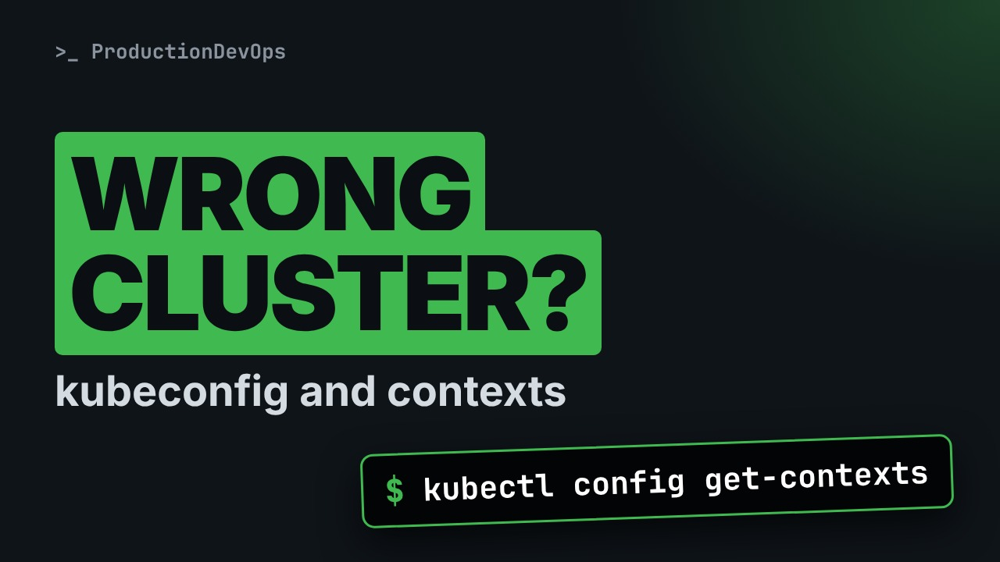
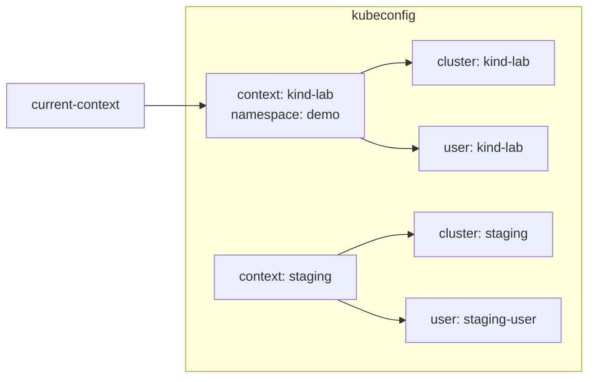
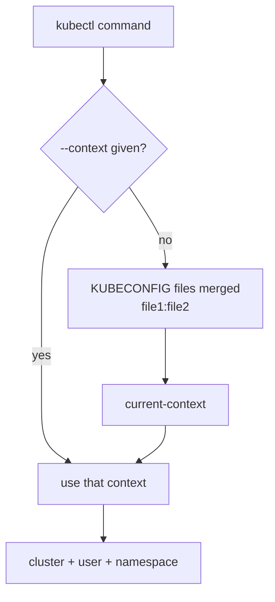

# kubeconfig and Contexts: Never Run kubectl on the Wrong Cluster



**Video:** https://youtu.be/nzbVyvq2rYY

Every kubectl command goes to one cluster, as one user, in one namespace, and the kubeconfig file decides which. We open the file, list and switch contexts, merge a second file with the KUBECONFIG variable, set a default namespace, and build the habits that keep commands off the wrong cluster. Part 4 of the Kubernetes Path.

## Files in this folder

- [`staging-kubeconfig`](staging-kubeconfig)
- [`challenge-solution.sh`](challenge-solution.sh) (solution of the challenge: try it yourself first)

## What you need

A Kubernetes cluster you can break: a local [kind](https://kind.sigs.k8s.io/) cluster with one control plane and two workers is what the video uses, plus `kubectl`. Never run these commands against a cluster that matters.

The outputs below were captured for real on the lab cluster. On yours, names, ages, IPs and ports will differ; everything else should match.

## The big picture

A kubeconfig file holds clusters, users and contexts: a context ties one cluster, one user and a default namespace together.



Which cluster a command reaches: the --context flag wins, then the current context of the merged KUBECONFIG files.



## The lesson, step by step

The same explanations as the video, with every command and its real output. Read it, then run it yourself.

You delete a Pod, and only then you notice: that was the production cluster. kubectl talks to whatever cluster one small file points to. Today we learn to read that file, and to control it.

### The plan

This is part four of the Kubernetes Path. Here is the plan. First, how to see which cluster kubectl is talking to. Then, the three parts of the kubeconfig file. We add a second cluster, and switch between the two. Finally, a default namespace, and the habits that keep you safe.

### Which cluster?

We work on a copy of the lab's kubeconfig file. The KUBECONFIG variable tells kubectl which file to read.

```console
$ echo $KUBECONFIG
demo-kubeconfig
```

The current context is the one every command uses.

```console
$ kubectl config current-context
kind-lab
```

Get contexts lists them all. The star marks the current one.

```console
$ kubectl config get-contexts
CURRENT   NAME       CLUSTER    AUTHINFO   NAMESPACE
*         kind-lab   kind-lab   kind-lab
```

### Inside the file

```
clusters:
  - name: kind-lab
    cluster: {server: "https://127.0.0.1:6443"}
users:
  - name: kind-lab
    user: {client-key-data: "..."}
contexts:
  - name: kind-lab
    context: {cluster: kind-lab, user: kind-lab, namespace: demo}
current-context: kind-lab
```

Clusters: where the API server is, and how to trust its certificate. Users: how you prove who you are, with a certificate, a key, or a token. Contexts: a name that ties one cluster, one user, and a default namespace together. And the current context: the one kubectl uses when you do not say otherwise.

Config view prints the file. Minify keeps only the current context. We keep just the server and the secret fields.

```console
$ kubectl config view --minify | grep -E 'server|DATA'
    certificate-authority-data: DATA+OMITTED
    server: https://127.0.0.1:35239
    client-certificate-data: DATA+OMITTED
    client-key-data: DATA+OMITTED
```

Dash dash raw would print the real keys. Never use it in a screen share, a ticket or a chat.

### Two clusters

A second file describes a fictional staging cluster. KUBECONFIG accepts a list of files, separated by a colon.

```console
$ export KUBECONFIG=demo-kubeconfig:staging-kubeconfig
```

Now kubectl sees both contexts.

```console
$ kubectl config get-contexts
CURRENT   NAME       CLUSTER    AUTHINFO       NAMESPACE
*         kind-lab   kind-lab   kind-lab       
          staging    staging    staging-user
```

Use context switches the default.

```console
$ kubectl config use-context staging
Switched to context "staging".
```

This is the dangerous moment: nothing on screen reminds you. We switch back.

```console
$ kubectl config use-context kind-lab
Switched to context "kind-lab".
```

### Default namespace

We create a namespace called demo.

```console
$ kubectl create namespace demo
namespace/demo created
```

Set context, with dash dash current, changes the context we are using. Here, its namespace.

```console
$ kubectl config set-context --current --namespace=demo
Context "kind-lab" modified.
```

The namespace column now says demo.

```console
$ kubectl config get-contexts
CURRENT   NAME       CLUSTER    AUTHINFO   NAMESPACE
*         kind-lab   kind-lab   kind-lab   demo
```

A plain get pods now reads the demo namespace. It is empty, and the message says which namespace it read.

```console
$ kubectl get pods
No resources found in demo namespace.
```

### Safe habits

```
source <(kubectl completion bash)
alias k=kubectl
complete -o default -F __start_kubectl k
PS1='[$(kubectl config current-context)] \w $ '
```

Completion: press tab to complete commands, resource names, even Pod names. A short alias, k, and completion for the alias too. And the current context in your prompt, so you always see where you are.

Scripts should never trust the current context. Dash dash context names the cluster for this one command.

```console
$ kubectl --context kind-lab get nodes
NAME                STATUS   ROLES           AGE   VERSION
lab-control-plane   Ready    control-plane   30m   v1.37.0
lab-worker          Ready    <none>          30m   v1.37.0
lab-worker2         Ready    <none>          30m   v1.37.0
```

We clean up the namespace.

```console
$ kubectl delete namespace demo
namespace "demo" deleted
```

### Gotchas

Two mistakes to avoid. Config view with dash dash raw prints keys and tokens. Never paste it in a ticket or a chat. And scripts that trust the current context. Someone switches, and the script runs somewhere else.

### Recap

Let's recap. A kubeconfig file has clusters, users, and contexts that tie them together. Get contexts lists them, current context shows the default, use context switches it. Set context with dash dash current gives your context a default namespace. Your challenge: create a context called lab dev, for the lab cluster, with the namespace dev. Switch to it, and prove that get pods reads dev. The solution is in the demo repository.

Before any command that changes something, check the context. Next on the Kubernetes Path: kubectl create versus apply, and how to get clean YAML without writing it by hand. Subscribe to follow the whole path.

## All the commands, to copy

Run them from inside this folder, in this order.

```bash
echo $KUBECONFIG
kubectl config current-context
kubectl config get-contexts
kubectl config view --minify | grep -E 'server|DATA'
export KUBECONFIG=demo-kubeconfig:staging-kubeconfig
kubectl config use-context staging
kubectl config use-context kind-lab
kubectl create namespace demo
kubectl config set-context --current --namespace=demo
kubectl get pods
kubectl --context kind-lab get nodes
kubectl delete namespace demo
```

## Challenge

Your challenge: create a context called lab dev, for the lab cluster, with the namespace dev. Switch to it, and prove that get pods reads dev. The solution is in the demo repository.

When you have tried: [`challenge-solution.sh`](challenge-solution.sh).

---

From the [ProductionDevOps](https://www.youtube.com/@production-devops) channel: real-world DevOps and SRE, explained with real commands.
