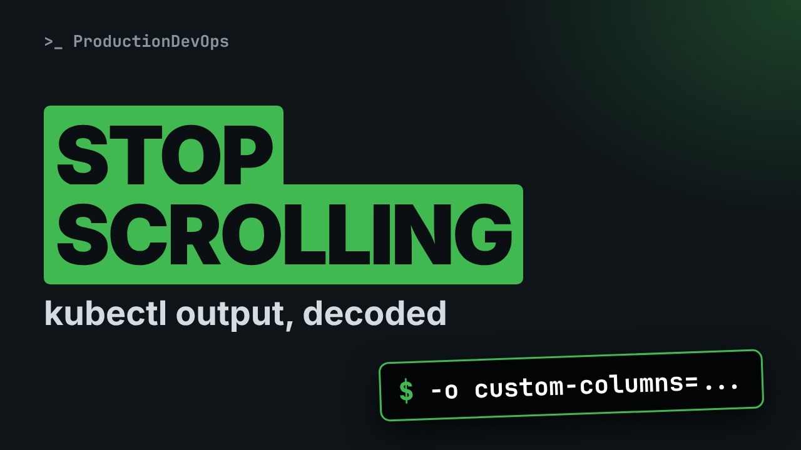
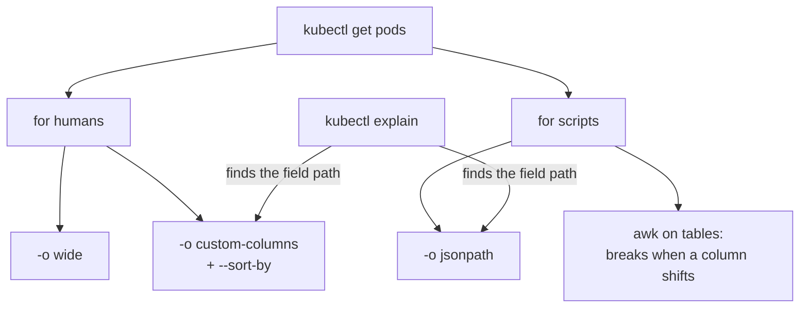
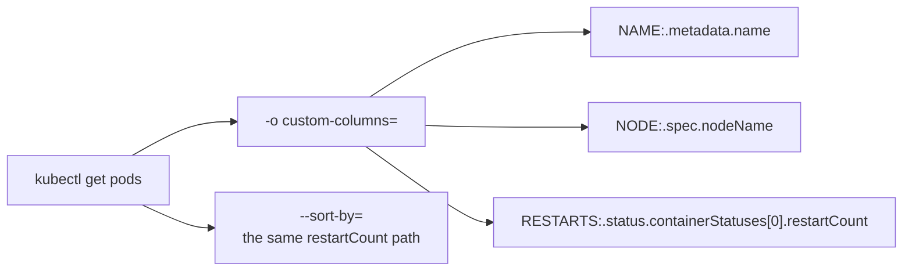

# Stop Scrolling kubectl Output: custom-columns, jsonpath and --sort-by



**Video:** https://youtu.be/lHxPHbiN8dc

During an incident you need one field, not a wall of YAML. We take kubectl output apart: -o wide, finding the right field path with kubectl explain, readable tables with custom-columns, sorting with --sort-by, and jsonpath for scripts. Plus the awk mistake that breaks the day a pod restarts.

## What you need

A Kubernetes cluster you can break: a local [kind](https://kind.sigs.k8s.io/) cluster with one control plane and two workers is what the video uses, plus `kubectl`. Never run these commands against a cluster that matters.

The outputs below were captured for real on the lab cluster. On yours, names, ages, IPs and ports will differ; everything else should match.

## The big picture

Pick the output for the reader: tables for humans, jsonpath for scripts, kubectl explain to find the field path.



The custom-columns command, split into its parts.



## The lesson, step by step

The same explanations as the video, with every command and its real output. Read it, then run it yourself.

In the middle of an incident, you need one fact: which server, how many restarts, which image. kubectl gives you a big table, or a wall of YAML. Let's learn to ask for exactly what we need.

### The plan

Here is the plan. First, the default table, and the wide version. Then why cutting columns out of these tables breaks in scripts. We find any field with kubectl explain. And we build our own table, and output made for scripts.

### Default vs wide

kubectl get pods. Five pods. Look at the restarts column: the api pod restarted three times, two minutes ago.

```console
$ kubectl get pods
NAME                     READY   STATUS    RESTARTS        AGE
api-6d8f9c7b5d-hx2lq     1/1     Running   3 (2m15s ago)   41m
web-7c9d8b6f5d-9wq7m     1/1     Running   0               41m
web-7c9d8b6f5d-q8m3n     1/1     Running   0               40m
web-7c9d8b6f5d-tz5rb     1/1     Running   0               41m
worker-84b7d6c9f-2pmvx   1/1     Running   1 (17m ago)     41m
```

dash o wide adds more columns: the pod address, and the node, the server it runs on. Useful, but the line gets very long.

```console
$ kubectl get pods -o wide
NAME                     READY   STATUS    RESTARTS        AGE   IP            NODE     NOMINATED NODE   READINESS GATES
api-6d8f9c7b5d-hx2lq     1/1     Running   3 (2m15s ago)   41m   10.88.1.23    node01   <none>           <none>
web-7c9d8b6f5d-9wq7m     1/1     Running   0               41m   10.88.2.14    node02   <none>           <none>
web-7c9d8b6f5d-q8m3n     1/1     Running   0               40m   10.88.1.31    node01   <none>           <none>
web-7c9d8b6f5d-tz5rb     1/1     Running   0               41m   10.88.1.12    node01   <none>           <none>
worker-84b7d6c9f-2pmvx   1/1     Running   1 (17m ago)     41m   10.88.2.19    node02   <none>           <none>
```

### The awk trap

A common shortcut in scripts: awk prints the first column, the name, and the fifth column, the age.

```console
$ kubectl get pods | awk '{print $1, $5}'
NAME AGE
api-6d8f9c7b5d-hx2lq (2m15s
web-7c9d8b6f5d-9wq7m 41m
web-7c9d8b6f5d-q8m3n 40m
web-7c9d8b6f5d-tz5rb 41m
worker-84b7d6c9f-2pmvx (17m
```

It works for healthy pods, and breaks on the ones that matter. Why? awk splits on spaces. When a pod has restarted, the restarts column contains spaces: three, then two minutes ago. So every column after it moves one step to the right.

### Finding field paths

Every value in these tables comes from a field of the pod object. A field has a path, like an address with dots. kubectl explain checks a path, and tells you what it means.

```console
$ kubectl explain pod.status.containerStatuses.restartCount
KIND:       Pod
VERSION:    v1

FIELD: restartCount <integer>

DESCRIPTION:
    RestartCount holds the number of times the container has been restarted.
```

So the restart counter lives under status, container statuses, restart count. Square brackets zero means the first container of the pod.

### custom-columns

```console
$ kubectl get pods -o custom-columns=NAME:.metadata.name,NODE:.spec.nodeName,RESTARTS:.status.containerStatuses[0].restartCount --sort-by=.status.containerStatuses[0].restartCount
```

With field paths, we can build our own table. The command is long, but each piece is simple. Left to right.

- `-o custom-columns=`: define your own columns
dash o custom columns: forget the default table, I define the columns.

- `NAME:.metadata.name`: header : field path
Each column is a header, a colon, and a field path. The pod name is at metadata dot name.

- `NODE:.spec.nodeName`: where the pod runs
The node is at spec dot node name.

- `RESTARTS:.status.containerStatuses[0].restartCount`: the path from kubectl explain
And the restart counter, with the path we just found.

- `--sort-by=.status.containerStatuses[0].restartCount`: sort by any field
dash dash sort by sorts by any field path. The pods with the most restarts end up at the bottom.

Here is the result.

```console
$ kubectl get pods -o custom-columns=NAME:.metadata.name,NODE:.spec.nodeName,RESTARTS:.status.containerStatuses[0].restartCount --sort-by=.status.containerStatuses[0].restartCount
NAME                     NODE     RESTARTS
web-7c9d8b6f5d-9wq7m     node02   0
web-7c9d8b6f5d-q8m3n     node01   0
web-7c9d8b6f5d-tz5rb     node01   0
worker-84b7d6c9f-2pmvx   node02   1
api-6d8f9c7b5d-hx2lq     node01   3
```

Three narrow columns, sorted, and the pod with the most restarts is on the last line. Readable at a glance.

### jsonpath for scripts

For scripts, use jsonpath: it prints exactly the fields you ask for. Here: the names of the pods with the label app equals web.

```console
$ kubectl get pods -l app=web -o jsonpath='{.items[*].metadata.name}'
web-7c9d8b6f5d-9wq7m web-7c9d8b6f5d-q8m3n web-7c9d8b6f5d-tz5rb
```

items with a star means: every pod in the list. One line, names separated by spaces. Perfect for a for loop. To get one line per pod, use range. Here: name, a tab, and the node. Stable to parse, whatever the restarts column looks like.

```console
$ kubectl get pods -o jsonpath='{range .items[*]}{.metadata.name}{"\t"}{.spec.nodeName}{"\n"}{end}'
api-6d8f9c7b5d-hx2lq	node01
web-7c9d8b6f5d-9wq7m	node02
web-7c9d8b6f5d-q8m3n	node01
web-7c9d8b6f5d-tz5rb	node01
worker-84b7d6c9f-2pmvx	node02
```

### Recap

Let's recap with four rules. One. For humans: dash o wide for a quick look, custom columns and sort by for a focused table. Two. For scripts: jsonpath, or JSON with j q. Never awk on the human table. Three. Find any field path with kubectl explain. Four. In bash, put jsonpath in single quotes. PowerShell and the Windows command prompt use different quoting, so test in the shell you really use.

Ask kubectl for the field you need, instead of searching the table for it. In the next video of this series, we use these skills to debug a pod stuck in CrashLoopBackOff. Subscribe so you do not miss it.

## All the commands, to copy

Run them from inside this folder, in this order.

```bash
kubectl get pods
kubectl get pods -o wide
kubectl get pods | awk '{print $1, $5}'
kubectl explain pod.status.containerStatuses.restartCount
kubectl get pods -o custom-columns=NAME:.metadata.name,NODE:.spec.nodeName,RESTARTS:.status.containerStatuses[0].restartCount --sort-by=.status.containerStatuses[0].restartCount
kubectl get pods -l app=web -o jsonpath='{.items[*].metadata.name}'
kubectl get pods -o jsonpath='{range .items[*]}{.metadata.name}{"\t"}{.spec.nodeName}{"\n"}{end}'
```

---

From the [ProductionDevOps](https://www.youtube.com/@production-devops) channel: real-world DevOps and SRE, explained with real commands.
