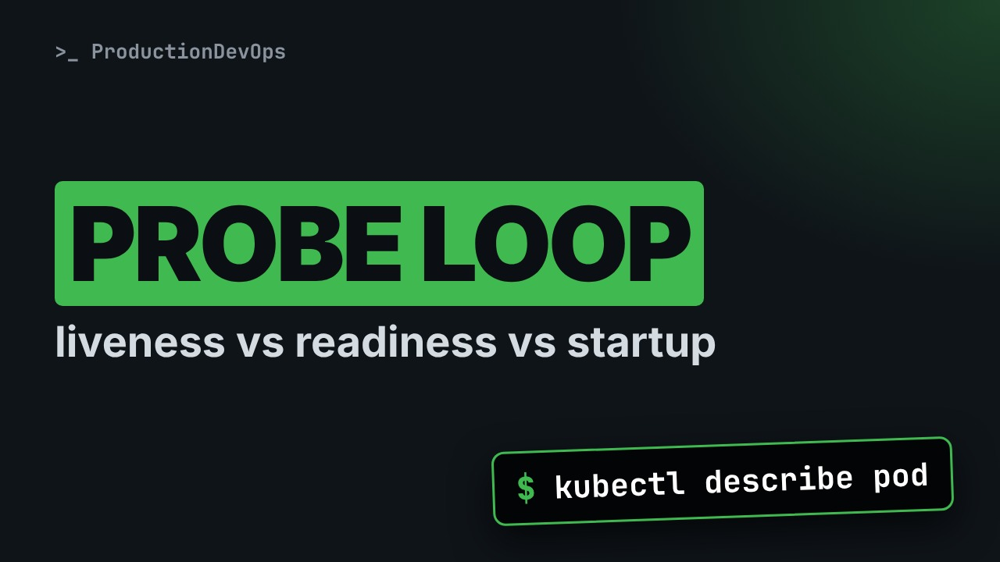
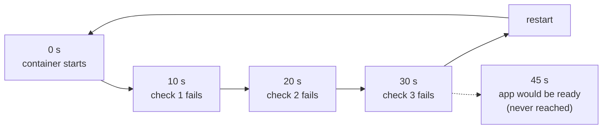
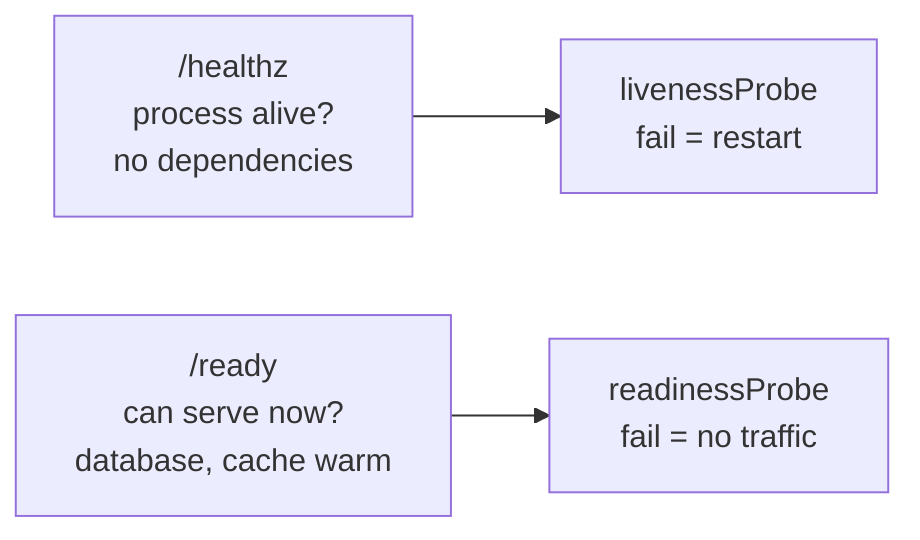

# Liveness vs Readiness vs Startup Probes: Stop Killing Healthy Pods



**Video:** https://youtu.be/IBvgdNBOyB8

A wrong liveness probe can restart a healthy but slow app forever. We look at what each Kubernetes probe really controls: liveness restarts, readiness removes traffic, startup waits for a slow boot. We reproduce the restart loop, read the timing behind it, fix it with a startupProbe, and cover the two classic mistakes: a liveness probe that checks the database, and the same endpoint for liveness and readiness.

## Files in this folder

- [`api.yaml`](api.yaml)

## What you need

A Kubernetes cluster you can break: a local [kind](https://kind.sigs.k8s.io/) cluster with one control plane and two workers is what the video uses, plus `kubectl`. Never run these commands against a cluster that matters.

The outputs below were captured for real on the lab cluster. On yours, names, ages, IPs and ports will differ; everything else should match.

## The lesson, step by step

The same explanations as the video, with every command and its real output. Read it, then run it yourself.

Your app is healthy. It is just slow to start. And Kubernetes restarts it, again and again, before it ever gets ready. The cause is one probe, set up wrong.

### The plan

Here is the plan. First, the three probes, and what each one controls. Then, a real restart loop caused by a liveness probe. The fix, with a startup probe. And finally, timeouts and thresholds, and what each endpoint should check.

### Three probes

A probe is a regular check on your container. Each of the three triggers a different action. Liveness asks: is the process stuck? If it fails, the container is restarted. Readiness asks: can it serve requests right now? If it fails, the pod gets no traffic from the Service. Nothing is restarted. Startup asks: has the app finished starting? Until it succeeds, the other two probes do not run. Once the startup probe succeeds, it never runs again for that container.

### The restart loop

Here is our API. Look at the restarts column.

```console
$ kubectl get pods -l app=api
NAME                  READY   STATUS    RESTARTS      AGE
api-6b9d4c7f8-q4m2x   0/1     Running   4 (15s ago)   4m10s
```

Four restarts in four minutes, and never ready. The previous logs show what it was doing.

```console
$ kubectl logs api-6b9d4c7f8-q4m2x --previous
2026-11-27T09:12:01Z INFO starting api v3.2.0
2026-11-27T09:12:01Z INFO warming cache from disk
2026-11-27T09:12:31Z INFO received SIGTERM, shutting down
```

It was still warming its cache. After thirty seconds, something asked it to stop. No error from the app itself.

The events in describe tell us who. grep keeps two kinds of events: Unhealthy and Killing.

```console
$ kubectl describe pod api-6b9d4c7f8-q4m2x | grep -E 'Unhealthy|Killing'
Warning  Unhealthy  25s (x12 over 4m5s)  kubelet  Liveness probe failed: Get "http://192.0.2.17:8080/healthz": dial tcp 192.0.2.17:8080: connect: connection refused
Normal   Killing    25s (x4 over 3m35s)  kubelet  Container api failed liveness probe, will be restarted
```

The liveness probe failed: connection refused, because the web server was not listening yet. So the kubelet restarted the container.

### Why 30 seconds

```
livenessProbe:
  httpGet:
    path: /healthz
    port: 8080
  initialDelaySeconds: 10
  periodSeconds: 10
  timeoutSeconds: 1
  failureThreshold: 3
```

This is the liveness probe. It sends an HTTP request to slash healthz, on port eighty eighty. The first check runs after ten seconds. Then one check every ten seconds. Each check must answer within one second, or it counts as a failure. One second is the default. After three failures in a row, the container is restarted.

**The math: 30 seconds vs 45 seconds**



Ten, twenty, thirty seconds: three failures, and a restart. But this app needs about forty five seconds to start. It never gets there. The loop never ends.

The tempting fix is to raise the initial delay to sixty seconds. It works today, but it has two problems. One. Every start now waits a full minute before liveness checks begin, even when the app starts fast. Two. The day startup takes seventy seconds, for example with a bigger cache, the loop comes back.

### The fix

```
startupProbe:
  httpGet: {path: /healthz, port: 8080}
  periodSeconds: 5
  failureThreshold: 36
livenessProbe:
  httpGet: {path: /healthz, port: 8080}
  periodSeconds: 10
  timeoutSeconds: 2
  failureThreshold: 3
```

We add a startup probe. Same endpoint, slash healthz. One check every five seconds, up to thirty six failures. Five times thirty six: the app has up to three minutes to start. The liveness probe has no initial delay anymore. It only starts after the startup probe has succeeded. And once running, a stuck process is still restarted after three failures, about thirty seconds. A two second timeout tolerates short pauses.

```
readinessProbe:
  httpGet: {path: /ready, port: 8080}
  periodSeconds: 5
  failureThreshold: 2
```

We also add a readiness probe, on a different endpoint: slash ready. We will see why in a moment. Two failures in a row, about ten seconds, and the pod stops receiving traffic until it recovers.

We apply the change and wait for the rollout.

```console
$ kubectl apply -f api.yaml
deployment.apps/api configured
```

The rollout status command waits until the new pods are ready.

```console
$ kubectl rollout status deployment/api --timeout=300s
Waiting for deployment "api" rollout to finish: 0 of 1 updated replicas are available...
deployment "api" successfully rolled out
```

Running, ready, zero restarts.

```console
$ kubectl get pods -l app=api
NAME                  READY   STATUS    RESTARTS   AGE
api-5f8c7b9d6-t2w8k   1/1     Running   0          3m2s
```

describe shows the three probes in one compact line each. A good habit after every change.

```console
$ kubectl describe pod api-5f8c7b9d6-t2w8k | grep -E 'Liveness|Readiness|Startup'
Liveness:   http-get http://:8080/healthz delay=0s timeout=2s period=10s #success=1 #failure=3
Readiness:  http-get http://:8080/ready delay=0s timeout=1s period=5s #success=1 #failure=2
Startup:    http-get http://:8080/healthz delay=0s timeout=1s period=5s #success=1 #failure=36
```

Notice the defaults you did not write: a one second timeout, and one success to be considered healthy again.

### Gotchas

The first classic mistake: a liveness endpoint that also checks the database. The database goes down for a minute. Every pod fails its liveness probe, at the same time. So all pods restart together. That does not fix the database. And when it comes back, every pod reconnects and warms up at once. A short outage becomes a long one. The rule: liveness checks only the process itself. Can it answer at all?

**Gotcha 2: one endpoint for both**



The second mistake: the same endpoint for liveness and readiness. Keep them separate. Healthz is cheap and checks only the process. Ready can check what the pod needs to serve, like its database. If that fails, the pod only stops getting traffic. Nothing restarts.

### Recap

Let's recap. Liveness restarts. Readiness controls traffic. For a slow boot, use a startup probe, not a huge initial delay. The time budget of a probe is period seconds times failure threshold. And liveness never checks dependencies.

Readiness is also what makes rollouts safe. That is the next video: safe rollouts and kubectl rollout undo. Subscribe so you don't miss it.

## All the commands, to copy

Run them from inside this folder, in this order.

```bash
kubectl get pods -l app=api
kubectl logs api-6b9d4c7f8-q4m2x --previous
kubectl describe pod api-6b9d4c7f8-q4m2x | grep -E 'Unhealthy|Killing'
kubectl apply -f api.yaml
kubectl rollout status deployment/api --timeout=300s
kubectl describe pod api-5f8c7b9d6-t2w8k | grep -E 'Liveness|Readiness|Startup'
```

---

From the [ProductionDevOps](https://www.youtube.com/@production-devops) channel: real-world DevOps and SRE, explained with real commands.
