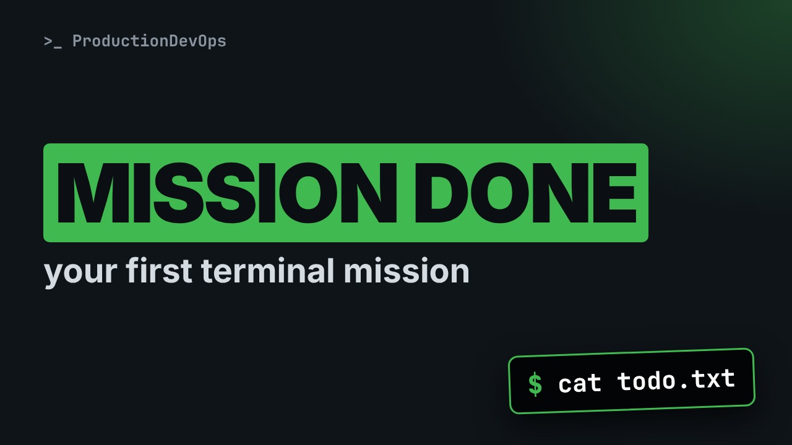
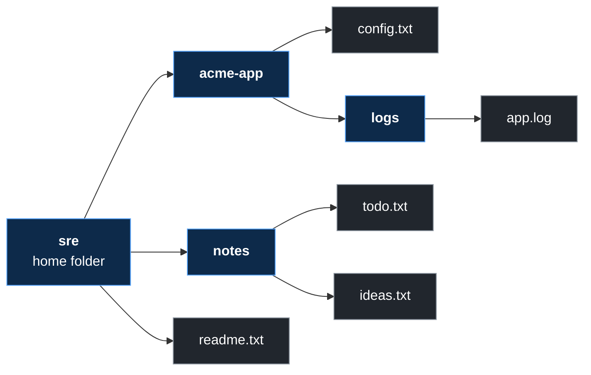
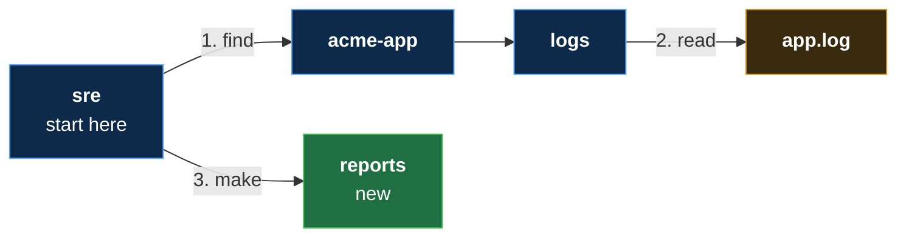
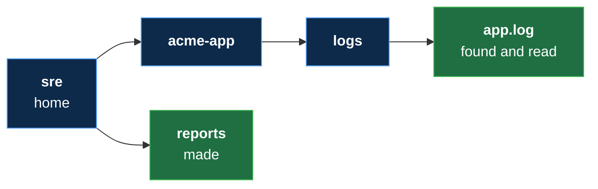

# Putting It Together: Your First Terminal Mission (No Experience Needed)



**Video:** https://youtu.be/Jei3xD7To7Y

Nine lessons ago you had never opened a terminal. In this last lesson of Linux from Zero, the commands you know work together on one small mission from a to-do list: find an app's log, read it, and make a folder for a report, with pwd, ls, cd, cat and mkdir. Then your safety net for when you get stuck, with --help and error messages, how to practice, and where to go next: the course Linux from User to Server Admin. No experience needed, every command runs for real. The final challenge and its solution are in the demos repo.

## Files in this folder

- [`acme-app/config.txt`](acme-app/config.txt)
- [`acme-app/logs/app.log`](acme-app/logs/app.log)
- [`notes/ideas.txt`](notes/ideas.txt)
- [`notes/todo.txt`](notes/todo.txt)
- [`readme.txt`](readme.txt)
- [`challenge-solution.sh`](challenge-solution.sh) (solution of the challenge: try it yourself first)

## What you need

A Linux shell (a VM, WSL or a container is fine). Everything runs inside this folder.

## Before you start

The video runs these commands first, off screen:

```bash
mkdir -p /lab && ln -sfn "$PWD" /lab/sre && cd /lab/sre && export HOME=/lab/sre
alias ls='ls --color=auto'
PROMPT_COMMAND='PS1="\[\e[1;32m\]sre@lab\[\e[0m\]:\[\e[1;34m\]\w\[\e[0m\]$ "'
```

## The lesson, step by step

The same explanations as the video, with every command. Read it, then run it yourself.

Nine lessons ago, you had never opened a terminal. Today your commands work together, on one small mission. And at the end, where to go next.

To follow along, you need a terminal. Lesson two shows how to get one. There is no new command today. Only the ones you know.

### The plan

This is the last lesson of Linux from Zero. First, your tools, in one picture. Then, we read the mission. We do it, step by step. And then, where to go next.

### Your tools

Your tools. P w d: where am I? L s: what is here? C d: move into a folder, up, or home. Cat: read a file. Make dir: make a folder. And dash dash help: ask any command how it works.

**The whole cabinet**



And here is the whole cabinet of our lab. You have seen every folder and every file in it.

### The mission

The mission is the to do list, in notes. We walk in.

```console
$ cd notes
```

And we read it.

```console
$ cat todo.txt
```

Three steps. Find the log, read it, make a folder for a report.

**The mission, on the cabinet**



Here is the plan, drawn. Find the log, two folders deep, and read it. Then make a reports folder at home.

### Find and read

A new terminal. Where am I? Home.

```console
$ pwd
```

What is here? We see acme app.

```console
$ ls
```

We walk into acme app, and look.

```console
$ cd acme-app
```

A folder called logs. That looks right.

```console
$ ls
```

Into logs, and we read the log file.

```console
$ cd logs
```

Cat app dot log. Two lines of info, and one warning: a slow request.

```console
$ cat app.log
```

### So far

So far: we found the log with p w d, l s and c d. We read it with cat. One warning. Next: step three, a folder for the report.

### Make

A new terminal starts at home. We make the reports folder here.

```console
$ mkdir reports
```

No message, so it worked. We check with l s.

```console
$ ls
```

Mission done. Find, read, make, with five commands you did not know ten lessons ago.

**Mission done**



Here is the mission on our cabinet. The log, found and read, two folders deep. And a new reports folder, at home.

### Stuck?

Lost? Ask p w d, then l s. In the wrong place? Move with c d, and try again. Forgot how a command works? Dash dash help. An error? Read who, what, and why.

### Practice

Practice on your own. Explore your own home folder, with l s, c d and p w d. Read a text file you know, with cat. Make a practice folder with make dir, and play inside it. Ten minutes a day beats one long evening.

### Recap

Recap: work in small steps. One command, then look. The prompt and p w d always tell you where you are. Your final challenge: read config dot t x t, then make a folder called backup, at home. Check with l s. Is backup there? The solution is in the demo repo.

### Where next

Where next? Linux from User to Server Admin, the full course. Lesson one: what Linux really is. Then files, users, processes, and real servers. You find it in the channel's playlists.

Thank you for following Linux from Zero. Next, the course Linux from User to Server Admin. Subscribe so you do not miss a lesson.

## All the commands, to copy

Run them from inside this folder, in this order (some are expected to fail: that is the point of the demo).

```bash
cd notes
cat todo.txt
pwd
ls
cd acme-app
cd logs
cat app.log
mkdir reports
```

## Challenge

Your final challenge: read config dot t x t, then make a folder called backup, at home.

When you have tried: [`challenge-solution.sh`](challenge-solution.sh).

---

From the [ProductionDevOps](https://www.youtube.com/@production-devops) channel: real-world DevOps and SRE, explained with real commands.
