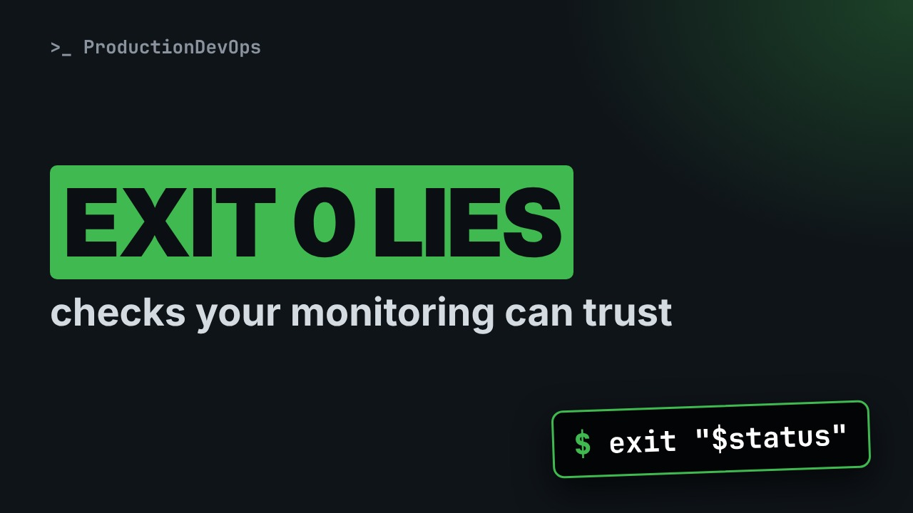
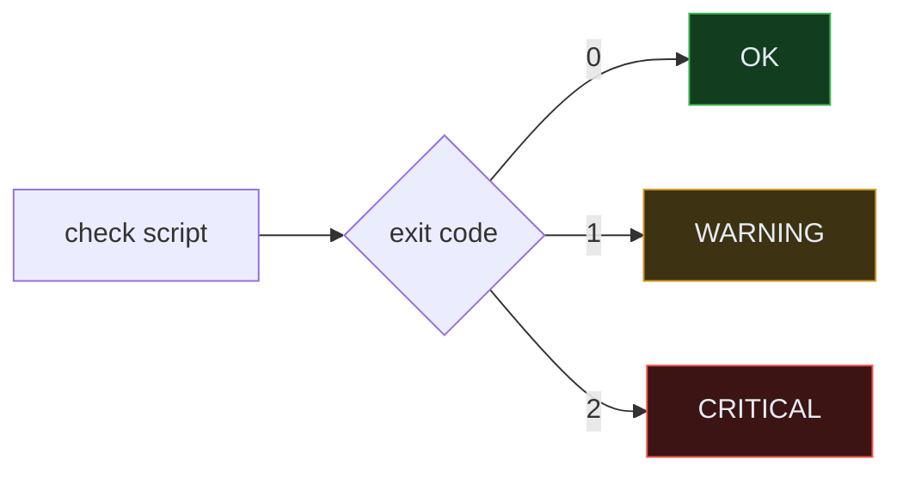

# A Log Health Check Script Your Monitoring Can Trust (Exit Codes 0, 1, 2)



**Video:** https://youtu.be/dDuTM5zzXaY

Most ad-hoc check scripts print a nice message and then exit 0, so cron and monitoring never notice anything. Step by step, we turn a naive log check into a small, testable script with monitoring-style exit codes: 0 OK, 1 WARNING, 2 CRITICAL. Disk usage without parsing columns, stale logs, recent errors, every outcome tested, and a systemd timer to run it.

## Files in this folder

- [`check-logs-naive.sh`](check-logs-naive.sh)
- [`check-logs.sh`](check-logs.sh)
- [`systemd/check-logs.service`](systemd/check-logs.service)
- [`systemd/check-logs.timer`](systemd/check-logs.timer)
- [`var-log/app.log`](var-log/app.log)

## What you need

A Linux shell (a VM, WSL or a container is fine). Everything runs inside this folder.

The outputs below were captured for real on the lab cluster. On yours, names, ages, IPs and ports will differ; everything else should match.

## The lesson, step by step

The same explanations as the video, with every command and its real output. Read it, then run it yourself.

Almost every team has a small script that checks the logs. It prints something reassuring, and it always ends with exit code zero. So nothing that runs it will ever notice a problem. In this video, we fix that, one small step at a time.

### The plan

Here is the plan, so you always know where we are. First, we run a naive check script, and see why it lies. Second, we learn the simple contract that monitoring tools use: exit codes zero, one and two. Third, we build a better script, one small block at a time. And finally, we test every possible result, and run it automatically with systemd.

### The naive check

Here is a typical first version. Three commands. Let's read them one by one.

```
#!/usr/bin/env bash
# check-logs-naive.sh - the version we all wrote once
df -h logs/acme | awk 'NR==2 {print "disk usage: " $5}'
find logs/acme -name '*.log' -mmin -15
echo "check done"
```

Line three asks d f for the disk usage of the log folder. Then awk takes the second line of the output, and prints its fifth column. Line four lists the log files that changed in the last fifteen minutes. And line five always prints check done. Keep this line in mind. It is the last command of the script, and that matters a lot.

This server has no logs slash acme folder at all. So the check should fail. Let's run it.

```console
$ bash check-logs-naive.sh
```

Now the important question: what exit code did the script return? The special variable dollar question mark holds it.

```console
$ echo "exit code: $?"
```

Zero. A person can see the errors. But a machine only sees the exit code, and zero means success. The script ended with an echo, and the echo worked. That is the whole bug.

### The exit code contract

**What a monitoring system actually reads**



Monitoring tools like Nagios, Icinga and many agents agree on a simple rule. They ignore the text, and read only the exit code. Zero means OK. One means warning. Two means critical. Our script must follow this rule.

From that contract, we get two rules. Rule one. When the script runs several checks, the final exit code is the worst result. One critical check makes the whole script critical. Rule two. Each check still prints one short line, for the person who gets paged at night.

### Building the script

Now the new script. We will look at it in four small blocks. Block one is the setup.

```
set -euo pipefail
LOG_DIR=${LOG_DIR:-/var/log/acme}
WARN=${WARN:-80}            # disk usage % for WARNING
CRIT=${CRIT:-90}            # disk usage % for CRITICAL
status=0
names=(OK WARNING CRITICAL)
check() {  # check <level> <message>
  echo "${names[$1]}: $2"
  if (( $1 > status )); then status=$1; fi
}
```

Strict mode, from the first video of this series. A failing command or a typo in a variable name stops the script, instead of being ignored. The settings. Each one reads an environment variable, and falls back to a default after the colon dash. So the same script works on every server, and later we can change the limits for a test. status starts at zero, which means OK. And names translates the numbers zero, one and two into words. The check function does two things. It prints one line, for example WARNING colon, and the message. Then, if this level is worse than the current status, it saves it. This is how the worst result wins.

Before the disk check, let's see the problem with the naive version. This is d f dash h, the human output.

```console
$ df -h var-log
```

It is made for humans. When a device name is long, d f can even wrap it onto its own line, and then the fifth column is something else. Instead, we ask d f for exactly one field: percent used.

```console
$ df --output=pcent var-log
```

Then tail keeps the last line, and t r deletes everything that is not a digit. We get a plain number.

```console
$ df --output=pcent var-log | tail -n 1 | tr -dc '0-9'; echo
```

```
used=$(df --output=pcent "$LOG_DIR" | tail -n 1 | tr -dc '0-9')
if   (( used >= CRIT )); then check 2 "disk ${used}% (critical at ${CRIT}%)"
elif (( used >= WARN )); then check 1 "disk ${used}% (warning at ${WARN}%)"
else                          check 0 "disk ${used}%"
fi
```

Check one, the disk. The plain number we just built goes into the variable used. Then we compare it with the limits, the highest first: critical, then warning, otherwise OK.

```
if [[ -n $(find "$LOG_DIR" -name '*.log' -mmin -"$MAX_AGE" -print -quit) ]]; then
  check 0 "logs updated in the last ${MAX_AGE} min"
else
  check 1 "no log written in the last ${MAX_AGE} min"
fi
errors=$(tail -n 200 "$LOG_DIR/app.log" | grep -c ERROR || true)
if (( errors > MAX_ERRORS )); then check 1 "$errors ERROR lines in the last 200"
else                               check 0 "$errors ERROR lines in the last 200"
fi
```

Check two: is the application still writing logs? find looks for a log file changed in the last fifteen minutes. If it finds nothing, the app may be stuck, so we raise a warning. Check three counts the lines with ERROR, in the last two hundred lines. grep dash c prints the count. When there are no matches, grep returns an error code, so or true keeps strict mode happy. More than five errors? Then a warning.

And the last two lines. A summary for humans, and then the line the naive version was missing: exit with the worst status. Now the exit code tells the truth.

```
echo "overall: ${names[$status]}"
exit "$status"
```

### Testing every outcome

Time to test. Our test log folder is a local folder, so we point the script at it with one variable.

```console
$ export LOG_DIR=var-log
```

First run, on a healthy system.

```console
$ ./check-logs.sh
```

And the exit code.

```console
$ echo "exit code: $?"
```

Now we pretend the application stopped writing two hours ago. touch dash d changes the file's time.

```console
$ touch -d '2 hours ago' var-log/app.log
```

Run the check again, and print the exit code on the same line.

```console
$ ./check-logs.sh; echo "exit code: $?"
```

Next, a burst of errors. We append six ERROR lines. Writing also makes the log fresh again.

```console
$ for i in 1 2 3 4 5 6; do echo 'ERROR db timeout' >> var-log/app.log; done
```

For critical, we do not fill a real disk. We just lower the limits, to ten and twenty percent. That is why the limits are variables.

```console
$ WARN=10 CRIT=20 ./check-logs.sh; echo "exit code: $?"
```

We tested OK, warning and critical in a few seconds, without breaking anything.

### Run it with systemd

```
# check-logs.service
[Service]
Type=oneshot
Environment=LOG_DIR=/var/log/acme
ExecStart=/usr/local/bin/check-logs.sh
# check-logs.timer
[Timer]
OnBootSec=2min
OnUnitActiveSec=5min
[Install]
WantedBy=timers.target
```

To run it automatically, we use a systemd timer instead of cron. First a service: one shot means it runs the script once and stops. It sets the log folder, and starts the script. Then the timer: two minutes after boot, and then every five minutes. Enable the timer once, with systemctl enable dash dash now check logs dot timer.

Here is the advantage over cron. When the script exits with one or two, systemd marks the run as failed.

```console
$ systemctl status check-logs.service --no-pager
× check-logs.service - Log health check
     Loaded: loaded (/etc/systemd/system/check-logs.service; static)
     Active: failed (Result: exit-code) since Tue 2026-10-20 10:05:02 CEST; 1min ago
TriggeredBy: ● check-logs.timer
    Process: 2311 ExecStart=/usr/local/bin/check-logs.sh (code=exited, status=1/FAILURE)
```

And every line the script printed is in the journal, with a timestamp.

```console
$ journalctl -u check-logs.service -n 4 --no-pager
Oct 20 10:05:02 lab check-logs.sh[2311]: OK: disk 41%
Oct 20 10:05:02 lab check-logs.sh[2311]: WARNING: no log written in the last 15 min
Oct 20 10:05:02 lab check-logs.sh[2311]: OK: 0 ERROR lines in the last 200
Oct 20 10:05:02 lab check-logs.sh[2311]: overall: WARNING
```

### Recap

Let's recap the four rules from this video. One. End with exit status. Never let an echo be the last word. Two. Ask tools for the exact field you need, instead of reading columns of human output. Three. Keep the limits in variables, so you can test every level safely. Four. Run it from a systemd timer, and read the results with systemctl and journalctl.

A check that always exits zero is worse than no check, because it makes you feel safe. The full script is linked in the description. Subscribe for more Bash for production.

## All the commands, to copy

Run them from inside this folder, in this order.

```bash
bash check-logs-naive.sh
echo "exit code: $?"
df -h var-log
df --output=pcent var-log
df --output=pcent var-log | tail -n 1 | tr -dc '0-9'; echo
export LOG_DIR=var-log
./check-logs.sh
touch -d '2 hours ago' var-log/app.log
./check-logs.sh; echo "exit code: $?"
for i in 1 2 3 4 5 6; do echo 'ERROR db timeout' >> var-log/app.log; done
WARN=10 CRIT=20 ./check-logs.sh; echo "exit code: $?"
systemctl status check-logs.service --no-pager
journalctl -u check-logs.service -n 4 --no-pager
```

---

From the [ProductionDevOps](https://www.youtube.com/@production-devops) channel: real-world DevOps and SRE, explained with real commands.
