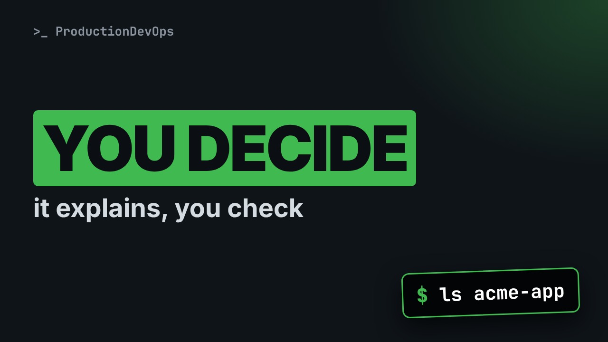
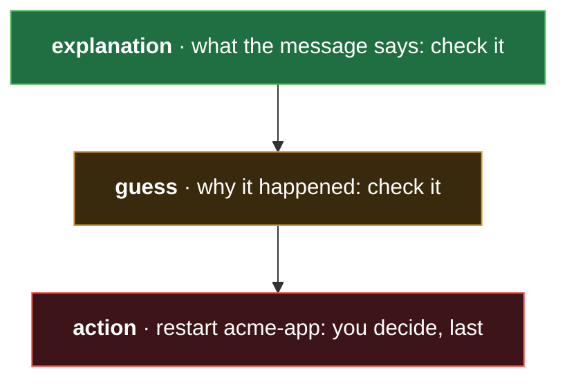
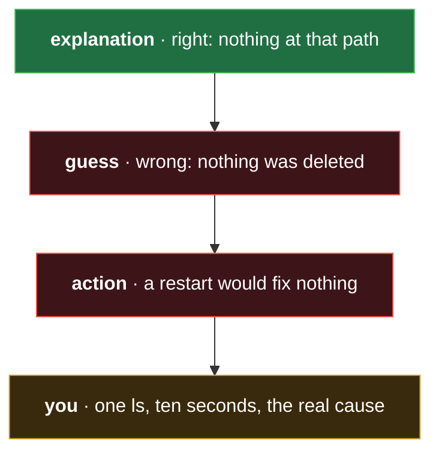

# Logs and Errors: Let It Explain, You Decide (AI for Ops: the Safe Basics)



**Video:** coming soon on the [channel](https://www.youtube.com/@production-devops).

A check script fails with an error. An AI assistant explains it in seconds, and suggests a restart. This lesson of AI Assistants for Ops: the Safe Basics reads a real error message from our lab together, splits the assistant's answer into an explanation, a guess and an action, and checks one claim ourselves with one safe command before anything is restarted. The explanation was right, the guess was wrong, and the real fix was one letter. Every command runs for real, the assistant's answer is a fictional example. The challenge and its solution are in the demos repo.

## Files in this folder

- [`acme-app/config.txt`](acme-app/config.txt)
- [`acme-app/logs/app.log`](acme-app/logs/app.log)
- [`check-app.sh`](check-app.sh)
- [`challenge-solution.sh`](challenge-solution.sh) (solution of the challenge: try it yourself first)

## What you need

A Linux shell (a VM, WSL or a container is fine). Everything runs inside this folder.

## Before you start

The video runs these commands first, off screen:

```bash
n=$(( $(cat .tt-n 2>/dev/null || echo 0) + 1 )); echo $n > .tt-n; if [ ! -e .tt-lab ]; then rm -rf /lab/ai7 && mkdir -p /lab/ai7 && cp -a acme-app check-app.sh /lab/ai7/ && touch .tt-lab; fi
if [ "$n" -ge 3 ]; then sed -i "s#acme-app/log/#acme-app/logs/#" /lab/ai7/check-app.sh; fi
export HOME=/lab/ai7 && cd /lab/ai7
alias ls='ls --color=auto'
PROMPT_COMMAND='HOME=/lab/ai7; PS1="\[\e[1;32m\]sre@lab\[\e[0m\]:\[\e[1;34m\]\w\[\e[0m\]$ "'
```

## The lesson, step by step

The same explanations as the video, with every command. Read it, then run it yourself.

A script fails, and the assistant suggests a restart. In five minutes: let it explain the error, check one claim yourself, and decide. At the end: who was right?

You will need lesson six: l s, and bash with a file name. A terminal with bash. Or just watch: every step is on screen. No new commands today. Reading is the skill.

### The plan

This is lesson seven of AI Assistants for Ops. First, a real error, read together. Then, the assistant's explanation. We sort it into explanation, guess, and action. And we check one claim ourselves, then decide.

### The error

- `error message — The text a program prints when something goes wrong (like the note on the oven display: door open)`: 
New word: error message. It is the text a program prints when something goes wrong. Like the note on the oven display: door open.

A teammate wrote a small script, check app dot s h. It prints the log of acme app. We run it with bash, as in lesson six.

We want to see this morning's log. We run the check.

```console
$ bash check-app.sh
```

Instead of the log, one line of error. Before we ask anyone, we read it together.

```console
$ cat: acme-app/log/app.log: No such file or directory
```

Error messages often have three pieces.

- `cat:`: who complains: the program
First, who complains. Cat, the program that reads files, inside the script.

- `acme-app/log/app.log:`: what: the path it tried
Then what it tried to open: this path.

- `No such file or directory`: why: nothing at that path
And why it failed. There is nothing at that path.

### Ask the assistant

Now we ask the assistant. First, the ten-second check from lesson three. No secrets here. We paste the exact error, and what we ran.

Here is a typical answer. I wrote it for this lesson.

```
You:
  My check script prints this error. What does it mean?
  cat: acme-app/log/app.log: No such file or directory

AI assistant:
  cat could not find the file acme-app/log/app.log.
  Most likely, acme-app stopped writing its log,
  or someone deleted the log file.
  Fix: restart acme-app to create a new log.
```

Our message: the exact error, and what we ran. First, it explains the message: cat could not find the file. Then, most likely: the app stopped, or someone deleted the log. And an action: restart acme app.

### Sort it

- `claim — A sentence that says something is true, and can be checked (like the helper says we are out of salt: you open the cupboard)`: 
New word: claim. It is a sentence that says something is true, and can be checked. If the helper says we are out of salt, you open the cupboard.

**Three kinds of sentence**



The answer has three kinds of sentence. An explanation and a guess: both are claims to check. And an action, that you decide last.

### So far

So far: the error says cat found nothing at that path. The answer has an explanation, a guess, and an action. Next: we check the guess, before any restart. If this is helping, subscribe. The next lesson puts the whole course on one page.

### Check it

Which claim do we check? The guess: the log was deleted. How to check it? Look in the folder, with l s. It is safe. L s only reads. It changes nothing.

What is inside acme app? We list it.

```console
$ ls acme-app
```

And is the log really gone? We list the logs folder.

```console
$ ls acme-app/logs
```

The error said log, without an s. The real folder is logs, with an s.

Now we read the teammate's script.

```
#!/bin/bash
# Morning check: show the acme-app log
cat acme-app/log/app.log
```

Bash reads this file. The comment says: show the log. Line three: cat acme app slash log. One letter is missing. A typo.

### Who was right

**Who was right?**



The explanation was right. The guess was wrong, and the restart would fix nothing. One l s found the real cause, in ten seconds.

The fix: I added the missing s on line three, in a text editor, off screen. No restart. Acme app keeps running for its customers.

We run the morning check again.

```console
$ bash check-app.sh
```

This morning's log, line by line. The script works, and nothing else was touched.

### The rules

So, the rules. Let it explain the message in plain words. Sort its answer: explanation, guess, and action. Check a claim with a command that only reads. The action is yours. Never restart or delete on its word alone.

### Recap

Recap. An error message says who complains, what it tried, and why it failed. A claim can be checked. Check it before you act. Your challenge: a script fails with permission denied. The example answer says: ask an admin for root access. Which claim do you check, and how? The solution is in the demo repo.

### Where next

Where next? Lesson eight: the whole course on one page. And where to go after this course.

Next lesson: the safe loop, and where to go next. Subscribe, and that lesson finds you.

## All the commands, to copy

Run them from inside this folder, in this order (some are expected to fail: that is the point of the demo).

```bash
bash check-app.sh
ls acme-app
ls acme-app/logs
```

## Challenge

Your challenge: a script fails with permission denied. The example answer says: ask an admin for root access.

When you have tried: [`challenge-solution.sh`](challenge-solution.sh).

---

From the [ProductionDevOps](https://www.youtube.com/@production-devops) channel: real-world DevOps and SRE, explained with real commands.
