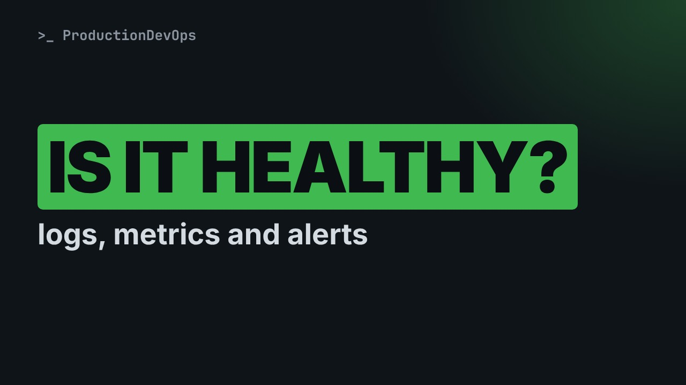
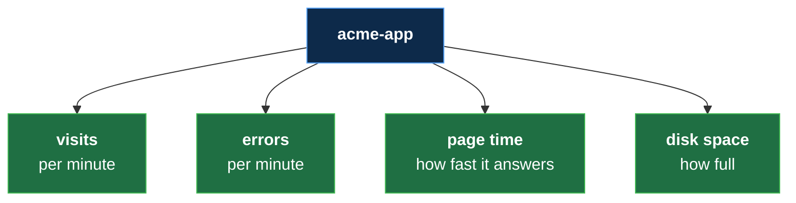
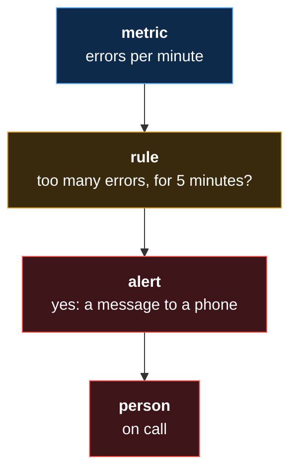
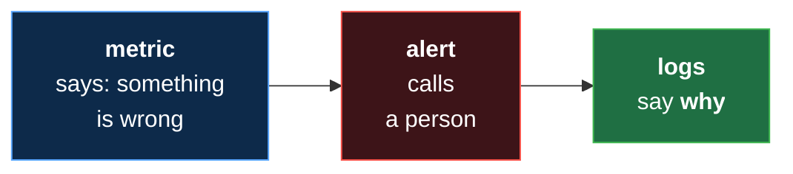

# Is Production Healthy? Logs, Metrics and Alerts (DevOps from Zero, No Experience Needed)

**Video:** https://youtu.be/nCQOsEF2hcc

It is nine at night and nobody is looking at the online shop. Is it working right now? How would you know? This lesson of DevOps from Zero shows, with pictures and a restaurant comparison, the three ways teams watch production: logs, metrics and alerts, plus dashboards and who is on call. Then how the three work together, and the one question every alert must answer. No terminal, nothing to install, no experience needed. Every new word is explained on screen. The challenge and its solution are in the demos repo.

## Files in this folder

- [`challenge-solution.md`](challenge-solution.md) (solution of the challenge: try it yourself first)

## What you need

A Linux shell (a VM, WSL or a container is fine). Everything runs inside this folder.

## The lesson, step by step

The same explanations as the video, with every command. Read it, then run it yourself.

It is nine at night, and nobody is looking at the shop. Is it working? At the end: the one question every alert must answer.

For this lesson you need nothing. Just watch. No terminal and no code. Only pictures. About five minutes.

### The plan

This is lesson six of DevOps from Zero. First, logs: what happened. Then metrics: how much, and how fast. Then alerts: when to call a person. And the three, working together.

### Watching

- `monitoring — Programs that watch a running system, all the time (like a manager who checks every station during dinner service)`: 
Remember production, the dining room with real customers. Monitoring means programs watch it all the time. Like a manager checking every station.

### Logs

- `log — A line of text a program writes when something happens (like the kitchen's order tickets: what, when, for which table)`: 
First tool: the log. A log is a line of text a program writes when something happens. Like the order tickets in a kitchen.

Here are three log lines from acme app. First: at four past nine, order ten forty two was paid. Two seconds later, it was shipped. Then an error: the payment service did not answer. Each line says when, then what happened.

### Metrics

- `metric — A number, measured again and again over time (like the oven thermometer, read every minute)`: 
Second tool: the metric. A metric is a number, measured again and again over time. Like the oven thermometer, read every minute.

**Four metrics of a shop**

Here are four metrics of a shop. Visits and errors per minute. How fast a page answers, and how full the disk is.

- `dashboard — A screen with charts of the most important metrics (like the board on the kitchen wall: orders waiting, minutes per dish)`: 
Metrics are drawn on a dashboard: a screen with charts of the most important ones. Like the board on the kitchen wall.

### So far

So far: logs are lines that say what happened, and when. Metrics are numbers over time, drawn on a dashboard. But at night, nobody looks at the dashboard. Next: alerts.

### Alerts

- `alert — A message sent to a person when a metric crosses a line (like the smoke alarm: silent, until it really matters)`: 
Third tool: the alert. An alert is a message sent to a person, when a metric crosses a line. Like a smoke alarm.

**From a metric to a person**

A rule watches a metric. Too many errors for five minutes? Then an alert goes to the phone of the person on call.

- `on call — The person ready to answer alerts, during a set time (like the duty manager tonight: the one to call if the oven fails)`: 
On call means: the person ready to answer alerts, during a set time. Like the duty manager tonight.

### Together

**The three, together**

Now the three, together. The metric says something is wrong, and the alert calls a person. The logs say why.

Back to our shop at night. The errors per minute go up. The person on call gets a message. The logs say: the payment service did not answer. Now they know where to look.

### The question

Now the question every alert must answer. Does a person need to act now? If not, make it a chart on the dashboard, not an alert. With too many alerts, people stop listening. Then they miss the real one. So alert on what customers feel: errors, and slow pages.

### Good to know

Good to know: many tools exist for this. The three ideas are the same in all of them. Dashboards are for looking. Alerts are for acting. To read real logs on Linux, there is a course on the channel: Linux Logging Done Right.

### Recap

Recap: a log is a line that says what happened. A metric is a number over time. An alert calls a person. Every alert must mean: someone needs to act now. Your challenge: log, metric or alert? The three examples are on screen. The answer is in the demo repo.

### Where next

Where next? Lesson seven: what a DevOps or SRE engineer does all day. Then lesson eight, your learning map.

Next lesson: what a DevOps or SRE engineer does all day. Subscribe so you do not miss it.

## Challenge

Your challenge: log, metric or alert? The three examples are on screen. The answer is in the demo repo.

When you have tried: [`challenge-solution.md`](challenge-solution.md).

---

From the [ProductionDevOps](https://www.youtube.com/@production-devops) channel: real-world DevOps and SRE, explained with real commands.
