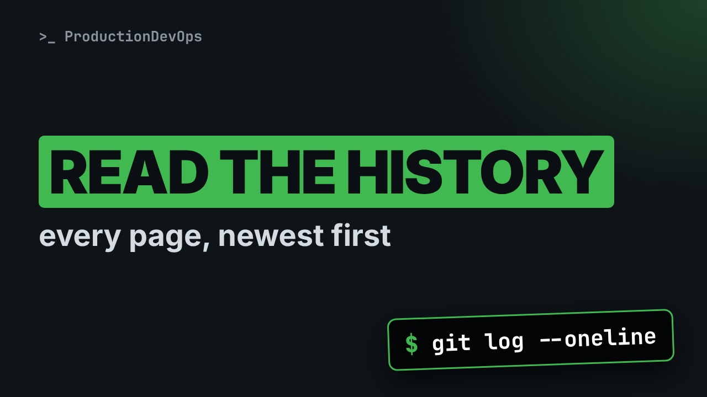
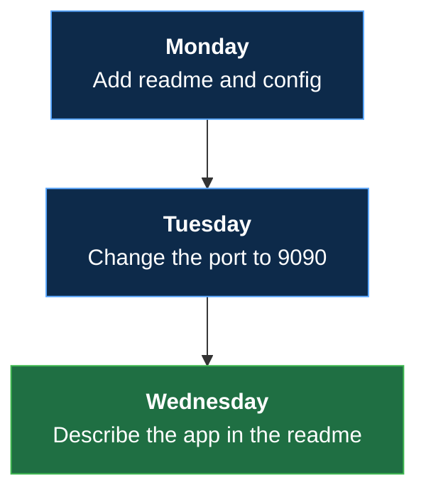
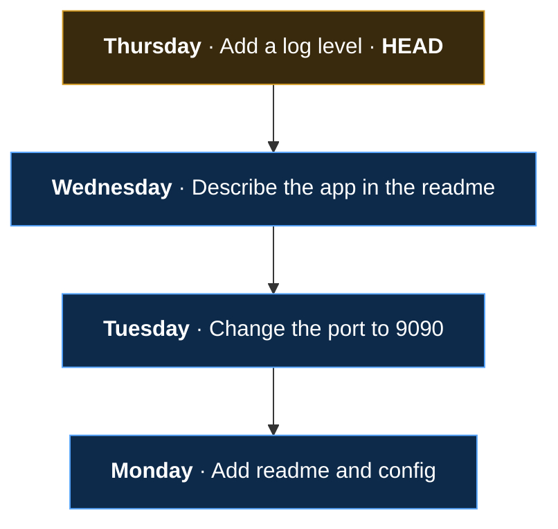

# Looking Back: git log (Git from Zero, No Experience Needed)



**Video:** coming soon on the [channel](https://www.youtube.com/@production-devops).

Your repository has pages now: time to read them. This lesson of Git and GitHub from Zero runs git log for real, reads one entry line by line (commit ID, author, date, message), answers a real question from the history, then uses git log --oneline for the short view and watches a new commit land on top. No experience needed: every new word is explained on screen, and every command runs for real. The challenge and its solution are in the demos repo.

## Files in this folder

- [`acme-app/config.txt`](acme-app/config.txt)
- [`acme-app/readme.txt`](acme-app/readme.txt)
- [`challenge-solution.sh`](challenge-solution.sh) (solution of the challenge: try it yourself first)

## What you need

A Linux shell (a VM, WSL or a container is fine). Everything runs inside this folder.

## Before you start

The video runs these commands first, off screen:

```bash
if [ ! -e .tt-lab ]; then rm -rf /lab/git6 && mkdir -p /lab/git6 && cp -a . /lab/git6/ && rm -f /lab/git6/.tt-runner.sh && touch .tt-lab; fi; n=$(( $(cat .tt-n 2>/dev/null || echo 0) + 1 )); echo $n > .tt-n
export HOME=/lab/git6 && cd /lab/git6/acme-app
git config --global user.name ops && git config --global user.email ops@example.com && git config --global init.defaultBranch main && git config --global core.pager cat
c() { GIT_AUTHOR_DATE="$1" GIT_COMMITTER_DATE="$1" git commit -qm "$2"; }
[ -d .git ] || { git init -q && git add . && c 2026-11-02T09:00:00Z "Add readme and config" && sed -i s/port=8080/port=9090/ config.txt && git add . && c 2026-11-03T10:30:00Z "Change the port to 9090" && echo "It says hello on port 9090." >> readme.txt && git add . && c 2026-11-04T15:45:00Z "Describe the app in the readme"; }
if [ "$n" = 3 ] && ! grep -q log_level config.txt; then echo log_level=info >> config.txt; fi
PROMPT_COMMAND='HOME=/lab/git6; PS1="\[\e[1;32m\]sre@lab\[\e[0m\]:\[\e[1;34m\]\w\[\e[0m\]$ "'
```

## The lesson, step by step

The same explanations as the video, with every command. Read it, then run it yourself.

Your book has pages now, and today you read them. At the end: which page changed the port? You will find it in seconds.

To follow along, you need a terminal with Git. And a few commits, from lesson five. Or just watch. Every step is on screen.

### The plan

This is lesson six of Git and GitHub from Zero. First, our history, drawn. Then, the new command: git log. Then we read one entry, line by line. And the short view: one line for each page.

### The history

**Our history so far**



After lesson five, one more page was saved, on Wednesday. So our book has three pages, from Monday to Wednesday.

- `log — A list of what happened, one entry per event (like the book's list of versions, newest on top)`: 
New word: log. A log is a list of what happened, one entry per event. Here, the book's list of versions.

### git log

Here is the one new command: git log. It shows the history. The newest commit comes first. It only reads. It changes nothing.

We are in acme app. We type git log, and press Enter.

```console
$ git log
```

Three entries. Each one starts with the word commit. The newest is on top: Wednesday first, Monday last.

```
commit 639e2f84b0be0189ec79f963e4993e3970223037 (HEAD -> main)
Author: ops <ops@example.com>
Date:   Wed Nov 4 15:45:00 2026 +0000

    Describe the app in the readme
```

Line one: the commit ID, all forty letters and digits. The part in brackets comes back soon. Line two: the author. Who saved this page. Line three: the date and time. When it was saved. After an empty line, the message, moved to the right. Why the page exists.

### So far

So far: git log lists every commit, newest first. Each entry has an ID, an author, a date, and a message. Next: which page changed the port? A shorter view helps.

### Short view

Git log dash dash one line shows one line per commit. The short ID, then the message. Handy when the history is long.

Which page changed the port? We type git log dash dash one line.

```console
$ git log --oneline
```

Three lines. On each one: the short ID, then the message. The port changed on the middle line: change the port to nine zero nine zero. Found it. On the top line, in brackets: head, arrow, main. That is where you are.

- `HEAD — Git's marker for the commit you are on now (like a bookmark in the recipe book: you are here)`: 
New word: head, in capitals. It is Git's marker for the commit you are on now. A bookmark: you are here.

### A new page

Off screen, we added a log level line to config. We put it on the tray.

```console
$ git add config.txt
```

And we sign it, with a message.

```console
$ git commit -m "Add a log level"
```

Now, the short view again.

```console
$ git log --oneline
```

Four lines. The new page is on top, and head moved with it.

**Four pages, newest on top**



This is the order git log uses: newest on top, oldest at the bottom. The bookmark sits on the newest page.

### Good to know

Good to know. On your computer, a long log opens page by page. Press q to leave. In this lab, Git is set to print it all at once. And the first seven characters of an ID are enough to name a commit.

### Recap

Recap: git log shows the history, newest first. Each entry has an ID, an author, a date, and a message. Dash dash one line gives one line each. Head means: you are here. Your challenge: in your practice repo, run git log dash dash one line. How many pages are there? The solution is in the demo repo.

### Where next

Where next? Lesson seven: branches, drawn. Try a new idea, without touching the main line.

Next lesson: branches, drawn. Subscribe so you do not miss it.

## All the commands, to copy

Run them from inside this folder, in this order (some are expected to fail: that is the point of the demo).

```bash
git log
git log --oneline
git add config.txt
git commit -m "Add a log level"
```

## Challenge

Your challenge: in your practice repo, run git log dash dash one line. How many pages are there? The solution is in the demo repo.

When you have tried: [`challenge-solution.sh`](challenge-solution.sh).

---

From the [ProductionDevOps](https://www.youtube.com/@production-devops) channel: real-world DevOps and SRE, explained with real commands.
