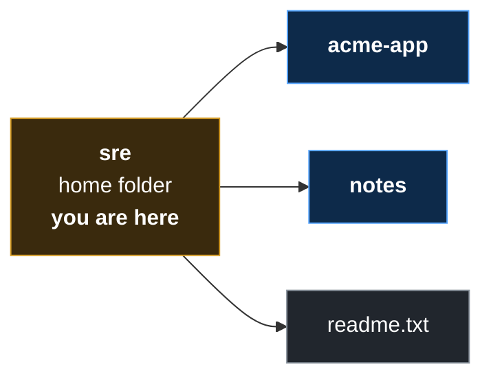
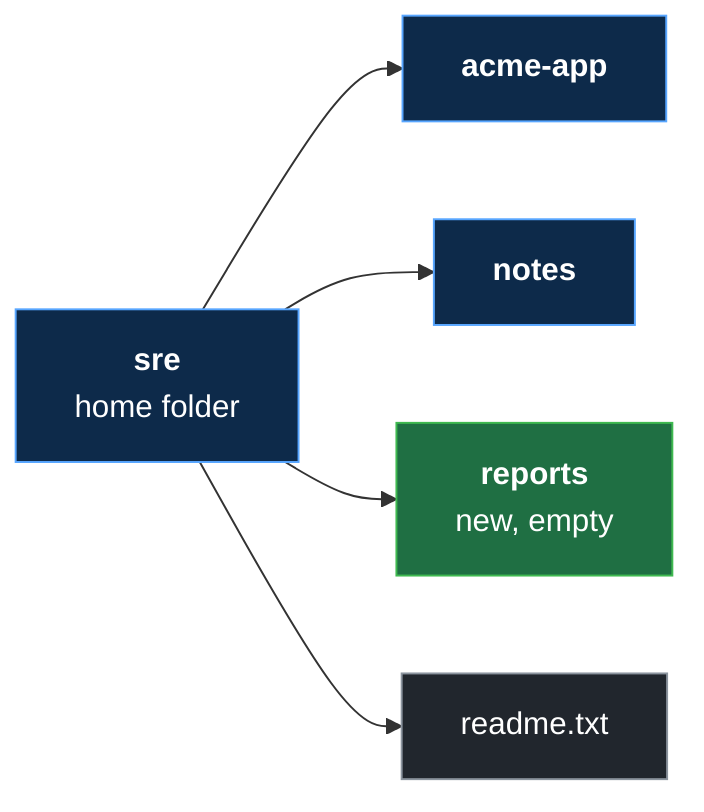
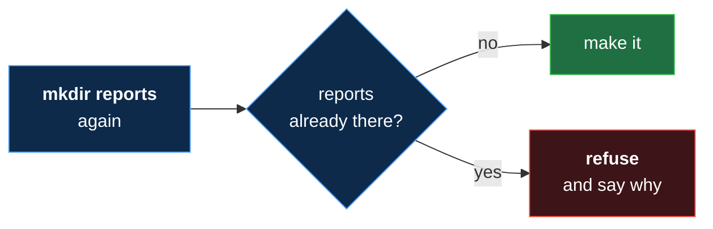

# Making Folders in the Linux Terminal: mkdir (No Experience Needed)


**Video:** https://youtu.be/E2sdvqy5IHQ

Until now you only looked. This lesson of Linux from Zero adds one command, mkdir, and you change the cabinet for the first time: you make a folder, check it with ls, make a folder inside it, and see what happens when you make the same folder twice. No experience needed: every new word is explained on screen, and every command runs for real. The challenge and its solution are in the demos repo.

## Files in this folder

- [`acme-app/config.txt`](acme-app/config.txt)
- [`acme-app/logs/app.log`](acme-app/logs/app.log)
- [`notes/ideas.txt`](notes/ideas.txt)
- [`notes/todo.txt`](notes/todo.txt)
- [`readme.txt`](readme.txt)
- [`challenge-solution.sh`](challenge-solution.sh) (solution of the challenge: try it yourself first)

## What you need

A Linux shell (a VM, WSL or a container is fine). Everything runs inside this folder.

## Before you start

The video runs these commands first, off screen:

```bash
mkdir -p /lab && ln -sfn "$PWD" /lab/sre && cd /lab/sre && export HOME=/lab/sre
alias ls='ls --color=auto'
PROMPT_COMMAND='PS1="\[\e[1;32m\]sre@lab\[\e[0m\]:\[\e[1;34m\]\w\[\e[0m\]$ "'
```

## The lesson, step by step

The same explanations as the video, with every command. Read it, then run it yourself.

Until now, you only looked. Today you change the cabinet for the first time: you add a folder. And at the end, what happens if you make the same folder twice?

To follow along, you need a terminal. Lesson two shows how to get one. Work in your home folder. It is yours.

### The plan

This is lesson seven of Linux from Zero. First, the new command: make dir. Then, make a folder, and check it. Then, a folder inside it. And what happens if it already exists.

### The cabinet

**Our cabinet, before**



Here is our home folder: two folders and one file. Let's add a folder for reports.

### The command

Here is the one new command: make dir. Make directory. Make dir reports makes a new folder, called reports. It appears where you are, and it is empty.

### Make one

We want a folder for reports. We type make dir reports, and press Enter.

```console
$ mkdir reports
```

No message at all. On Linux, that usually means: it worked. Let's check with l s, from lesson four.

```console
$ ls
```

And what is inside reports? Nothing yet. L s prints nothing for an empty folder.

```console
$ ls reports
```

- `silent success — A command that worked often prints nothing at all (like the clerk nods, and gets on with it)`: 
This has a name: silent success. A command that worked often prints nothing. Like a clerk who just nods.

**Our cabinet, after**



Here is the cabinet now. A new, empty folder called reports, right where we were standing.

Choose short, clear names, like reports, or old dash notes. Avoid spaces. Use a dash or an underscore instead. Lowercase names are the easiest to type.

### So far

So far: make dir and a name makes a folder, where you are. No message means it worked, and l s confirms it. Next: a folder inside a folder, and the same folder twice.

### Inside it

A new terminal starts at home. We walk into reports, with c d.

```console
$ cd reports
```

Now make dir again, for a folder called drafts.

```console
$ mkdir drafts
```

L s shows it: drafts, inside reports.

```console
$ ls
```

And where am I? Inside reports, inside home.

```console
$ pwd
```

**Folders inside folders**


Folders inside folders, as deep as you like. The cabinet grows the way you need.

### Twice?

**The same name, twice?**



Before making a folder, make dir checks the name. If a folder with that name is already there, it refuses, and says why.

What if we make reports again? It is already there.

```console
$ mkdir reports
```

Make dir refuses, and says why: file exists. For Linux, a folder is a kind of file. Was anything lost? We list reports.

```console
$ ls reports
```

Drafts is still there. Nothing was lost.

Why is refusing good? Make dir never replaces a folder. So what is inside stays safe. And the message says why. Lesson nine reads messages like this with you.

### Good to know

After every change, look. L s confirms it. Names are case sensitive. Capital R reports is another folder. Removing folders comes in a later course, with care.

### Recap

Recap: make dir and a name makes a new, empty folder, where you are. No message means it worked. If it is already there, it refuses, and nothing is lost. Your challenge: inside notes, make a folder called old, and check it with l s. The solution is in the demo repo.

### Where next

Where next? Lesson eight: ask a command for help. Every command can explain itself.

Next lesson: asking a command for help. Subscribe so you do not miss it.

## All the commands, to copy

Run them from inside this folder, in this order (some are expected to fail: that is the point of the demo).

```bash
mkdir reports
ls
ls reports
cd reports
mkdir drafts
pwd
```

## Challenge

Your challenge: inside notes, make a folder called old, and check it with l s. The solution is in the demo repo.

When you have tried: [`challenge-solution.sh`](challenge-solution.sh).

---

From the [ProductionDevOps](https://www.youtube.com/@production-devops) channel: real-world DevOps and SRE, explained with real commands.
