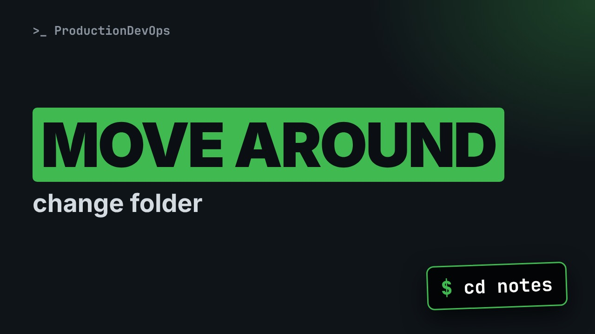
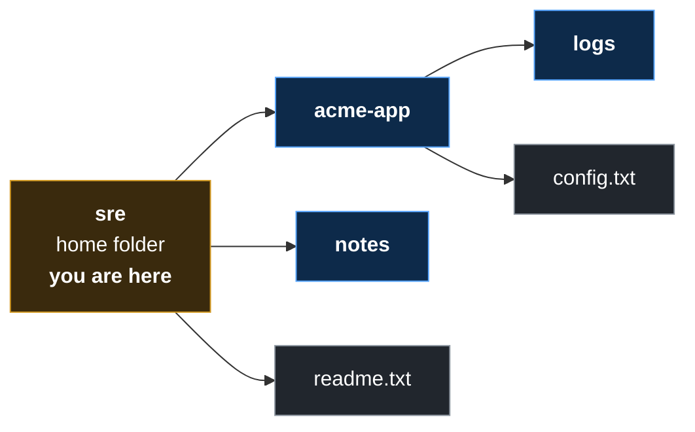
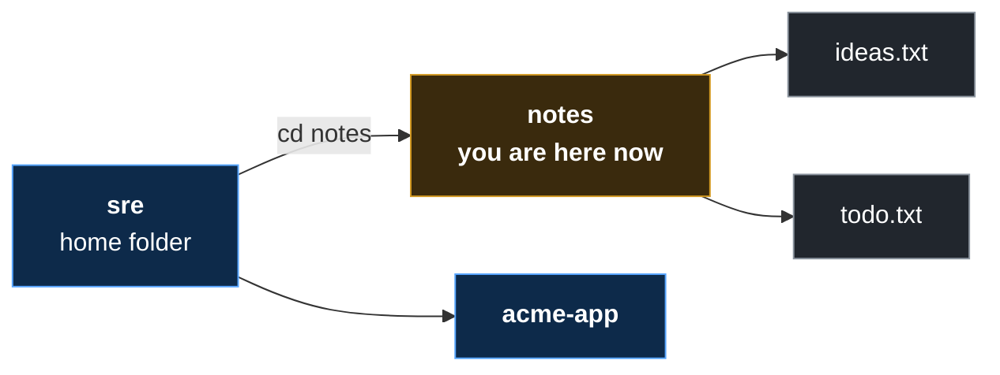
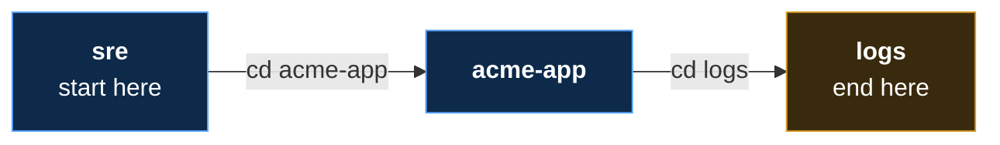

# Moving Around in the Linux Terminal: cd (No Experience Needed)



**Video:** https://youtu.be/DpQi_sZ8T0U

So far you looked at folders from your home folder. This lesson of Linux from Zero adds one command, cd, to walk into a folder, back out to the folder above, two folders deep, and straight home from anywhere. The prompt shows where you are after every move, and pwd confirms it. No experience needed: every new word is explained on screen, and every command runs for real. The challenge and its solution are in the demos repo.

## Files in this folder

- [`acme-app/config.txt`](acme-app/config.txt)
- [`acme-app/logs/app.log`](acme-app/logs/app.log)
- [`notes/ideas.txt`](notes/ideas.txt)
- [`notes/todo.txt`](notes/todo.txt)
- [`readme.txt`](readme.txt)
- [`challenge-solution.sh`](challenge-solution.sh) (solution of the challenge: try it yourself first)

## What you need

A Linux shell (a VM, WSL or a container is fine). Everything runs inside this folder.

## Before you start

The video runs these commands first, off screen:

```bash
mkdir -p /lab && ln -sfn "$PWD" /lab/sre && cd /lab/sre && export HOME=/lab/sre
alias ls='ls --color=auto'
PROMPT_COMMAND='PS1="\[\e[1;32m\]sre@lab\[\e[0m\]:\[\e[1;34m\]\w\[\e[0m\]$ "'
```

## The lesson, step by step

The same explanations as the video, with every command. Read it, then run it yourself.

So far, you looked at folders from your home folder. Today you walk into them, and back out. And at the end, the one-word way home, from anywhere.

To follow along, you need a terminal. Lesson two shows how to get one. Or just watch. Every step is on screen.

### The plan

This is lesson five of Linux from Zero. First, walk into a folder. Then, walk back out. Then, two folders deep. And the way home, from anywhere.

### The cabinet

**Our cabinet: you are at home**



Here is our cabinet again. A new terminal starts in your home folder. Today, you walk to the other folders.

### The command

Here is the one new command: c d. Change directory. C d notes means: walk into the folder notes. After each move, the prompt shows where you are.

### Walk in

We want to work inside notes. We type c d notes, and press Enter.

```console
$ cd notes
```

Nothing is printed. But look at the prompt: tilde, slash notes. Where am I? P w d agrees: slash notes, at the end.

```console
$ pwd
```

And l s now lists what is in notes.

```console
$ ls
```

**You moved**



On our cabinet, you walked from home into notes. Now l s lists notes, because that is where you stand.

Read the prompt. Tilde alone means you are home. Tilde slash notes means: in notes, inside home. The prompt moves with you, after every c d.

### Walk out

- `parent folder — The folder one level up, the one that holds this folder (like closing a folder, and going back to the bigger one that holds it)`: 
New word: parent folder. It is the folder one level up, the one that holds this folder. Like going back to the bigger folder around it.

A new terminal starts at home. So, first, into notes again.

```console
$ cd notes
```

Now back out. C d, a space, and two dots.

```console
$ cd ..
```

Two dots mean the parent folder. The prompt shows only tilde: we are home.

### So far

So far: c d and a name walks into a folder. C d dot dot goes up one level, to the parent. Next: two folders deep, and the way home.

### Two deep

**Two folders deep**



The log of acme app is two folders deep. We walk one folder at a time: acme app, then logs.

First, into acme app.

```console
$ cd acme-app
```

Then into logs, which is inside acme app.

```console
$ cd logs
```

Where am I? Four parts now, ending with acme app, slash logs.

```console
$ pwd
```

Now the way home. Just c d, with nothing after it.

```console
$ cd
```

The prompt shows tilde. We are home, in one word.

Three ways to move. C d and a name: into a folder. C d dot dot: up one level. And c d alone: home, from anywhere.

### Good to know

Names are case sensitive. Capital N notes is not notes. A new terminal window always starts in your home folder. The Tab key finishes a name for you. Type c d n o, and press Tab. C d changes only where you are. No files change.

### Recap

Recap: c d and a name, in. C d dot dot, up. C d alone, home. The prompt and p w d show where you are. Your challenge: walk to logs, ask p w d, then come home in one word. The solution is in the demo repo.

### Where next

Where next? Lesson six: read a file. The log of acme app, line by line.

Next lesson: reading a file. Subscribe so you do not miss it.

## All the commands, to copy

Run them from inside this folder, in this order (some are expected to fail: that is the point of the demo).

```bash
cd notes
pwd
ls
cd ..
cd acme-app
cd logs
cd
```

## Challenge

Your challenge: walk to logs, ask p w d, then come home in one word. The solution is in the demo repo.

When you have tried: [`challenge-solution.sh`](challenge-solution.sh).

---

From the [ProductionDevOps](https://www.youtube.com/@production-devops) channel: real-world DevOps and SRE, explained with real commands.
