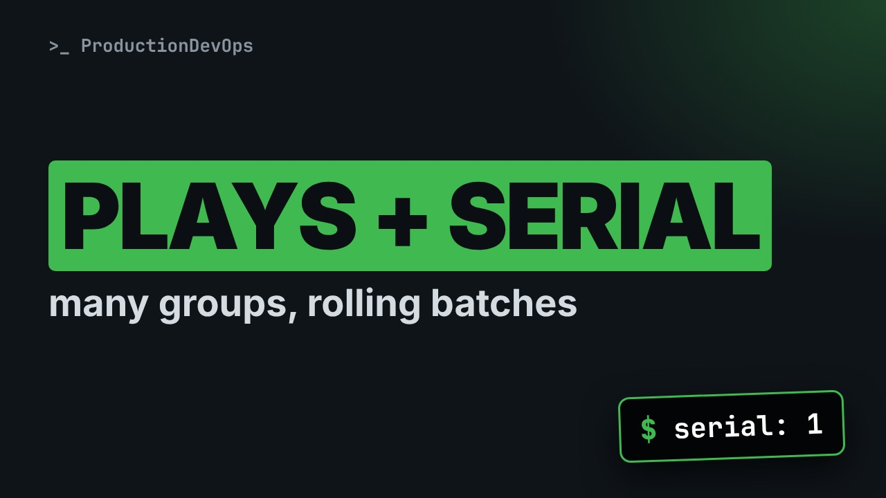
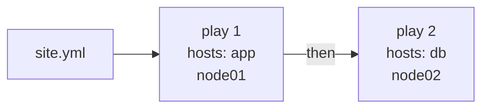

# Ansible Plays, become and serial: One Playbook, Many Groups, Rolling Batches



**Video:** coming soon on the [channel](https://www.youtube.com/@production-devops).

Lesson 9 of Ansible for RHCE. One playbook, several plays: each play targets its own group, and plays run in order. We set become for a whole play or for one task, run a task as another user with become_user, skip fact gathering with gather_facts false, then roll a change out one host at a time with serial, and pick the host order with order. Every step is run on real managed nodes, and the output shows the batches. Challenge and solution in the demos repo.

## Files in this folder

- [`ansible.cfg`](ansible.cfg)
- [`inventory.ini`](inventory.ini)
- [`lab/up.sh`](lab/up.sh)
- [`reverse.yml`](reverse.yml)
- [`rolling.yml`](rolling.yml)
- [`site.yml`](site.yml)
- [`challenge-solution.yml`](challenge-solution.yml) (solution of the challenge: try it yourself first)

## What you need

A Linux shell (a VM, WSL or a container is fine). Everything runs inside this folder.

## Before you start

The video runs these commands first, off screen:

```bash
if [ -f .lab-reset ]; then bash lab/up.sh; else bash lab/up.sh reset && touch .lab-reset; fi >/dev/null 2>&1
```

## The lesson, step by step

The same explanations as the video, with every command. Read it, then run it yourself.

The app servers and the database need different steps, as different users, in the right order. And you never want to update every server at once. One playbook can do all of that.

### The plan

This is lesson 9 of Ansible for RHCE. Here is the plan. First, several plays in one file, each for a different group. Then become, for a whole play or for one task, and become user. Then gather facts false, to skip the automatic first task. And serial and order: rolling batches, in the order you choose.

### Several plays

Our inventory has two new groups: app, with node zero one, and db, with node zero two.

```console
$ ansible-inventory --graph
```

Each play in a playbook can target its own group.

**One playbook, two plays**



site dot yml holds two plays. Ansible runs them in order. The second play starts only when the first one has finished on all its hosts.

```
---
- name: Prepare the app server
  hosts: app
  become: true
  gather_facts: false
  tasks:
    - name: Create the app directory
      ansible.builtin.file:
        path: /srv/acme-app
        state: directory
        mode: "0755"
```

The first play targets the app group. become true at play level: every task of this play runs as root. gather facts false skips the automatic Gathering Facts task. The play is faster, but facts about the host are not available.

```
- name: Prepare the database server
  hosts: db
  gather_facts: false
  vars:
    ansible_pipelining: true    # lab only: no ACL tools on the nodes
  tasks:
    - name: Create the database user
      ansible.builtin.user:
        name: acmedb
      become: true
```

The second play: a new list item, at the same level as the first play, for the db group. There is no become at play level here. This task sets become true for itself only. One lab detail. To run a task as an unprivileged user, Ansible needs ACL tools on the node. Our minimal nodes lack them, and pipelining avoids the temporary files that need them.

```
    - name: Create the data directory as acmedb
      ansible.builtin.file:
        path: /tmp/acmedb-data
        state: directory
        mode: "0700"
      become: true
      become_user: acmedb
```

become true, with become user acmedb. The task runs as acmedb, not as root. So the directory will belong to acmedb, the user who created it.

```console
$ ansible-playbook site.yml | grep -v '^$'
```

Playbook output has many empty lines. We drop them, so every run fits on the screen.

- `ansible-playbook site.yml`: run the playbook
First, we run the playbook, as usual.

- `| grep -v`: keep lines that do NOT match
The pipe sends the output to grep. Dash v inverts it: keep only the lines that do not match.

- `'^$'`: an empty line
The pattern: caret is the start of the line, dollar is the end. Nothing in between: an empty line.

Which hosts does each play touch? We run it, with our filter.

```console
$ ansible-playbook site.yml | grep -v '^$'
```

First the app play, on node zero one only. Then the database play, on node zero two only. And no Gathering Facts task. The recap adds up every play: one line per host, whatever play it was in.

Who owns the new directory on node zero two? stat prints the owner, the mode and the name.

```console
$ ssh node02 "stat -c '%U %a %n' /tmp/acmedb-data"
```

acmedb: the task really ran as that user.

### become

Privilege escalation can be set in several places. The closest one wins. At play level, it applies to every task in the play. At task level, it overrides the play, for that task only. become false turns it off for one task. become user defaults to root, and become method defaults to sudo. You can also use dash b on the command line, or set become in ansible dot cfg.

### serial

```
---
- name: Rolling update of acme-app
  hosts: web
  become: true
  gather_facts: false
  serial: 1
  tasks:
    - name: Write the app config
      ansible.builtin.copy:
        dest: /etc/acme-app.conf
        content: "version=2.0\n"
```

By default, a play runs each task on all its hosts in parallel. Here, both nodes in web. serial one: the play runs from start to end on one host, then on the next one. That is a rolling update.

We run it.

```console
$ ansible-playbook rolling.yml | grep -v '^$'
```

The PLAY header appears twice: one batch per host. node zero one first, then node zero two, in inventory order. If a batch fails, the next batches do not start. A bad change stops at the first host.

serial takes a number, a percentage, or a list. serial one: one host at a time. serial thirty percent: a share of the hosts in each batch. A list: one host first, as a canary, then five, then half of the rest each time.

### order

order picks the host order. reverse dot yml is the same playbook, with one line added. diff shows it.

```console
$ diff rolling.yml reverse.yml
```

order reverse inventory: the last host in the inventory goes first.

We run it.

```console
$ ansible-playbook reverse.yml | grep -v '^$'
```

node zero two goes first now. And both say ok: the config file already had this content. Other values are sorted, reverse sorted, and shuffle. The default is inventory.

### Gotchas

Four things to watch. Each play needs its own hosts line. become and gather facts do not carry over from the play above. With gather facts false, any task that uses host facts fails. We will use facts in a later lesson. Becoming an unprivileged user needs ACL tools on the node, or pipelining. RHEL ships the ACL tools. order is easiest to see with serial. Without it, all hosts run in parallel, and answers come back in any order.

### Recap

Let's recap. One playbook can hold many plays. Each has its own hosts, and they run in order. become at play level or task level, and become user to run as someone else. serial for rolling batches, and order to choose who goes first. Your challenge: add a third play to site dot yml. On all hosts, one at a time, in sorted order, write slash etc slash motd as root, with no fact gathering. The solution is in the demo repository.

Plays split the work, become picks the user, serial keeps the service up. Next lesson: handlers, the tasks that run only when something changed. Subscribe so you do not miss it.

## All the commands, to copy

Run them from inside this folder, in this order (some are expected to fail: that is the point of the demo).

```bash
ansible-inventory --graph
ansible-playbook site.yml | grep -v '^$'
ssh node02 "stat -c '%U %a %n' /tmp/acmedb-data"
ansible-playbook rolling.yml | grep -v '^$'
diff rolling.yml reverse.yml
ansible-playbook reverse.yml | grep -v '^$'
```

## Challenge

Your challenge: add a third play to site dot yml. On all hosts, one at a time, in sorted order, write slash etc slash motd as root, with no fact gathering. The solution is in the demo repository.

When you have tried: [`challenge-solution.yml`](challenge-solution.yml).

---

From the [ProductionDevOps](https://www.youtube.com/@production-devops) channel: real-world DevOps and SRE, explained with real commands.
