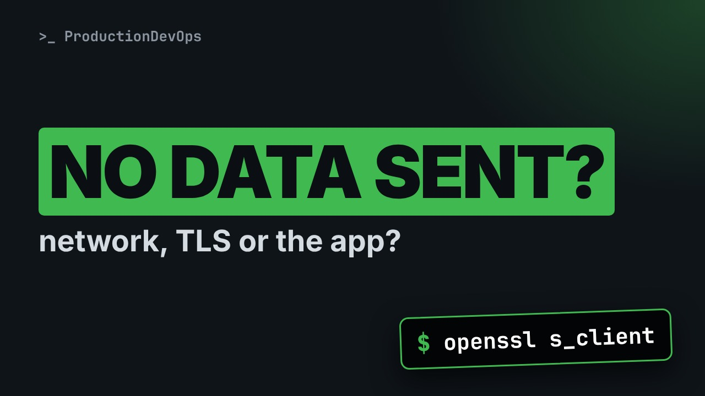
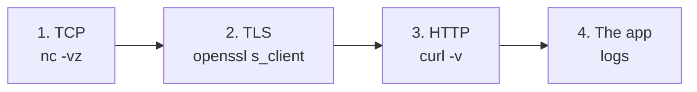

# Is It the Network, TLS or the App? 3 Commands That Tell You



**Video:** https://youtu.be/mdFgxKXBI8g

The container is up, the port is published, and the browser says the page did not send any data. Before restarting anything, check one layer at a time: TCP with nc, TLS with openssl s_client, HTTP with curl. We run all three for real against a small HTTPS test server and find two classic mistakes: plain http on a TLS port, and the wrong path.

## Files in this folder

- [`serve.sh`](serve.sh)
- [`tls-server.py`](tls-server.py)

## What you need

A Linux shell (a VM, WSL or a container is fine). Everything runs inside this folder.

## Before you start

The video runs these commands first, off screen:

```bash
[ -f app.pem ] || openssl req -x509 -newkey rsa:2048 -nodes -keyout app.key -out app.pem -days 365 -subj /CN=app-server 2>/dev/null
./serve.sh app.pem app.key >/dev/null
```

## The lesson, step by step

The same explanations as the video, with every command. Read it, then run it yourself.

The container is up. The port is published. And the browser says: this page didn't send any data. Before you restart anything, three commands tell you which layer is broken.

### The plan

Here is the plan. First, the situation, and why restarting is the wrong first move. Then one command per layer: TCP, TLS, and HTTP. We run them for real, and read what each answer means. And finally, what to check when a layer fails.

### The situation

Here is the situation. It happens all the time with web consoles running in containers. The container is up, and port eighty four forty three is published. In the browser, we open localhost, port eighty four forty three. The result: an empty response. The page did not send any data. Restarting the container is tempting. But it destroys the evidence, and often changes nothing.

### Three layers

**Check one layer at a time**



A web request goes through layers. First a TCP connection. Then the TLS handshake. Then the HTTP request. Only then the application. We test them in this order, with one command each.

### 1. TCP

Layer one, TCP. net cat with dash v z only tries to connect, and reports the result. Nothing is sent.

```console
$ nc -vz 127.0.0.1 8443
```

Succeeded. Something is listening on that port. For comparison, here is a port where nothing listens.

```console
$ nc -vz 127.0.0.1 8444
```

Connection refused: nothing is listening. If it hangs until a timeout instead, a firewall is usually dropping the packets.

### 2. TLS

Layer two, TLS. open S S L s client opens a TLS connection and prints a short summary with dash brief.

```console
$ openssl s_client -connect 127.0.0.1:8443 -servername app-server -brief </dev/null
```

Connection established, with TLS one point three. The server presents a certificate for the name app server. The verification error says the certificate is self signed, so nobody vouches for it. That is a trust problem, not a broken server. The next videos fix it properly.

### 3. HTTP

Layer three, HTTP. First, exactly what the browser did: plain http, on this port.

```console
$ curl -sS http://127.0.0.1:8443/
```

Connection reset, and no data. The server expects a TLS handshake. It receives plain text instead, so it closes the connection. The browser shows this as: no data sent. Some servers, like nginx, answer with a clear error page instead. Many simply close the connection, like this one.

Now with https. Dash k skips the certificate check, only for this test. Dash i shows the response headers.

```console
$ curl -k -i https://127.0.0.1:8443/
```

A four oh four. Not great, but the server is answering. Look at the body: a small script that sends the browser to slash app. So the application does not live at the root. A four oh four on slash does not mean the app is down.

Let's request slash app.

```console
$ curl -k -i https://127.0.0.1:8443/app
```

A three oh two redirect, to the login page. And the login page itself:

```console
$ curl -k -sS -o /dev/null -w '%{http_code}\n' https://127.0.0.1:8443/app/login
```

Two hundred. The application is healthy. Dash w prints only the status code, handy in scripts.

### The verdict

So, what was wrong? Not the server. First, the wrong scheme: http instead of https. That alone gives the empty page. Second, the wrong path: the root instead of slash app. And the self signed certificate is a separate problem, about trust. It explains a warning, not an empty page. No restart was needed, and nothing changed in the container.

### When a layer fails

When a layer does fail, this is where to look next. TCP refused: check that the process listens inside the container, with S S dash L N T, and that the port is published. TCP timeout: look at firewalls, security groups, or a wrong address. TLS fails: read the server logs. Usually a keystore or certificate problem. HTTP five hundred errors: now the application logs are the right place.

### Recap

Let's recap. net cat dash v z: can we connect? open S S L s client: does the TLS handshake work, and which certificate comes back? curl dash i: what does HTTP answer, and where does it redirect? One layer at a time. Then the logs. Restarts come last.

Three commands, one layer at a time, and you know where the problem is. Next in this series: why a certificate that curl accepts is rejected by your browser. Subscribe so you don't miss it.

## All the commands, to copy

Run them from inside this folder, in this order (some are expected to fail: that is the point of the demo).

```bash
nc -vz 127.0.0.1 8443
nc -vz 127.0.0.1 8444
openssl s_client -connect 127.0.0.1:8443 -servername app-server -brief </dev/null
curl -sS http://127.0.0.1:8443/
curl -k -i https://127.0.0.1:8443/
curl -k -i https://127.0.0.1:8443/app
curl -k -sS -o /dev/null -w '%{http_code}\n' https://127.0.0.1:8443/app/login
```

---

From the [ProductionDevOps](https://www.youtube.com/@production-devops) channel: real-world DevOps and SRE, explained with real commands.
