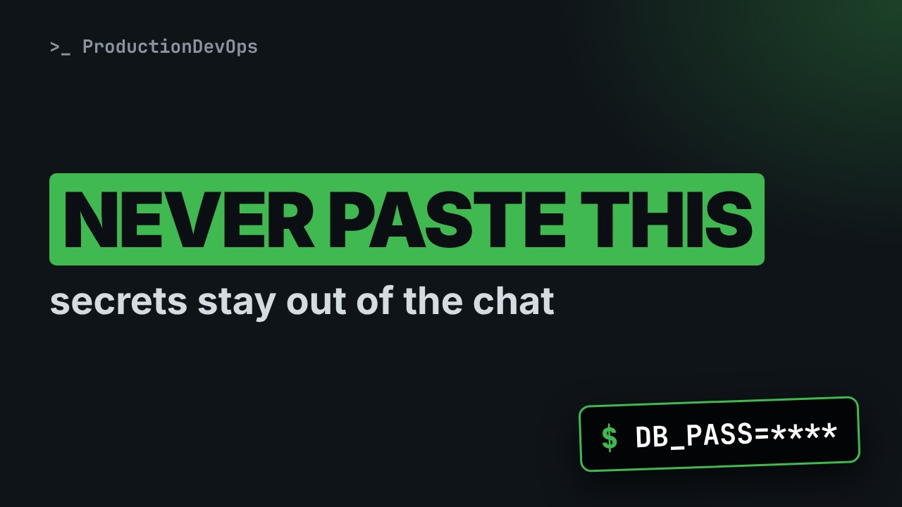
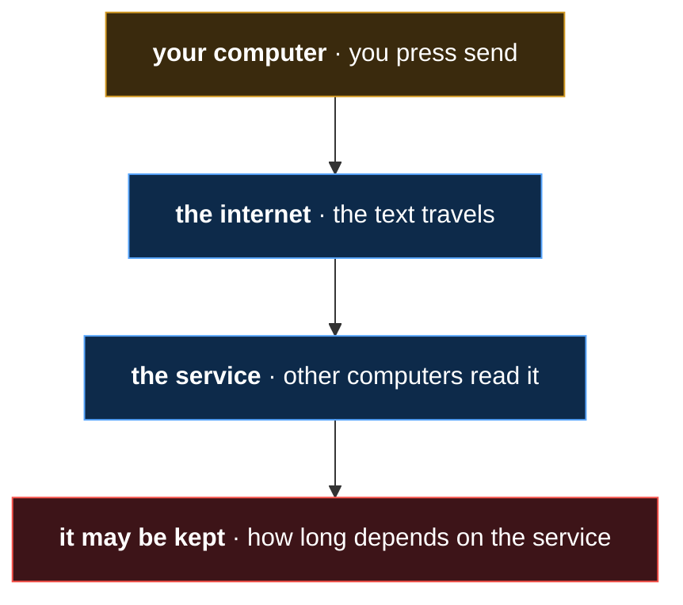
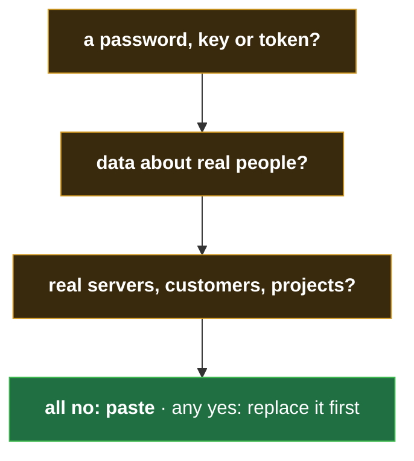

# Never Paste Secrets: What Not to Share with AI (AI for Ops: the Safe Basics)



**Video:** coming soon on the [channel](https://www.youtube.com/@production-devops).

Your message to an AI assistant leaves your computer, and you often cannot take it back. This lesson of AI Assistants for Ops: the Safe Basics shows the kinds of things you must never paste (passwords and keys, data about real people, the internal details of your company), how to share a problem safely with placeholders, a ten-second check before every paste, and what to do if a secret slipped out. Every example is fictional and every value is hidden on screen. Valid for any assistant, nothing to install. The challenge and its solution are in the demos repo.

## Files in this folder

- [`challenge-solution.md`](challenge-solution.md) (solution of the challenge: try it yourself first)

## What you need

A Linux shell (a VM, WSL or a container is fine). Everything runs inside this folder.

## The lesson, step by step

The same explanations as the video, with every command. Read it, then run it yourself.

What you paste into an AI assistant leaves your computer. In five minutes: what you must never paste, and a ten-second check before every paste.

You will need lessons one and two: the prompt, and likely text. Nothing to install. Only pictures and cards. Every example here is fictional, and every value is hidden on screen.

### The plan

This is lesson three of AI Assistants for Ops. First, where your message goes. Then, what you must never paste. How to share a problem safely. And a ten-second check.

### Where it goes

**Where your message goes**



When you press send, the text leaves your computer. Other computers read it, and they may keep it. For how long depends on the service and its settings.

So think of it this way. Once sent, the text is out of your hands. Paste only what you could show to a stranger. And your company's rules come first. Some tools are approved, some are not.

### Secrets

- `secrets — Things that give access: a password, a key, a token (like the combination of the restaurant safe: you never tell the helper)`: 
New word: secrets. A secret is anything that gives access, like a password, a key or a token. Like the combination of the restaurant safe, that you never tell the helper.

Here is a typical settings file. The real values are hidden on screen, on purpose.

```
DB_HOST=db.example.com
DB_USER=acme
DB_PASS=****
API_KEY=****
```

Where the database is, and the user name. These are not secret on their own. The database password. In a real file, the real password would be here. An A P I key: a long code that lets a program use a service. Same rule.

The second kind: data about real people. Here, a list of customers, made up for this lesson.

```
name,email,city
Ana Example,ana@example.com,Springfield
Ben Sample,ben@example.com,Shelbyville
```

Names, email addresses, cities. Real people never agreed to share them with a chat. Even one line is too much. Make up a fake line instead.

The third kind: the inside of your company. Real server names and network addresses. Names of customers, and of internal projects. And anything marked internal or confidential.

### So far

So far: text you send is out of your hands. Never paste secrets, data about people, or the inside of your company. Next: how to still get help, safely. If this is helping, subscribe. The next lesson turns a five-word question into a prompt that works.

### Share safely

- `placeholder — A stand-in word, written where the real value was (like writing 'the code' on the ticket, not the real combination)`: 
The trick is a placeholder. It is a stand-in word, written where the real value was. Like writing the code on a ticket, and never the real combination.

Here is the same problem, ready to share.

```
DB_HOST=<db-host>
DB_USER=<db-user>
DB_PASS=<removed>
Error: login failed for user <db-user>
```

Host and user become placeholders, in angle brackets. The password is simply removed. The assistant does not need it. The error message stays. That is what the assistant needs to help.

### The check

**The ten-second check**



Before every paste, ask three questions: any secret, any data about people, any real servers or customers? All no: paste. Any yes: replace it first.

### If it happens

If a secret slipped out, treat it as leaked. Deleting the chat is not enough. Change it: a new password, or a new key. And tell your team, or your security contact, today. No shame, just speed.

### Recap

Recap. Text you send is out of your hands. Never paste secrets, data about people, or the inside of your company. Use placeholders, and keep the error message. Your challenge: four lines, in the demo repo. Which two must you replace before you paste?

### Where next

Where next? Lesson four: asking well, with context, limits and examples.

Next lesson: asking well, with context, limits and examples. Subscribe, and that lesson finds you.

## Challenge

Your challenge: four lines, in the demo repo. Which two must you replace before you paste?

When you have tried: [`challenge-solution.md`](challenge-solution.md).

---

From the [ProductionDevOps](https://www.youtube.com/@production-devops) channel: real-world DevOps and SRE, explained with real commands.
