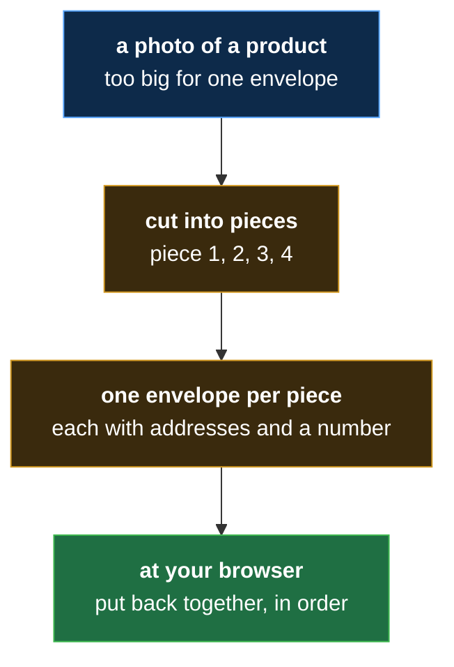
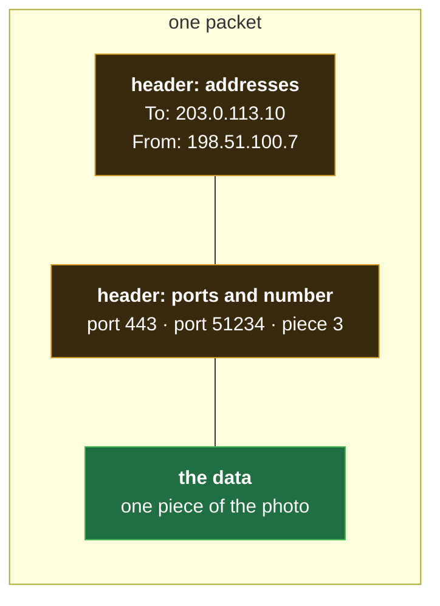
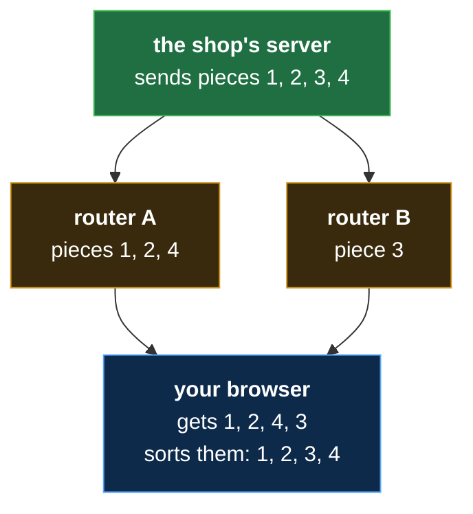
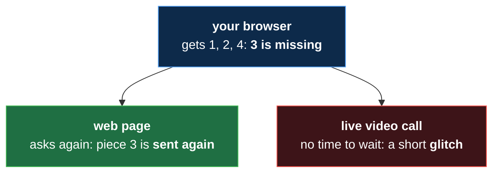

# Packets: Data in Small Envelopes (How the Internet Works, No Experience Needed)

**Video:** coming soon on the [channel](https://www.youtube.com/@production-devops).

A photo, a video, a whole web page: none of them crosses the internet in one piece. This lesson of How the Internet Works, Simply explains packets with the postal service: a big parcel split into many small numbered envelopes. What is written on each one, why small envelopes are better, why they can take different roads and arrive out of order, and what happens when one gets lost. No terminal, nothing to install, no experience needed. Every new word is explained on screen. The challenge and its solution are in the demos repo.

## Files in this folder

- [`challenge-solution.md`](challenge-solution.md) (solution of the challenge: try it yourself first)

## What you need

A Linux shell (a VM, WSL or a container is fine). Everything runs inside this folder.

## The lesson, step by step

The same explanations as the video, with every command. Read it, then run it yourself.

A photo, a video, a whole web page. None of them travels in one piece. At the end: what happens when one envelope gets lost.

For this lesson you need nothing. Just watch. No terminal and no code. Only pictures. About five minutes.

### The plan

This is lesson five of How the Internet Works, Simply. First, a big parcel, cut into envelopes. Then, what is written on each envelope. Then, why envelopes take different roads. And what happens when one gets lost.

### Envelopes

- `packet — A small piece of data, with addresses written on the outside (like one envelope of a big parcel, split into many)`: 
New word: packet. A packet is a small piece of data, with addresses on the outside. Like one envelope of a big parcel, split into many.

**A photo from the shop, in packets**

The shop sends you a product photo. It is too big for one envelope, so it is cut into pieces. Each piece travels in its own envelope.

How small? On most networks, a packet carries at most about fifteen hundred letters of text. That is less than one page of a book. So one web page, with pictures, often needs hundreds of packets.

### On the outside

- `header — The labels on the outside of a packet (like everything written on the envelope, not the letter inside)`: 
New word: header. The header is the labels on the outside of a packet. Everything written on the envelope, not the letter inside.

**One packet, opened up**

Here is one packet, opened up. On the outside, the header: the two addresses, the two ports, and a number. Inside, the data.

Why a number? To put the pieces back in order. And to notice when one is missing.

### So far

So far: big data travels as many small packets. Each one has a header: addresses, ports, and a number. Next: the road they take, and the lost envelope.

### The roads

Remember routers, the post offices of lesson one. Each one reads the To address in the header. It never needs to open the data inside. Then it sends the packet one step closer to that address.

**Different roads, any order**

Routers choose the road for each packet. Here, piece three takes another road, and arrives last. Your browser sorts the pieces by number.

Why small envelopes? Many conversations share the same roads, taking turns. Nobody waits behind one huge parcel. And if one is lost, only that one is sent again.

### Lost

- `packet loss — Packets that never arrive (like a letter lost in the post)`: 
New words: packet loss. Packet loss means packets that never arrive. Like a letter lost in the post.

**One envelope gets lost**

Piece three never arrives. For a web page, it is simply sent again. For a live call, there is no time: you hear a short glitch.

Why does a packet get lost? A router can be too busy, with a full waiting line. Or the Wi-Fi signal is weak, or a cable is bad. A little loss is normal. A lot makes everything feel slow.

### Good to know

Good to know: the rules that resend and sort packets have a name, T C P. Every header field, captured for real, is in the course Networking Fundamentals. And in lesson eight, you send packets yourself.

### Recap

Recap: data travels in small packets, like envelopes. The header outside has addresses, ports and a number. The data is inside. Packets can take different roads. The numbers fix the order. Your challenge: pieces one, two, four and five arrive. What is missing, and what happens next? The answer is in the demo repo.

### Where next

Where next? Lesson six: your home network, and the router. Then lesson seven: clients and servers.

Next lesson: your home network, and the router. Subscribe so you do not miss it.

## Challenge

Your challenge: pieces one, two, four and five arrive. What is missing, and what happens next? The answer is in the demo repo.

When you have tried: [`challenge-solution.md`](challenge-solution.md).

---

From the [ProductionDevOps](https://www.youtube.com/@production-devops) channel: real-world DevOps and SRE, explained with real commands.
