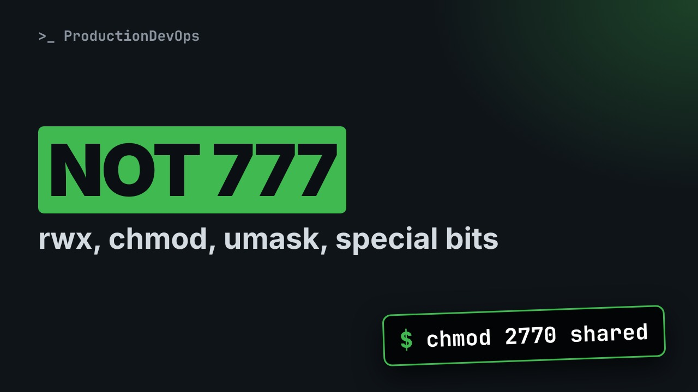
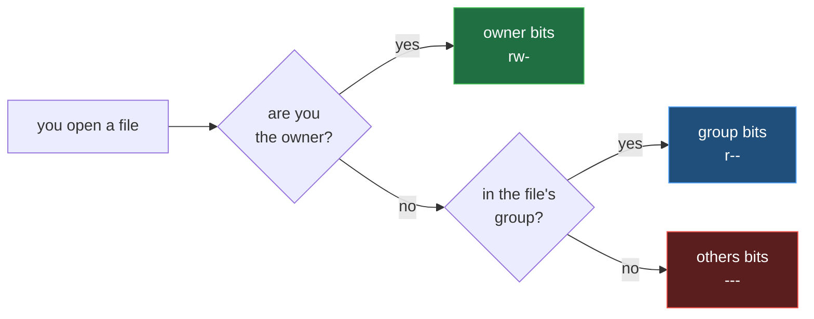

# Linux Permissions and Ownership: rwx, chmod, chown, umask, setuid, setgid and sticky



**Video:** coming soon on the [channel](https://www.youtube.com/@production-devops).

Permission denied, so someone runs chmod 777. It is never the fix. In lesson 7 we prove, live and as three different users, what r, w and x really mean on a file and on a folder, how Linux picks the owner, group or others bits, chmod in symbolic and octal form, chown and chgrp, how umask decides the mode of every new file, and the three special bits: setuid (passwd), setgid (a shared group folder) and sticky (/tmp). Up to date for RHEL/AlmaLinux 9 and Ubuntu 24.04. Lesson 7 of Linux from User to Server Admin.

## Files in this folder

- [`hello.sh`](hello.sh)
- [`notes.txt`](notes.txt)
- [`report.txt`](report.txt)
- [`challenge-solution.sh`](challenge-solution.sh) (solution of the challenge: try it yourself first)

## What you need

A Linux shell (a VM, WSL or a container is fine). Everything runs inside this folder.

## Before you start

The video runs these commands first, off screen:

```bash
getent group acme >/dev/null || groupadd acme
id dev1 >/dev/null 2>&1 || useradd -M -s /bin/bash -G acme dev1; id dev2 >/dev/null 2>&1 || useradd -M -s /bin/bash -G acme dev2; id visitor >/dev/null 2>&1 || useradd -M -s /bin/bash visitor
umask 0022
chown dev1:acme notes.txt; chmod 640 notes.txt; chown root:root hello.sh report.txt; chmod 644 hello.sh report.txt
mkdir -p box shared drop; echo hello > box/a.txt; chmod 644 box/a.txt; chmod 755 box; rm -f shared/* drop/* new.txt private.txt; rmdir newdir 2>/dev/null; chgrp acme shared; chmod 770 shared; chmod 1777 drop; true
```

## The lesson, step by step

The same explanations as the video, with every command. Read it, then run it yourself.

Permission denied, so someone runs chmod 777, and your security is gone. Let's prove what r, w and x mean, and see how a user edits a file only root can read.

### The plan

This is lesson 7 of Linux from User to Server Admin. First, r, w and x on files and folders, proved live. Then chmod, chown and chgrp. Then umask, and the three special bits.

### How access works

**Which bits apply to you? Only one set.**



Every file has an owner, a group, and three sets of r w x bits. Linux checks the owner, then the group, then everybody else, called others. Like three doors: you take the first one with your name.

### Files

Who may read notes dot txt? Owner dev1 reads and writes, group acme reads, others nothing.

```console
$ ls -l notes.txt
```

Our lab shell is root, which skips the checks, so su runs each test as another user. dev1, the owner: allowed.

```console
$ su dev1 -c 'cat notes.txt'
```

dev2 is in group acme: allowed.

```console
$ su dev2 -c 'cat notes.txt'
```

visitor falls into others: permission denied.

```console
$ su visitor -c 'cat notes.txt'
```

Can we run hello dot sh? Look at ls: no x anywhere.

```console
$ ls -l hello.sh
```

Even root cannot run it: at least one x is needed.

```console
$ ./hello.sh
```

chmod u plus x adds x for the owner, and now it runs.

```console
$ chmod u+x hello.sh && ./hello.sh
```

### Folders

Now a folder, box, with one file. Others get only r.

```console
$ chmod o=r box
```

What can visitor see? The names, and question marks for everything else.

```console
$ su visitor -c 'ls -l box'
```

And visitor cannot open the file, though the file is readable by all.

```console
$ su visitor -c 'cat box/a.txt'
```

Now only x for others.

```console
$ chmod o=x box
```

visitor cannot list the folder.

```console
$ su visitor -c 'ls box'
```

But with the exact name, the file opens. x on a folder means: go through it.

```console
$ su visitor -c 'cat box/a.txt'
```

Now w and x for others, on the folder.

```console
$ chmod o=wx box
```

visitor deletes root's file. Deleting needs w on the folder, not on the file.

```console
$ su visitor -c 'rm -f box/a.txt'
```

In short: r reads a file, or lists a folder. w changes a file, or deletes inside a folder. x runs a file, or enters a folder.

### chmod

report dot txt starts with r w, r, r.

```console
$ ls -l report.txt
```

u is the owner, g the group, o others. Plus adds, minus removes: write for the group, no read for others.

```console
$ chmod g+w,o-r report.txt
```

Look at the groups of three: r w, r w, nothing.

```console
$ ls -l report.txt
```

Equals sets the exact bits for each set.

```console
$ chmod u=rwx,g=rx,o= report.txt && ls -l report.txt
```

```
r = 4    w = 2    x = 1        add them, one digit per set

7 rwx    6 rw-    5 r-x    4 r--    0 ---

644  rw-r--r--   config files, web pages
600  rw-------   private keys, secrets
755  rwxr-xr-x   programs, most folders
750  rwxr-x---   an app folder: owner and group only
```

In octal, r is four, w two, x one. Add them: seven is r w x, six r w, five r x. Six four four for normal files. Six hundred for secrets. Seven five five for programs and folders. Seven five zero keeps others out.

chmod six hundred, then stat shows the mode in octal, percent a, and in letters, percent capital A.

```console
$ chmod 600 report.txt && stat -c '%a %A' report.txt
```

Let's take stock. One set of bits applies. chmod takes letters or octal. Next: owners, new files, and the passwd trick.

### Ownership

chgrp changes the group.

```console
$ chgrp acme report.txt
```

chown user colon group changes both. Look at the owner and group columns.

```console
$ chown dev1:acme report.txt && ls -l report.txt
```

Can dev1 give notes dot txt to dev2? No: only root can give a file away.

```console
$ su dev1 -c 'chown dev2 notes.txt'
```

### umask

Which mode does a new file get? umask shows the bits removed.

```console
$ umask
```

We create a new file and a new folder.

```console
$ touch new.txt && mkdir newdir
```

Files start at six six six, folders at seven seven seven. Minus zero two two: six four four and seven five five.

```console
$ ls -ld new.txt newdir
```

umask zero two seven also removes everything for others.

```console
$ umask 027 && touch private.txt && ls -l private.txt
```

### Special bits

Three more bits, as a fourth digit in front. Setuid, four: a program runs as its owner. Setgid, two, on a folder: new files get the folder's group. Sticky, one: you delete only your own files. A capital S or T means x is missing.

Password hashes live in slash etc slash shadow. Look at the modes: normal users cannot even read it.

```console
$ ls -l /etc/shadow
```

So how does a user change a password? passwd has an s for its owner, root. It runs as root.

```console
$ ls -l /usr/bin/passwd
```

shared belongs to group acme. dev1 creates a file in it.

```console
$ su dev1 -c 'touch shared/a.txt'
```

Now we set the setgid bit on the folder.

```console
$ chmod g+s shared
```

dev1 creates a second file. Look at the group column: a got dev1's own group, b got acme, for the whole team.

```console
$ su dev1 -c 'touch shared/b.txt' && ls -l shared
```

Slash tmp is writable by everybody, and ends with a t: sticky.

```console
$ ls -ld /tmp
```

Our drop folder is the same, one seven seven seven. dev1 leaves a file there.

```console
$ su dev1 -c 'touch drop/dev1.txt'
```

visitor has w on the folder, but the sticky bit says no.

```console
$ su visitor -c 'rm -f drop/dev1.txt'
```

### Gotchas

Three traps. One. chmod 777 lets anyone change your file. Two. chmod dash R six four four removes x from folders. Capital X adds x to folders only. Three. You need x on every folder above a file: namei dash l shows them.

### Recap

Let's recap. One set of bits applies: the first that matches. On a folder, r lists, w deletes, x lets you in. chmod with letters or octal; umask removes bits. Your challenge: a team folder for acme where files keep the group, nobody deletes others' files, and outsiders cannot enter. The solution is in the demo repository.

Now you can set access without 777. Next lesson: copying, moving and links, and the traps of cp, mv and rm. Subscribe to follow the course.

## All the commands, to copy

Run them from inside this folder, in this order (some are expected to fail: that is the point of the demo).

```bash
ls -l notes.txt
su dev1 -c 'cat notes.txt'
su dev2 -c 'cat notes.txt'
su visitor -c 'cat notes.txt'
ls -l hello.sh
./hello.sh
chmod u+x hello.sh && ./hello.sh
chmod o=r box
su visitor -c 'ls -l box'
su visitor -c 'cat box/a.txt'
chmod o=x box
su visitor -c 'ls box'
chmod o=wx box
su visitor -c 'rm -f box/a.txt'
ls -l report.txt
chmod g+w,o-r report.txt
chmod u=rwx,g=rx,o= report.txt && ls -l report.txt
chmod 600 report.txt && stat -c '%a %A' report.txt
chgrp acme report.txt
chown dev1:acme report.txt && ls -l report.txt
su dev1 -c 'chown dev2 notes.txt'
umask
touch new.txt && mkdir newdir
ls -ld new.txt newdir
umask 027 && touch private.txt && ls -l private.txt
ls -l /etc/shadow
ls -l /usr/bin/passwd
su dev1 -c 'touch shared/a.txt'
chmod g+s shared
su dev1 -c 'touch shared/b.txt' && ls -l shared
ls -ld /tmp
su dev1 -c 'touch drop/dev1.txt'
su visitor -c 'rm -f drop/dev1.txt'
```

## Challenge

Your challenge: a team folder for acme where files keep the group, nobody deletes others' files, and outsiders cannot enter. The solution is in the demo repository.

When you have tried: [`challenge-solution.sh`](challenge-solution.sh).

---

From the [ProductionDevOps](https://www.youtube.com/@production-devops) channel: real-world DevOps and SRE, explained with real commands.
