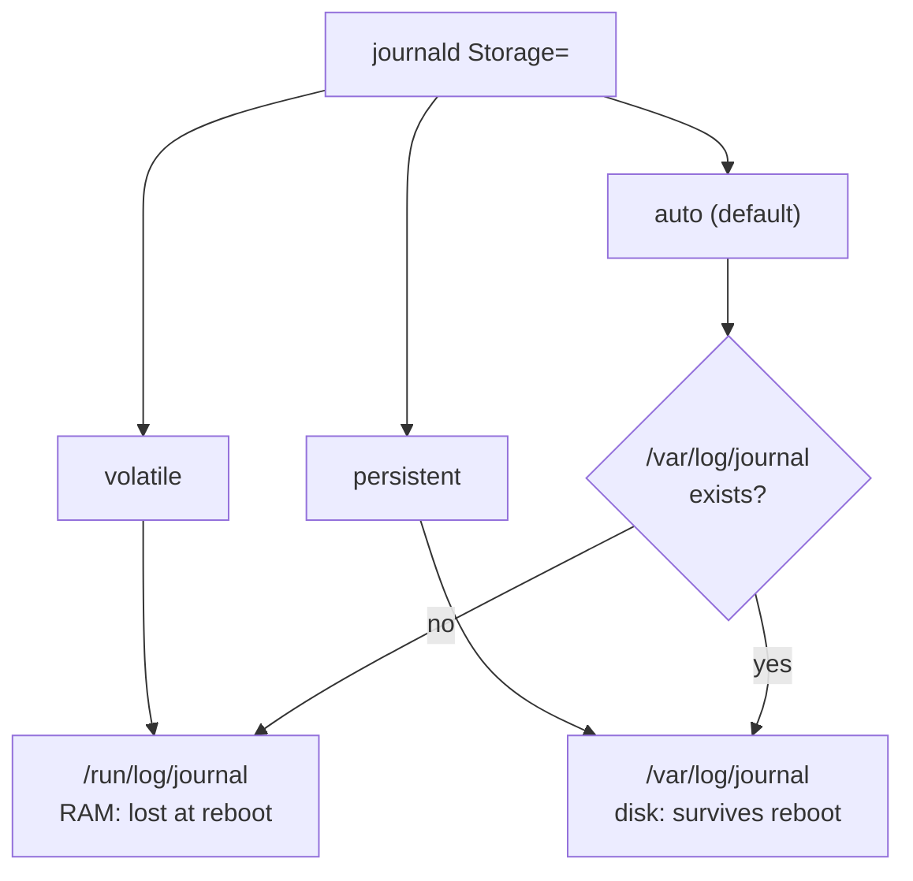

# Your Logs Vanish After Reboot? Make journald Persistent (the Right Way)


**Video:** https://youtu.be/_TfFevUPuqE

With the default Storage=auto, whether your journal survives a reboot depends on a single directory that may or may not exist. We check what your server really does, make the journal persistent with a drop-in file, set sane size limits, manage it with Ansible, and verify the result across a reboot.

## What you need

A Linux shell (a VM, WSL or a container is fine). Everything runs inside this folder.

The outputs below were captured for real on the lab cluster. On yours, names, ages, IPs and ports will differ; everything else should match.

## The big picture

Where the journal lives depends on the Storage setting, and with the default "auto" on whether /var/log/journal exists.



The fix: a drop-in file instead of editing journald.conf, then a restart and a check after the next reboot.


## The lesson, step by step

The same explanations as the video, with every command and its real output. Read it, then run it yourself.

A server crashed and rebooted overnight. You open the logs to find out why, and the journal starts this morning. Everything before the reboot is gone. On many systems this is the default. Let's fix it.

### The plan

Here is the plan. First, the one setting that decides it all. Then we check a server with three commands. We fix it with a small file, and verify the result, also after a reboot. And we do the same with Ansible, plus three pitfalls to avoid.

### Storage modes

journald has a setting called Storage. It decides where the journal lives. Volatile: the journal lives in memory, under slash run. It is lost at every reboot. Persistent: the journal lives on disk, under slash var slash log slash journal. It survives reboots. Auto, the default, is the tricky one. It writes to disk only if the folder slash var slash log slash journal already exists. If not, it silently stays in memory.

### Check your server

journalctl dash dash list boots shows every boot the journal remembers. One line per boot.

```console
$ journalctl --list-boots
IDX BOOT ID                          FIRST ENTRY                 LAST ENTRY
  0 8f2c1d9e0b7a4c3d9e1f2a3b4c5d6e7f Tue 2026-10-20 08:12:41 CEST Tue 2026-10-20 10:31:02 CEST
```

Only one line, index zero, the current boot. But this server has been rebooted many times. So older logs are gone.

Does the folder slash var slash log slash journal exist?

```console
$ ls -ld /var/log/journal
ls: cannot access '/var/log/journal': No such file or directory
```

No. And with storage auto, no folder means: memory only. Let's look in slash run, the memory location.

```console
$ ls /run/log/journal
5b0e9a7c3f1d4e8a9b2c6d0f1e3a5c7b
```

There it is, in memory. Everything in there disappears at the next reboot.

### The fix: a drop-in

```
[Journal]
Storage=persistent
SystemMaxUse=1G
SystemKeepFree=2G
MaxRetentionSec=30day
```

The fix is a small file in a folder called journald dot conf dot d. This is a drop-in: it adds settings on top of the main file, without editing it. Package updates never overwrite it. Storage equals persistent. Now it no longer depends on a folder that may or may not exist. And since the journal now lives on disk, we give it limits: at most one gigabyte, always leave two gigabytes free on the disk, and keep thirty days at most.

### Apply and verify

Create the drop-in folder, copy our file into it, and restart journald.

```console
$ sudo mkdir -p /etc/systemd/journald.conf.d && sudo cp 10-persistent.conf /etc/systemd/journald.conf.d/ && sudo systemctl restart systemd-journald
```

No output. But careful: journald does not refuse a broken config. A typo only shows up as a warning in its own log. So we always read journald's last messages.

```console
$ journalctl -u systemd-journald -n 2 --no-pager
Oct 20 10:35:12 lab systemd-journald[1214]: Journal started
Oct 20 10:35:12 lab systemd-journald[1214]: System Journal (/var/log/journal/5b0e9a7c3f1d4e8a9b2c6d0f1e3a5c7b) is 8.0M, max 1.0G, 1015.9M free.
```

No warning. And the second line confirms it: the journal is now in slash var slash log slash journal, with our one gigabyte maximum.

Now the real test: after the next reboot, how many boots does the journal remember?

```console
$ journalctl --list-boots
IDX BOOT ID                          FIRST ENTRY                 LAST ENTRY
 -1 8f2c1d9e0b7a4c3d9e1f2a3b4c5d6e7f Tue 2026-10-20 08:12:41 CEST Tue 2026-10-20 10:41:55 CEST
  0 2a7d4c9b1e3f4a6c8d0e2f4a6b8c0d1e Tue 2026-10-20 10:42:30 CEST Tue 2026-10-20 10:44:08 CEST
```

Two lines. Minus one is the previous boot. Here is the command you want after an unexpected reboot: the last lines before it went down.

```console
$ journalctl -b -1 -n 3 --no-pager
Oct 20 10:41:54 lab systemd[1]: Reached target System Reboot.
Oct 20 10:41:55 lab systemd-shutdown[1]: Syncing filesystems and block devices.
Oct 20 10:41:55 lab systemd-shutdown[1]: Sending SIGTERM to remaining processes...
```

### With Ansible

```
- name: Persistent journal with size limits
  ansible.builtin.copy:
    dest: /etc/systemd/journald.conf.d/10-persistent.conf
    content: |
      [Journal]
      Storage=persistent
      SystemMaxUse=1G
    mode: "0644"
  notify: Restart journald
```

On many servers, use Ansible. One task writes the same drop-in file. notify asks a handler called restart journald to run, but only if this task changed something.

And this is the handler: a task that restarts journald. Because it runs only after a change, running the playbook a second time restarts nothing.

```
- name: Restart journald
  ansible.builtin.systemd_service:
    name: systemd-journald
    state: restarted
```

### Pitfalls

Three mistakes undo all of this. One. Editing the main journald dot conf. A package update can replace it. Use a drop-in. Two. Restarting journald without reading its messages. A typo is only a warning, and the old behaviour stays. Three. A cleanup script that deletes slash var slash log slash journal. With storage auto, you are silently back in memory. With storage persistent, journald simply creates it again.

Make the journal persistent on purpose, give it limits, and check it with journalctl dash dash list boots. Then the next unexpected reboot will leave a trail. Subscribe for the rest of the Linux logging series.

## All the commands, to copy

Run them from inside this folder, in this order.

```bash
journalctl --list-boots
ls -ld /var/log/journal
ls /run/log/journal
sudo mkdir -p /etc/systemd/journald.conf.d && sudo cp 10-persistent.conf /etc/systemd/journald.conf.d/ && sudo systemctl restart systemd-journald
journalctl -u systemd-journald -n 2 --no-pager
journalctl -b -1 -n 3 --no-pager
```

---

From the [ProductionDevOps](https://www.youtube.com/@production-devops) channel: real-world DevOps and SRE, explained with real commands.
