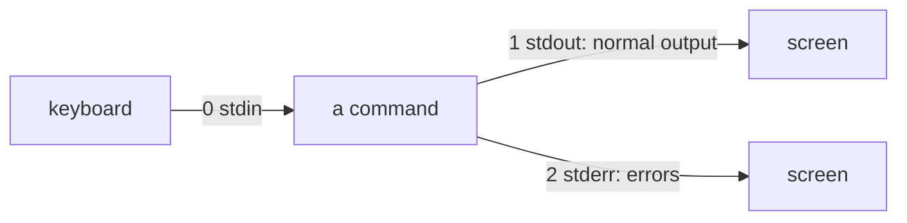

# Pipes, Redirection and Expansion: What the Shell Does Before Your Command Runs


**Video:** coming soon on the [channel](https://www.youtube.com/@production-devops).

You redirect a command to a file, and the error still lands on your screen. A file name with a space breaks your script. In lesson 4 we prove, live, how the three streams work (stdin, stdout, stderr and file descriptors), every redirection (>, >>, 2>, 2>&1, &>, <), pipes and tee, then the order of shell expansions (brace, tilde, parameter, command substitution, arithmetic, word splitting, globbing) and the three kinds of quoting. Lesson 4 of Linux from User to Server Admin.

## Files in this folder

- [`app.log`](app.log)
- [`my report.txt`](my report.txt)
- [`challenge-solution.sh`](challenge-solution.sh) (solution of the challenge: try it yourself first)

## What you need

A Linux shell (a VM, WSL or a container is fine). Everything runs inside this folder.

## The lesson, step by step

The same explanations as the video, with every command. Read it, then run it yourself.

You send a command's output to a file, and the error still lands on your screen. And at the end, a file name with a space that breaks your command. Both come from where output goes, and what the shell changes before your command runs.

### The plan

This is lesson 4 of Linux from User to Server Admin. First, the three streams every command has. Then redirection: sending those streams to files. Then pipes, and tee. Finally, expansion, and how quotes control it.

### Three streams

**Every command has three streams**



Every command starts with three streams, each with a number called a file descriptor. Zero is standard input, one is standard output, and two is standard error, for error messages. By default, both outputs go to the same screen, so they look the same.

### Redirection

ls, with one file that exists and one that does not: one error, and one normal line.

```console
$ ls app.log missing.log
```

Greater than sends standard output to a file. But the error is still on the screen.

```console
$ ls app.log missing.log > out.txt
```

The file has only the normal output.

```console
$ cat out.txt
```

Two greater than redirects file descriptor two, standard error. Now only the normal line is on screen.

```console
$ ls app.log missing.log 2> err.txt
```

To capture both, redirect output to the file, then two greater than ampersand one: send two where one goes.

```console
$ ls app.log missing.log > all.txt 2>&1
```

Both lines are in the file.

```console
$ cat all.txt
```

The same pieces in the other order, and the error is back on screen. Redirections are read left to right: when two was copied, one still pointed to the screen.

```console
$ ls app.log missing.log 2>&1 > all.txt
```

Bash also has a shortcut: ampersand greater than, both streams to one file.

```console
$ ls app.log missing.log &> all.txt
```

One greater than creates the file, or empties it first.

```console
$ echo "run 1" > runs.log
```

Two greater than signs append to the end.

```console
$ echo "run 2" >> runs.log
```

Two lines. One greater than again would empty the file: this is how logs get lost.

```console
$ cat runs.log
```

A quick checkpoint. Greater than for output, two greater than for errors, both with two greater than ampersand one, and double greater than to append. Redirections are read left to right. Next: pipes, and then the space that breaks a file name.

### Pipes and tee

Less than makes a file the standard input. wc dash l counts its lines.

```console
$ wc -l < app.log
```

A pipe connects the output on the left to the input on the right. grep keeps the error lines, wc counts them.

```console
$ grep ERROR app.log | wc -l
```

But a pipe carries standard output only: the error from ls skips it, and lands on the screen.

```console
$ ls app.log missing.log | wc -l
```

Two greater than ampersand one, before the pipe, sends errors through too.

```console
$ ls app.log missing.log 2>&1 | wc -l
```

tee is a T junction: it writes its input to errors dot txt, and passes it on to wc.

```console
$ grep ERROR app.log | tee errors.txt | wc -l
```

To throw errors away, send them to slash dev slash null, which swallows everything.

```console
$ ls app.log missing.log 2>/dev/null
```

### Expansion

Before a command runs, bash rewrites the line, in this order.

```
1  brace         report-{a,b}.txt  →  report-a.txt report-b.txt
2  tilde         ~root             →  /root
3  parameter     $name             →  acme-app
   command       $(uname -r)       →  the command's output
   arithmetic    $(( 3 * 1024 ))   →  3072
4  word splitting   unquoted results are split on spaces
5  globbing      *.log             →  app.log runs.log
6  quote removal    the quotes themselves disappear
```

First, braces generate words. Then a tilde becomes a home folder. Then, left to right: variables, command substitution with dollar parenthesis, and arithmetic. Then unquoted results are split at spaces: the step that breaks file names. Then star dot log becomes the matching file names, and the quotes are removed. Only then does the command start.

echo is the perfect probe: it prints the words it receives, after expansion. Braces first.

```console
$ echo report-{jan,feb,mar}.txt
```

Tilde root becomes the home folder of root.

```console
$ echo ~root
```

A variable: no spaces around the equals sign.

```console
$ name=acme-app
```

Dollar name is replaced by its value, everywhere it appears.

```console
$ echo "$name runs in /opt/app/$name"
```

```console
$ echo "kernel: $(uname -r)"
```

Before we run the next one, let's read dollar parenthesis.

- `echo`: receives the finished line
echo will receive the finished text. It never sees dollar parenthesis.

- `$(`: start: run a command
Dollar and an open parenthesis start a command substitution.

- `uname -r`: the inner command
Inside, any command. Here, uname dash r, the kernel release from lesson 1.

- `)`: end: its output goes here
The closing parenthesis ends it. Bash runs the inner command first, and puts its output in the line.

Which kernel are we on? We let the shell fill it in.

```console
$ echo "kernel: $(uname -r)"
```

Double parentheses do arithmetic, with integers only: seven divided by two gives three.

```console
$ echo $(( 7 / 2 ))
```

Star dot log is replaced by the matching file names. The shell does this, not the command.

```console
$ echo *.log
```

### Quoting

A variable holds a file name with a space.

```console
$ file="my report.txt"
```

Without quotes, the value is split at the space. cat receives two names, and finds neither.

```console
$ cat $file
```

With double quotes, it stays one word. Quote your variables, always.

```console
$ cat "$file"
```

Single quotes: nothing expands. Every character stays as typed.

```console
$ echo '$HOME and $(date) stay as text'
```

Double quotes: dollar expansions work, but there is no word splitting and no globbing.

```console
$ echo "$(( 2 + 3 )) workers, *.log"
```

A backslash protects only the next character.

```console
$ echo \$HOME costs \$5
```

### Gotchas

Three traps that hit everybody once. One. sort a file into itself, and you get an empty file: the shell empties the target before the command starts. Two. Two greater than ampersand one goes after the file redirection. Three. If a glob matches nothing, bash passes it unchanged to the command.

### Recap

Let's recap. Three streams: zero in, one out, two errors. Greater than file, then two greater than ampersand one, for both. A pipe carries output only. Expansions: braces, tilde, dollar, word splitting, then globbing. Your challenge: one line that saves the error lines of app dot log to a file named with today's date, shows their count, and hides error messages. The solution is in the demo repository.

Now you decide where every stream goes, and what the shell changes first. Next lesson: shell variables, the environment, and getting help. Subscribe to follow the course.

## All the commands, to copy

Run them from inside this folder, in this order (some are expected to fail: that is the point of the demo).

```bash
ls app.log missing.log
ls app.log missing.log > out.txt
cat out.txt
ls app.log missing.log 2> err.txt
ls app.log missing.log > all.txt 2>&1
cat all.txt
ls app.log missing.log 2>&1 > all.txt
ls app.log missing.log &> all.txt
echo "run 1" > runs.log
echo "run 2" >> runs.log
cat runs.log
wc -l < app.log
grep ERROR app.log | wc -l
ls app.log missing.log | wc -l
ls app.log missing.log 2>&1 | wc -l
grep ERROR app.log | tee errors.txt | wc -l
ls app.log missing.log 2>/dev/null
echo report-{jan,feb,mar}.txt
echo ~root
name=acme-app
echo "$name runs in /opt/app/$name"
echo "kernel: $(uname -r)"
echo $(( 7 / 2 ))
echo *.log
file="my report.txt"
cat $file
cat "$file"
echo '$HOME and $(date) stay as text'
echo "$(( 2 + 3 )) workers, *.log"
echo \$HOME costs \$5
```

## Challenge

Your challenge: one line that saves the error lines of app dot log to a file named with today's date, shows their count, and hides error messages. The solution is in the demo repository.

When you have tried: [`challenge-solution.sh`](challenge-solution.sh).

---

From the [ProductionDevOps](https://www.youtube.com/@production-devops) channel: real-world DevOps and SRE, explained with real commands.
