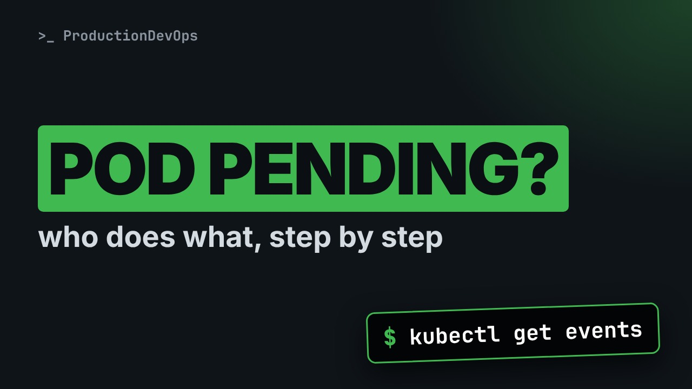
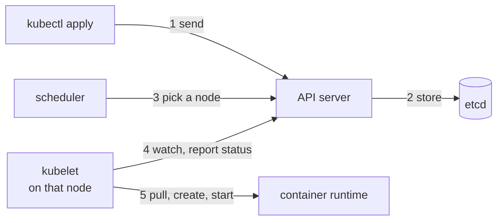

# What Really Happens When You Create a Pod



**Video:** https://youtu.be/ppFUJIgkOdQ

You run kubectl apply and a Pod appears, but who does what in between? We follow one Pod on a real three-node cluster: the API server stores it, the scheduler picks a node, the kubelet starts the container, and the events show each step in order. Then a Pod that finishes, a Pod that can never be scheduled, and which component to suspect at each stuck point. Part 3 of the Kubernetes Path.

## Files in this folder

- [`stuck.yaml`](stuck.yaml)
- [`web.yaml`](web.yaml)
- [`challenge-solution.yaml`](challenge-solution.yaml) (solution of the challenge: try it yourself first)

## What you need

A Kubernetes cluster you can break: a local [kind](https://kind.sigs.k8s.io/) cluster with one control plane and two workers is what the video uses, plus `kubectl`. Never run these commands against a cluster that matters.

The outputs below were captured for real on the lab cluster. On yours, names, ages, IPs and ports will differ; everything else should match.

## The lesson, step by step

The same explanations as the video, with every command and its real output. Read it, then run it yourself.

You type kubectl apply, and a Pod appears. But between those two moments, four different components did their part. When a Pod gets stuck, knowing who does what tells you where to look.

### The plan

This is part three of the Kubernetes Path. Here is the plan. First, the chain of components that turns a YAML file into a running container. Then we follow one Pod on a real cluster, and read its events in order. We look at Pod phases, with a Pod that runs once and finishes. And a Pod that never starts, to see which component tells us why.

### The chain

**From kubectl to a running container**



kubectl sends the Pod to the API server, which saves it in etcd. Nothing runs yet. The scheduler watches for Pods without a node, and picks one. The kubelet on that node sees its new Pod, asks the container runtime to pull the image and start the container, and reports the status back to the API server.

### Our lab

Our lab is a local cluster with three nodes, made with a tool called kind.

```console
$ kubectl get nodes
NAME                STATUS   ROLES           AGE     VERSION
lab-control-plane   Ready    control-plane   4m11s   v1.37.0
lab-worker          Ready    <none>          3m44s   v1.37.0
lab-worker2         Ready    <none>          3m44s   v1.37.0
```

The components of the chain run as Pods too, in the kube-system namespace. Dash l selects them by label.

```console
$ kubectl get pods -n kube-system -l tier=control-plane
NAME                                        READY   STATUS    RESTARTS   AGE
etcd-lab-control-plane                      1/1     Running   0          4m7s
kube-apiserver-lab-control-plane            1/1     Running   0          4m12s
kube-controller-manager-lab-control-plane   1/1     Running   0          4m10s
kube-scheduler-lab-control-plane            1/1     Running   0          4m7s
```

The API server, etcd, the scheduler and the controller manager. The kubelet is not here: it is a normal service on every node.

### Follow one Pod

```
apiVersion: v1
kind: Pod
metadata:
  name: web
  labels:
    app: web
spec:
  containers:
    - name: nginx
      image: nginx:1.27
```

A Pod called web. One container, running the nginx web server image, with a fixed version tag.

We apply the file.

```console
$ kubectl apply -f web.yaml
pod/web created
```

And we look at it immediately.

```console
$ kubectl get pod web
NAME   READY   STATUS              RESTARTS   AGE
web    0/1     ContainerCreating   0          0s
```

A few seconds later, the same command.

```console
$ kubectl get pod web
NAME   READY   STATUS    RESTARTS   AGE
web    1/1     Running   0          80s
```

### Events

Every component writes events about the Pod. We list the events of web, with two columns: the reason, and the component that wrote it.

```console
$ kubectl get events --field-selector involvedObject.name=web -o custom-columns=REASON:.reason,FROM:.reportingComponent
REASON      FROM
Scheduled   default-scheduler
Pulling     kubelet
Pulled      kubelet
Created     kubelet
Started     kubelet
```

First, the scheduler: Scheduled, it assigned a node. Then everything else comes from the kubelet: it got the image, created the container, and started it.

describe shows the Pod's conditions: a checklist that fills up as the chain progresses. We print just that part.

```console
$ kubectl describe pod web | grep -A6 Conditions:
Conditions:
  Type                        Status
  PodReadyToStartContainers   True 
  Initialized                 True 
  Ready                       True 
  ContainersReady             True 
  PodScheduled                True
```

Pod Scheduled is the scheduler's step. The others are the kubelet's: sandbox ready, init done, containers ready, and finally the whole Pod ready.

### Phases

Every Pod has one phase, a simple summary of where it is in its life. Pending: the Pod is accepted, but not running yet. It may have no node, or its image is still downloading. Running: it is on a node, and at least one container is running. Succeeded, or Failed: all containers have ended, with exit code zero, or not zero. And Unknown: the node stopped reporting, so nobody knows.

kubectl run creates a Pod from the command line. Restart never means: run once, do not restart it. The command after the two dashes runs in the container.

```console
$ kubectl run once --image=busybox:1.36 --restart=Never -- echo hello from a Pod
pod/once created
```

The STATUS column says Completed.

```console
$ kubectl get pod once
NAME   READY   STATUS      RESTARTS   AGE
once   0/1     Completed   0          10s
```

But the real phase, read with jsonpath, is Succeeded. The STATUS column is a friendly summary, not the phase.

```console
$ kubectl get pod once -o jsonpath='{.status.phase}{"\n"}'
Succeeded
```

Its output is still there, in the logs.

```console
$ kubectl logs once
hello from a Pod
```

### A Pod that never starts

```
apiVersion: v1
kind: Pod
metadata:
  name: stuck
spec:
  nodeSelector:
    disktype: ssd
  containers:
    - name: nginx
      image: nginx:1.27
```

This Pod has a node selector. It may only run on a node with the label disktype equals ssd. None of our nodes has that label. Let's see what happens.

We apply it.

```console
$ kubectl apply -f stuck.yaml
pod/stuck created
```

It stays Pending.

```console
$ kubectl get pod stuck
NAME    READY   STATUS    RESTARTS   AGE
stuck   0/1     Pending   0          5s
```

The same events command. One event, Failed Scheduling, from the scheduler.

```console
$ kubectl get events --field-selector involvedObject.name=stuck -o custom-columns=REASON:.reason,FROM:.reportingComponent
REASON             FROM
FailedScheduling   default-scheduler
```

Now its message. tr replaces each comma with a new line, so it is easy to read.

```console
$ kubectl get events --field-selector involvedObject.name=stuck -o custom-columns=MSG:.message --no-headers | tr ',' '\n'
0/3 nodes are available: 1 node(s) had untolerated taint(s)
 2 node(s) didn't match Pod's node affinity/selector. preemption: 0/3 nodes are available: 3 Preemption is not helpful for scheduling.
```

Three nodes, two reasons. The control plane has a taint, a keep-out sign this Pod does not tolerate. The two workers do not match the selector. And evicting other Pods would not help either.

We add the label to one worker.

```console
$ kubectl label node lab-worker disktype=ssd
node/lab-worker labeled
```

We did not touch the Pod. The scheduler keeps retrying, and this time it finds a node. Custom columns show the phase and the node.

```console
$ kubectl get pod stuck -o custom-columns=NAME:.metadata.name,PHASE:.status.phase,NODE:.spec.nodeName
NAME    PHASE     NODE
stuck   Running   lab-worker
```

We clean up: the three Pods, and the label. A dash after the key removes it.

```console
$ kubectl delete pod web once stuck
pod "web" deleted from default namespace
pod "once" deleted from default namespace
pod "stuck" deleted from default namespace
```

And the label.

```console
$ kubectl label node lab-worker disktype-
node/lab-worker unlabeled
```

### Who to suspect

Read the events, then go to the component that wrote them. Pending, with Failed Scheduling: the scheduler. Not enough CPU or memory, a selector, or a taint. Container Creating, or Image Pull Back Off: the kubelet. The image, a volume, or the network setup. Crash Loop Back Off: the chain worked. Your application starts and exits. Read the logs of the previous run.

### Gotchas

Two habits that save time. The STATUS column is only a summary. The reason is in the events. Read the events before you delete a stuck Pod. A new Pod starts a new history, and events expire after one hour by default.

### Recap

Let's recap. The API server stores the Pod, the scheduler picks a node, the kubelet starts the containers. The events show every step, in order, and which component did it. A Pod is Pending, Running, Succeeded, Failed, or Unknown. Your challenge: make a Pod stay Pending for a different reason than a label. Then find which component explains it, and its exact message. The solution is in the demo repository.

When a Pod is stuck, read its events and go to the component that wrote them. Next on the Kubernetes Path: kubeconfig and contexts, so you always know which cluster you are talking to. Subscribe to follow the whole path.

## All the commands, to copy

Run them from inside this folder, in this order.

```bash
kubectl get nodes
kubectl get pods -n kube-system -l tier=control-plane
kubectl apply -f web.yaml
kubectl get pod web
kubectl get events --field-selector involvedObject.name=web -o custom-columns=REASON:.reason,FROM:.reportingComponent
kubectl describe pod web | grep -A6 Conditions:
kubectl run once --image=busybox:1.36 --restart=Never -- echo hello from a Pod
kubectl get pod once
kubectl get pod once -o jsonpath='{.status.phase}{"\n"}'
kubectl logs once
kubectl apply -f stuck.yaml
kubectl get pod stuck
kubectl get events --field-selector involvedObject.name=stuck -o custom-columns=REASON:.reason,FROM:.reportingComponent
kubectl get events --field-selector involvedObject.name=stuck -o custom-columns=MSG:.message --no-headers | tr ',' '\n'
kubectl label node lab-worker disktype=ssd
kubectl get pod stuck -o custom-columns=NAME:.metadata.name,PHASE:.status.phase,NODE:.spec.nodeName
kubectl delete pod web once stuck
kubectl label node lab-worker disktype-
```

## Challenge

Your challenge: make a Pod stay Pending for a different reason than a label. Then find which component explains it, and its exact message. The solution is in the demo repository.

When you have tried: [`challenge-solution.yaml`](challenge-solution.yaml).

---

From the [ProductionDevOps](https://www.youtube.com/@production-devops) channel: real-world DevOps and SRE, explained with real commands.
