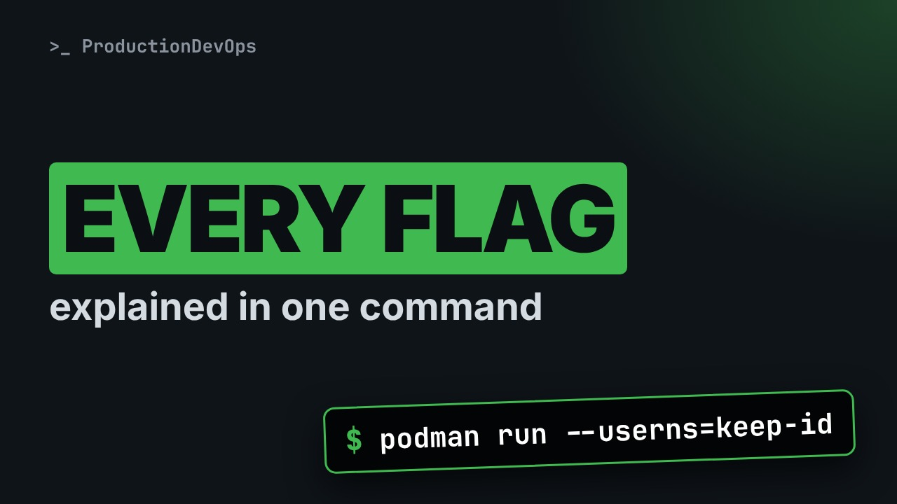
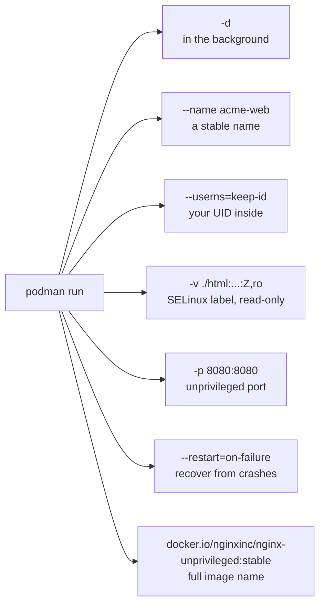
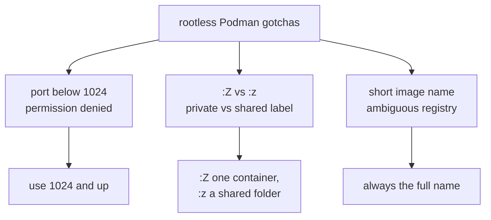

# Anatomy of a Production-Ready podman run (Every Flag Explained)



**Video:** https://youtu.be/wJY6khjU9C8

One podman run command, seven pieces, and the reason each one is there. Step by step, we take apart a rootless web container flag by flag, run it and verify it, then look at the three gotchas that bite people when they move from Docker to rootless Podman, each one shown on screen.

## Files in this folder

- [`html/index.html`](html/index.html)

## What you need

A Linux shell (a VM, WSL or a container is fine). Everything runs inside this folder.

The outputs below were captured for real on the lab cluster. On yours, names, ages, IPs and ports will differ; everything else should match.

## The big picture

One podman run command, seven decisions: each flag answers one question.



The three rootless gotchas and their fixes.



## The lesson, step by step

The same explanations as the video, with every command and its real output. Read it, then run it yourself.

This single command starts a web server the way you want it in production. It looks long, but every piece has a reason. Let's take it apart, one piece at a time.

### The plan

Here is the plan. First, one word you will hear a lot: rootless. Then we read the command, one flag at a time. We run it, and check that each choice really did what we wanted. And we finish with three gotchas, each one shown on screen.

### Rootless in one minute

Rootless means something simple. The container runs as your normal user, not as root. You do not need sudo to start it. Why it matters: if someone breaks into the container, they are not root on the server. The price is a few limits, for example on low port numbers. We will see them at the end.

### Reading the command

```console
$ podman run -d --name acme-web --userns=keep-id -v ./html:/usr/share/nginx/html:Z,ro -p 8080:8080 --restart=on-failure docker.io/nginxinc/nginx-unprivileged:stable
```

Here is the full command. Each colored piece answers one question. Let's go left to right.

- `-d`: run in the background
Dash d means detached. The container runs in the background, and you get your prompt back.

- `--name acme-web`: stable, readable name
Dash dash name gives it a fixed name. Every later command can use acme web, instead of a random ID.

- `--userns=keep-id`: map your UID inside
User namespace keep id maps your own user ID inside the container. So files on the shared folder keep the right owner.

- `-v ./html:/usr/share/nginx/html:Z,ro`: SELinux label, read-only
Dash v mounts the local html folder into the container. Capital Z gives it the right SELinux label. And r o means read only: a web server should never change its own content.

- `-p 8080:8080`: unprivileged port
Dash p publishes port eighty eighty. Not port eighty: we will see why in the gotchas.

- `--restart=on-failure`: recover from crashes
Restart on failure: if the process crashes, podman starts it again. If you stop it on purpose, it stays stopped.

- `docker.io/nginxinc/nginx-unprivileged:stable`: fully qualified image
And the image has its full name, registry included. No guessing where it comes from.

### Run and verify

Let's run it. Podman prints the long ID of the new container. That means it started.

```console
$ podman run -d --name acme-web --userns=keep-id -v ./html:/usr/share/nginx/html:Z,ro -p 8080:8080 --restart=on-failure docker.io/nginxinc/nginx-unprivileged:stable
7c4e9a1f2b3d5e6f708192a3b4c5d6e7f8091a2b3c4d5e6f7081920a1b2c3d4e
```

Now we check our choices. podman p s lists running containers. We see our name, and the port we chose.

```console
$ podman ps --format 'table {{.Names}}  {{.Status}}  {{.Ports}}'
NAMES       STATUS        PORTS
acme-web    Up 4 seconds  0.0.0.0:8080->8080/tcp
```

Is the web page served from our folder? curl asks the server for the page.

```console
$ curl -s localhost:8080 | head -3
<!doctype html>
<title>acme-app</title>
<h1>It works, rootless.</h1>
```

And the restart policy? podman inspect can print one single setting.

```console
$ podman inspect acme-web --format '{{.HostConfig.RestartPolicy.Name}}'
on-failure
```

### Gotcha 1: low ports

First gotcha. What happens if a rootless container asks for port eighty? We use a new name, web two, to try.

```console
$ podman run -d --name web2 -p 80:8080 docker.io/nginxinc/nginx-unprivileged:stable
Error: rootlessport cannot expose privileged port 80, you can add 'net.ipv4.ip_unprivileged_port_start=80' to /etc/sysctl.conf (currently 1024), or choose a larger port number (>= 1024): listen tcp 0.0.0.0:80: bind: permission denied
```

The error even tells you the two options. Use a port from ten twenty four up, usually behind a reverse proxy. Or lower that kernel setting, on purpose, for the whole machine.

### Gotcha 2: SELinux labels

Second gotcha: the SELinux label. ls dash capital Z shows it. With capital Z, the label ends with two numbers, a private pair.

```console
$ ls -Z html/index.html
system_u:object_r:container_file_t:s0:c214,c853 html/index.html
```

That pair belongs to this one container. If a second container mounts the same folder with capital Z, it relabels it, and the first one loses access. For a folder shared by several containers, use small z. Small z gives a shared label, without the private pair.

### Gotcha 3: short names

Third gotcha. On some machines, a short name like nginx works. On this one, it does not.

```console
$ podman pull nginx
Error: short-name "nginx" did not resolve to an alias and no unqualified-search registries are defined in "/etc/containers/registries.conf"
```

Where a short name goes depends on a config file that is different on every machine. With the full name, the command works the same everywhere.

### Recap

Let's recap. Every flag in a production command answers a question: name, user, volume, port, restart, and image. Rootless containers use ports from ten twenty four up. Capital Z for a folder used by one container, small z for a shared folder. And always write the full image name.

If a flag in your scripts has no reason you can explain, that is the one to look at first. Subscribe for more commands, explained piece by piece.

## All the commands, to copy

Run them from inside this folder, in this order.

```bash
podman run -d --name acme-web --userns=keep-id -v ./html:/usr/share/nginx/html:Z,ro -p 8080:8080 --restart=on-failure docker.io/nginxinc/nginx-unprivileged:stable
podman ps --format 'table {{.Names}}  {{.Status}}  {{.Ports}}'
curl -s localhost:8080 | head -3
podman inspect acme-web --format '{{.HostConfig.RestartPolicy.Name}}'
podman run -d --name web2 -p 80:8080 docker.io/nginxinc/nginx-unprivileged:stable
ls -Z html/index.html
podman pull nginx
```

---

From the [ProductionDevOps](https://www.youtube.com/@production-devops) channel: real-world DevOps and SRE, explained with real commands.
