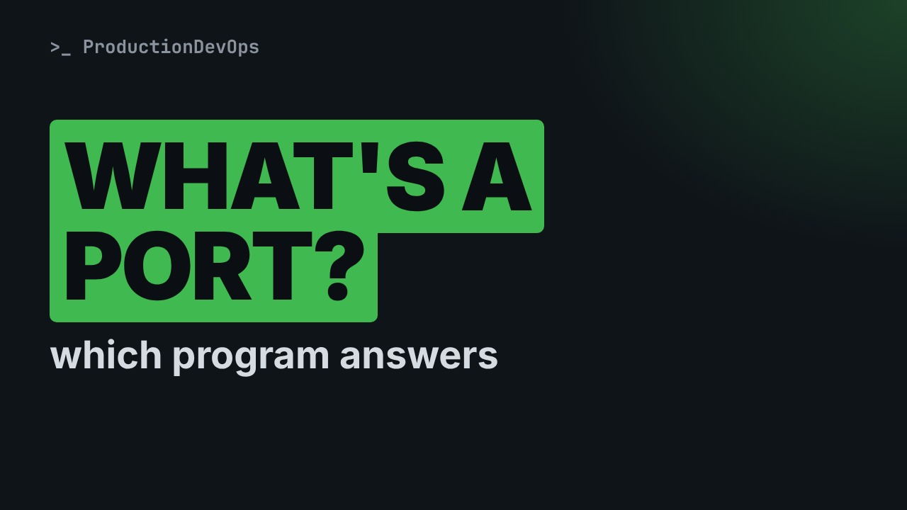
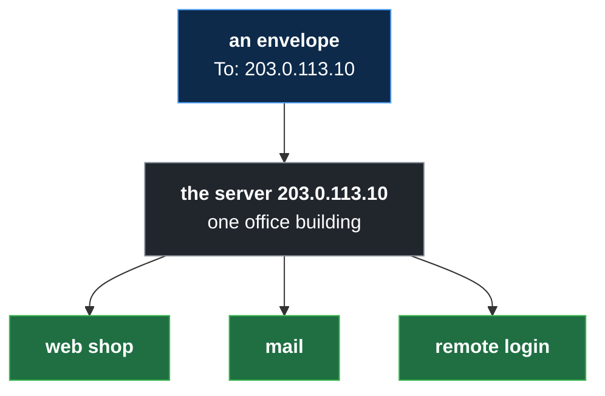
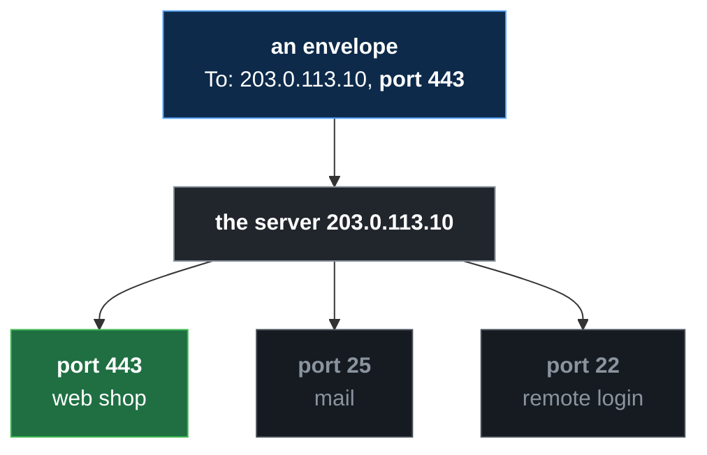
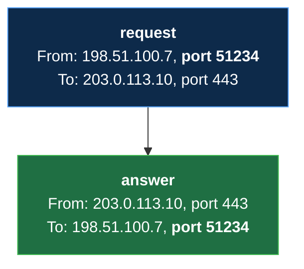

# Ports: Which Program Answers (How the Internet Works, No Experience Needed)

**Video:** coming soon on the [channel](https://www.youtube.com/@production-devops).

One server can run a web shop, a mail service and a remote login at the same time, all behind one address. So which program gets your request? This lesson of How the Internet Works, Simply explains ports with the postal service: the department inside an office building. The well-known numbers, the port on your side of the conversation, what happens when nobody is listening, and what the colon in an address like shop.example:8080 means. No terminal, nothing to install, no experience needed. Every new word is explained on screen. The challenge and its solution are in the demos repo.

## Files in this folder

- [`challenge-solution.md`](challenge-solution.md) (solution of the challenge: try it yourself first)

## What you need

A Linux shell (a VM, WSL or a container is fine). Everything runs inside this folder.

## The lesson, step by step

The same explanations as the video, with every command. Read it, then run it yourself.

One server, one address, and many programs inside. Which one gets your request? At the end: what the colon in shop dot example colon eighty eighty means.

For this lesson you need nothing. Just watch. No terminal and no code. Only pictures. About five minutes.

### The plan

This is lesson four of How the Internet Works, Simply. First, one address with many programs behind it. Then ports, the department number. Then, why your side has a port too. And what happens when nobody is listening.

### Many programs

- `program — Instructions a computer runs: a browser, a web shop, a mail service (like one department inside an office building)`: 
First, a reminder. A program is a set of instructions a computer runs. A browser is one, a web shop is another.

**One server, many programs**

Our shop's server runs three programs: the web shop, mail, and a remote login. The envelope says only the address. Which program should open it?

### Ports

- `port — A number that picks one program on a computer (like the department on the envelope: same building, right desk)`: 
New word: port. A port is a number that picks one program on a computer. Like a department written on the envelope.

**Address + port**

Now the envelope says: address, and port four four three. The address finds the building. The port finds the department: the web shop.

A port is a whole number. It goes from zero to sixty five thousand five hundred and thirty five. One program waits for letters on one port. We say it listens. Some numbers are well known. Everyone agrees on them.

Port eighty: websites, the plain way. Its rules are called H T T P. Port four four three: websites with the padlock, H T T P S. Port twenty two: remote login, called S S H. Port fifty three: D N S, the address book from lesson three.

### So far

So far: the address finds the computer. The port finds the program, for example four four three for the web shop. Next: your side has a port too. And what happens at an empty port.

### Your side

**Your side has a port too**

Your browser gets a port too, picked at random, here five one two three four. The answer comes back to that port, so it reaches the right program.

Many programs on your computer use the internet at once. Each conversation gets its own port. So every answer finds the right window.

### Nobody home

- `connection refused — The computer answers, but no program listens on that port (like the building is there, but that department is closed)`: 
New words: connection refused. The computer answers, but no program listens on that port. The building is there, but the department is closed.

When nobody is listening, the address is right. The server is up. But the port is empty. The program is stopped, or listens on another port. So check the program, not the internet.

### The colon

Now the colon. In shop dot example colon eighty eighty, the part after the colon is the port. Without a colon, the browser uses four four three or eighty by itself. Eighty eighty is a common choice for test servers.

### Good to know

Good to know: one port holds one program at a time. A firewall can block ports. You will meet it in Networking Fundamentals.

### Recap

Recap: the address finds the computer, and the port finds the program. Some ports are well known: eighty, four four three, twenty two, and fifty three. Both sides have a port. An empty port means: connection refused. Your challenge: which program answers at the two addresses on screen? The answer is in the demo repo.

### Where next

Where next? Lesson five: packets, data in small envelopes. Then lesson six: your home network, and the router.

Next lesson: packets, data in small envelopes. Subscribe so you do not miss it.

## Challenge

Your challenge: which program answers at the two addresses on screen? The answer is in the demo repo.

When you have tried: [`challenge-solution.md`](challenge-solution.md).

---

From the [ProductionDevOps](https://www.youtube.com/@production-devops) channel: real-world DevOps and SRE, explained with real commands.
