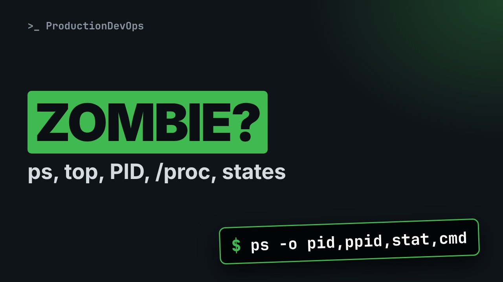
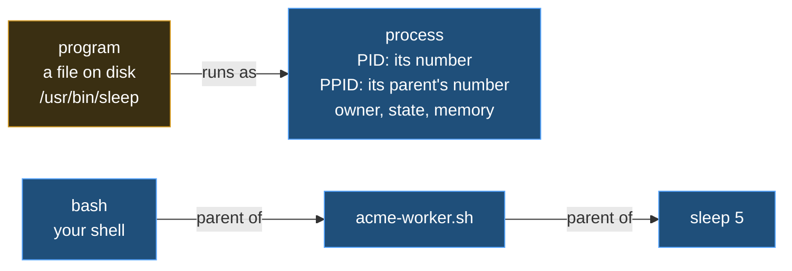
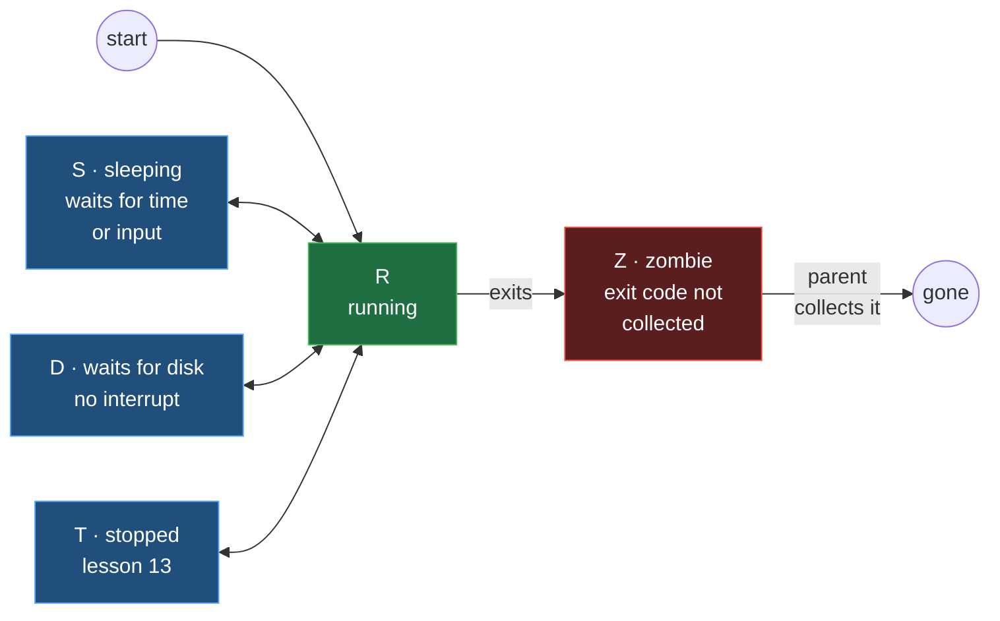

# Linux Processes: ps, top, PID and PPID, /proc and Process States



**Video:** coming soon on the [channel](https://www.youtube.com/@production-devops).

Every command you run becomes a process with a number, a parent and a state, and some processes are dead but still in the table. In lesson 12 we look at the processes of a small acme-app worker: PID and PPID, ps with your own columns, pgrep and pstree, the /proc folder of a process, top in batch mode, what the states R, S, D, T and Z mean, and a real zombie, made and cleaned up live. Up to date for RHEL/AlmaLinux 9 and Ubuntu 24.04. Lesson 12 of Linux from User to Server Admin.

## Files in this folder

- [`acme-worker.sh`](acme-worker.sh)
- [`make-zombie.sh`](make-zombie.sh)
- [`challenge-solution.sh`](challenge-solution.sh) (solution of the challenge: try it yourself first)

## What you need

A Linux shell (a VM, WSL or a container is fine). Everything runs inside this folder.

## Before you start

The video runs these commands first, off screen:

```bash
trap 'kill $(jobs -p) 2>/dev/null' EXIT
pkill acme-worker 2>/dev/null; for i in $(seq 40); do pgrep acme >/dev/null || break; sleep 0.25; done
./acme-worker.sh >/dev/null 2>&1 &
```

## The lesson, step by step

The same explanations as the video, with every command. Read it, then run it yourself.

Every command you run becomes a process, with a number and a parent. Some processes are finished, and still in the table. At the end, we make one of these zombies, and clean it up.

### The plan

This is lesson 12 of Linux from User to Server Admin. First, PID and PPID: every process has a parent. Then ps, pgrep, pstree and the proc folder. Then top, the process states, and a real zombie.

### PID and PPID

**A program on disk, a process in memory**



A program is a file on disk; a process is one running copy of it, with a number, the PID. Every process has a parent, and the parent's number is the PPID. So processes form a tree.

Which process is this shell? Dollar dollar holds its PID.

```console
$ echo $$
```

ps dash p shows one process by PID: the time it used, and its name, bash.

```console
$ ps -p $$
```

### Find a process

Our lab already runs a small service, started from this shell. Here it is, whole.

```
#!/bin/bash
# acme-worker.sh: a pretend service that waits for work
while true
do
  sleep 5
done
```

The first line says: run this file with bash. Then a comment. Lesson 14 explains both. while true, do, done: repeat forever. Each round runs sleep five, a new process: a child of the worker.

```console
$ ps -o pid,ppid,stat,cmd --ppid $$
```

ps shows the columns you ask for, for the processes you pick.

- `-o`: output: these columns
Dash o: show these columns, separated by commas.

- `pid,ppid`: its number, its parent's number
pid and ppid: the process number, and its parent's number.

- `stat,cmd`: its state, its command line
stat, the state, and cmd, the full command line.

- `--ppid $$`: only the children of this shell
Dash dash ppid: only the children of this shell. A full list would show everything on the machine.

Is the worker running? pgrep finds processes by name, dash a adds the command line.

```console
$ pgrep -a acme
```

pstree dash p draws the tree under our shell, with PIDs: bash, the worker, its sleep.

```console
$ pstree -p $$
```

Now the columns. The worker's PPID is our shell's PID. Its state is S, sleeping.

```console
$ ps -o pid,ppid,stat,cmd --ppid $$
```

And ps shows itself as R, running. The plus: the foreground.

### /proc

```console
$ ls /proc/$(pgrep acme)
```

The kernel shows every process as a folder, named after its PID.

- `/proc/`: the kernel's live view
Slash proc is not on disk: the kernel builds it live, one folder per process.

- `$(pgrep acme)`: replaced by the worker's PID
Dollar, brackets: the shell runs pgrep first, and puts its output, the PID, right here. Lesson 4.

The worker's folder: files about its memory, its open files, its limits.

```console
$ ls /proc/$(pgrep acme)
```

The status file, first seven lines: the name, the state, its PID and its PPID. This is where ps reads them.

```console
$ head -7 /proc/$(pgrep acme)/status
```

Let's take stock. A PID is a process number, the PPID its parent's. pgrep finds, pstree draws, ps shows the columns you pick. Next: the states, top, and the zombie we promised.

### States

**The life of a process**



R is running, S is sleeping, waiting for time or input: most processes, most of the time. D waits for the disk, and T is stopped. A process that exits stays as Z, a zombie, until its parent collects its exit code.

### top

top normally takes over the screen. Dash b, batch, and dash n one print one snapshot. The header is five lines.

```console
$ top -b -n1 | head -5
```

Line one is the load average. Line two counts the tasks in each state: look at zombie, at the end. Dash p picks one process: the last two lines are the columns, and our worker. In a real terminal, plain top is live, and q quits.

```console
$ top -b -n1 -p $(pgrep acme) | tail -2
```

### A zombie

Four lines make a zombie, on purpose.

```
#!/bin/bash
# make-zombie.sh: a parent that never collects its child
sleep 1 &
exec sleep 300
```

bash runs it, and the comment says the plan. Start a child, sleep one, in the background. It finishes after one second. exec replaces the script with sleep three hundred. sleep never collects children, so the finished child stays.

We start it in the background, with an ampersand. Lesson 13 explains it.

```console
$ ./make-zombie.sh &
```

Dollar exclamation mark is its PID. Its child: state Z, defunct. Finished, but still in the table.

```console
$ ps -o pid,ppid,stat,cmd --ppid $!
```

top counts it too, at the end of the Tasks line.

```console
$ top -b -n1 | grep Tasks
```

A zombie cannot be killed: it is already dead. Kill its parent instead.

```console
$ kill $!
```

The orphan is adopted, usually by PID 1, which collects it at once. Zero zombies.

```console
$ top -b -n1 | grep Tasks
```

### Gotchas

Three traps to remember. One. A zombie uses no CPU and no memory, only a PID. Thousands of them mean a buggy parent. Two. A process in D waits for the disk, and not even kill dash nine stops it. Three. ps a u x and ps dash e f both list every process, in two styles. Pipe them to grep.

### Recap

Let's recap. Every process has a PID, a parent and a state, all in slash proc. pgrep finds, pstree draws, ps and top show the details. R, S, D, T, Z, and a zombie waits for its parent. Your challenge: start sleep five hundred in the background, and read its parent and its state from slash proc. The solution is in the demo repository.

Now you know what a process is, and how to find, read and follow one. Next lesson: jobs, signals and priorities, and what kill really sends. Subscribe to follow the course.

## All the commands, to copy

Run them from inside this folder, in this order (some are expected to fail: that is the point of the demo).

```bash
echo $$
ps -p $$
ps -o pid,ppid,stat,cmd --ppid $$
pgrep -a acme
pstree -p $$
ls /proc/$(pgrep acme)
head -7 /proc/$(pgrep acme)/status
top -b -n1 | head -5
top -b -n1 -p $(pgrep acme) | tail -2
./make-zombie.sh &
ps -o pid,ppid,stat,cmd --ppid $!
top -b -n1 | grep Tasks
kill $!
```

## Challenge

Your challenge: start sleep five hundred in the background, and read its parent and its state from slash proc. The solution is in the demo repository.

When you have tried: [`challenge-solution.sh`](challenge-solution.sh).

---

From the [ProductionDevOps](https://www.youtube.com/@production-devops) channel: real-world DevOps and SRE, explained with real commands.
