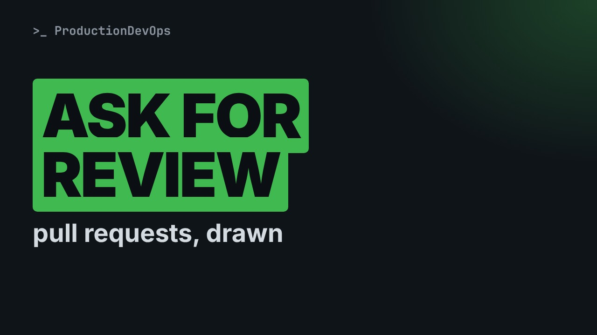
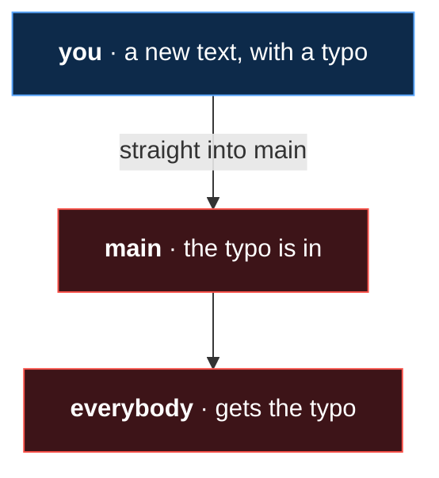
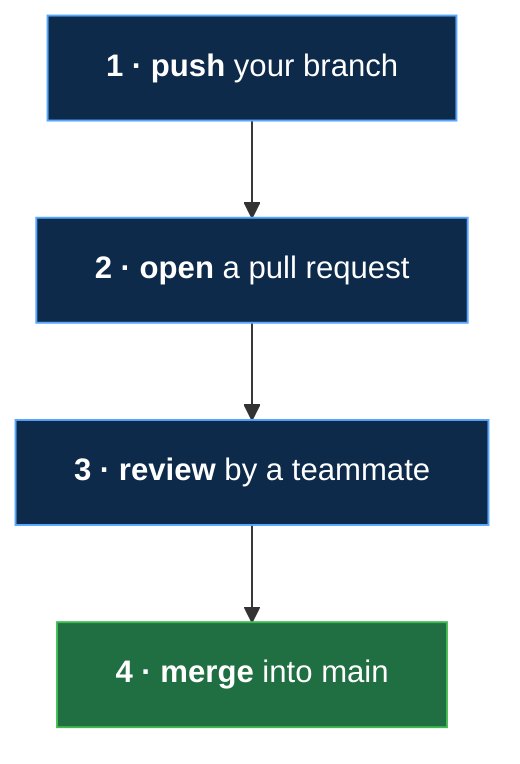
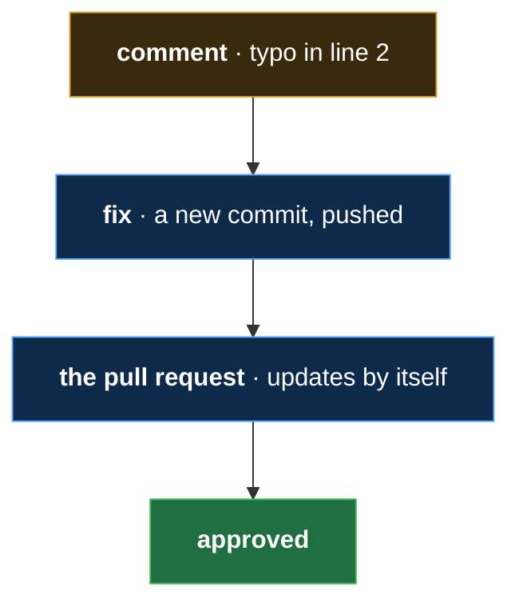
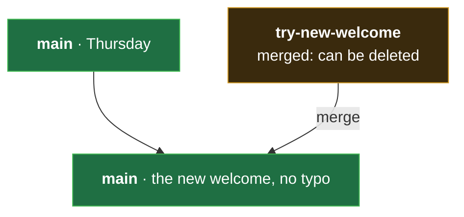
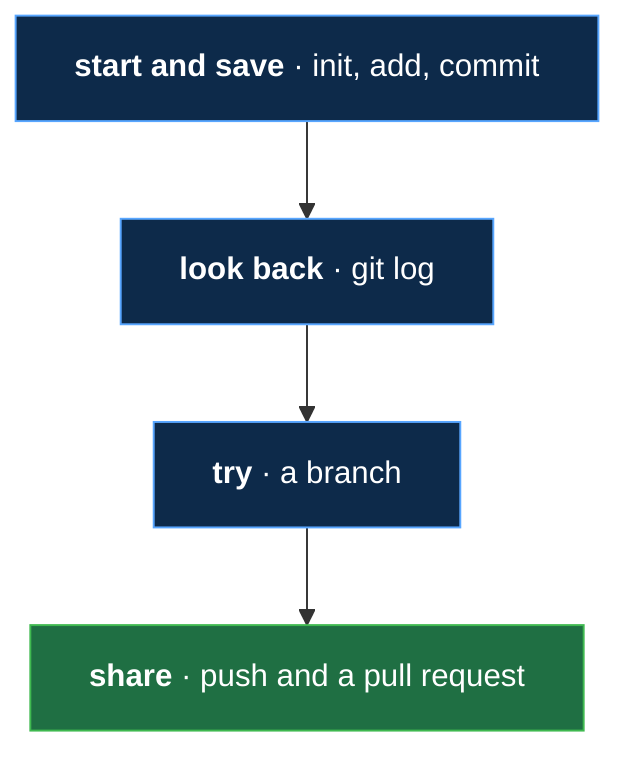

# Pull Requests: Asking for a Review (Git from Zero, No Experience Needed)

**Video:** coming soon on the [channel](https://www.youtube.com/@production-devops).

Should your new change go straight into main? This last lesson of Git and GitHub from Zero draws the pull request, step by step, with one comparison: asking the head chef to taste your new recipe before it goes into the main book. Branch, push, open the request, review and fixes, then merge. Then the whole course in one picture, and where to go next. No terminal, nothing to install, no experience needed. The challenge and its solution are in the demos repo.

## Files in this folder

- [`challenge-solution.md`](challenge-solution.md) (solution of the challenge: try it yourself first)

## What you need

A Linux shell (a VM, WSL or a container is fine). Everything runs inside this folder.

## The lesson, step by step

The same explanations as the video, with every command. Read it, then run it yourself.

Your branch has a new recipe. Should it go straight into the main book? At the end: how teams make sure it is good, first.

For this lesson you need nothing. Just watch. It builds on lessons seven and eight: branches, and GitHub.

### The plan

This is lesson nine, the last of Git and GitHub from Zero. First, the risk: changes that go straight into main. Then, a pull request: ask first. Then the review, the fixes, and the merge. And the whole course, in one picture.

### The risk

**Straight into main?**

Here is the risk. Your new welcome text has a typo. It goes straight into main, and everybody gets the typo.

### Pull request

- `pull request — A request to merge your branch into main, after a review (like asking the head chef to taste your new recipe first)`: 
New word: pull request. It is a request to merge your branch into main, after a review. You ask the head chef to taste it first.

Why the word pull? You ask the team to pull your changes into main. It lives on GitHub, next to the repository. Its short name is P R. It is not a Git command. It is a page on GitHub, with a discussion.

**A pull request, step by step**

Four steps. Push your branch, and open a pull request. A teammate reviews it, and then it is merged into main.

### Review

- `review — A teammate reads your changes, comments, and approves (like the head chef tastes, then says yes, or what to fix)`: 
New word: review. A teammate reads your changes, comments, and approves. The head chef tastes, then says yes, or what to fix.

What does the reviewer see? The exact lines you added and removed. Your commit messages: what changed, and why. And comments, on any line. The whole discussion stays with the change, for later.

**A fix, then yes**

The reviewer spots the typo, and comments. You fix it with a new commit, and push. The pull request updates, and gets approved.

### So far

So far: a pull request asks before merging into main. A review means read, comment, fix, and approve. Next: the merge, and what main looks like after it.

### Merge

**After the merge**

Here is the payoff. Main has the new welcome, without the typo. The branch has done its job, and can be deleted.

Why do teams love pull requests? Two pairs of eyes on every change. A record of why each change happened. And automatic checks, like tests, can run on each one.

### The course

**The whole course, in one picture**

Here is the whole course, in one picture. Start a book, save pages, and look back. Then try ideas on a branch, and share them.

So what can you do now? Save every version, with a good message. Read a history, and find a change. And follow a team workflow, on GitHub. And use the words every team uses: remote, push, clone, and pull.

### Good to know

Good to know. Other websites call it a merge request. Same idea. Small pull requests get faster, better reviews. And be kind. Comment on the code, not the person.

### Recap

Recap: a pull request asks to merge a branch into main. In a review, a teammate reads, comments, and approves. Fixes are new commits on the branch. Then comes the merge. Your challenge: put these four steps in order. Merge, open a pull request, push the branch, review. The answer is in the demo repo.

### Where next

Where next? DevOps from Zero shows the big picture, where Git fits. Linux from Zero gives you more practice in the terminal. YAML and Config Files from Zero: the files you will commit most. And Kubernetes from Zero, when you are ready.

That is the end of Git and GitHub from Zero. Pick your next course. Subscribe so you do not miss it.

## Challenge

Your challenge: put these four steps in order. Merge, open a pull request, push the branch, review. The answer is in the demo repo.

When you have tried: [`challenge-solution.md`](challenge-solution.md).

---

From the [ProductionDevOps](https://www.youtube.com/@production-devops) channel: real-world DevOps and SRE, explained with real commands.
