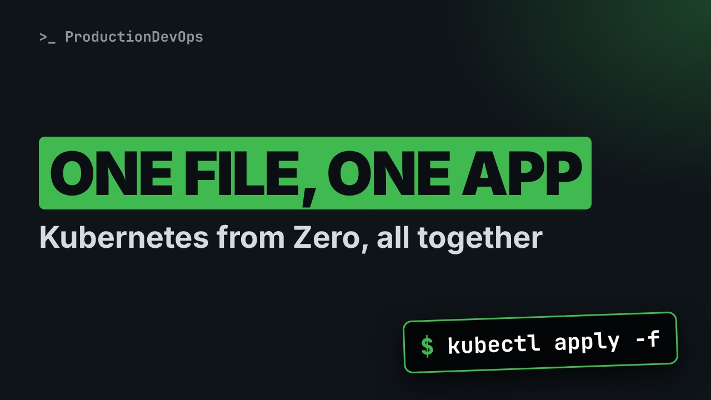
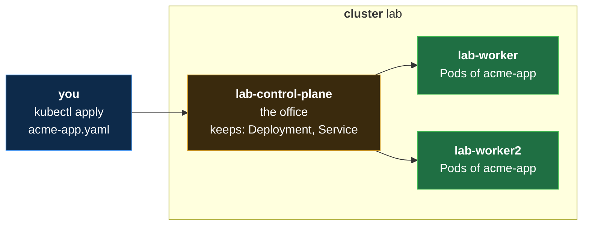

# Kubernetes from Zero, Putting It Together: a Whole App From One File



**Video:** https://youtu.be/gwV3gvYsIPE

You know the pieces, now build a whole app with them. This last lesson of Kubernetes from Zero puts a Deployment and a Service in one file, applies it from zero with the commands you already know, proves it heals itself, and fills in the cluster drawing of lesson 3 with the real names. Then a quick quiz, and where to go next: the Kubernetes Path. No experience needed: every word was explained in the earlier lessons. The file, the challenge and its solution are in the demos repo.

## Files in this folder

- [`acme-app.yaml`](acme-app.yaml)
- [`challenge-solution.sh`](challenge-solution.sh) (solution of the challenge: try it yourself first)
- [`cleanup.sh`](cleanup.sh)

## What you need

A Linux shell (a VM, WSL or a container is fine). Everything runs inside this folder.

The outputs below were captured for real on the lab cluster. On yours, names, ages, IPs and ports will differ; everything else should match.

## The lesson, step by step

The same explanations as the video, with every command and its real output. Read it, then run it yourself.

In seven lessons you learned the pieces. Today we put them together: one file, one command, a working app. Then, where to go next.

You need nothing. You can just watch. To follow along, use the practice cluster from lesson four, and a browser. No new command today. Only the four you know.

### The plan

This is lesson eight, the last one of Kubernetes from Zero. First, one file with everything in it. Then we apply it from zero, and test it. Then the drawing from lesson three, with the real names. And a quick quiz, and where to go next.

### Your words

A cluster is made of nodes. The control plane decides, and the workers run the apps. A Pod is the tray that holds a container. A Deployment keeps a number of Pods running. And a Service gives them one fixed name and address.

### One file

Here is the whole file, in two columns. It has two parts you already know.

```
apiVersion: apps/v1
kind: Deployment
metadata:
  name: acme-app
spec:
  replicas: 3
  selector:
    matchLabels:
      app: acme-app
  template:
    metadata:
      labels:
        app: acme-app
    spec:
      containers:
        - name: web
          image: nginx:1.27-alpine
---
apiVersion: v1
kind: Service
metadata:
  name: acme-app
spec:
  selector:
    app: acme-app
  ports:
    - port: 80
```

On top, the Deployment from lesson six: three copies of our Pod. At the bottom, the Service from lesson seven. And in the middle, one new line.

```
          image: nginx:1.27-alpine
---
apiVersion: v1
```

Three dashes. In YAML they mean: one document ends here, and the next one starts. So one file can hold many things: here, the last line of the Deployment, and the first of the Service.

All together: a whole app in one file. Three copies, and one address in front of them.

```
apiVersion: apps/v1
kind: Deployment
metadata:
  name: acme-app
spec:
  replicas: 3
  selector:
    matchLabels:
      app: acme-app
  template:
    metadata:
      labels:
        app: acme-app
    spec:
      containers:
        - name: web
          image: nginx:1.27-alpine
---
apiVersion: v1
kind: Service
metadata:
  name: acme-app
spec:
  selector:
    app: acme-app
  ports:
    - port: 80
```

### From zero

Our cluster is empty. We apply the file.

```console
$ kubectl apply -f acme-app.yaml
deployment.apps/acme-app created
service/acme-app created
```

Are the Pods running?

```console
$ kubectl get pods
NAME                        READY   STATUS    RESTARTS   AGE
acme-app-7747ffb7d6-7249t   1/1     Running   0          5s
acme-app-7747ffb7d6-hqm4b   1/1     Running   0          5s
acme-app-7747ffb7d6-qcz28   1/1     Running   0          5s
```

And the Service?

```console
$ kubectl get service acme-app
NAME       TYPE        CLUSTER-IP      EXTERNAL-IP   PORT(S)   AGE
acme-app   ClusterIP   192.0.2.10   <none>        80/TCP    6s
```

**Lesson 3's drawing, filled in**



Here is lesson three's drawing, filled in. The office keeps our order and our Service. The two kitchens run the three Pods.

### Test it

Can we reach it? The direct line from lesson seven.

```console
$ kubectl port-forward service/acme-app 8081:80
Forwarding from 127.0.0.1:8081 -> 80
Forwarding from [::1]:8081 -> 80
Handling connection for 8081
```

We visited localhost, port eighty eighty one, as a browser does. That is the handling connection line. In a browser, you would see the nginx welcome page. Control C stops the line.

### So far

So far: one file holds a Deployment and a Service. One apply, and the whole app runs. Next: does it still heal itself?

### It heals

We delete every Pod, like in lesson six.

```console
$ kubectl delete pods -l app=acme-app
pod "acme-app-7747ffb7d6-7249t" deleted from default namespace
pod "acme-app-7747ffb7d6-hqm4b" deleted from default namespace
pod "acme-app-7747ffb7d6-qcz28" deleted from default namespace
```

A few seconds later?

```console
$ kubectl get pods
NAME                        READY   STATUS    RESTARTS   AGE
acme-app-7747ffb7d6-5795q   1/1     Running   0          6s
acme-app-7747ffb7d6-842jw   1/1     Running   0          6s
acme-app-7747ffb7d6-gmbf6   1/1     Running   0          7s
```

### Clean up

To remove everything, we delete with the same file. Dash f works for delete too.

```console
$ kubectl delete -f acme-app.yaml
deployment.apps "acme-app" deleted from default namespace
service "acme-app" deleted from default namespace
```

And the cluster is empty again.

```console
$ kubectl get pods
No resources found in default namespace.
```

### Quick quiz

Three quick questions. Answer in your head. One. Who decides where a Pod runs? Two. A Pod of a Deployment is deleted. What happens? Three. Pods get new addresses. What gives them one fixed address?

One: the control plane, the office. Two: a new Pod takes its place. The control loop keeps the number. Three: a Service.

### Recap

Recap: a whole app fits in one file. Deployment, three dashes, Service. Apply dash f creates it, and delete dash f removes it. Your challenge: delete only the Service. Do the Pods stop? The solution is in the demo repo.

### Where next

You finished Kubernetes from Zero. Well done. Where next? The Kubernetes Path. It is one step up. It shows what a container really is, and how a Pod is created. A little practice with the terminal helps.

Continue with the Kubernetes Path, from part one. Subscribe, and keep going.

## All the commands, to copy

Run them from inside this folder, in this order.

```bash
kubectl apply -f acme-app.yaml
kubectl get pods
kubectl get service acme-app
kubectl port-forward service/acme-app 8081:80
kubectl delete pods -l app=acme-app
kubectl delete -f acme-app.yaml
```

## Challenge

Your challenge: delete only the Service. Do the Pods stop? The solution is in the demo repo.

When you have tried: [`challenge-solution.sh`](challenge-solution.sh).

---

From the [ProductionDevOps](https://www.youtube.com/@production-devops) channel: real-world DevOps and SRE, explained with real commands.
