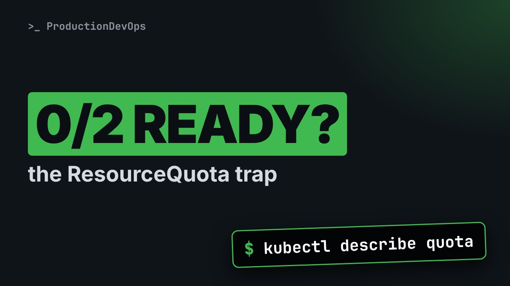
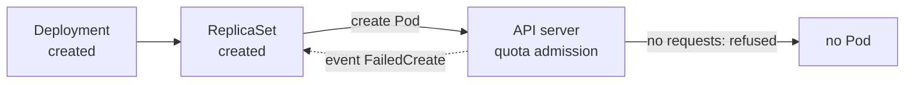

# Kubernetes ResourceQuota and LimitRange: Why Your Pods Never Start



**Video:** coming soon on the [channel](https://www.youtube.com/@production-devops).

The Deployment says created, yet zero Pods run. We put a namespace under a ResourceQuota on a real cluster and hit the classic trap: Pods without requests and limits are refused, and only the ReplicaSet events say why. Then quotas on CPU, memory and object counts, the exact message when a Pod asks for more than what is left, and a LimitRange that fills in defaults and rejects oversized containers. Lesson 5 of Kubernetes Deep Dive.

## Files in this folder

- [`app.yaml`](app.yaml)
- [`big.yaml`](big.yaml)
- [`counts.yaml`](counts.yaml)
- [`extra.yaml`](extra.yaml)
- [`limits.yaml`](limits.yaml)
- [`quota.yaml`](quota.yaml)
- [`challenge-solution.sh`](challenge-solution.sh) (solution of the challenge: try it yourself first)

## What you need

A Kubernetes cluster you can break: a local [kind](https://kind.sigs.k8s.io/) cluster with one control plane and two workers is what the video uses, plus `kubectl`. Never run these commands against a cluster that matters.

The outputs below were captured for real on the lab cluster. On yours, names, ages, IPs and ports will differ; everything else should match.

## The lesson, step by step

The same explanations as the video, with every command and its real output. Read it, then run it yourself.

The Deployment says created, yet zero Pods run, and kubectl get pods shows nothing. A quota is saying no, and later we fix it without touching the Deployment.

### The plan

Lesson five of Kubernetes Deep Dive. What a namespace scopes. A resource quota, and the trap it sets. Filling a quota, and counting objects. A limit range: defaults and bounds.

### Namespaces

A namespace is a scope for names and rules. Names are unique per namespace: two teams can each have a web. Permissions, quotas, limit ranges and network policies apply per namespace. Nodes, volumes and namespaces themselves are cluster-wide. Alone, it is not a security wall.

We create a namespace for a fictional team A.

```console
$ kubectl create namespace team-a
namespace/team-a created
```

Next to it, the namespaces every cluster starts with. Kube system holds the control plane Pods.

```console
$ kubectl get namespaces
NAME                 STATUS   AGE
default              Active   10m
kube-node-lease      Active   10m
kube-public          Active   10m
kube-system          Active   10m
local-path-storage   Active   9m57s
team-a               Active   1s
```

### ResourceQuota

```
apiVersion: v1
kind: ResourceQuota
metadata: {name: compute, namespace: team-a}
spec:
  hard:
    requests.cpu: "2"
    requests.memory: 1Gi
    limits.cpu: "4"
    limits.memory: 2Gi
    pods: "6"
```

A resource quota called compute, in the namespace team A. The sum of all CPU and memory requests in the namespace may not go above two CPUs and one gibibyte. The same for limits, with a higher ceiling. And at most six Pods, whatever their size.

We apply it.

```console
$ kubectl apply -f quota.yaml
resourcequota/compute created
```

Describe shows two columns: what is used now, and the hard ceiling.

```console
$ kubectl describe resourcequota compute -n team-a
Name:            compute
Namespace:       team-a
Resource         Used  Hard
--------         ----  ----
limits.cpu       0     4
limits.memory    0     2Gi
pods             0     6
requests.cpu     0     2
requests.memory  0     1Gi
```

### The trap

Now a team member deploys a web server, the quick way, without requests or limits.

```console
$ kubectl create deployment web --image=nginx:1.27 --replicas=2 -n team-a
deployment.apps/web created
```

A few seconds later, zero of two ready. No error appeared anywhere.

```console
$ kubectl get deployment web -n team-a
NAME   READY   UP-TO-DATE   AVAILABLE   AGE
web    0/2     0            0           8s
```

```console
$ kubectl get events -n team-a --field-selector reason=FailedCreate -o jsonpath='{.items[0].message}' | grep -o 'failed quota.*' | sed 's/; /\n/g'
```

Where is the error? The Pods never existed, so the event sits on the ReplicaSet.

- `get events -n team-a`: the events of the namespace
List the events of the namespace.

- `--field-selector reason=FailedCreate`: only failed creations
Keep only the reason Failed Create.

- `-o jsonpath='{.items[0].message}'`: the message of the first one
Print the first event's message.

- `grep -o 'failed quota.*'`: from 'failed quota' to the end
Keep the text from failed quota on.

- `sed 's/; /\n/g'`: one item per line
Sed: one item per line.

Why is nothing running? We run the command.

```console
$ kubectl get events -n team-a --field-selector reason=FailedCreate -o jsonpath='{.items[0].message}' | grep -o 'failed quota.*' | sed 's/; /\n/g'
failed quota: compute: must specify limits.cpu for: nginx
limits.memory for: nginx
requests.cpu for: nginx
requests.memory for: nginx
```

Read the first line: the quota called compute refused the Pod. The quota must add up requests and limits, so every container has to declare them. And our Deployment declares none. Jsonpath prints its resources field, and the braces at the end add a new line.

```console
$ kubectl get deployment web -n team-a -o jsonpath='{.spec.template.spec.containers[0].resources}{"\n"}'
{}
```

**Why the error hides**



The Deployment and its ReplicaSet are created without problems. The refusal happens later, when the ReplicaSet asks for each Pod. So the error lands on the ReplicaSet, and kubectl get pods shows nothing.

### Filling the quota

```
containers:
  - name: nginx
    image: nginx:1.27
    resources:
      requests: {cpu: 300m, memory: 128Mi}
      limits: {cpu: 500m, memory: 256Mi}
```

A second Deployment, called app, declares resources for its container. Each one requests three hundred millicores of CPU and one hundred twenty eight mebibytes of memory. And sets limits above them. A millicore is a thousandth of a CPU.

We apply it. The app Deployment runs three replicas.

```console
$ kubectl apply -f app.yaml
deployment.apps/app created
```

This time the three Pods start. The quota adds them up: three times three hundred is nine hundred millicores of requests.

```console
$ kubectl describe resourcequota compute -n team-a
Name:            compute
Namespace:       team-a
Resource         Used   Hard
--------         ----   ----
limits.cpu       1500m  4
limits.memory    768Mi  2Gi
pods             3      6
requests.cpu     900m   2
requests.memory  384Mi  1Gi
```

```
apiVersion: v1
kind: Pod
metadata: {name: extra, namespace: team-a}
spec:
  containers:
    - name: nginx
      image: nginx:1.27
      resources:
        requests: {cpu: 1200m, memory: 64Mi}
        limits: {cpu: 1500m, memory: 128Mi}
```

One more Pod, requesting one point two CPUs. Only one point one is left under the ceiling.

A Pod created directly is refused at once. Two greater than ampersand one sends the error into the pipe, and tr puts each item on its own line.

```console
$ kubectl apply -f extra.yaml 2>&1 | grep -o 'exceeded quota.*' | tr ',' '\n'
exceeded quota: compute
 requested: requests.cpu=1200m
 used: requests.cpu=900m
 limited: requests.cpu=2
```

The message names the quota, and gives three numbers: what the Pod requested, what is already used, and the limit.

Let's take stock. A quota caps totals per namespace, and refuses what does not fit. With a quota on requests, a container without requests gets no Pod at all. Next: object counts, and then the promised fix for web, without editing it.

### Object counts

```
apiVersion: v1
kind: ResourceQuota
metadata: {name: objects, namespace: team-a}
spec:
  hard:
    count/deployments.apps: "2"
    services: "2"
    configmaps: "5"
    persistentvolumeclaims: "1"
```

Quotas also count objects. Count slash, then the resource and its API group, works for almost any resource. Some have a short form: services, config maps, persistent volume claims.

We add the second quota. A namespace can have several: each one is checked.

```console
$ kubectl apply -f counts.yaml
resourcequota/objects created
```

Team A already has two Deployments, web and app. We try a third.

```console
$ kubectl create deployment third --image=nginx:1.27 -n team-a 2>&1 | grep -o 'exceeded quota.*' | tr ',' '\n'
exceeded quota: objects
 requested: count/deployments.apps=1
 used: count/deployments.apps=2
 limited: count/deployments.apps=2
```

### LimitRange

```
apiVersion: v1
kind: LimitRange
metadata: {name: defaults, namespace: team-a}
spec:
  limits:
    - type: Container
      default: {cpu: 200m, memory: 128Mi}
      defaultRequest: {cpu: 100m, memory: 64Mi}
      max: {cpu: "1", memory: 512Mi}
      min: {cpu: 50m, memory: 32Mi}
```

A limit range sets rules for each container in the namespace, not for the total. Default fills in the limits, and default request fills in the requests, when a container declares none. Max and min refuse containers outside these bounds.

We apply the limit range.

```console
$ kubectl apply -f limits.yaml
limitrange/defaults created
```

A limit range only touches Pods at creation. So we ask the web Deployment to create fresh Pods.

```console
$ kubectl rollout restart deployment web -n team-a
deployment.apps/web restarted
```

Two of two ready. The same Deployment, unchanged, now fits the quota.

```console
$ kubectl get deployment web -n team-a
NAME   READY   UP-TO-DATE   AVAILABLE   AGE
web    2/2     2            2           23s
```

Where did the defaults go? We print the resources of the first web Pod.

```console
$ kubectl get pods -n team-a -l app=web -o jsonpath='{.items[0].spec.containers[0].resources}{"\n"}'
{"limits":{"cpu":"200m","memory":"128Mi"},"requests":{"cpu":"100m","memory":"64Mi"}}
```

Requests and limits are there now. They came from the limit range. And the Deployment template? We print the same field there.

```console
$ kubectl get deployment web -n team-a -o jsonpath='{.spec.template.spec.containers[0].resources}{"\n"}'
{}
```

Still empty. Admission changed each Pod, not the template. And a container that asks for a limit of two CPUs, above the maximum of one.

```console
$ kubectl apply -f big.yaml 2>&1 | grep -o 'forbidden.*'
forbidden: maximum cpu usage per Container is 1, but limit is 2
```

Cleanup: the namespace, and everything in it.

```console
$ kubectl delete namespace team-a
namespace "team-a" deleted
```

### More knobs

More options you will meet. A ratio cap between limit and request. Limit ranges for Pods and volume claims. Quota scopes, such as one priority class. And storage quotas.

### Recap

Let's recap. A quota caps totals per namespace: CPU, memory and object counts. A quota on requests makes them mandatory. A limit range sets defaults and bounds, for new Pods only. Your challenge: a quota of five hundred millicores, a default request of two hundred, and three replicas. How many run, and where is the message? The solution is in the demo repository.

Quotas sum up, limit ranges fill in, and the ReplicaSet tells you when a Pod was refused. Next in Kubernetes Deep Dive: requests, limits and QoS classes. Subscribe to follow the course.

## All the commands, to copy

Run them from inside this folder, in this order.

```bash
kubectl create namespace team-a
kubectl get namespaces
kubectl apply -f quota.yaml
kubectl describe resourcequota compute -n team-a
kubectl create deployment web --image=nginx:1.27 --replicas=2 -n team-a
kubectl get deployment web -n team-a
kubectl get events -n team-a --field-selector reason=FailedCreate -o jsonpath='{.items[0].message}' | grep -o 'failed quota.*' | sed 's/; /\n/g'
kubectl get deployment web -n team-a -o jsonpath='{.spec.template.spec.containers[0].resources}{"\n"}'
kubectl apply -f app.yaml
kubectl apply -f extra.yaml 2>&1 | grep -o 'exceeded quota.*' | tr ',' '\n'
kubectl apply -f counts.yaml
kubectl create deployment third --image=nginx:1.27 -n team-a 2>&1 | grep -o 'exceeded quota.*' | tr ',' '\n'
kubectl apply -f limits.yaml
kubectl rollout restart deployment web -n team-a
kubectl get pods -n team-a -l app=web -o jsonpath='{.items[0].spec.containers[0].resources}{"\n"}'
kubectl apply -f big.yaml 2>&1 | grep -o 'forbidden.*'
kubectl delete namespace team-a
```

## Challenge

Your challenge: a quota of five hundred millicores, a default request of two hundred, and three replicas. How many run, and where is the message? The solution is in the demo repository.

When you have tried: [`challenge-solution.sh`](challenge-solution.sh).

---

From the [ProductionDevOps](https://www.youtube.com/@production-devops) channel: real-world DevOps and SRE, explained with real commands.
