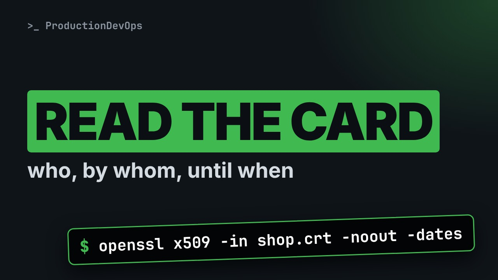
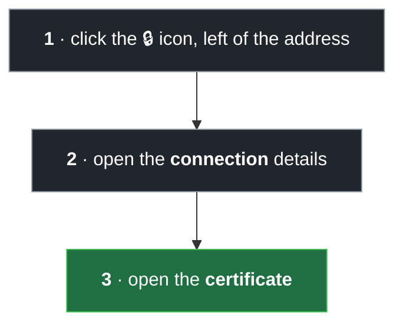
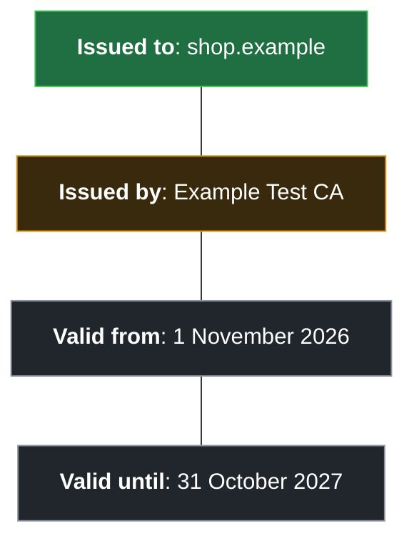
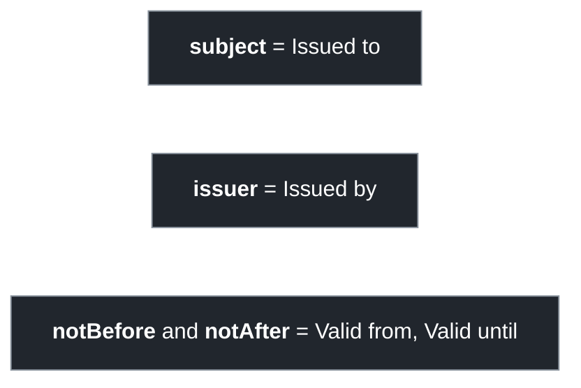

# Reading a Certificate (HTTPS and Certificates, No Experience Needed)



**Video:** coming soon on the [channel](https://www.youtube.com/@production-devops).

Every website's ID card can be read: who it is for, who signed it, and until when it is valid. This lesson of HTTPS and Certificates, Simply shows where to find the certificate in a browser, drawn with fictional names, then reads a real test certificate in a terminal with one command, openssl x509, taken apart piece by piece: -subject, -issuer and -dates, then all three together. You need a terminal (Linux, macOS or WSL on Windows), or just watch. Every new word is explained on screen. The script that makes the test certificates, the challenge and its solution are in the demos repo.

## Files in this folder

- [`make-certs.sh`](make-certs.sh)
- [`challenge-solution.md`](challenge-solution.md) (solution of the challenge: try it yourself first)

## What you need

A Linux shell (a VM, WSL or a container is fine). Everything runs inside this folder.

## Before you start

The video runs these commands first, off screen:

```bash
if [ ! -e .tt-lab ]; then rm -rf /lab/https && bash make-certs.sh /lab/https >/dev/null 2>&1 && touch .tt-lab; fi
export HOME=/lab/https && cd /lab/https
PROMPT_COMMAND='HOME=/lab/https; PS1="\[\e[1;32m\]sre@lab\[\e[0m\]:\[\e[1;34m\]\w\[\e[0m\]$ "'
```

## The lesson, step by step

The same explanations as the video, with every command. Read it, then run it yourself.

In five minutes: how to read a website's certificate. Who it is for, who signed it, until when.

For the second half you need a terminal. Linux, macOS, or WSL on Windows. No terminal yet? Linux from Zero, lesson two, shows you how. Or just watch. Every step is on screen.

### The plan

This is lesson five of HTTPS and Certificates, Simply. First, we open the ID card in a browser. Then, three questions to ask every card. Then, one command, piece by piece. And all three answers, in one command.

### In your browser

**Opening the ID card in a browser**



In a browser, click the icon left of the address. Open the connection details, then the certificate. The words differ a little between browsers.

**The ID card, drawn (fictional)**



Here is such a panel, drawn with fictional names. Every card answers three questions: who it is for, who signed it, and until when.

### In a terminal

- `OpenSSL — A free toolbox program for keys and certificates (like a magnifying glass for ID cards)`: 
Now, a terminal. New word: open S S L, a free toolbox for keys and certificates. Think of a magnifying glass for ID cards.

For this lesson we made a fictional office, called Example Test CA. It signed a card for shop dot example. It is the file shop dot c r t. It is for learning only. The script that made it is in the demo repo.

```console
$ openssl x509 -in shop.crt -noout -subject
```

Our one new command has five pieces.

- `openssl`: the toolbox program
Open S S L is the toolbox program.

- `x509`: its certificate tool
X five oh nine is its tool for certificates. It is the name of their format.

- `-in shop.crt`: which file to read
Dash in, shop dot c r t: the file to read.

- `-noout`: skip the coded block
Dash no out: do not print the card's coded text. We only want answers.

- `-subject`: show: who it is for
Dash subject: show who the card is for.

### Who is it for?

We want to know who this card is for. We type the command, and press Enter.

```console
$ openssl x509 -in shop.crt -noout -subject
```

One line comes back. Subject, then C N equals shop dot example. C N means common name, the site's name. This card is for shop dot example.

### Who signed it?

Second question: who signed it? Same command. We swap the last piece for dash issuer.

```console
$ openssl x509 -in shop.crt -noout -issuer
```

Issuer, C N equals Example Test CA. Our fictional office signed this card.

### So far

So far: dash subject told us who the card is for. Shop dot example. Dash issuer told us who signed it. Example Test CA. Next: until when? The dates decide if the card still works. If this is helping, subscribe: the next lesson explains the browser's scariest warnings.

### Until when?

Third question. Same command again, now with dash dates.

```console
$ openssl x509 -in shop.crt -noout -dates
```

Not before: November first, 2026. Before this day, the card is not valid yet. Not after: October thirty first, 2027. After this day, it has expired. G M T is world time, the same clock everywhere.

### All together

What just happened? Only the last piece changed. Now all three pieces, together.

```console
$ openssl x509 -in shop.crt -noout -subject -issuer -dates
```

Four lines: who it is for, who signed it, from, and until. All three answers at once.

**Terminal and browser: the same card**



Same answers as the browser's panel. Subject is issued to, issuer is issued by, and the same two dates.

### Good to know

Good to know: browsers really check a second list of names, inside the card. The TLS course shows it. The card file is public. The private key file is not: never share it, never show it.

### Recap

Recap: every card answers three questions. Who for, who signed, until when. This command reads a card: open S S L x five oh nine, a file, dash no out. Dash subject, dash issuer and dash dates choose the answers. Your challenge: read the office's own card, test dash C A dot c r t. Who is it for, and who signed it? The answer is in the demo repo.

### Where next

Where next? Lesson six: common browser errors, explained. What you see when one of the checks fails.

Subscribe, and the next lesson, common browser errors, explained, finds you.

## All the commands, to copy

Run them from inside this folder, in this order (some are expected to fail: that is the point of the demo).

```bash
openssl x509 -in shop.crt -noout -subject
openssl x509 -in shop.crt -noout -issuer
openssl x509 -in shop.crt -noout -dates
openssl x509 -in shop.crt -noout -subject -issuer -dates
```

## Challenge

Your challenge: read the office's own card, test dash C A dot c r t. Who is it for, and who signed it? The answer is in the demo repo.

When you have tried: [`challenge-solution.md`](challenge-solution.md).

---

From the [ProductionDevOps](https://www.youtube.com/@production-devops) channel: real-world DevOps and SRE, explained with real commands.
