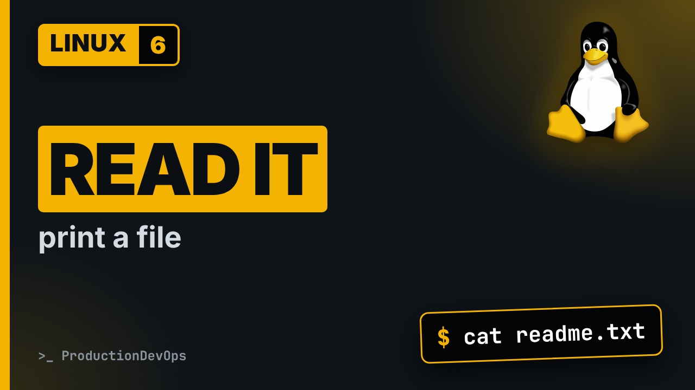
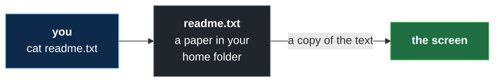
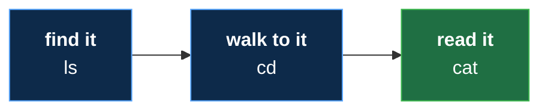
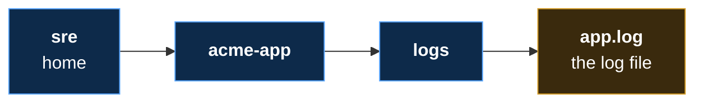

# Reading a File in the Linux Terminal: cat (No Experience Needed)



**Video:** https://youtu.be/ddac_s75KIA

You can find files now, but what do they say? This lesson of Linux from Zero adds one command, cat, that prints a file on the screen. We read a short note, then a to-do list, then the real log file of a small app, line by line. No experience needed: every new word is explained on screen, and every command runs for real. The challenge and its solution are in the demos repo.

## Files in this folder

- [`acme-app/config.txt`](acme-app/config.txt)
- [`acme-app/logs/app.log`](acme-app/logs/app.log)
- [`notes/ideas.txt`](notes/ideas.txt)
- [`notes/todo.txt`](notes/todo.txt)
- [`readme.txt`](readme.txt)
- [`challenge-solution.sh`](challenge-solution.sh) (solution of the challenge: try it yourself first)

## What you need

A Linux shell (a VM, WSL or a container is fine). Everything runs inside this folder.

## Before you start

The video runs these commands first, off screen:

```bash
mkdir -p /lab && ln -sfn "$PWD" /lab/sre && cd /lab/sre && export HOME=/lab/sre
alias ls='ls --color=auto'
PROMPT_COMMAND='PS1="\[\e[1;32m\]sre@lab\[\e[0m\]:\[\e[1;34m\]\w\[\e[0m\]$ "'
```

## The lesson, step by step

The same explanations as the video, with every command. Read it, then run it yourself.

You can find files now, but what do they say? One command prints a file on the screen. And at the end, a real log file, read line by line.

To follow along, you need a terminal. Lesson two shows how to get one. Or just watch. Every step is on screen.

### The plan

This is lesson six of Linux from Zero. First, the new command: cat. Then, we read a short note. Then, a to do list. And a real log file.

### The command

- `text file — A file of plain letters and numbers that people can read (like a typed page, not a photo)`: 
New word: text file. It holds plain letters and numbers, that people can read. Like a typed page, not a photo.

Here is the one new command: cat, then the name of a file. It prints the whole file on the screen. The name comes from concatenate: joining files, one after another.

### Try it

Which files are here? We ask l s, from lesson four.

```console
$ ls
```

We want to read readme dot t x t. We type cat, a space, and its name.

```console
$ cat readme.txt
```

Two lines of text. Then the prompt comes back.

**What cat did**



Cat took the paper from the folder, and showed its text on the screen. The file itself did not change.

### So far

So far: cat and a file name prints that file on the screen. The file does not change. Next: a file inside a folder.

### A to-do list

The to do list is in notes. We walk in, with c d from lesson five.

```console
$ cd notes
```

Then cat, again, with the file's name.

```console
$ cat todo.txt
```

Three steps. Keep this list in mind: it is your mission in lesson ten.

**Find, walk, read**



That is the pattern for any file. Find it with l s, and walk to it with c d. Then read it with cat.

### A real log

- `log file — A file where a program writes what it did, one line per event (like a diary the app keeps)`: 
New word: log file. A program writes in it what it did, one line per event. Like a diary the app keeps.

**Where the log is**



Our app, acme app, keeps its log in a folder called logs. The file is app dot log.

A new terminal starts at home. So, into acme app.

```console
$ cd acme-app
```

Into logs.

```console
$ cd logs
```

And cat the log file.

```console
$ cat app.log
```

```
2026-11-02 08:00:01 INFO  acme-app started
2026-11-02 08:00:02 INFO  listening on port 8080
2026-11-02 09:15:40 WARN  slow request: 2.1 seconds
```

Each line starts with a date and a time. Then INFO: all is well. The app started. Next, the app is ready, and listens for visitors. The number is a port: a later course explains it. Then WARN: a warning. One request was slow. Engineers read lines like this every day.

- `log level — A word on each log line: how serious it is (like the colour of a sticky note: green, yellow, red)`: 
The words INFO and WARN have a name: log level. They say how serious each line is. Like the colour of a sticky note.

Info: all is well, just news. Warn: something to look at, soon. Error: something failed. Engineers search logs for these first.

### Good to know

Cat only reads. The file does not change. A long file scrolls past fast. A later course shows how to read it page by page. Cat on a folder gives an error. Lesson nine reads it with you.

### Recap

Recap: cat and a name prints a text file. A log has one line per event, with a date and a time. Your challenge: read config dot t x t, in acme app. Which folder holds the logs? The solution is in the demo repo.

### Where next

Where next? Lesson seven: make your own folders. The first time you change the cabinet.

Next lesson: making folders. Subscribe so you do not miss it.

## All the commands, to copy

Run them from inside this folder, in this order (some are expected to fail: that is the point of the demo).

```bash
ls
cat readme.txt
cd notes
cat todo.txt
cd acme-app
cd logs
cat app.log
```

## Challenge

Your challenge: read config dot t x t, in acme app. Which folder holds the logs? The solution is in the demo repo.

When you have tried: [`challenge-solution.sh`](challenge-solution.sh).

---

From the [ProductionDevOps](https://www.youtube.com/@production-devops) channel: real-world DevOps and SRE, explained with real commands.
