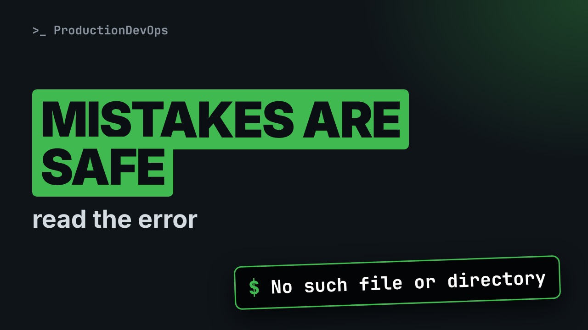
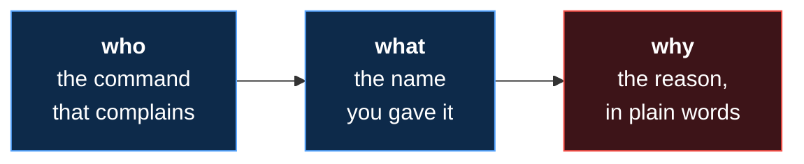
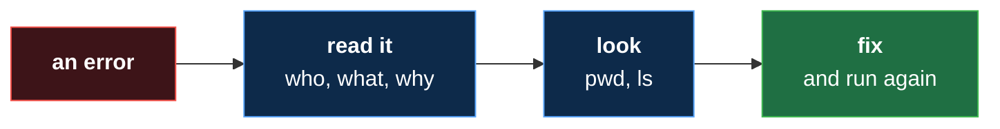

# Mistakes Are Safe: Reading Linux Error Messages (No Experience Needed)



**Video:** coming soon on the [channel](https://www.youtube.com/@production-devops).

A strange message appears, and it feels like you broke something. You almost certainly did not. In this lesson of Linux from Zero we make four common mistakes on purpose, with commands you already know, and read every error message in three parts: who complains, about what, and why. Then the one question that fixes most of them. No experience needed: every new word is explained on screen, and every error is real. The challenge and its solution are in the demos repo.

## Files in this folder

- [`acme-app/config.txt`](acme-app/config.txt)
- [`acme-app/logs/app.log`](acme-app/logs/app.log)
- [`notes/ideas.txt`](notes/ideas.txt)
- [`notes/todo.txt`](notes/todo.txt)
- [`readme.txt`](readme.txt)
- [`challenge-solution.sh`](challenge-solution.sh) (solution of the challenge: try it yourself first)

## What you need

A Linux shell (a VM, WSL or a container is fine). Everything runs inside this folder.

## Before you start

The video runs these commands first, off screen:

```bash
mkdir -p /lab && ln -sfn "$PWD" /lab/sre && cd /lab/sre && export HOME=/lab/sre
alias ls='ls --color=auto'
PROMPT_COMMAND='PS1="\[\e[1;32m\]sre@lab\[\e[0m\]:\[\e[1;34m\]\w\[\e[0m\]$ "'
```

## The lesson, step by step

The same explanations as the video, with every command. Read it, then run it yourself.

A strange message appears, and you feel you broke something. You almost certainly did not. And at the end, the one question that fixes most mistakes.

To follow along, you need a terminal. Lesson two shows how to get one. There is no new command today. Only the ones you know.

### The plan

This is lesson nine of Linux from Zero. First, how to read an error, in three parts. Then, we make four mistakes, on purpose. We fix each one. And the one question that fixes most of them.

### Three parts

- `error message — Text a command prints when it cannot do what you asked (like the clerk's note: "could not do it, and here is why")`: 
New word: error message. It is the text a command prints when it cannot do what you asked. Like a note from the clerk: could not do it, and here is why.

**Every error has three parts**



Most error messages have three parts, split by colons. Who complains, about what, and why. Read them from the left.

### Mistake 1

We want to read the to do list. We type cat to do dot t x t.

```console
$ cat todo.txt
```

Who: cat; what: to do dot t x t; why: no such file or directory. The file exists, but not here. We are at home, so what is here?

```console
$ ls
```

No to do list at home. It is in notes, from lesson six.

So, a fix. Walk into notes.

```console
$ cd notes
```

And read it again.

```console
$ cat todo.txt
```

### Mistake 2

Now we try to read notes, a folder, with cat.

```console
$ cat notes
```

Who: cat; what: notes; why: is a directory. Cat reads files, not folders. To see what is in a folder, we use l s.

```console
$ ls notes
```

### So far

So far: read an error in three parts. Who, what, and why. No such file often means: the wrong folder. Next: two more mistakes, and the question that fixes most of them.

### Mistake 3

We try to make a folder called notes. But notes is already there.

```console
$ mkdir notes
```

Who: make dir; what: notes; why: file exists. A different name fixes it.

### Mistake 4

- `shell — The program that reads what you type, and starts the commands (like the clerk at the counter, who reads your note)`: 
One more word, for the last mistake: shell. It is the program that reads what you type, and starts the commands. Ours is called bash.

Now a typo. We type p w d, with one d too many.

```console
$ pwdd
```

Who: bash, the shell; what: p w d d; why: command not found. No command has that name. We fix the typo, and it works.

```console
$ pwd
```

### The question

**From error to fix**



Every fix today followed the same path. Read the error, look around, then fix it and run again.

Here is the question. Most mistakes come from one thing: you are not where you think. So ask p w d: where am I? Then ask l s: what is here? Then read the error: who, what, why.

### Good to know

These four mistakes changed nothing at all. Not every command is this gentle. Deleting comes in a later course, with care. Stuck? Search for the exact message. Others had it too.

### Recap

Recap: an error tells you who, what, and why. Four classics: wrong folder, folder not file, already there, and a typo. First, ask p w d and l s. Your challenge: list a folder called nothere. Find who, what and why. The solution is in the demo repo.

### Where next

Where next? Lesson ten: putting it all together. Your mission, from the to do list.

Next lesson: putting it together, your first terminal mission. Subscribe so you do not miss it.

## All the commands, to copy

Run them from inside this folder, in this order (some are expected to fail: that is the point of the demo).

```bash
cat todo.txt
ls
cd notes
cat notes
ls notes
mkdir notes
pwdd
pwd
```

## Challenge

Your challenge: list a folder called nothere. Find who, what and why. The solution is in the demo repo.

When you have tried: [`challenge-solution.sh`](challenge-solution.sh).

---

From the [ProductionDevOps](https://www.youtube.com/@production-devops) channel: real-world DevOps and SRE, explained with real commands.
