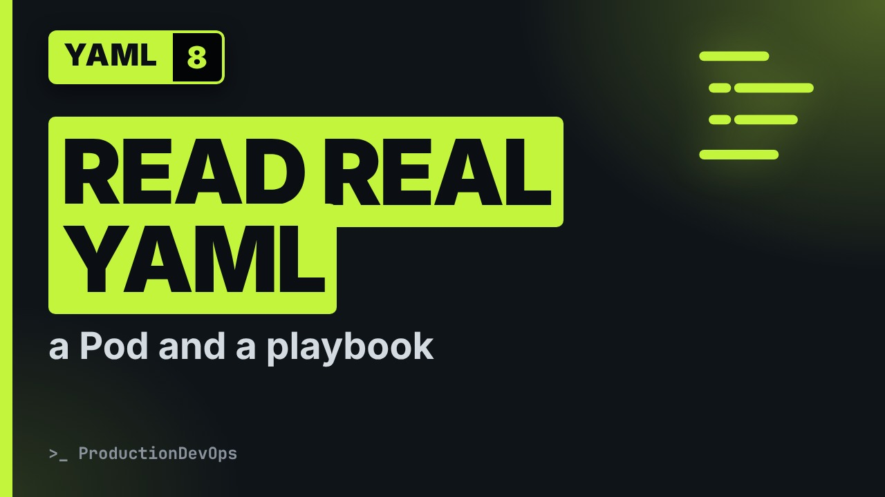
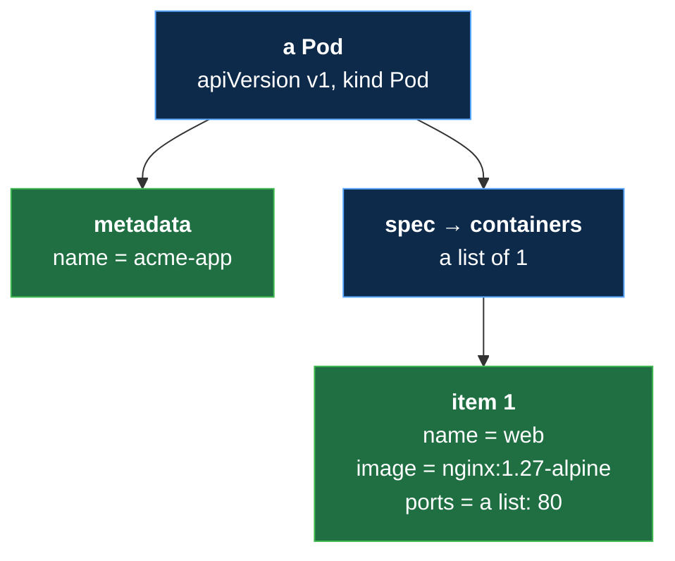

# Reading Real Files: a Kubernetes Pod and an Ansible Playbook (YAML from Zero, No Experience Needed)



**Video:** https://youtu.be/sQrZBF39Hhw

You know every YAML rule you need. Now use them on real files. This last lesson of YAML from Zero reads two files from two real DevOps tools, line by line: a Kubernetes Pod manifest and an Ansible playbook. Keys and values, lists, groups inside lists, a short-form list, a boolean: everything from the course, in the files engineers write every day. Nothing to run, no cluster and no servers needed: we only read. Then choose your next course: Kubernetes from Zero or Ansible from Zero. Every new word is explained on screen. The files, the challenge and its solution are in the demos repo.

## Files in this folder

- [`challenge.yaml`](challenge.yaml)
- [`playbook.yml`](playbook.yml)
- [`pod.yaml`](pod.yaml)
- [`challenge-solution.md`](challenge-solution.md) (solution of the challenge: try it yourself first)

## What you need

A Linux shell (a VM, WSL or a container is fine). Everything runs inside this folder.

## The lesson, step by step

The same explanations as the video, with every command. Read it, then run it yourself.

You know every YAML rule you need. Today we use them on two real files, from two real tools. By the end, you can read both.

For this lesson you need nothing. Just watch. No cluster and no servers. Today we only read. About five minutes.

### The plan

This is lesson eight, the last one of YAML from Zero. First, your toolbox: the rules so far. Then, a Kubernetes file, line by line. Then, an Ansible file, line by line. And your next course.

### Toolbox

Your toolbox. Key, colon, space, value. And a dash and a space for a list item. Spaces at the start say what belongs to what. And true or false, quotes, notes, and three dashes.

### A Kubernetes Pod

- `Kubernetes — A tool that runs apps on many servers and keeps them running (like a manager who reads your order form, then makes it true)`: 
First tool: Kubernetes. It runs apps on many servers, and keeps them running. Like a manager who reads your order form, then makes it true.

- `manifest — A YAML file that tells Kubernetes what you want (like the order form you hand to the manager)`: 
You talk to Kubernetes with a manifest: a YAML file that says what you want.

Here is a whole manifest. Look at the shapes first.

```
---
apiVersion: v1
kind: Pod
metadata:
  name: acme-app
spec:
  containers:
    - name: web
      image: nginx:1.27-alpine
      ports:
        - containerPort: 80
```

The top says what we want. The middle gives it a name. The bottom says what runs inside.

```
---
apiVersion: v1
kind: Pod
```

Three dashes: a document starts. Then the api version: which version of the form. Here, v one. Kind says what we want: a Pod. A Pod is the box Kubernetes runs your app in.

```
metadata:
  name: acme-app
```

Metadata means facts about the Pod. Nothing after the colon: a group starts. Two spaces in, so name belongs to metadata. The Pod is called acme app.

```
spec:
  containers:
    - name: web
      image: nginx:1.27-alpine
      ports:
        - containerPort: 80
```

Spec: what runs inside. Containers is a list. A container is your app, packed to run. A dash: item one, a group, as in lesson four. Name web, image nginx. Ports lines up with name: same group. It holds a list: port eighty.

**The Pod, drawn**



Here is what Kubernetes reads. A Pod called acme app, with a list of one container, called web.

### So far

So far: a manifest is your order form for Kubernetes. It holds groups, a list of groups, and a list inside an item. Next: the same rules, in an Ansible file.

### An Ansible playbook

- `Ansible — A tool that does the same tasks on many servers (like a head office that sends the same checklist to every branch)`: 
Second tool: Ansible. It does the same tasks on many servers. Like a head office that sends one checklist to every branch.

- `playbook — An Ansible YAML file: which servers, and a list of tasks (like the checklist form: who it is for, then the steps)`: 
The Ansible file is a playbook. It says which servers, and gives a list of tasks. Like a checklist form.

Here is a whole playbook. Shapes first.

```
---
- name: Prepare acme-app
  hosts: [node01, node02]
  remote_user: ops
  gather_facts: false
  tasks:
    - name: Create the app folder
      ansible.builtin.file:
        path: /tmp/acme-app
        state: directory
```

The top says which servers, and how to reach them. The bottom is the list of tasks.

```
- name: Prepare acme-app
  hosts: [node01, node02]
  remote_user: ops
  gather_facts: false
```

A dash at the start: the whole file is a list. Item one is a group. Hosts means servers: a short list, from lesson three. Node zero one and node zero two. Log in as the user ops. Gather facts is a boolean: false, so Ansible skips that step.

```
  tasks:
    - name: Create the app folder
      ansible.builtin.file:
        path: /tmp/acme-app
        state: directory
```

Tasks is a list. Item one is a group, with a name for people to read. This long key, with dots, names a ready-made Ansible task: one for files and folders. Two spaces deeper: its settings. The path, and state directory, which means a folder.

### Good to know

The tool chooses the key names, like kind, hosts or tasks. Its guide lists them. Both files pass YAML lint. The tool itself then checks names and values. Real files are longer, but never different.

```
  containers:
    - name: web
        image: nginx:1.27-alpine
      ports:
        - containerPort: 80
```

Your challenge. This is the bottom of a broken Pod file. Which line breaks it?

### Recap

Recap: a manifest is an order form for Kubernetes. A playbook gives Ansible its servers and a list of tasks. The same YAML rules are in both. And you can read them now. Your challenge: find the line that breaks the challenge file. The answer is in the demo repo.

### Where next

Where next? Pick a course. Kubernetes from Zero: write a Pod, then run it. Ansible from Zero: write a playbook, then run it. Both start from zero, and your YAML is ready.

Thank you for following YAML from Zero. See you in your next course.

## Challenge

Your challenge: find the line that breaks the challenge file. The answer is in the demo repo.

When you have tried: [`challenge-solution.md`](challenge-solution.md).

---

From the [ProductionDevOps](https://www.youtube.com/@production-devops) channel: real-world DevOps and SRE, explained with real commands.
