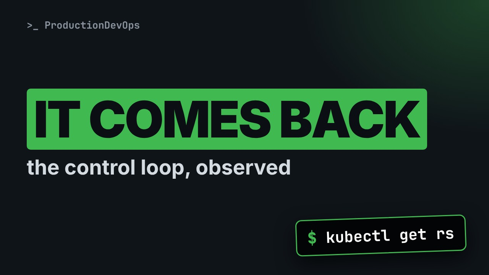
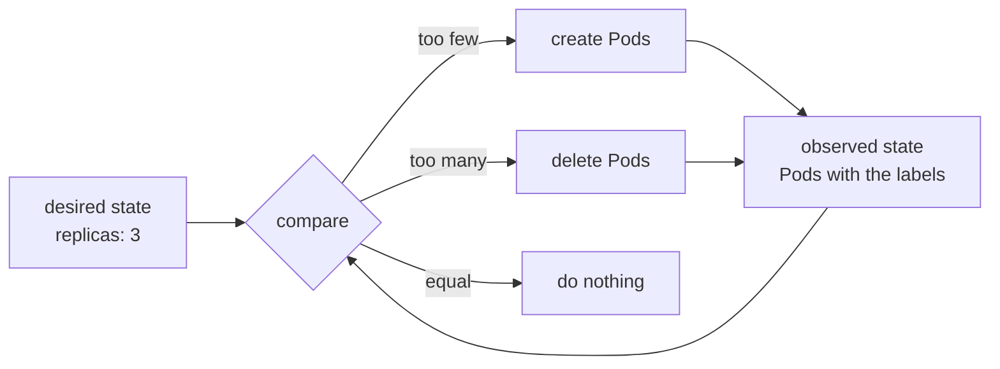

# ReplicaSets and Deployments: The Control Loop That Replaces Your Pods



**Video:** coming soon on the [channel](https://www.youtube.com/@production-devops).

Delete a bare Pod and it is gone for good. Delete a Pod owned by a ReplicaSet and a new one appears in seconds. We watch the control loop at work on a real cluster: reconciliation, scaling, owner references, adoption of orphan Pods, a Pod taken out of its ReplicaSet with one label, the Deployment that sits on top with its pod-template-hash, and the three ways to delete an owner: background, foreground and orphan. Lesson 4 of Kubernetes Deep Dive.

## Files in this folder

- [`rs.yaml`](rs.yaml)
- [`challenge-solution.sh`](challenge-solution.sh) (solution of the challenge: try it yourself first)

## What you need

A Kubernetes cluster you can break: a local [kind](https://kind.sigs.k8s.io/) cluster with one control plane and two workers is what the video uses, plus `kubectl`. Never run these commands against a cluster that matters.

The outputs below were captured for real on the lab cluster. On yours, names, ages, IPs and ports will differ; everything else should match.

## The lesson, step by step

The same explanations as the video, with every command and its real output. Read it, then run it yourself.

Delete a Pod owned by a ReplicaSet, and a new one appears in seconds. Today we watch that control loop, and later one label takes a running Pod away from its owner.

### The plan

Lesson four of Kubernetes Deep Dive. A bare Pod, and the control loop it lacks. A ReplicaSet that replaces and scales Pods. Owner references, adoption and orphans. Then Deployments, and deleting owners.

### A bare Pod

```console
$ kubectl run solo --image=nginx:1.27 -n loop
```

First, one Pod, with nothing in charge.

- `run solo`: create one Pod, named solo
Run creates one Pod, called solo.

- `--image=nginx:1.27`: the container image
Dash dash image: its image.

- `-n loop`: in the namespace loop
Dash n loop: this lesson's namespace, used everywhere.

We create the bare Pod.

```console
$ kubectl run solo --image=nginx:1.27 -n loop
pod/solo created
```

Now we delete it, as a node failure or a mistake would.

```console
$ kubectl delete pod solo -n loop
pod "solo" deleted from loop namespace
```

And it stays deleted. Nobody recorded that we wanted one running.

```console
$ kubectl get pods -n loop
No resources found in loop namespace.
```

### The control loop

**Observe, compare, act, repeat**



Think of a thermostat: it keeps comparing the room with the setting, and corrects the difference. A controller does the same with the desired state and the real state it observes through the API server. This one runs in the controller manager.

### ReplicaSet

```
apiVersion: apps/v1
kind: ReplicaSet
metadata:
  name: web
  namespace: loop
spec:
  replicas: 3
  selector:
    matchLabels:
      app: web
```

A ReplicaSet called web, in the apps group. Replicas is the desired state: three Pods. The selector says which Pods it counts: every Pod with the label app equals web.

```
template:
  metadata:
    labels:
      app: web
  spec:
    containers:
      - name: nginx
        image: nginx:1.27
```

The template is a Pod, without a name. Its labels must match the selector, or the API server refuses the ReplicaSet. Every new Pod gets this spec. The controller adds a random suffix to the name.

We apply it.

```console
$ kubectl apply -f rs.yaml
replicaset.apps/web created
```

The ReplicaSet reports desired, current and ready.

```console
$ kubectl get rs web -n loop
NAME   DESIRED   CURRENT   READY   AGE
web    3         3         3       4s
```

Three Pods, each named after the ReplicaSet, with a random suffix.

```console
$ kubectl get pods -n loop -l app=web
NAME        READY   STATUS    RESTARTS   AGE
web-kqsvz   1/1     Running   0          4s
web-mklvs   1/1     Running   0          4s
web-tg8vh   1/1     Running   0          4s
```

### Reconciliation

```console
$ timeout 20 kubectl get pods -n loop -l app=web -w --output-watch-events --no-headers | awk '{printf "%-9s %-18s %s\n", $1, $2, $4}'
```

To see the loop act, we watch the Pods.

- `timeout 20`: stop after 20 seconds
Stop after twenty seconds.

- `-w`: watch: print every change
Dash w: print every change.

- `--output-watch-events`: add the type of change
Show the type: added, modified, deleted.

- `| awk '{printf`: awk prints a shorter line
Awk prints a shorter line,

- `$1, $2, $4`: keep columns 1, 2 and 4
with change, name and status.

We run it. Three seconds in, a helper deletes one Pod.

```console
$ timeout 20 kubectl get pods -n loop -l app=web -w --output-watch-events --no-headers | awk '{printf "%-9s %-18s %s\n", $1, $2, $4}'
ADDED     web-kqsvz          Running
ADDED     web-mklvs          Running
ADDED     web-tg8vh          Running
MODIFIED  web-kqsvz          Terminating
MODIFIED  web-kqsvz          Terminating
ADDED     web-zf2x2          Pending
MODIFIED  web-zf2x2          Pending
MODIFIED  web-zf2x2          ContainerCreating
MODIFIED  web-kqsvz          Completed
MODIFIED  web-kqsvz          Completed
DELETED   web-kqsvz          Completed
MODIFIED  web-zf2x2          ContainerCreating
MODIFIED  web-zf2x2          Running
```

First the three Pods we already had. Then one goes to Terminating. At once a new name appears and reaches Running. The controller saw two, wanted three, and made one.

### Scaling

Scaling only changes the desired number. The loop does the rest.

```console
$ kubectl scale rs web -n loop --replicas=5
replicaset.apps/web scaled
```

Two more Pods, five in total.

```console
$ kubectl get rs web -n loop
NAME   DESIRED   CURRENT   READY   AGE
web    5         5         5       27s
```

Now down to two.

```console
$ kubectl scale rs web -n loop --replicas=2
replicaset.apps/web scaled
```

Three Pods are deleted. The controller ranks them first: a Pod not ready yet goes before a ready one.

```console
$ kubectl get pods -n loop -l app=web
NAME        READY   STATUS    RESTARTS   AGE
web-mklvs   1/1     Running   0          31s
web-tg8vh   1/1     Running   0          31s
```

Let's take stock. A bare Pod, once deleted, stays deleted. A ReplicaSet keeps comparing, and restores the count, up or down. Next: how a Pod knows its owner, and the one-label trick we promised.

### Owners

```console
$ kubectl get pods -n loop -l app=web -o jsonpath='{.items[0].metadata.ownerReferences[0]}' | tr ',' '\n'
```

How does a Pod know its owner? Jsonpath reads one field of the Pod.

- `-o jsonpath=`: print one field, by path
Print one field, not a table.

- `.items[0]`: the first Pod of the list
Items zero: the first Pod.

- `.metadata.ownerReferences[0]`: its first owner reference
Then its first owner reference.

- `| tr ',' '\n'`: one field per line
Tr: one field per line.

Which object owns the first Pod? Read kind and name: the ReplicaSet web.

```console
$ kubectl get pods -n loop -l app=web -o jsonpath='{.items[0].metadata.ownerReferences[0]}' | tr ',' '\n'
{"apiVersion":"apps/v1"
"blockOwnerDeletion":true
"controller":true
"kind":"ReplicaSet"
"name":"web"
"uid":"f1882132-6cad-44de-a33a-152c8a98d12d"}
```

Controller true: this owner manages the Pod. There can be only one. The uid points to this exact ReplicaSet, not just to its name.

### Adoption

```console
$ kubectl get pods -n loop -o custom-columns=NAME:.metadata.name,OWNER:.metadata.ownerReferences[0].name
```

Next, every Pod with its owner, in one table.

- `-o custom-columns=`: you choose the columns
You choose the columns.

- `NAME:`: a column header
A header, a colon,

- `.metadata.name`: a path inside each Pod
and a path, as in jsonpath.

- `,OWNER:.metadata.ownerReferences[0].name`: second column: owner name
Then the owner's name.

Cascade equals orphan deletes the ReplicaSet, but leaves its Pods alone.

```console
$ kubectl delete rs web -n loop --cascade=orphan
replicaset.apps "web" deleted from loop namespace
```

The two Pods still run, with no owner. They are orphans.

```console
$ kubectl get pods -n loop -o custom-columns=NAME:.metadata.name,OWNER:.metadata.ownerReferences[0].name
NAME        OWNER
web-mklvs   <none>
web-tg8vh   <none>
```

We apply the same file again. It asks for three Pods.

```console
$ kubectl apply -f rs.yaml
replicaset.apps/web created
```

Did it create three new Pods? We add a third column: the creation time.

```console
$ kubectl get pods -n loop -l app=web -o custom-columns=NAME:.metadata.name,OWNER:.metadata.ownerReferences[0].name,CREATED:.metadata.creationTimestamp
NAME        OWNER   CREATED
web-mklvs   web     2026-10-23T21:37:25Z
web-qpv27   web     2026-10-23T21:37:59Z
web-tg8vh   web     2026-10-23T21:37:25Z
```

Look at the creation times: two Pods are older. The new ReplicaSet adopted them, and created one.

```console
$ kubectl label $(kubectl get pods -n loop -l app=web -o name | head -n 1) -n loop app=debug --overwrite
```

Now the opposite: a label change takes a Pod out.

- `$(`: run this part first
The shell runs the inner command first, and pastes its output.

- `-o name`: prints pod/NAME
It prints pod slash name,

- `| head -n 1`: keep the first line
and head keeps the first.

- `app=debug --overwrite`: replace the label value
Then app becomes debug, overwriting web.

Which Pod leaves? kubectl names it.

```console
$ kubectl label $(kubectl get pods -n loop -l app=web -o name | head -n 1) -n loop app=debug --overwrite
pod/web-mklvs labeled
```

What happened to it? We list all Pods, with the app label as a column.

```console
$ kubectl get pods -n loop -o custom-columns=NAME:.metadata.name,APP:.metadata.labels.app,OWNER:.metadata.ownerReferences[0].name
NAME        APP     OWNER
web-mklvs   debug   <none>
web-qpv27   web     web
web-tg8vh   web     web
web-z2wrn   web     web
```

The relabelled Pod has no owner, but keeps running. The ReplicaSet counted two, so it created a third. A classic debugging trick: take a bad Pod out of its ReplicaSet and its Service, and inspect it in peace.

### Deployments

You rarely create ReplicaSets yourself. A Deployment creates them for you.

```console
$ kubectl create deployment shop --image=nginx:1.27 --replicas=2 -n loop
deployment.apps/shop created
```

Dash capital L adds the pod template hash: a fingerprint of the template.

```console
$ kubectl get rs,pods -n loop -l app=shop -L pod-template-hash
NAME                             DESIRED   CURRENT   READY   AGE   POD-TEMPLATE-HASH
replicaset.apps/shop-b6c4c6c96   2         2         2       2s    b6c4c6c96

NAME                       READY   STATUS    RESTARTS   AGE   POD-TEMPLATE-HASH
pod/shop-b6c4c6c96-twwv9   1/1     Running   0          2s    b6c4c6c96
pod/shop-b6c4c6c96-xjd2k   1/1     Running   0          2s    b6c4c6c96
```

We change the template: a new image.

```console
$ kubectl set image deployment/shop nginx=nginx:1.28 -n loop
deployment.apps/shop image updated
```

Two ReplicaSets now: a new hash for the new template, and the old one at zero, kept for rollbacks.

```console
$ kubectl get rs -n loop -l app=shop -L pod-template-hash
NAME             DESIRED   CURRENT   READY   AGE   POD-TEMPLATE-HASH
shop-b6c4c6c96   0         0         0       5s    b6c4c6c96
shop-b8f74c769   2         2         2       3s    b8f74c769
```

### Deleting an owner

Delete an owner, and the garbage collector handles its children. Background, the default: the owner goes at once, the children after. Foreground: children first. A finalizer keeps the owner until they are gone. Orphan: only the owner goes, as we saw. Nobody replaces the children.

### Gotchas

Two traps. A bare Pod that matches a selector gets adopted. With too many Pods, it may be the one deleted. A ReplicaSet template change affects only new Pods. Deployments do the replacing.

### Recap

Let's recap. Observe, compare, act, again and again. A ReplicaSet counts Pods by label, and owns them by uid. A Deployment makes one ReplicaSet per template hash. Challenge: relabel a Deployment Pod, then undo it. Which Pod disappears? Solution in the demo repository.

You declare how many, the loop makes it true. Next: namespaces, quotas and limit ranges. Subscribe to follow the course.

## All the commands, to copy

Run them from inside this folder, in this order.

```bash
kubectl run solo --image=nginx:1.27 -n loop
kubectl delete pod solo -n loop
kubectl get pods -n loop
kubectl apply -f rs.yaml
kubectl get rs web -n loop
kubectl get pods -n loop -l app=web
timeout 20 kubectl get pods -n loop -l app=web -w --output-watch-events --no-headers | awk '{printf "%-9s %-18s %s\n", $1, $2, $4}'
kubectl scale rs web -n loop --replicas=5
kubectl scale rs web -n loop --replicas=2
kubectl get pods -n loop -l app=web -o jsonpath='{.items[0].metadata.ownerReferences[0]}' | tr ',' '\n'
kubectl get pods -n loop -o custom-columns=NAME:.metadata.name,OWNER:.metadata.ownerReferences[0].name
kubectl delete rs web -n loop --cascade=orphan
kubectl get pods -n loop -l app=web -o custom-columns=NAME:.metadata.name,OWNER:.metadata.ownerReferences[0].name,CREATED:.metadata.creationTimestamp
kubectl label $(kubectl get pods -n loop -l app=web -o name | head -n 1) -n loop app=debug --overwrite
kubectl get pods -n loop -o custom-columns=NAME:.metadata.name,APP:.metadata.labels.app,OWNER:.metadata.ownerReferences[0].name
kubectl create deployment shop --image=nginx:1.27 --replicas=2 -n loop
kubectl get rs,pods -n loop -l app=shop -L pod-template-hash
kubectl set image deployment/shop nginx=nginx:1.28 -n loop
kubectl get rs -n loop -l app=shop -L pod-template-hash
```

## Challenge

Challenge: relabel a Deployment Pod, then undo it. Which Pod disappears? Solution in the demo repository.

When you have tried: [`challenge-solution.sh`](challenge-solution.sh).

---

From the [ProductionDevOps](https://www.youtube.com/@production-devops) channel: real-world DevOps and SRE, explained with real commands.
