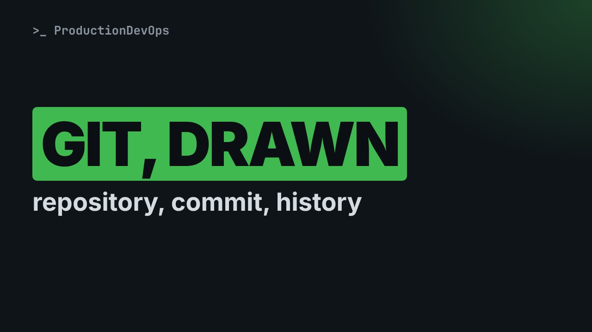
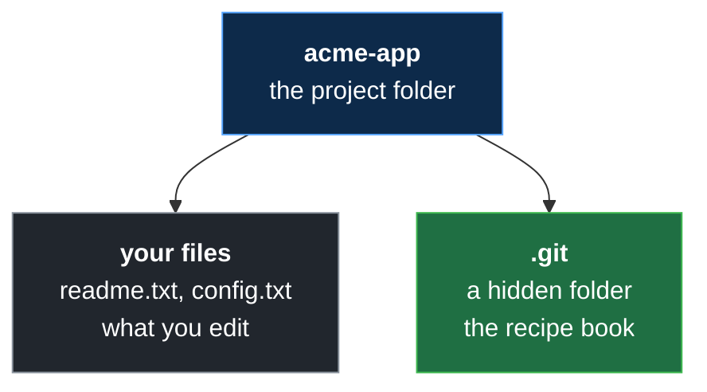
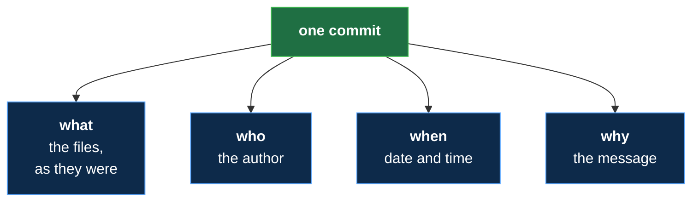
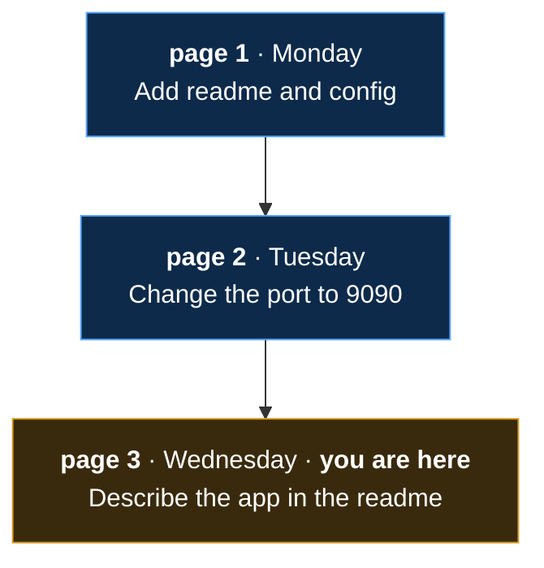
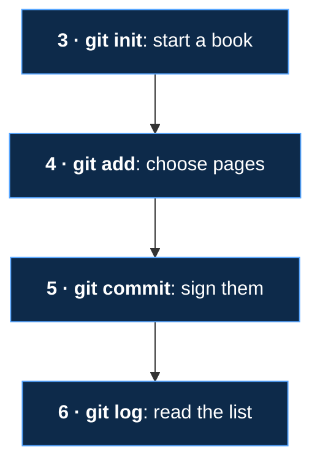

# Repository, Commit, History: Drawn (Git from Zero, No Experience Needed)

**Video:** coming soon on the [channel](https://www.youtube.com/@production-devops).

Three words carry all of Git: repository, commit and history. This lesson of Git and GitHub from Zero draws them with one recipe-book comparison: the repository is the book, a commit is a signed and dated page, the history is the list of pages. You also see what a good commit message looks like and the four commands of the next lessons in one picture. No terminal, nothing to install, no experience needed. The challenge and its solution are in the demos repo.

## Files in this folder

- [`challenge-solution.md`](challenge-solution.md) (solution of the challenge: try it yourself first)

## What you need

A Linux shell (a VM, WSL or a container is fine). Everything runs inside this folder.

## The lesson, step by step

The same explanations as the video, with every command. Read it, then run it yourself.

Three words carry all of Git: repository, commit, and history. At the end, you will see the next four lessons in one picture.

For this lesson you need nothing. Just watch. Only pictures today. The terminal starts in lesson three.

### The plan

This is lesson two of Git and GitHub from Zero. First, the repository: our recipe book. Then, the commit: a signed and dated page. Then, the history: the list of pages. And the next four lessons, in one picture.

### Repository

- `repository — A project folder, plus the full history of its files (like a recipe book: every recipe, and every old version)`: 
First word: repository. It is a project folder, plus the full history of its files. Think of a recipe book, with every old version.

**A repository, drawn**

Our example project is called acme app. Your files are there, as always. Next to them, a hidden folder called dot git keeps the book.

So a repository has two parts. Your files: what you edit today. And the book: every version you saved. A new page is added only when you decide. Git never saves on its own.

### Commit

- `commit — One saved version of your files, with a note (like a signed and dated page in the recipe book)`: 
Second word: commit. A commit is one saved version of your files, with a note. Like a signed and dated page in the book.

**What a commit holds**

What does a commit hold? The files as they were, who saved them, and when. And why: the message.

- `commit message — A short note that says what changed, and why (like the note on the page: less salt, it was too salty)`: 
New word: commit message. It is a short note that says what changed, and why. Less salt, it was too salty.

What makes a good message? It is short: one line. It says what changed. For example: change the port to nine zero nine zero. And it says why, when that helps. For example: for the new proxy. Not fix, or stuff. Next month, those tell you nothing.

- `commit ID — A unique code Git gives every commit, like 7c20f94 (like a serial number stamped on each page)`: 
One more: the commit ID. Git gives every commit a unique code of letters and digits. Like a serial number stamped on each page.

### So far

So far: a repository is your folder, plus its book. A commit is one signed page: what, who, when, and why. Next: the pages together make the history.

### History

- `history — All the commits, in order, each one after the one before (like the book's list of versions, page after page)`: 
Third word: history. It is all the commits, in order, each one after the one before. The book's list of versions.

**A history, drawn**

Here is a small history: three pages, from Monday to Wednesday. Each message says what changed. The newest page is where you are.

How do you read a history? Each commit knows the one before it. Saving adds a page. It never erases an old one. So you can always go back to an old page. And the newest page is where you are now.

### The next lessons

**The next four lessons**

Here are the next four lessons, one command each. Start a book, choose what to save, sign it, and read the list.

### Good to know

Good to know. A repository can hold any text: code, configs, or notes. Never edit the dot git folder by hand. Git does that. And if you delete it, the whole history is gone. Git works the same way on Linux, macOS and Windows.

### Recap

Recap: a repository is the folder, plus its book in dot git. A commit is a signed page: what, who, when, and why. The history is the pages in order. Saving never erases. Your challenge: imagine a shopping list in Git. Write three good commit messages for it. An example is in the demo repo.

### Where next

Where next? Lesson three: your first repository, with git init. From now on, we use a terminal.

Next lesson: your first repository, with git init. Subscribe so you do not miss it.

## Challenge

Your challenge: imagine a shopping list in Git. Write three good commit messages for it. An example is in the demo repo.

When you have tried: [`challenge-solution.md`](challenge-solution.md).

---

From the [ProductionDevOps](https://www.youtube.com/@production-devops) channel: real-world DevOps and SRE, explained with real commands.
